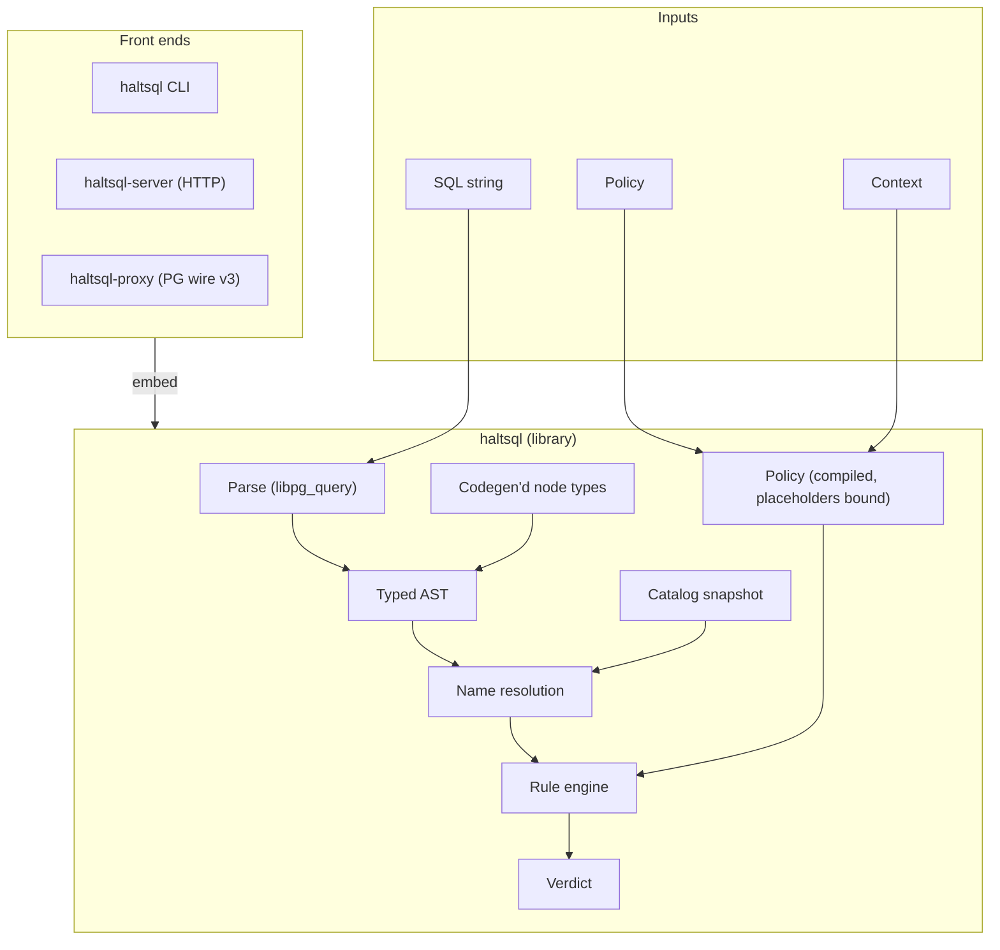

# HaltSQL — Product & Engineering Plan

> A policy firewall for LLM-generated SQL. Written in OCaml, built on the real
> PostgreSQL parser, shipped as a library, a single static CLI, an HTTP sidecar
> and an optional Postgres wire-protocol proxy.

Status: **Draft v0.1** · Owner: Arnav Dadarya · Last updated: 2026-11-07

---

## 1. Summary

LLM agents that write SQL are a new kind of untrusted client: they are
authenticated as *your* service, but their output is shaped by prompts that an
attacker can influence. HaltSQL sits between the model and the database and
answers one question per statement:

> **Is this exact SQL string allowed for this caller, under this policy?**

It returns `allowed: true|false` plus machine-readable reasons. In verify mode it
never rewrites SQL and never talks to the database: if the answer is yes, you run
the exact string you checked.

The design follows the `sql-guardrail` Python project (policy file,
`verify(sql, policy, context)`, violation reasons, sidecar). HaltSQL ports the
**design**, not the code. It sets itself apart with:

1. **One static binary and an OCaml library**, with no Python runtime and no
   network dependencies.
2. **A typed, generated AST** over `libpg_query`, the actual Postgres parser,
   with exhaustive pattern matching so new node types cannot slip through
   silently.
3. **Tenant isolation as a first-class rule**, enforced in every mode,
   including the proxy (AgentIAM's stated gap).
4. **Adversarial, policy-driven property tests** and differential testing
   against a live Postgres with row-level security (RLS) as the oracle.
5. **Enterprise operations**: audit logs, OpenTelemetry, signed policies,
   shadow mode, signed reproducible releases, and an SBOM.

---

## 2. Goals and non-goals

### Goals (v1.0)
- Deny by default. Anything the analyzer doesn't fully understand is rejected.
- PostgreSQL dialect only (tracking libpg_query's Postgres major, currently 17).
- Read-only workloads (`SELECT`) first-class; writes behind explicit policy in v1.1.
- Deterministic verdicts: the same SQL, policy, and context always give the same result.
- p99 under 1 ms in-process and under 3 ms over the sidecar, for queries under 8 KB.
- Stable, versioned public interfaces: policy schema, verdict JSON, reason codes, HTTP API.

### Non-goals
- Not a replacement for database permissions or RLS. HaltSQL is one layer of
  defense in depth (see §11).
- No other SQL dialects in v1. MySQL, Snowflake, and others are post-1.0 and need
  their own parsers.
- No query rewriting in verify mode. The rewrite features (`LIMIT` injection,
  tenant predicate injection) are optional and limited to the proxy.
- No prompt-injection detection. HaltSQL judges the SQL, not the prompt.

---

## 3. Threat model

**Assets:** rows belonging to other tenants, columns marked sensitive, schema
integrity, database availability.

**Adversary:** controls the text of the SQL, either directly or through prompt
injection. Does **not** control the authenticated context (tenant ID, user ID,
role), which comes from the host application's session.

| Attack class | Examples | Defense |
|---|---|---|
| Statement smuggling | `SELECT 1; DROP TABLE x`, `DO $$…$$`, `CALL`, `COPY` | Exactly one statement; allowlist of statement kinds |
| Data-modifying CTEs | `WITH d AS (DELETE FROM t RETURNING *) SELECT * FROM d` | Recursive classification of every CTE body |
| Hidden side effects in SELECT | `SELECT nextval(…)`, `set_config(…)`, `pg_sleep`, `dblink`, `lo_import`, `pg_read_file`, `SELECT … INTO`, `FOR UPDATE` | Function allowlist (deny by default); reject `INTO` and locking clauses |
| `EXPLAIN ANALYZE` | Runs the inner statement | Classify the inner statement; `ANALYZE` off by default |
| Table and column escape | Subqueries, `LATERAL`, set operations, views, `pg_catalog`, `information_schema`, `'t'::regclass` | Full scope resolution; system schemas denied; `reg*` casts denied |
| Tenant bypass | `OR 1=1`, predicate only in an outer query, `UNION` branch without a filter, a `JOIN` to an unscoped tenant table | Per-relation, per-scope conjunct proof (§6.3) |
| Identifier confusion | Case folding, `"Users"` vs `users`, `U&"\0075sers"`, `search_path` | Resolve names from parser output, never from regex; explicit `search_path` in policy |
| Resource exhaustion | Deep nesting, huge `IN` lists, cartesian joins, `generate_series(1,1e12)` | Parse limits (bytes, depth, nodes); `LIMIT` required; SRF allowlist |
| Analyzer crashes | Malformed input | Fuzzed parser bridge; every exception becomes `deny` (fail closed) |

---

## 4. Architecture



> **As built.** The shipped code keeps this shape with three changes: the typed
> AST is hand-written (`lib/core/ast.ml`) and filled from libpg_query's JSON
> output rather than generated from `srcdata/` and decoded from protobuf; the
> server and proxy use Lwt rather than Eio; and `haltsql verify --batch` uses
> OCaml 5 domains. See [docs/how-it-works/architecture.md](docs/how-it-works/architecture.md).

### Key decisions

| Decision | Choice | Rationale |
|---|---|---|
| Language | OCaml 5.x | Exhaustive matching, strong types, fast native code, static binaries |
| Parser | `libpg_query` via the `pg_query` OCaml bindings, or a thin C stub we own | The real Postgres grammar; no grammar drift |
| AST transport | **Protobuf** output from libpg_query, not JSON | Typed, faster, and versioned. JSON stays a fallback for debugging |
| Typed AST | **Generated** from libpg_query's `srcdata/*.json` (node and enum definitions) | Covers all ~250 node types; regenerated on each PG major |
| Unknown nodes | Compile error in the analyzer (no wildcard `_ ->` arms in rule code) | New node types force a review |
| Concurrency | OCaml 5 domains plus Eio for the server and proxy | Parallel verification with no GIL |
| Policy and config format | YAML **or** JSON, treated the same, with a published JSON Schema (§6.6) | Matches sql-guardrail's ergonomics; YAML for people, JSON for generated files and tools |
| License | MIT | Simple and permissive (see ADR-0006); sql-guardrail is also MIT, so attribute any ported tests |

---

## 5. Repository layout

The layout below is the repository as built. It differs from the first draft of
this plan: the typed AST is hand-written in `lib/core` and filled from
libpg_query's JSON output (not generated from `srcdata/` and decoded from
protobuf), policy and config loading share one `lib/load` library, and the lab
harness is Python. [docs/how-it-works/architecture.md](docs/how-it-works/architecture.md)
describes each library and its dependencies.

```text
haltsql/
├── dune-project, haltsql.opam, haltsql-server.opam, haltsql-proxy.opam
├── vendor/libpg_query/            # vendored libpg_query (C, Postgres 17 grammar)
├── lib/
│   ├── core/        haltsql.core           # Ast, Policy, Context, Catalog, Reason, Verdict
│   ├── pgquery/     haltsql.pgquery        # C stubs: parse to JSON, fingerprint, worker pool
│   ├── parse/       haltsql.parse          # limits; libpg_query JSON -> typed Ast, fail closed
│   ├── analyzer/    haltsql.analyzer       # scopes, name resolution, rule families, tenancy proofs
│   ├── load/        haltsql.load           # YAML/JSON documents: Policy, Config, Catalog, TestSuite
│   ├── haltsql/     haltsql                # public facade: Haltsql.verify, Suite_runner
│   ├── cloud/       haltsql.cloud          # audit hash chain, S3/GCS sinks, secret resolvers
│   ├── bundle/      haltsql.bundle         # signed policy bundles (Ed25519)
│   ├── rlsgen/      haltsql.rlsgen         # RLS / grant DDL generation and drift checks
│   ├── catalog_tools/ haltsql.catalog_tools # schema pull, PII importers, policy drafter
│   ├── auth/        haltsql-server.auth    # JWT/OIDC/mTLS caller authentication
│   ├── telemetry/   haltsql-server.telemetry # OTLP traces and metrics
│   └── pgwire/      haltsql-proxy.pgwire   # PostgreSQL wire protocol v3 sessions
├── bin/
│   ├── haltsql/                   # CLI: verify, explain, validate, test, bundle, rls, schema, ...
│   ├── server/                    # HTTP sidecar (haltsql-server)
│   └── proxy/                     # PG wire-protocol proxy (haltsql-proxy)
├── clients/ {python, typescript, go, java, mcp, testvectors}   # SDKs, MCP server, shared test vectors
├── integrations/ {langchain, llamaindex, vanna}
├── test/                          # alcotest suites per library, plus:
│   ├── corpus/                    # attack corpus (kind: TestSuite)
│   ├── golden/  conformance/  property/  fuzz/
│   └── fixtures/                  # policies and catalogs used by the tests
├── bench/                         # micro-benchmarks
├── lab/                           # haltlab: enterprise environment emulation (§8.2), Python
│   ├── harness/  scenarios/  schemas/  datagen/  generators/  policies/
│   └── infra/ {compose, kind}
├── schemas/                       # published JSON Schemas (haltsql schema export)
├── examples/                      # example policies, configs, catalogs, suites, CI
├── ci/gitlab/                     # GitLab CI templates
├── deploy/ {helm, k8s, systemd, diagrams}
├── docs/                          # Markdown docs (published by website/, Docusaurus)
├── website/
└── .github/workflows/
```

---

## 6. Core design

### 6.1 Public API

```ocaml
module Haltsql : sig
  module Policy : sig
    type t                                   (* compiled, immutable *)
    val of_yaml_file : string -> (t, Policy_error.t list) result
    val of_json      : Yojson.Safe.t -> (t, Policy_error.t list) result
    val version      : t -> string           (* content hash, e.g. sha256:… *)
  end

  module Context : sig
    type t                                   (* values from the authenticated session *)
    val make : (string * Value.t) list -> t  (* e.g. ["tenant_id", `String "acme"] *)
  end

  type verdict = {
    allowed     : bool;
    reasons     : Reason.t list;             (* empty iff allowed *)
    warnings    : Reason.t list;             (* shadow-mode / advisory rules *)
    fingerprint : string;                    (* normalized-query hash for grouping *)
    policy_version : string;
    tables_read : Qualified_name.t list;     (* for audit and UI *)
    columns_read: Qualified_name.t list;
    bind_params : (int * Value.t) list;      (* bound-tenant mode, see §6.3 *)
  }

  val verify : Policy.t -> Context.t -> string -> verdict
  (** Total: never raises. Parse failure, limits, or internal errors give
      [allowed = false] with reason [E_INTERNAL]/[E_PARSE]/[E_LIMIT]. *)
end
```

### 6.2 Rule families and stable reason codes

Every rejection carries `{code, message, span (byte offsets), path (AST path), rule_id}`.
Codes are part of the public API and are never renumbered.

| Code | Rule |
|---|---|
| `E_PARSE` | SQL did not parse |
| `E_LIMIT` | Byte, depth, or node-count limit exceeded |
| `E_MULTI_STATEMENT` | More than one statement |
| `E_STATEMENT_KIND` | Statement kind not allowed (DDL, `DO`, `COPY`, `SET`, …) |
| `E_DATA_MODIFYING_CTE` | Write inside a CTE when writes are not allowed |
| `E_TABLE_DENIED` | Relation not in allowlist (includes system schemas) |
| `E_COLUMN_DENIED` | Column not allowed, or `*` expands to a denied column |
| `E_COLUMN_UNRESOLVED` | Ambiguous or unknown column (we deny, never guess) |
| `E_FUNCTION_DENIED` | Function or operator not in allowlist |
| `E_CAST_DENIED` | Dangerous cast (`regclass`, `regproc`, …) |
| `E_TENANT_MISSING` | A tenant-scoped relation lacks a provable tenant predicate |
| `E_TENANT_MISMATCH` | Tenant literal ≠ context value |
| `E_LIMIT_REQUIRED` / `E_LIMIT_TOO_HIGH` | Missing or excessive `LIMIT` |
| `E_LOCKING_CLAUSE` | `FOR UPDATE/SHARE` |
| `E_SELECT_INTO` | `SELECT … INTO` |
| `E_JOIN_BUDGET` | More joins than allowed / cross join without a predicate |
| `E_INTERNAL` | Analyzer bug, always fails closed and always alerts |

### 6.3 Tenant isolation semantics (the hard part)

For every **occurrence** of a tenant-scoped base relation `R` (alias `a`) in any
scope, including CTEs, subqueries, set-operation branches, `LATERAL`, and `EXISTS`,
HaltSQL must prove that the rows of `R` are filtered to the tenant **in that same
scope**:

- The scope's `WHERE`, or the `ON` clause of an inner join that attaches `R`,
  contains a **top-level conjunct** (an AND-chain only; `OR`, `NOT`, and `CASE`
  break the proof) of the form `a.tenant_col = <tenant-value>`.
- `<tenant-value>` is either:
  - **Literal mode:** a literal whose normalized value equals the context value
    (type-checked against the catalog's column type), or
  - **Bound mode (recommended):** the placeholder `$n`. HaltSQL returns
    `bind_params = [(n, ctx.tenant_id)]` and the caller *must* bind it. This
    way the model never sees or emits the tenant ID.
- A predicate in an outer query does **not** cover an inner occurrence, and
  `LEFT JOIN … ON` conditions do not filter the preserved side.
- Equality propagation through joins (`a.tenant_id = b.tenant_id AND
  b.tenant_id = $1`) is supported as a v1.1 enhancement, through a union-find
  over equality conjuncts. v1 requires a direct predicate on every relation.

Writes (v1.1): `INSERT` must set the tenant column to the tenant value in every
row (no `INSERT … SELECT` unless the source passes the same proof); `UPDATE` may
not assign the tenant column and needs the predicate; `DELETE` needs the predicate.

### 6.4 Name resolution
- Unquoted identifiers are case-folded exactly as Postgres does; quoted ones are
  preserved. `U&` escapes are decoded by the parser.
- Unqualified relations resolve through the policy's declared `search_path`.
  CTE names shadow tables, following Postgres scoping rules.
- `SELECT *` and `t.*` expand against the catalog. If the catalog doesn't know a
  table, the query is denied.
- Views are opaque relations with their own policy entry. HaltSQL does not inline
  view definitions.
- The catalog comes from the policy (allowed columns) and, optionally, a
  snapshot produced by `haltsql schema pull --dsn …` (from `information_schema`),
  committed next to the policy and hashed into `policy_version`.

### 6.5 Policy format (v1 schema)

```yaml
apiVersion: haltsql.dev/v1
kind: Policy
metadata: { name: analytics-agent, owner: data-platform }
dialect: postgres-17
search_path: [app]
catalog: ./schema.snapshot.json          # optional
limits: { max_bytes: 16384, max_depth: 64, max_nodes: 20000, max_joins: 6 }
statements: { allow: [select] }          # v1.1: insert, update, delete
require_limit: { max: 1000 }
tenancy:
  mode: bound                            # bound | literal
  value: ${ctx.tenant_id}                # resolved only from Context, never from SQL
tables:
  app.orders:
    columns: [id, tenant_id, status, total_cents, created_at]
    tenant_column: tenant_id
  app.customers:
    columns: [id, tenant_id, name, created_at]   # email/phone intentionally absent
    tenant_column: tenant_id
  app.currencies:
    columns: "*"                          # global reference table, no tenant scoping
functions:
  allow: [count, sum, avg, min, max, coalesce, date_trunc, lower, upper, now]
mode: enforce                             # enforce | shadow
```

Policy tooling: JSON Schema published at a stable URL; `haltsql lint-policy`
(unknown keys, tables missing from the catalog, tenant columns missing, unused
entries); `haltsql test policy.yaml cases/` for user-written allow/deny cases in CI.

### 6.6 Policies and configs in YAML or JSON

Users write everything HaltSQL reads in **YAML or JSON, whichever they prefer**.
Both formats mean the same thing, have the same features, and are checked against
the same schema.

**Two document kinds**, told apart by `kind`:

| Kind | What it controls | Who reads it |
|---|---|---|
| `Policy` | What SQL is allowed: tables, columns, functions, tenancy, limits (§6.5) | Library, CLI, server, proxy |
| `Config` | How HaltSQL runs: listen addresses, TLS, auth tokens, which policies to load, audit sinks, logging, metrics, proxy upstream | CLI, server, proxy |

A `Config` points at policy files (in either format) or embeds policies inline,
so a small deployment can be a single file.

**One loading pipeline for both formats**
1. Detect the format from the extension (`.yaml`, `.yml`, `.json`), or from
   `--format` when reading stdin.
2. Parse into one shared tree (a JSON value). YAML is parsed as **YAML 1.2 core
   schema** (via `ocaml-yaml`/libyaml), so `no`, `on`, and `012` stay strings
   instead of turning into booleans or octal.
3. Validate against the JSON Schema for that `kind` and `apiVersion`.
4. Decode into typed OCaml records, with errors that give file, line, column, and
   the key path (`tables."app.orders".tenant_column: required`).

**Safe parsing rules:** duplicate keys are an error; unknown keys are an error
(typos must not silently loosen a policy); custom YAML tags are rejected; anchor
and alias expansion is capped (prevents "billion laughs" attacks); file size and
nesting depth are limited.

**Placeholders**
- In a `Policy`, `${ctx.*}` is the only placeholder. It is filled from the
  request context at verify time, so a policy file gives the same result on every
  machine.
- In a `Config`, `${env:NAME}` and `${file:/path}` load secrets (tokens, TLS keys)
  without writing them into the file. They are not allowed in policies.

**Precedence for runtime settings:** command-line flags > `HALTSQL_*` environment
variables > config file > built-in defaults. `haltsql config show --effective`
prints the merged result with secrets redacted.

**Example `Config` (YAML)**
```yaml
apiVersion: haltsql.dev/v1
kind: Config
server:
  listen: 0.0.0.0:8443
  tls: { cert: /etc/haltsql/tls.crt, key: ${file:/etc/haltsql/tls.key} }
  auth:
    tokens:
      - name: analytics-agent
        token_sha256: ${env:HALTSQL_ANALYTICS_TOKEN_HASH}
        policy: analytics-agent          # each token is pinned to one policy
policies:
  - path: ./policies/analytics-agent.yaml
  - path: ./policies/support-bot.json    # formats can be mixed
reload: { watch: true }
audit:
  sinks: [{ type: file, path: /var/log/haltsql/audit.jsonl }]
  log_raw_sql: false
telemetry: { metrics: { prometheus: true }, otlp_endpoint: ${env:OTEL_EXPORTER_OTLP_ENDPOINT} }
logging: { level: info, format: json }
```

**The same `Config` in JSON**
```json
{
  "apiVersion": "haltsql.dev/v1",
  "kind": "Config",
  "server": {
    "listen": "0.0.0.0:8443",
    "tls": { "cert": "/etc/haltsql/tls.crt", "key": "${file:/etc/haltsql/tls.key}" },
    "auth": { "tokens": [ { "name": "analytics-agent",
      "token_sha256": "${env:HALTSQL_ANALYTICS_TOKEN_HASH}", "policy": "analytics-agent" } ] }
  },
  "policies": [ { "path": "./policies/analytics-agent.yaml" },
                { "path": "./policies/support-bot.json" } ],
  "reload": { "watch": true },
  "audit": { "sinks": [ { "type": "file", "path": "/var/log/haltsql/audit.jsonl" } ],
             "log_raw_sql": false },
  "telemetry": { "metrics": { "prometheus": true },
                 "otlp_endpoint": "${env:OTEL_EXPORTER_OTLP_ENDPOINT}" },
  "logging": { "level": "info", "format": "json" }
}
```

**Tooling**
- `haltsql validate <file>`: checks any Policy or Config, in either format.
- `haltsql convert <file> --to json|yaml`: lossless conversion between formats.
- `haltsql schema export`: writes the JSON Schemas so editors (VS Code YAML
  extension, JetBrains) give autocomplete and inline errors.
- `policy_version` is a hash of the **normalized** policy, so the same policy
  in YAML and in JSON gets the same version.
- Tests: every example in `docs/` and `test/fixtures/` exists in both formats,
  and CI checks that each pair decodes to identical records.

---

## 7. Delivery surfaces

### 7.1 CLI (`haltsql`)
`verify` (stdin or file, `--json`), `explain` (prints the resolved scopes, the
relations found, and the tenant proof, to debug denials), `lint-policy`,
`schema pull`, `test`, `version --sbom`.

### 7.2 HTTP sidecar (`haltsql-server`)
- `POST /v1/verify` with `{sql, context, policy?}` returns the verdict JSON.
- `GET /healthz`, `GET /readyz`, `GET /metrics` (Prometheus), `GET /v1/policies`.
- Auth: mTLS or static bearer tokens (hashed at rest); per-token policy binding,
  so a caller cannot pick a looser policy.
- Policy hot reload (file watch or SIGHUP) with atomic swap; the last good
  policy is kept on errors.
- OpenAPI 3.1 spec, generated and checked in CI.

### 7.3 Wire-protocol proxy (`haltsql-proxy`) (v1.2)
- Speaks PG protocol v3: Simple Query, plus Extended Query (`Parse` is verified;
  `Bind` is checked for the tenant param in bound mode).
- The tenant comes from **connection identity** (the client cert CN or SCRAM user
  mapped to a tenant in config), never from SQL or `application_name`.
- Denials return a Postgres `ErrorResponse` with SQLSTATE `42501` and the
  reason code in `DETAIL`. The connection stays usable.
- Rejects `SET`, `RESET`, and `search_path` changes, `LISTEN`, and replication
  and `COPY` sub-protocols.
- TLS on both legs; pooling compatible with PgBouncer in front or behind.
- Optional, off by default: `LIMIT` injection by AST rewrite and deparse.
  Rewrites are logged with the before and after SQL.

### 7.4 Client SDKs
Thin, generated-from-OpenAPI clients for Python, TypeScript, and Go, plus
adapters for common agent frameworks (a LangChain SQL tool wrapper and an MCP
server that exposes a `query` tool guarded by HaltSQL).

---

## 8. Test strategy

A security tool is only as good as the evidence that it works. The test suite
has to show three things, every night:
1. **No escapes:** nothing HaltSQL allows can read another tenant's data, read a
   denied column, or change anything in the database.
2. **Few false alarms:** realistic queries that should be allowed are allowed.
3. **It survives real deployments:** messy schemas, many teams and policies,
   connection poolers, certificate rotation, outages, upgrades, and heavy load.

### 8.1 Test layers

| Layer | What it checks | Tooling | Gate |
|---|---|---|---|
| Unit | Each module and rule in isolation, with positive and negative cases | Alcotest | Every rule and reason code has both kinds of case |
| Golden | Verdict JSON, `explain` output, and error messages stay stable | Snapshot files reviewed in PRs | Any change needs an approved snapshot update |
| Conformance | Same verdicts as sql-guardrail's test cases (MIT, attributed) | `test/conformance/` | 100% pass; each intentional difference is documented |
| Attack corpus | Known bypass tricks, one `.sql` file plus expected verdict each; grows with every bug, report, and published technique | `test/corpus/` (target ≥2,000 cases by 1.0) | 100% pass to merge |
| Property-based | Evasion transforms applied to allowed queries (§8.3) | QCheck, with shrinking | A transform that breaks isolation must flip the verdict to deny |
| Differential | Allowed queries run against real Postgres; the database is the judge (§8.4) | Enterprise lab | Zero escapes |
| Fuzzing | Parser bridge, protobuf decoder, YAML/JSON loader, HTTP and wire-protocol input | AFL++, Crowbar, libFuzzer on the C stub | No crashes; every input gets a verdict |
| Mutation | Tests actually catch bugs in the rule code | Mutation testing on `rules/`, `resolve/`, `policy/` | ≥85% of mutants caught |
| Contract | HTTP API matches its OpenAPI spec; SDKs agree with the server | Schemathesis; shared SDK test vectors in Python, TS, and Go | 100% pass |
| Coverage | Untested code | bisect_ppx | ≥95% lines in `rules/`, `resolve/`, `policy/`, `docload/` |

### 8.2 The enterprise lab (`haltlab`)

`haltlab` is a test harness that builds a realistic company environment from a
declarative scenario file, runs traffic through HaltSQL, and checks the results
against the real database. It runs locally (Docker Compose) and in CI (kind,
which is Kubernetes in Docker), and later ships to customers so they can test
their own policies against a copy of their own schema.

**Scenario files** use the same YAML/JSON loader as policies (§6.6):

```yaml
apiVersion: haltsql.dev/v1
kind: Scenario
metadata: { name: saas-shared-schema-sf10 }
environment:
  postgres: [13, 14, 15, 16, 17]          # run once per server version
  topology: k8s-sidecar                   # embedded | sidecar | k8s-sidecar | proxy | proxy-behind-pgbouncer
  pooler: { pgbouncer: transaction }
  tls: { internal_ca: true, rotate_every: 10m }
  identity: { oidc: keycloak, client_certs: true }
  faults: [policy-reload-during-load, audit-sink-down, upstream-db-restart]
schema: fixtures/schemas/saas-erp.sql     # or: generate: { tables: 400, seed: 7 }
data: { scale: 10, tenants: 500, skew: zipf(1.2), seed: 42 }
policies: [policies/analytics.yaml, policies/support.json, policies/finance.yaml]
workloads:
  - benign: { source: nl2sql-corpus, queries: 50000 }
  - adversarial: { source: evasion-generator, queries: 200000 }
  - replay: { file: traces/agent-traffic.jsonl }
expect:
  escapes: 0
  side_effects: 0
  false_positive_rate: { max: 0.02 }
  latency_p99_ms: { sidecar: 3 }
```

**Schemas modeled on real companies** (all synthetic, written by us):

| Fixture | What it stresses |
|---|---|
| Multi-tenant SaaS, shared tables with `tenant_id` | The core tenancy proof |
| Composite tenant keys (`org_id` + `workspace_id`) | Multi-column tenant predicates |
| Hierarchical tenants (parent org can see child orgs) | Policies with sets of allowed tenant values |
| Schema-per-tenant and database-per-tenant | `search_path` and qualified-name handling |
| ERP-style, 400+ tables across 12 schemas | Name resolution at scale, policy size, `lint-policy` speed |
| Partitioned tables, table inheritance, views, materialized views | Relations that are not plain tables |
| Mixed-case quoted names, reserved words as names, Unicode names | Identifier handling |
| JSONB, arrays, enums, domains, generated columns, soft-delete flags | Type checking of tenant literals; column rules on nested data |
| Sensitive columns (PII, salaries, secrets) | Column denial, including through `*`, `row_to_json(t)`, `t::text`, and whole-row references |
| Legacy naming (no foreign keys, `tbl_` prefixes, duplicate column names across tables) | Ambiguous-column handling |

**Data generator:** seeded and deterministic, with scale factors (SF1, SF10,
SF100), uneven tenant sizes (a few huge tenants, many tiny ones), and edge-case
values (NULL tenant IDs, empty strings, look-alike IDs such as `acme` vs `acme `
vs `ACME`).

**Honeytoken rows:** every tenant and every sensitive column gets unique marker
values. If any allowed query returns a marker that belongs to another tenant or
to a denied column, the run fails and the query is saved as a new corpus case.
This catches leaks even in ways nobody thought to test.

**Topologies and infrastructure**
- Deployment shapes: in-process library, sidecar container in a pod, shared
  HTTP service behind a load balancer, wire proxy, proxy in front of or behind
  PgBouncer (transaction and session pooling), read replicas.
- Postgres server versions 13–17. The parser is fixed to PG 17 grammar, so this
  checks that verdicts hold on older servers.
- Identity: Keycloak as the OIDC provider, an internal certificate authority for
  mTLS, SCRAM passwords, certificate rotation during load, expired and revoked
  certificates.
- Managed-database checks (weekly, in dedicated cloud test accounts): Amazon RDS
  and Aurora, Google Cloud SQL and AlloyDB, Azure Database for PostgreSQL,
  Supabase, Neon. These catch differences in extensions, default roles, and
  settings.
- Client compatibility for the proxy: psql/libpq, JDBC, psycopg 3, asyncpg,
  node-postgres, pgx, SQLAlchemy, Prisma, Hibernate, and BI tools (Metabase,
  Grafana). Covers prepared statements, pipelining, cancel requests, and large
  results.

**Organization scale:** 50+ policies owned by different teams, 1,000+ API tokens,
policies hot-reloaded every few seconds under load, shadow-to-enforce rollouts,
and per-team rate limits.

### 8.3 Adversarial query generation

- **Evasion transforms** derived from each policy, applied alone and in
  combination: wrap in a CTE, subquery, or `LATERAL`; add a `UNION`/`INTERSECT`/
  `EXCEPT` branch; move the tenant filter to an outer query; add `OR` or `NOT`;
  `LEFT JOIN` to a tenant table; alias shadowing and CTE-name shadowing; quoting,
  case, and Unicode-escape variants; casts and `reg*` casts; set-returning
  functions in `FROM`; whole-row references; `EXPLAIN ANALYZE` wrappers;
  data-modifying CTEs; comments and dollar quoting in odd places.
- **Grammar-based generation:** random but valid Postgres queries built from the
  scenario's schema, to explore shapes no human wrote.
- **LLM red team:** prompt-injection suites given to several current models,
  which are told to extract other tenants' data through a text-to-SQL agent. All
  SQL they produce goes through HaltSQL and the lab.
- **Benign corpus:** natural-language questions turned into SQL by several
  models against each fixture schema, plus public text-to-SQL benchmarks adapted
  to our schemas where licenses allow. This measures false positives.
- Every failure is automatically minimized (QCheck shrinking) and added to the
  attack corpus, so it can never come back.

### 8.4 The oracles: how a run decides pass or fail

| Oracle | How it works | Catches |
|---|---|---|
| **RLS differential** | Each allowed query also runs as a role restricted by Postgres row-level security to the current tenant. Any difference in results between the two runs is an escape | Tenant leaks |
| **Honeytokens** | Scan every result for markers from other tenants or denied columns | Tenant and column leaks |
| **Column privileges** | Run allowed queries as a role granted `SELECT` on only the policy's columns. A permission error means HaltSQL allowed a column it shouldn't | Column leaks |
| **Side effects** | Run in a read-only transaction and compare before and after: table checksums, sequence values, `pg_locks`, temp files, `pg_stat_statements`, settings changed by `set_config`, and an event-trigger log | Hidden writes, locks, and state changes |
| **Resource limits** | `statement_timeout` and memory monitoring during execution | Queries that slip past limit rules and overload the database |
| **Verdict stability** | Same query, policy, and context checked across processes, platforms, and YAML vs. JSON policy files | Nondeterminism |

### 8.5 Resilience, chaos, and failure modes

Each fault is injected while traffic is running, and each test checks that
HaltSQL **fails closed** (denies rather than allows) and recovers:
- Corrupt, truncated, or schema-invalid policy file written during hot reload:
  the last good policy stays active and an alert fires.
- Audit sink unavailable or disk full: behavior follows config (block requests,
  or buffer and alert). It is never silent loss.
- OpenTelemetry collector down, DNS failures, network latency and partitions
  (Toxiproxy), upstream database restart or failover (proxy mode).
- Pod kills, out-of-memory kills, CPU throttling, clock skew, certificate expiry.
- Malformed HTTP and Postgres protocol messages, slowloris-style connections,
  oversized requests.

### 8.6 Performance and soak testing

- Microbenchmarks per stage (parse, resolve, rules) with core_bench; a slowdown
  of more than 10% fails CI.
- Load tests with k6 at 1×, 5×, and 10× expected peak traffic, with policies of
  10, 100, and 1,000 tables.
- Pathological inputs: deeply nested queries, 10,000-item `IN` lists, 50-way
  joins, very long identifiers. Each must finish within limits or be denied
  quickly.
- 72-hour soak test with continuous hot reloads, watching for memory growth,
  file descriptor leaks, and latency drift.

### 8.7 Upgrade and compatibility testing

- Every released policy and config schema version is kept as a fixture forever
  and must still load (or produce a clear migration error).
- Rolling upgrade from version N-1 to N under load, with mixed versions running
  side by side.
- libpg_query upgrades run the full corpus and differential suite before merge.
- Platform matrix: Linux amd64/arm64 (static musl and glibc), macOS arm64, and
  supported OCaml versions.

### 8.8 When each tier runs

| Tier | When | Contents | Time budget |
|---|---|---|---|
| PR | Every pull request | Unit, golden, conformance, attack corpus, quick property tests, contract tests, one small lab scenario | < 15 min |
| Nightly | Every night | All lab scenarios at SF1–SF10 across Postgres 13–17, ≥1M differential queries, fuzzing (4 h), chaos suite, mutation testing | < 6 h |
| Weekly | Every week | SF100 scenarios, managed-cloud databases, full client compatibility matrix, 72 h soak, LLM red team | < 3 days |
| Release | Every release candidate | Everything above, plus the upgrade suite and a signed test report attached to the release | Blocks release |

### 8.9 Release gates

A release ships only when all of the following hold:
- Zero escapes and zero side effects across the nightly runs of the previous 7 days.
- False-positive rate on the benign corpus ≤ 2%, and not worse than the previous release.
- Coverage, mutation score, and performance targets met.
- No open crash bugs from fuzzing.
- A signed, published test report listing the scenarios, corpus size, and
  results. This doubles as evidence for customers' security reviews.

---

## 9. Enterprise readiness

**Security**
- Fail closed everywhere; `E_INTERNAL` pages on-call through metrics alerts.
- Signed policies (Sigstore/cosign or minisign); the server can require
  signatures (`--require-signed-policy`).
- Tamper-evident audit log: JSON lines with
  `{ts, request_id, caller, policy_version, fingerprint, verdict, reasons, sql_hash}`,
  hash-chained. Raw SQL logging is opt-in, with redaction of literals.
  Sinks: stdout, file, OTLP, Kafka (v1.1).
- `SECURITY.md`, private disclosure, a 90-day policy, and CVE issuance via GitHub advisories.
- Third-party security audit before 1.0 GA; public bug bounty after.

**Operations**
- OpenTelemetry traces and metrics: `haltsql_verify_total{verdict,code}` and
  latency histograms.
- Shadow mode: evaluate and log a new policy without enforcing it, then diff it
  against the enforced one before rollout.
- Multi-policy routing by caller; per-policy rate limits on the server.
- Health and readiness probes, graceful shutdown, and config through file, env, or flags (12-factor).

**Supply chain and distribution**
- Reproducible static builds (musl, Alpine builder) for linux-amd64/arm64 and
  darwin-arm64.
- Distroless/scratch Docker images, signed with cosign, with SLSA L3 provenance
  and a CycloneDX SBOM per release.
- Packages on opam, Homebrew, GitHub Releases, a Helm chart, and a Terraform
  module example.
- Semver: policy `apiVersion`, HTTP `/v1`, and reason codes are covered by
  compatibility guarantees. LTS release line after 1.0.

**Compliance support**
- Docs mapping HaltSQL controls to SOC 2 CC6/CC7, ISO 27001 A.8, and HIPAA
  access-control requirements (as a supporting control, not a certification).

**Documentation**
- Quickstart (5 minutes to first deny), policy reference, threat model,
  "defense in depth with RLS" guide, proxy deployment guide, runbooks, and an
  ADR log in `docs/adr/`.

---

## 10. Roadmap

| Phase | Scope | Exit criteria |
|---|---|---|
| **0. Validation** (1 wk) | Confirm sql-guardrail's policy schema, test suite, and license; confirm the `pg_query` OCaml bindings build on OCaml 5.x and expose protobuf, or decide to own the C stub; pin libpg_query (PG 17); write ADR-001..005 | ADRs merged; spike parses 1k-query corpus |
| **1. Parser foundation** (2–3 wk) | Vendor libpg_query, codegen the typed AST from `srcdata`, protobuf decode, limits, fuzz harness | Round-trips the PG regression-suite queries; 24h fuzz clean |
| **2. Core analyzer** (3–4 wk) | IR, catalog, name resolution, statement, table, column, function, and limit rules, verdict and reason codes, YAML/JSON loader for policies and configs (§6.6), CLI `verify`/`explain`/`lint-policy`/`validate`/`convert` | Conformance suite passes; attack corpus ≥300 cases |
| **3. Tenant isolation and lab v1** (3–4 wk) | Literal and bound modes, per-scope proof, evasion generators, `haltlab` v1 (Docker Compose, 3 schema fixtures, data generator with honeytokens, RLS/honeytoken/side-effect oracles), nightly CI tier | Zero escapes over 1M nightly queries for 7 consecutive nights |
| **4. Sidecar and SDKs** (2–3 wk) | HTTP server, auth, hot reload, metrics, audit, Docker image, Python/TS/Go clients, MCP adapter, contract tests | Load test: 10k rps per core at p99 < 3 ms |
| **5. Full lab and hardening → 1.0 GA** (5–6 wk) | `haltlab` v2 (kind/Kubernetes, all schema fixtures, Postgres 13–17, Keycloak and mTLS, chaos suite, benign and LLM red-team corpora, soak and upgrade tests, managed-cloud weekly runs), signed releases, SBOM, SLSA, docs site, external security audit, Helm chart | Release gates in §8.9 met; audit findings resolved; 1.0 tagged |
| **6. v1.1** | Writes (INSERT/UPDATE/DELETE), join equality propagation, Kafka audit sink, policy signing enforcement | — |
| **7. v1.2 Proxy** | PG wire proxy with connection-identity tenancy, optional `LIMIT` rewrite, proxy topologies and PgBouncer in the lab | Full client compatibility matrix (§8.2) passes |
| **8. `haltlab` for customers** | Package the lab so customers can run scenarios against a copy of their own schema and policies | — |
| **Later** | Column masking suggestions, cost/row estimates via `EXPLAIN` (opt-in, needs DB), more dialects, policy UI | — |

Estimated time to 1.0 GA: **about 16–23 engineer-weeks** for one experienced OCaml
engineer, including the enterprise lab. Two engineers in parallel (one on parser
and analyzer, one on the lab, server, and operations) could do it in about
10–13 weeks. Running the weekly managed-cloud tier also needs a cloud test budget.

---

## 11. Defense in depth (what we tell customers)

HaltSQL should be **one of three layers**, never the only one:
1. **Database role:** a dedicated read-only role with `GRANT SELECT` on exactly
   the policy's tables and columns, plus `statement_timeout`.
2. **Postgres RLS:** tenant policies keyed on `current_setting('app.tenant_id')`,
   set by the application, not the model.
3. **HaltSQL:** blocks bad queries *before* they reach the database, with
   specific reasons the agent can use to self-correct, plus an audit trail.

---

## 12. Risks and open questions

| Risk | Mitigation |
|---|---|
| The `pg_query` OCaml bindings are thin or unmaintained | Own a ~300-line C stub over libpg_query's protobuf API; the bindings are a convenience, not a dependency we have to keep |
| libpg_query moves to a new PG major and changes the AST | Codegen plus exhaustive matching turns the drift into compile errors; pin a major per HaltSQL minor |
| False positives frustrate users | `explain` output, actionable reasons, shadow mode, and an agent-feedback string per reason code |
| Proof gaps in tenant logic | Differential RLS oracle as the source of truth; external audit focused on §6.3 |
| Static linking on macOS | Linux builds fully static; macOS builds link only libSystem dynamically |

Open questions:
1. Open-core vs. fully open source? A proxy and policy UI could be commercial tiers.
2. Should bound mode be the **only** supported tenancy mode, to remove literal
   comparison edge cases entirely?
3. Policy distribution: files only, or also a control plane (an S3/GCS URL with
   signature verification)?
4. Minimum supported OCaml: 5.1+ only, or keep 4.14 for the library?

---

## 13. Immediate next steps
1. `opam switch create haltsql 5.2.0` and scaffold the dune project per §5.
2. Phase 0 spike: parse 1k queries via libpg_query protobuf from OCaml; time it.
3. Clone sql-guardrail, extract its policy schema and test cases into
   `test/conformance/` with attribution.
4. Write ADRs: parser choice, AST codegen, tenancy semantics, verdict schema, license.

---

## 14. Enterprise integrations status

Status as of 2026-11-08 (unreleased, on top of 0.0.1). "Tier 1" is what an
enterprise needs to deploy the sidecar and call it from its stack; "Tier 2"
is the policy lifecycle and database-side tooling around it; "Tier 3" is
operating it at scale (SIEM, remote bundles, IdP groups, OPA, Kubernetes,
Terraform, release builds). Every item fails closed. Tier 1 and Tier 2 are
tested against in-process fakes or the lab Postgres 17. Tier 3 is tested
against the real software in containers (Kafka, Elasticsearch, OpenSearch,
OPA, Keycloak, `registry:2`, MinIO, kind, envtest) and the lab Postgres 17,
with no mocks or emulators of external services; what could not be run that
way is listed under known gaps.

### Tier 1: deploy and integrate

| Item | Status | Where | Known gaps |
|---|---|---|---|
| Built-in TLS 1.2/1.3, mTLS, certificate hot reload, plain health listener | Implemented | `bin/server/lib/tls_setup.ml`, `server.ml`; [authentication.md](docs/authentication.md) | No CRL/OCSP; enabling or disabling TLS needs a restart |
| OIDC/JWT callers (discovery, JWKS cache, claim-derived context, policy from claim) | Implemented | `lib/auth` (`haltsql-server.auth`) | HTTPS IdP only via system CAs or the `State.oidc_fetch` hook; no ES512/PS384/PS512 |
| mTLS identities (SPIFFE ID, CN) with static context | Implemented | `lib/auth/mtls.ml` | — |
| Secret providers (`${vault:}`, `${aws-sm:}`, `${gcp-sm:}`) for CLI and server, async prefetch on reload | Implemented | `lib/cloud/secrets.ml`, `bin/server/lib/integrations.ml`, `bin/haltsql/cmds.ml`; [secrets.md](docs/secrets.md) | Reload prefetch scans raw text, so YAML-escaped placeholders fail closed; no `~/.aws` or ECS credentials |
| S3 / GCS audit sinks with `on_error` (fail closed or bounded buffer), `/readyz` health, sink metrics | Implemented | `lib/cloud` (`haltsql.cloud`), `bin/server/lib/audit.ml`; [audit-sinks.md](docs/audit-sinks.md) | Sinks are not reopened on reload (restart to change them) |
| OpenTelemetry (OTLP/HTTP JSON) spans per verify and mirrored metrics | Implemented | `lib/telemetry` (`haltsql-server.telemetry`), `bin/server/lib/telemetry.ml`; [observability.md](docs/observability.md) | No protobuf or gRPC; fixed-Huffman gzip only |
| Python SDK + guarded execution (psycopg 3, asyncpg, SQLAlchemy) | Implemented | `clients/python`; [sdk-python.md](docs/sdk-python.md) | Not published to PyPI |
| TypeScript, Go and Java SDKs with guarded execution | Implemented | `clients/{typescript,go,java}`; `docs/sdk-*.md` | Java refuses SQL containing `?`, `{` or `}`; not published |
| MCP server | Implemented | `clients/mcp`; [mcp.md](docs/mcp.md) | One connection per query (no pool) |
| LangChain, LlamaIndex, Vanna integrations | Implemented | `integrations/` | Vanna 2.x tested without a full Agent flow |
| Shared client test vectors | Implemented | `clients/testvectors` (Python) and per-SDK `vectors.json` (TS/Go/Java) | Two vector formats still coexist |

### Tier 2: policy lifecycle and database-side tooling

| Item | Status | Where | Known gaps |
|---|---|---|---|
| `haltsql-proxy` wire-protocol firewall (SCRAM / client-cert auth, Bind rewriting, TLS) | Implemented | `lib/pgwire` (`haltsql-proxy.pgwire`), `bin/proxy`; [proxy.md](docs/proxy.md) | No pooling or metrics endpoint; COPY, LISTEN and savepoints unavailable |
| `haltsql rls generate` / `rls check` | Implemented | `lib/rlsgen`; [rls-generation.md](docs/rls-generation.md) | Expression comparison in `check` is heuristic; tested on PG 17 only |
| `haltsql schema pull` / `schema import` (dbt, DataHub, Unity Catalog, Atlan, Collibra) / `policy draft` | Implemented | `lib/catalog_tools`; [schema-and-pii.md](docs/schema-and-pii.md) | No SASLprep, no channel binding; 4 MB document limit |
| Signed policy bundles (`haltsql bundle`), server loading with reference re-validation, hot reload re-verification | Implemented | `lib/bundle`, `bin/server/lib/integrations.ml`; [policy-bundles.md](docs/policy-bundles.md) | Remote sources (OCI, S3, HTTPS) are built in now (see Tier 3); no GCS source |
| GitHub Action, GitLab templates, pre-commit hooks | Implemented | `action.yml`, `.github/actions/policy-ci`, `ci/gitlab`; [policy-ci.md](docs/policy-ci.md) | Not yet exercised on real GitHub/GitLab runners |

### Tier 3: operate at scale

| Item | Status | Where | Known gaps |
|---|---|---|---|
| Shadow reports: `haltsql report` (`--suggest`, `--apply-to`), `GET /v1/admin/report`, `GET /v1/admin/status` | Implemented | `lib/report`, `bin/haltsql/cmd_report.ml`, `bin/server/lib/report_api.ml`; [shadow-reports.md](docs/shadow-reports.md) | The admin report window is in memory and starts empty after a restart; suggestions never touch tenancy or writes (by design) |
| Proxy hash-chained audit with multiple sinks, proxy hot reload (`SIGHUP`, `reload.watch`), `haltsql audit verify` | Implemented | `lib/pgwire/paudit.ml`, `lib/pgwire/server.ml`, `bin/haltsql/cmd_audit.ml`; [proxy.md](docs/proxy.md), [audit-verify.md](docs/audit-verify.md) | Proxy has no Kafka/Elasticsearch sinks and no metrics endpoint; a full rewrite of a log rebuilds a valid chain unless the head is kept elsewhere (`--expect-head`, a second sink or WORM storage) |
| SIEM stream sinks: Kafka and Elasticsearch/OpenSearch | Implemented | `lib/siem` (`haltsql.siem`), `bin/server/lib/state.ml`; [audit-sinks.md](docs/audit-sinks.md#streaming-sinks-elasticsearch-opensearch-kafka) | Kafka is at least once with no idempotent producer and no compression; no spool, so records queued in memory are lost on a crash |
| Remote bundle sources (OCI via `registry:2`, S3 via MinIO, HTTPS), `haltsql bundle push/pull --oci`, `cache_dir`, rollback refusal, hot reload | Implemented | `lib/bundle_source`, `bin/server/lib/bundle_sources.ml`, `bin/haltsql/cmd_bundle_oci.ml`; [policy-bundles.md](docs/policy-bundles.md) | OCI over TLS is tested against nginx with a private CA, not a real registry over TLS; blob redirects to object storage are untested; no GCS source (dropped) |
| Policies from IdP groups (`policy_from_groups`: Okta, Keycloak, Auth0, Entra ID overage) | Implemented | `lib/auth/group_policy.ml`, `lib/auth/oidc.ml`; [authentication.md](docs/authentication.md#policies-from-idp-groups) | Only Keycloak 26 is tested live; the Okta, Auth0 and Entra claim shapes (including overage) are covered by unit tests with real token layouts |
| OPA external policy (deny-only), reason code `E_EXTERNAL_POLICY` | Implemented | `lib/opa`, `bin/server/lib/http.ml`, `examples/opa`; [opa.md](docs/opa.md) | Server only (not the proxy); one OPA request per allowed query, no decision cache |
| Kubernetes operator (`haltsql.dev/v1alpha1`: `HaltSQLPolicy`, `HaltSQLServer`) | Implemented | `deploy/operator`; [kubernetes-operator.md](docs/kubernetes-operator.md) | No admission webhook; no GCS bundle sources; no persistent `spool_dir` volume; secret rotation needs a manual rollout restart |
| Terraform modules: `haltsql-kubernetes`, `haltsql-aws` (ECS Fargate), `haltsql-azure` (Container Apps), `haltsql-gcp` (Cloud Run) | Kubernetes applied on kind; cloud modules static checks only | `deploy/terraform`; [terraform.md](docs/terraform.md) | AWS, Azure and GCP modules have never been applied (only `terraform validate`, tflint with the cloud rulesets, trivy). Azure open questions: `sub_path` on Container Apps secret volumes, and Key Vault role-assignment propagation on the first apply. The ECS task role is unsupported because the server's AWS credential chain does not read the ECS/Pod Identity container credentials endpoint. The Kubernetes module's `secret_env`, `network_policy.egress` and `proxy` inputs need chart values (`extraEnv`, `networkPolicy.egress`, `proxy`) the chart does not have yet |
| Helm chart `extraPolicies`, `extraConfig`, bundle cache volume | Implemented | `deploy/helm/haltsql`; [deployment.md](docs/deployment.md#kubernetes-helm-chart) | Not exercised by the kind apply test (`deploy/terraform/test/e2e-kind.sh` uses no bundle source or extra config) |
| Static musl binaries, `build-images.yml`, `scripts/docker-smoke.sh`, benchmark harness and CI gate | Implemented | `Dockerfile`, `.github/workflows/{build-images,release}.yml`, `bench/`, `scripts/bench.sh`; [performance.md](docs/performance.md) | Benchmark numbers come from a loaded M1 Max with Postgres in Docker Desktop; the CI gate is calibration-normalized and deliberately loose (fails only above 2.5x the baseline) |
| DB compatibility suite (`lab/compat`) and `compat-cloud.yml` | Local engines run (PG 18, Supabase Postgres, AlloyDB Omni, Citus, TimescaleDB) | `lab/compat`, `.github/workflows/compat-cloud.yml`; [compatibility.md](docs/compatibility.md) | Managed databases not run: Aurora, Neon, hosted Supabase, AlloyDB; Redshift only through the offline grammar suite; `compat-cloud.yml` has never run |
| Agent frameworks: OpenAI Agents SDK, LangGraph, Semantic Kernel, CrewAI, Google ADK | Implemented | `integrations/`; [agent-frameworks.md](docs/agent-frameworks.md) | The OpenAI Agents and ADK tests drive tool calls through private framework internals, so they are pinned to exact versions (`constraints.txt`); not published to PyPI |
| Container integration CI (`integration.yml`), `HALTSQL_SKIP_DOCKER` | Implemented | `.github/workflows/integration.yml`, `test/*/docker_util.ml` | Not yet exercised on GitHub runners |

Dropped by design: Splunk, Datadog and Microsoft Sentinel sinks (Kafka and
Elasticsearch/OpenSearch feed them), the Bedrock agent integration, and GCS
bundle sources. A Splunk sink could be tested for real against the
`splunk/splunk` container if its licence is accepted.

### Packaging

- `haltsql` (opam): the core libraries (`haltsql`, `haltsql.core`, `.parse`,
  `.load`, `.analyzer`, `.pgquery`), which have no network or TLS
  dependencies, plus the CLI and the libraries it links (`haltsql.cloud`,
  `haltsql.bundle`, `haltsql.rlsgen`, `haltsql.catalog_tools`). The package
  therefore depends on lwt, cohttp and tls. Splitting the CLI into its own
  package would make the core package dependency-light again.
- `haltsql-server`: the sidecar plus `haltsql-server.auth` and
  `haltsql-server.telemetry`.
- `haltsql-proxy`: the proxy binary plus `haltsql-proxy.pgwire`.
- The container image and release archives ship `haltsql`, `haltsql-server`
  and `haltsql-proxy`.

### Cross-cutting gaps

- Successful TLS handshakes to an upstream Postgres (proxy, `rls check`,
  `schema pull`) are untested, because the lab Postgres runs with `ssl=off`.
  Only the fail-closed refusals are tested.
- Three small Postgres v3 clients exist (`lib/rlsgen/pg_wire.ml`,
  `lib/catalog_tools/pg_wire.ml`, `lib/pgwire/upstream.ml`). They should be
  merged into one library.
- The musl static build (Dockerfile `builder`/`dist`/`scratch` stages, used by
  `release.yml` and `build-images.yml`) has not run on GitHub's runners yet.
