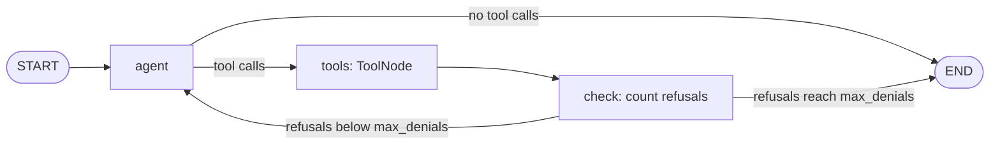

# Agent frameworks

HaltSQL ships small Python packages for five agent frameworks. Each one gives
the agent a tool that runs read-only SQL after HaltSQL has verified it:

| Framework | Package (directory) | What you get |
|---|---|---|
| OpenAI Agents SDK (`openai-agents`) | `haltsql-openai-agents` ([`integrations/openai_agents`](../integrations/openai_agents)) | `haltsql_query_tool()` (a `FunctionTool`), `haltsql_tool_input_guardrail()` |
| LangGraph | `haltsql-langgraph` ([`integrations/langgraph`](../integrations/langgraph)) | `haltsql_query_tool()` (works with `ToolNode`), `build_sql_agent_graph()` with a retry-on-deny loop |
| Semantic Kernel (Python) | `haltsql-semantic-kernel` ([`integrations/semantic_kernel`](../integrations/semantic_kernel)) | `HaltSQLPlugin` (one `kernel_function`) |
| CrewAI | `haltsql-crewai` ([`integrations/crewai`](../integrations/crewai)) | `HaltSQLQueryTool` (a `BaseTool`) |
| Google Agent Development Kit (`google-adk`) | `haltsql-google-adk` ([`integrations/google_adk`](../integrations/google_adk)) | `HaltSQLQueryTool` (a `BaseTool`), `haltsql_before_tool_callback()`, `HaltSQLGuardPlugin`, `build_sql_agent()` |

The packages are thin layers over the [Python SDK](sdk-python.md). Every
query goes through `haltsql.guard`. For LangChain, LlamaIndex and Vanna, see
[integrations.md](integrations.md).

## What every package does

All five packages follow the same rules:

- **One tool, one argument.** The tool is named `haltsql_query`. Its only
  argument is `query`, the SQL text. In Semantic Kernel the tool is the
  `query` function of the `haltsql` plugin, so the model sees
  `haltsql-query`.
- **The context comes from your application.** The tenant and any other
  context come from state that your application sets and the model cannot
  write. Where that state lives depends on the framework:
  - OpenAI Agents SDK: the run context.
  - LangGraph: the runtime context.
  - ADK: session state.
  - Semantic Kernel and CrewAI: a mapping or callable you give the tool.
  
  The context is never a tool argument. If the model adds extra arguments
  such as `tenant_id`, they never reach HaltSQL: the OpenAI Agents SDK, ADK,
  CrewAI and Semantic Kernel tools refuse the call, and the LangGraph and
  LangChain tools drop the extra argument and use the trusted context. If no context is configured, the
  query is refused before it is verified.
- **Verify, then execute.** The packages call `haltsql.guard.authorize` and
  then `guard.execute`. The database receives the exact string HaltSQL
  verified, with the verdict's `bind_params`. It runs in a `READ ONLY`
  transaction with a `statement_timeout` (default 5000 ms) and a row cap
  (default 200). Only statements whose verdict `statement_kind` is `select`
  are run.
- **Nothing runs when HaltSQL is unavailable.** If the sidecar or CLI fails,
  times out, or returns a verdict for a different string, the query does not
  run. The database connection is opened only after HaltSQL allows the query.
- **Refusals go back to the model.** A refused query is returned as a
  structured result, so the model can fix the SQL and retry. It is not raised
  as an exception.

The result has the same shape in every package. ADK returns it as a dict,
LangGraph as the `ToolMessage` artifact, and the other packages as JSON text:

```json
{"status": "ok", "executed": true, "columns": ["id", "status"],
 "rows": [[1, "open"], [3, "paid"]], "row_count": 2, "truncated": false}
```

```json
{"status": "denied", "executed": false,
 "reasons": [{"code": "E_TENANT_MISMATCH", "message": "...",
              "hint": "Use a $n placeholder (e.g. orders.tenant_id = $1) instead of a tenant literal; HaltSQL returns the value to bind."}],
 "message": "HaltSQL denied the query; it was not executed. Fix the SQL and retry:\n- E_TENANT_MISMATCH: Use a $n placeholder ..."}
```

```json
{"status": "error", "executed": false,
 "message": "SQL verification is unavailable; the query was not executed."}
```

A `status` of `error` with `executed: true` means HaltSQL allowed the query
but the database rejected it, for example because of a statement timeout. The
message gives the error class and its first line.
See [reason-codes.md](reason-codes.md) for the codes.

## The runner

Every package exports the same `HaltSQLToolRunner`. It holds the verifier,
the connection factory and the limits:

```python
import psycopg
from haltsql import HaltSQLClient, LocalVerifier

runner = HaltSQLToolRunner(
    HaltSQLClient.from_env(),             # or LocalVerifier("policy.yaml")
    connect=lambda: psycopg.connect(DSN), # a read-only role; called only after an allow
    max_rows=200,
    statement_timeout_ms=5000,
    settings=lambda ctx: {"app.tenant_id": ctx["tenant_id"]},  # optional, e.g. for RLS
)
```

`connect` must return a psycopg 3 connection. The runner closes it after each
query. Use a database role that can only read, and row-level security, as
[defense-in-depth.md](defense-in-depth.md) describes.

## OpenAI Agents SDK

```python
from dataclasses import dataclass, field
from agents import Agent, Runner
from haltsql_openai_agents import HaltSQLToolRunner, haltsql_query_tool

@dataclass
class AppContext:                      # passed to Runner.run(context=...); never sent to the model
    user_id: str
    haltsql_context: dict = field(default_factory=dict)

agent = Agent(name="analyst", instructions="Answer with SQL.",
              tools=[haltsql_query_tool(runner)])
result = await Runner.run(agent, "How many open orders?",
                          context=AppContext(user.id, {"tenant_id": user.tenant_id}))
```

By default the tool reads the `haltsql_context` attribute or key of the run
context. Pass `context_from=lambda app: {...}` to map your own context object.

`haltsql_tool_input_guardrail(verifier, sql_arg="query")` is a tool input
guardrail for SQL tools you already have
(`@function_tool(tool_input_guardrails=[...])`). It verifies the tool's SQL
argument before the tool runs. If HaltSQL does not allow it, the guardrail
calls `reject_content`: the tool does not run and the model gets the refusal
JSON.

The guardrail cannot pass `$n` values to the tool. So it refuses any SQL that
HaltSQL allows only with bound parameters. Use it with a policy in literal
tenancy mode (see [tenancy.md](tenancy.md)), or use `haltsql_query_tool`. The
guardrail checks only the SQL. The guarded tool must still apply read-only
access, timeouts and row limits itself.

## LangGraph

```python
from langgraph.prebuilt import ToolNode
from haltsql_langgraph import HaltSQLToolRunner, haltsql_query_tool, build_sql_agent_graph

tool = haltsql_query_tool(runner)          # ToolNode([tool]) works as usual
graph = build_sql_agent_graph(llm.bind_tools([tool]), tool, max_denials=3)
out = graph.invoke({"messages": [("user", "How many open orders?")]},
                   context={"haltsql_context": {"tenant_id": user.tenant_id}})
```

The tool takes LangGraph's `ToolRuntime`, which is hidden from the model, and
reads `haltsql_context` from the runtime context (`graph.invoke(...,
context=...)`). It uses `response_format="content_and_artifact"`. The
`ToolMessage` content is the JSON for the model, and `artifact` is the same
result as a dict. `is_denial(message)` tells you whether a message is a
refusal.

`build_sql_agent_graph` is an example graph:



After a refusal, the model gets the hints and tries again. After
`max_denials` refusals, the graph stops with a short message instead of
looping.

## Semantic Kernel

```python
import contextvars
from semantic_kernel import Kernel
from haltsql_semantic_kernel import HaltSQLPlugin, HaltSQLToolRunner, PLUGIN_NAME

current_ctx = contextvars.ContextVar("haltsql_ctx", default=None)   # set per request

kernel = Kernel()
kernel.add_plugin(HaltSQLPlugin(runner, context=current_ctx.get), plugin_name=PLUGIN_NAME)
```

`context` is a mapping, or a zero-argument callable that is evaluated on
every call. The callable runs in a worker thread, and `contextvars` values are
copied into that thread. A callable that returns `None` refuses the query.

The plugin never reads the context from `KernelArguments`, because automatic
function calling merges the model's arguments into them. If the model sends
arguments the function does not declare, Semantic Kernel itself refuses the
call.

## CrewAI

```python
from crewai import Agent
from haltsql_crewai import HaltSQLQueryTool, HaltSQLToolRunner

tool = HaltSQLQueryTool(runner=runner, context=lambda: {"tenant_id": session.tenant_id})
analyst = Agent(role="Analyst", goal="Answer questions about orders",
                backstory="Writes careful SQL.", tools=[tool])
```

Build the tool, or the crew, per request, with that request's context. Do not
take the tenant from crew inputs or task text. The argument schema forbids
extra fields, so a model-written `tenant_id` is a validation error.

## Google Agent Development Kit

```python
from google.adk.runners import InMemoryRunner
from haltsql_google_adk import HaltSQLToolRunner, build_sql_agent

agent = build_sql_agent(runner, model="gemini-2.5-flash")     # an LlmAgent with HaltSQLQueryTool
adk = InMemoryRunner(agent=agent, app_name="analytics")
session = await adk.session_service.create_session(
    app_name="analytics", user_id=user.id,
    state={"haltsql_context": {"tenant_id": user.tenant_id}})
```

`HaltSQLQueryTool` reads the context from session state, from the
`haltsql_context` key by default (`state_key=` changes it). Set that key when
you create the session. Do not let a tool or an agent's `output_key` write
it. If the value is not a mapping, the query is refused. The tool returns the
result dict as the function response.

ADK has database tools for BigQuery, Spanner and Bigtable. It can also load
the tools of MCP Toolbox for Databases through `ToolboxToolset`, which
includes `postgres-execute-sql`. To guard tools like these that run
PostgreSQL, use one of these:

- `LlmAgent(before_tool_callback=haltsql_before_tool_callback(verifier))`
  guards one agent.
- `Runner(..., plugins=[HaltSQLGuardPlugin(verifier)])` guards every agent
  the runner executes.

Both use `tools=` to map tool names to their SQL argument. The default is
`{"execute_sql": "sql"}`. Tools that are not listed are not checked.

For a listed tool, the guard verifies the SQL with the tenant from session
state. If HaltSQL does not allow it, the guard returns the refusal dict
instead of running the tool. Like the Agents SDK guardrail, it refuses any
verdict that needs bound parameters, because the other tool cannot pass them.
Use literal tenancy for those tools. The guard checks only the SQL: run those
tools with a read-only role and their own timeouts. Plugins run before an
agent's own callbacks. If you use the callback form, list it first and do not
let a later callback change the arguments.

Do not use the guard with BigQuery or GoogleSQL Spanner tools: HaltSQL
verifies the PostgreSQL dialect only.

## Testing

Each package has tests that use the real framework objects, the real
`haltsql` CLI (`LocalVerifier`), a real `haltsql-server` process, and the lab
Postgres. Nothing in those tests fakes HaltSQL or the database:

- OpenAI Agents SDK: tool calls go through the SDK's function-tool executor.
- LangGraph: a real `ToolNode` and `StateGraph`.
- Semantic Kernel: `Kernel.invoke` and `Kernel.invoke_function_call`.
- CrewAI: `BaseTool.run` and the structured-tool path.
- ADK: an `InMemoryRunner` session and ADK's function-call handler.

The tests never call an LLM. Where a graph needs a model turn, a short
deterministic script writes the tool calls.

```sh
make -C lab up                                     # Postgres 17 on 127.0.0.1:5417
dune build ./bin/haltsql/main.exe ./bin/server/main.exe
ONLY=agents clients/python/run-all-tests.sh        # or FULL=1 for every Python suite
```

The frameworks pin conflicting dependency versions, so the script gives each
package its own virtualenv (`integrations/<pkg>/.venv`, Python 3.11 to 3.13).
Each package's `constraints.txt` lists the exact versions the tests were run
with. Integration tests skip with a message when the binaries or the lab
Postgres are missing.
