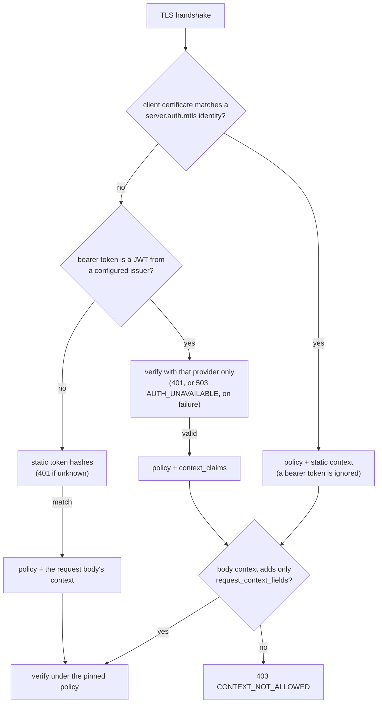

# Authentication and TLS

`haltsql-server` decides two things about every `/v1/*` request before it
looks at the SQL: **who is calling** and **which context the verdict uses**.
Both come from the caller's credentials, never from the prompt. This page
covers built-in TLS, client certificates (mTLS), OIDC/JWT bearer tokens and
static tokens. The configuration keys are listed in
[config-reference.md](config-reference.md#servertls); the HTTP behaviour in
[http-api.md](http-api.md#authentication).

## The request pipeline



1. **mTLS.** When the connection presented a client certificate (already
   verified against `server.tls.client_ca` by the TLS layer) and its identity
   matches a `server.auth.mtls` entry, that entry authenticates the request.
   A bearer token on the same request is ignored. A valid certificate that
   matches no identity falls through to step 2.
2. **OIDC.** A bearer token shaped like a JWT whose unverified `iss` equals a
   configured provider's `issuer` is verified by that provider only. A
   rejection is final (`401`, or `503 AUTH_UNAVAILABLE` when the provider's
   keys cannot be fetched). Tokens from other issuers, and opaque tokens, go
   to step 3.
3. **Static tokens.** The token's SHA-256 is compared in constant time with
   every `server.auth.tokens` entry.

Every identity is pinned to exactly one policy. A request that names another
policy gets `403 FORBIDDEN`.

### Context rules

| Caller | Context used for the verdict |
|---|---|
| mTLS identity | the identity's static `context` + body fields listed in its `request_context_fields` |
| OIDC token | values of `context_claims` + body fields listed in the provider's `request_context_fields` |
| static token with `context` or `request_context_fields` | the token's static `context` + body fields listed in its `request_context_fields` |
| static token without either key, anonymous | the request body's `context` |

A body field outside `request_context_fields` is refused with
`403 CONTEXT_NOT_ALLOWED`; it is never silently dropped or overridden. A body
field that repeats an identity-provided field with exactly the same value is
accepted, so clients that always send their context keep working. The config
loader rejects `request_context_fields` that overlap `context_claims` or the
static mTLS context.

## Built-in TLS

```yaml
server:
  listen: 0.0.0.0:8443
  tls:
    cert: /etc/haltsql/tls/tls.crt       # chain, leaf first
    key: /etc/haltsql/tls/tls.key
    client_ca: /etc/haltsql/tls/ca.crt   # enables client certificates
    client_auth: optional                # none | optional | required
    min_version: "1.2"                   # or "1.3"
```

- TLS 1.2 and 1.3 only. TLS 1.2 is limited to ECDHE key exchange with AEAD
  ciphers (AES-GCM, ChaCha20-Poly1305); TLS 1.3 to AES-GCM and
  ChaCha20-Poly1305. Renegotiation is disabled. The handshake must finish
  within 10 seconds.
- The private key must match the certificate; startup (exit code 2) and
  reload fail otherwise.
- `client_auth: optional` asks for a certificate and verifies it when one is
  sent; `required` also refuses handshakes without one. Verification is RFC
  5280 path validation against `client_ca` at the current time.
- **Rotation.** `SIGHUP`, or file watching (`reload.watch`), re-reads the
  certificate, key and client CA. New connections use the new material;
  existing connections are not interrupted. If the new files are broken or
  mismatched, the previous material stays active and the reload is counted in
  `haltsql_tls_reload_total{result="error"}`. This works with cert-manager
  and Kubernetes secret volumes (the kubelet updates the files in place).
  Turning TLS on or off requires a restart.
- **Probes.** With `client_auth: required`, kubelet probes cannot present a
  certificate. Start the server with `--health-listen 0.0.0.0:8081` to serve
  only `/healthz` and `/readyz` over plain HTTP on a second port.

## mTLS identities

```yaml
server:
  tls:
    cert: /etc/haltsql/tls/tls.crt
    key: /etc/haltsql/tls/tls.key
    client_ca: /etc/haltsql/tls/ca.crt
    client_auth: required
  auth:
    mtls:
      identities:
        - spiffe_id: spiffe://corp.example/ns/agents/sa/analytics
          policy: saas-analytics
          context: { tenant_id: acme }
        - subject_cn: support-bot
          policy: support-bot
          request_context_fields: [tenant_id]
```

- `spiffe_id` matches the certificate's URI SAN exactly. Following the
  X.509-SVID rules, a certificate with more than one URI SAN has no SPIFFE ID
  and never matches a `spiffe_id` entry.
- `subject_cn` matches the subject common name exactly (case-sensitive). The
  CN is decoded from UTF8String, PrintableString, BMPString or
  UniversalString; a TeletexString, malformed, empty or control-character CN
  never matches (fail closed).
- Server certificates that haltsql-server checks (OIDC issuers, bundle
  sources, OPA, audit sinks) are matched by host name against DNS
  SubjectAltName entries only: a certificate with the name only in its CN is
  rejected.
- The first matching identity in configuration order wins.
- Audit records carry `caller_type: "mtls"` and `subject` set to the SPIFFE
  ID, or the CN.

With SPIRE, point `client_ca` at the trust bundle and have the agent workload
use its X.509-SVID as the client certificate.

## OIDC / JWT bearer tokens

```yaml
server:
  auth:
    oidc:
      - name: corp-okta
        issuer: https://corp.okta.com/oauth2/default
        audiences: [haltsql]
        # jwks_uri: discovered from <issuer>/.well-known/openid-configuration
        algorithms: [RS256, ES256]
        leeway_seconds: 60
        jwks_cache_seconds: 300
        policy_claim: haltsql_policy
        allowed_policies: [saas-analytics, support-bot]
        context_claims:
          tenant_id: https://corp.example/tenant   # a claim name containing dots
          org_id: org.id                           # or a dot path
        required_claims:
          scope: sql.verify
        request_context_fields: [user_id]
```

What is checked, in order:

| Check | Rule | Failure |
|---|---|---|
| shape | three base64url segments, JSON objects without duplicate members, no `crit` header, at most 16 KiB | `401 malformed token` |
| algorithm | header `alg` is in `algorithms`; `none` and every HMAC algorithm are always rejected | `401` |
| key | the header's `kid` names a JWKS key of the matching type (RSA for RS*/PS256, P-256 for ES256, P-384 for ES384, Ed25519 for EdDSA), with `use` absent or `sig` and `alg` absent or equal; RSA keys must be at least 2048 bits; symmetric keys are never loaded | `401` (missing or unknown `kid`) |
| signature | verified with that key | `401` |
| `iss` | equals `issuer` exactly | `401` |
| `aud` | a string or array containing one of `audiences` | `401` |
| `exp` | required; `now < exp + leeway` | `401 token has expired` |
| `nbf`, `iat` | if present, not later than `now + leeway` | `401` |
| `required_claims` | a string must equal the claim, or be an element of an array claim, or a word of a space-separated claim such as `scope`; a list requires every value | `401` |
| policy | `policy`, or the string value of `policy_claim` if it is in `allowed_policies`, or the first `policy_from_groups` rule the token's groups match (see [Policies from IdP groups](#policies-from-idp-groups)) | `401` |
| context | each `context_claims` path must exist; strings and integral numbers become one value, non-empty arrays of those a set; anything else is rejected | `401` |

The `sub` claim is recorded as the audit `subject`; the token itself is never
logged or stored.

### Key fetching and caching

- Discovery: when `jwks_uri` is not set, it is read from
  `<issuer>/.well-known/openid-configuration` (a trailing `/` of the issuer is
  removed first). The document's `issuer` must equal the configured issuer
  exactly; its `jwks_uri` must be `https` (or `http` with
  `allow_insecure_http`, for tests) and carry no credentials.
- HTTPS uses the system CA store and checks the host name. Responses are
  limited to 1 MiB and 5 seconds; redirects are not followed.
- Keys are fetched at startup and cached for `jwks_cache_seconds`.
- A token with an unknown `kid` triggers one refresh, at most once every 30
  seconds per provider (key rotation without a restart, without letting
  random `kid`s hammer the IdP).
- If a refresh fails, the cached keys stay usable for at most
  `min(jwks_cache_seconds, 3600)` seconds past their expiry
  (stale-while-error). After that, every token from that provider gets
  `503 AUTH_UNAVAILABLE` until the IdP is reachable again. Failed refreshes
  are retried at most every 5 seconds.
- A hot reload keeps the key cache of providers whose configuration did not
  change.

### Choosing the policy

Pin a provider to one policy with `policy: NAME` when all its tokens belong
to one agent. Use `policy_claim` + `allowed_policies` when one IdP issues
tokens for several agents: the token cannot select a policy outside the
allowlist.
Use `policy_from_groups` when the IdP already sorts callers into groups or
roles: no custom claim is needed.

### Policies from IdP groups

```yaml
server:
  auth:
    oidc:
      - name: corp-keycloak
        issuer: https://sso.corp.example/realms/corp
        audiences: [haltsql]
        policy_from_groups:
          claim: groups                 # default; a dot path such as realm_access.roles works
          map:                          # ordered: the first entry the token matches wins
            - { group: data-platform-admins, policy: admin-readonly }
            - { group: support, policy: support-bot }
            - { group: analysts, policy: saas-analytics }
          default: null                 # no match: 401
```

How a verified token's policy is chosen:

1. **Overage check.** If the token says its groups did not fit (Azure AD /
   Entra ID "groups overage", below), it is rejected: `401`, reason
   `groups_overage`.
2. **Lookup.** `claim` is looked up like `context_claims`: first as one claim
   name (so an Auth0 namespaced claim `https://corp.example/groups` works),
   then as a dot path through nested objects. A missing claim is `401`
   (`missing_claim`).
3. **Shape.** A string is one group and is never split on spaces; an array
   must contain only strings. Anything else (a number, an object, an array
   with a non-string) is `401` (`bad_claim`).
4. **First match.** The `map` entries are tried in the order written, and the
   first one whose `group` the token has wins, whatever the order of the
   groups inside the token. A caller in both `support` and `analysts` above
   gets `support-bot`, so list the most specific or most privileged groups
   first. Groups are compared exactly (case-sensitive).
5. **Default.** If nothing matches, `default` is used. Without a `default`
   the token is rejected: `401`, reason `no_group_policy` (the message does
   not echo the token's groups).

The token is still pinned to the selected policy (a request naming another
policy gets `403 FORBIDDEN`), and `context_claims`, `required_claims` and
`request_context_fields` work as for any OIDC provider.

| IdP | Claim to use | Notes |
|---|---|---|
| Okta | `groups` | Add a groups claim to the authorization server's access token, with a filter (for example "starts with `haltsql-`") so it stays small. |
| Keycloak | `groups`, or `realm_access.roles` / `resource_access.<client>.roles` | Add a *Group Membership* mapper to the client (or a client scope) with *Full group path* off, so groups are `analysts` and not `/analysts`; enable *Add to access token*. Realm and client roles are in the access token by default. Keycloak omits the claim for a user in no group, which is a `401` (`missing_claim`). |
| Auth0 | a namespaced claim, e.g. `https://corp.example/groups` | Set it from a post-login Action (`api.accessToken.setCustomClaim`). |
| Azure AD / Entra ID | `groups` (object ids) or `roles` (app roles) | See overage below. App roles (`roles`) are usually the better choice: they are scoped to the application and never overflow. |

**Azure AD / Entra ID groups overage.** When a user is in more groups than
fit in a token (200 for JWTs), Entra ID leaves the `groups` claim out and adds
`_claim_names: {"groups": "src1"}` and `_claim_sources` pointing at Microsoft
Graph (or, for implicit-flow tokens, `hasgroups: true`). HaltSQL never calls
Graph: a partial or missing group list could select the wrong policy, so such
a token is rejected with `groups_overage`, even if a `groups` claim is also
present. To avoid it, set *groupMembershipClaims* to `ApplicationGroup` and
assign only the relevant groups to the enterprise application, or map app
roles with `claim: roles`.

Group mapping is only as good as the IdP's group administration: anyone who
can add a user to `data-platform-admins` grants that user the
`admin-readonly` policy.

## Static tokens

Static tokens remain supported. Store only `token_sha256`; each token is
pinned to one policy.

**Bind each token to its tenant.** Give the token a `context` and the request
body can no longer claim another tenant:

```yaml
server:
  auth:
    tokens:
      - name: acme-agent
        token_sha256: "..."
        policy: analytics-agent
        context: { tenant_id: acme }          # fixed for this token
        request_context_fields: [user_id]     # the body may still add these
```

A body field outside `request_context_fields` gets `403 CONTEXT_NOT_ALLOWED`.
Use one token per tenant, or OIDC / mTLS when tenants are many.

A token with neither `context` nor `request_context_fields` is **unbound**: it
authenticates the calling service, and the request body supplies the whole
context. Any holder of an unbound token can obtain a verdict for any tenant it
names, so use unbound tokens only when the caller is your own trusted backend
that takes the tenant from its authenticated session. Audit records carry the
context and `context_source` (`authenticated` or `request`) either way.

## Observability

- `haltsql_auth_total{method,result}`: `method` is `token`, `oidc`, `mtls`,
  `anonymous` or `none`; `result` is `ok`, `rejected` or `unavailable`.
- `haltsql_tls_reload_total{result}`.
- OIDC rejections are logged at `info` with a stable reason code
  (`expired`, `bad_signature`, `wrong_audience`, `groups_overage`,
  `no_group_policy`, ...) and the peer address.
  JWKS refresh failures are logged at `warn`.

## Threat notes

- **Algorithm confusion** (`alg: none`, HS256 signed with the RSA public
  key) is impossible: HMAC and `none` are never accepted and the key type
  must match the algorithm.
- **Tenant spoofing**: an OIDC or mTLS caller cannot change its tenant via the
  request body (`CONTEXT_NOT_ALLOWED`).
- **Issuer confusion**: a token is only verified by providers whose `issuer`
  equals its `iss`, and then must pass that provider's checks.
- **IdP outage**: bounded stale keys, then fail closed.
- **Fail closed**: every verification error is a denial; clients must treat
  any non-200 response as a denial.
- **Group claims**: a token whose groups overflowed (Entra ID overage), whose
  groups claim is missing or malformed, or whose groups match no rule
  without a `default`, is rejected. Group membership is read only from the
  signed token, never from the request.

## Implementation notes

Signatures, hashes, HMAC, PBKDF2 and base64 come from maintained OCaml
libraries (`mirage-crypto`, `digestif`, `kdf`, `base64`). The compact-JWS
decoder, JWK parsing and the claim checks in `lib/auth` are HaltSQL's own
code on top of those primitives.

### Why JWT verification is in-tree

Replacing `lib/auth/jwt.ml` and `jwk.ml` with the `jose` opam package was
evaluated against `jose` 0.11.0 and not adopted. In that version:

- RS384, RS512 and PS256 are not verifiable (three of the seven algorithms
  HaltSQL accepts), and there is no RSA-PSS support.
- `Jws.validate` chooses the verification routine from the key type and
  does not compare it with the header `alg`, so the algorithm is not bound
  to the key.
- `Jwk.of_pub_json` and `Jwks.of_json` accept `kty: oct` keys from a JWKS,
  which then verify by HMAC-SHA256. HaltSQL never accepts symmetric keys.
- A non-JSON header, an unknown `enc`, a JWKS that is not an object and a
  short ECDSA signature raise exceptions instead of returning errors.
- Padded and non-canonical base64url, `crit` headers, sub-2048-bit RSA keys
  and JWKs carrying private members are accepted.

Keeping the checks listed under [Threat notes](#threat-notes) would have
required HaltSQL's decoder, key checks and three algorithms to stay, with
the library wrapping the same `mirage-crypto` calls for the other four. The
`oidc` package depends on `jose` and was not adopted for the same reason.
