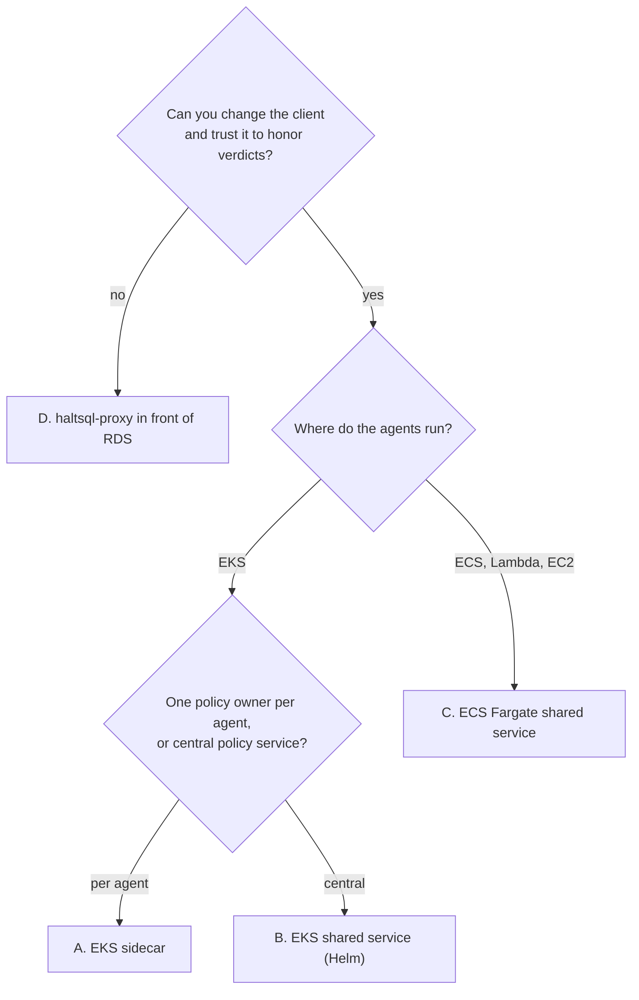
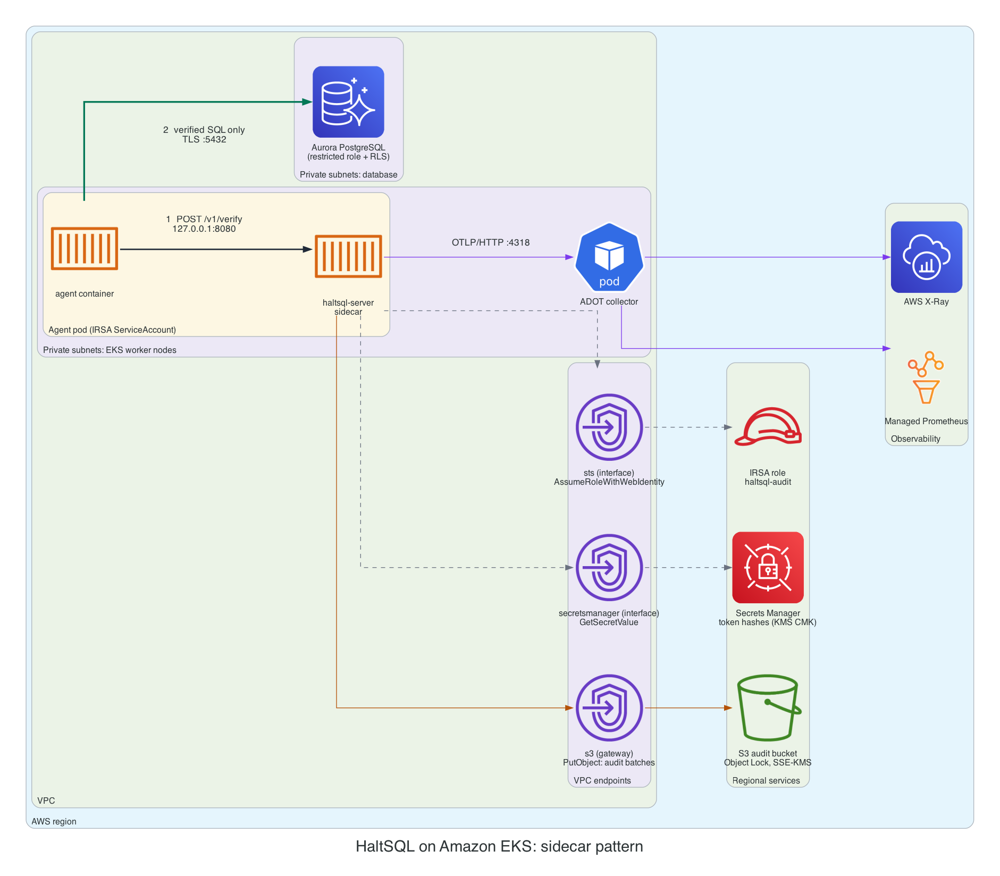
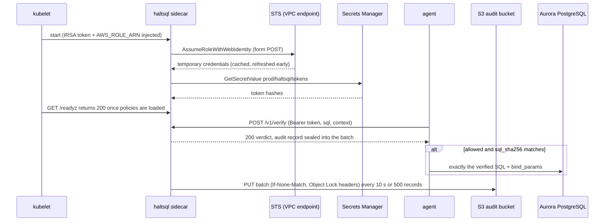
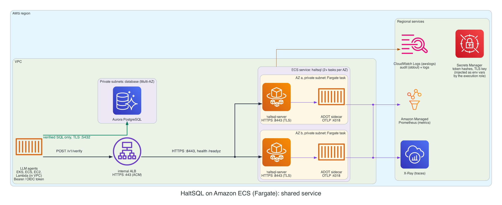
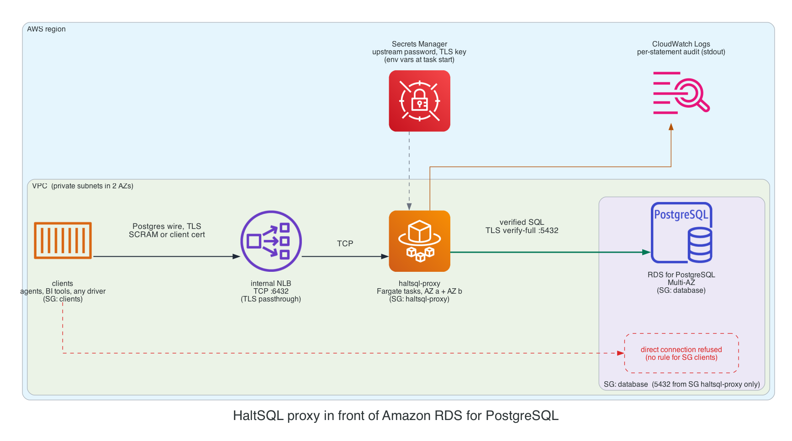

# Deploying on AWS

This guide covers four ways to run HaltSQL on AWS:

- `haltsql-server` as a sidecar on Amazon EKS;
- `haltsql-server` as a shared service on EKS or on Amazon ECS (Fargate);
- `haltsql-proxy` in front of Amazon RDS or Aurora PostgreSQL.

It covers IAM, networking, TLS, the S3 Object Lock audit trail,
observability, scaling and cost.

The manifests, task definitions, IAM policies and a small Terraform module
are in [`deploy/cloud/aws/`](../deploy/cloud/aws/). The
general deployment guide is [deployment.md](deployment.md), and the trade-offs
between the modes are explained in
[how-it-works/deployment-modes.md](how-it-works/deployment-modes.md).

`haltsql-server` never connects to the database. On AWS it makes at most
these outbound calls:

| Call | When | Config |
|---|---|---|
| STS `AssumeRoleWithWebIdentity` | IRSA credentials, refreshed 5 minutes before they expire | `credentials: { source: web_identity }`; the `${aws-sm:..}` chain |
| EC2 IMDSv2 | instance-profile credentials | `credentials: { source: instance }`; the `${aws-sm:..}` chain |
| Secrets Manager `GetSecretValue` | at startup and on every reload | `${aws-sm:<id>[#key]}` + `secrets.aws.region` |
| S3 `PutObject` | one object per audit batch | `audit.sinks[].type: s3` |
| OIDC discovery / JWKS | OIDC callers, cached | `server.auth.oidc` |
| OTLP/HTTP | traces and metrics export | `telemetry.otlp` |

> **Terraform.** To provision these patterns as code, use the modules in
> [`deploy/terraform`](../deploy/terraform/) ([terraform.md](terraform.md)):
> `haltsql-aws` runs `haltsql-server` on ECS on Fargate, and `haltsql-kubernetes` installs
> the Helm chart on any cluster. This guide explains the architecture and the
> settings those modules expose; the manifests in
> [`deploy/cloud/aws/`](../deploy/cloud/aws/) are the equivalent by hand.

## Choosing a pattern

| Pattern | Pick it when | Enforcement | Audit on AWS |
|---|---|---|---|
| **A. EKS sidecar** | Agents run on EKS. This is the default recommendation. | The agent (or the SDK's guarded execute) acts on the verdict. | S3 Object Lock, using IRSA. |
| **B. EKS shared service (Helm)** | Many agents on EKS, with central policy rollout. | Same as A, with one network hop. | S3 Object Lock, using IRSA. |
| **C. ECS Fargate shared service** | Agents on ECS, Lambda or EC2 call one internal endpoint. | Same as A. | CloudWatch Logs (stdout). See [Audit on ECS](#audit-on-ecs). |
| **D. `haltsql-proxy` in front of RDS** | You cannot change the client (BI tools, vendor agents), or you do not trust the app to honor verdicts. | The proxy. The database is reachable only through it. | CloudWatch Logs (stdout). |



Whichever pattern you choose, keep the database-side controls: a
least-privilege role, `default_transaction_read_only` for read-only agents,
and row-level security ([defense-in-depth.md](defense-in-depth.md)).

## What HaltSQL supports on AWS

Only the features below exist in the code (`lib/cloud/`). Each limitation
noted here shapes the patterns that follow.

| Area | Supported | Not supported (today) |
|---|---|---|
| Credentials | `env` (`AWS_ACCESS_KEY_ID`/`AWS_SECRET_ACCESS_KEY`/`AWS_SESSION_TOKEN`), `static` (from the config, through secret placeholders), `web_identity` (IRSA: `AWS_WEB_IDENTITY_TOKEN_FILE` + `AWS_ROLE_ARN`), `instance` (EC2 IMDSv2) | The **ECS task role** (container credentials, `AWS_CONTAINER_CREDENTIALS_RELATIVE_URI`), **EKS Pod Identity** (`AWS_CONTAINER_CREDENTIALS_FULL_URI`), shared config/profile files, SSO |
| Secrets | `${aws-sm:<secret-id>[#json-key]}` placeholders, resolved at startup and on each reload, with the chain `env` → `web_identity` → `instance` | Rotation without a reload (send `SIGHUP`, or let `reload.watch` see a file change) |
| Audit | `s3` sink: SigV4, create-only PUTs, Content-MD5 + SHA-256 checksums, Object Lock headers, spool directory, `fail_closed` or `buffer` | SSE-KMS headers per object (use bucket default encryption instead), Firehose or CloudWatch sinks |
| Telemetry | OTLP/HTTP (JSON) to any collector; Prometheus `/metrics` | SigV4-signed OTLP straight to X-Ray or CloudWatch (send it through an ADOT collector) |
| Proxy | Upstream password and SCRAM verifiers from `${env:}`/`${file:}`; upstream `tls.mode: verify-full` against the RDS CA bundle | `${aws-sm:}`, S3 audit, metrics, RDS IAM database authentication, TLS key/cert as inline PEM (they must be files) |

Note that the S3 sink's `credentials.source` defaults to **`env`**, not to the
chain. On EKS, set `credentials: { source: web_identity }` explicitly.

## Prerequisites

- A VPC with private subnets in at least two Availability Zones.
- For private subnets without a NAT gateway, these VPC endpoints:
  - `com.amazonaws.<region>.sts` (interface, needed for IRSA);
  - `secretsmanager` (interface);
  - `s3` (gateway);
  - `logs` (interface);
  - for ECS: `ecr.api`, `ecr.dkr`;
  - for ADOT: `xray`, `aps-workspaces`.
- The image `ghcr.io/haltsql/haltsql:<version>`, mirrored to ECR if your
  nodes cannot reach GHCR. Verify its cosign signature and pin it by digest
  ([deployment.md](deployment.md#verifying-release-artifacts)).
- An audit bucket with Object Lock. `deploy/cloud/aws/terraform/` creates it,
  together with its KMS key, the least-privilege policy and an optional IRSA
  role:

  ```sh
  cd deploy/cloud/aws/terraform
  terraform init
  terraform apply \
    -var audit_bucket_name=corp-haltsql-audit \
    -var 'secret_arns=["arn:aws:secretsmanager:eu-west-1:111122223333:secret:prod/haltsql/tokens-??????"]' \
    -var 'irsa={oidc_provider_arn="arn:aws:iam::111122223333:oidc-provider/oidc.eks.eu-west-1.amazonaws.com/id/EXAMPLE",oidc_issuer_host="oidc.eks.eu-west-1.amazonaws.com/id/EXAMPLE",namespace="agents",service_account="analytics-agent"}'
  ```

- Policies validated and tested in CI (`haltsql validate`, `haltsql test`,
  see [policy-ci.md](policy-ci.md)).

## A. EKS sidecar



Each agent pod gets a `haltsql` container. The agent calls
`http://127.0.0.1:8080/v1/verify`, so verification never leaves the pod. Only
the agent talks to Aurora. The sidecar uses IRSA for these calls:

- STS, to obtain credentials;
- Secrets Manager, to read the token hashes;
- S3, to write audit batches.

It also sends OTLP to an ADOT collector.



### Steps

1. **IAM role.** Attach `deploy/cloud/aws/iam/haltsql-policy.json` (or the
   Terraform `policy_arn`) to a role. Its trust policy
   (`iam/irsa-trust-policy.json`) must allow exactly
   `system:serviceaccount:agents:analytics-agent` with audience
   `sts.amazonaws.com`.
2. **Secrets.** Store the token hashes as one JSON secret. The agent keeps the
   raw token; the sidecar sees only the hash.

   ```sh
   TOKEN="$(openssl rand -hex 32)"
   aws secretsmanager create-secret --name prod/haltsql/tokens \
     --kms-key-id alias/haltsql-secrets \
     --secret-string "{\"analytics-agent\":\"$(printf '%s' "$TOKEN" | sha256sum | cut -d' ' -f1)\"}"
   kubectl -n agents create secret generic analytics-agent-haltsql --from-literal=token="$TOKEN"
   ```

3. **Config.** `deploy/cloud/aws/eks/sidecar.yaml` contains the full config.
   The AWS-specific parts are:

   ```yaml
   server:
     auth:
       tokens:
         - name: analytics-agent
           token_sha256: ${aws-sm:prod/haltsql/tokens#analytics-agent}
           policy: analytics-agent
   audit:
     sinks:
       - type: s3
         bucket: corp-haltsql-audit
         region: eu-west-1
         prefix: haltsql/audit/analytics-agent/
         object_lock: { mode: COMPLIANCE, retain_days: 365 }
         credentials: { source: web_identity }
         spool_dir: /var/lib/haltsql/spool
         on_error: fail_closed
   telemetry:
     otlp:
       endpoint: http://adot-collector.observability:4318
       service_name: haltsql-analytics-agent
   secrets:
     aws:
       region: eu-west-1
   ```

4. **ServiceAccount and pod.** Annotate the ServiceAccount with
   `eks.amazonaws.com/role-arn`. Annotate the pod with
   `eks.amazonaws.com/skip-containers: agent`, so that only the `haltsql`
   container receives the web-identity token and the `AWS_*` variables. The
   agent then cannot write audit objects or read the hashes. Mount the
   ConfigMaps as directories, not with `subPath`, so that `reload.watch`
   sees policy updates.
5. **Apply and check.**

   ```sh
   kubectl apply -f deploy/cloud/aws/eks/sidecar.yaml
   kubectl -n agents logs deploy/analytics-agent -c haltsql | head     # "policies loaded", no credential errors
   aws s3 ls s3://corp-haltsql-audit/haltsql/audit/analytics-agent/ --recursive | tail
   ```

A startup error such as `aws-sm: no AWS credentials found (...)` or `STS
returned HTTP 403 AccessDenied` stops the pod with exit code 2. Check the
role's trust policy (namespace, ServiceAccount name and audience) and the STS
endpoint.

## B. EKS shared service (Helm)

Use the chart in `deploy/helm/haltsql` with the overlay
`deploy/cloud/aws/eks/values-eks.yaml`:

```sh
helm upgrade --install haltsql oci://ghcr.io/haltsql/charts/haltsql --version 0.0.3 -n haltsql --create-namespace \
  -f deploy/cloud/aws/eks/values-eks.yaml \
  --set-file 'policies.analytics-agent\.yaml=policies/analytics-agent.yaml'
kubectl apply -n haltsql -f deploy/cloud/aws/eks/networkpolicy-shared.yaml
```

The overlay does the following:

- annotates the chart's ServiceAccount with the IRSA role;
- renders an `s3` sink with `credentials: { source: web_identity }` and a
  spool in the chart's `/var/log/haltsql` emptyDir;
- turns on built-in TLS from a cert-manager Secret (for example issued by AWS
  Private CA through `aws-privateca-issuer`);
- runs three or more replicas spread across zones, with a PDB and an HPA.

Limitations of the chart on AWS:

- **NetworkPolicy.** The chart's NetworkPolicy denies all egress. With an S3
  sink that blocks STS and S3, and with `fail_closed` every request then
  gets `503`. The overlay sets `networkPolicy.enabled: false` and ships
  `networkpolicy-shared.yaml` instead, which allows DNS, HTTPS to the VPC
  endpoints, and OTLP. The policy is only enforced if the VPC CNI's
  network-policy agent (or Calico or Cilium) is enabled.
- **No `secrets` or `telemetry.otlp` values.** The chart cannot render
  `secrets.aws` or `telemetry.otlp`, so `${aws-sm:..}` placeholders and OTLP
  export are not available through it. Feed the token hashes in with
  `existingTokenSecret`, a Secret synced from Secrets Manager (for example by
  External Secrets Operator). Get metrics by scraping `/metrics` with ADOT or
  an Amazon Managed Service for Prometheus scraper. If you need OTLP traces,
  use the sidecar manifest style (a hand-written ConfigMap).

Agents reach the service at `https://haltsql.haltsql.svc:8080`, and need the
cluster CA that signed `haltsql-tls`.

## C. ECS Fargate shared service



An internal Application Load Balancer spreads requests over `haltsql-server`
tasks in two or more AZs. Each task runs the server and an ADOT collector
sidecar.

### Steps

1. **Bake config and policies into an image.** ECS has no ConfigMaps. The
   distroless image has no shell, so the config cannot be written at
   start-up. `deploy/cloud/aws/ecs/Dockerfile` adds `config.yaml` and
   `policies/` to the official image. Each policy change becomes a new image
   digest, which leaves a clean audit trail. Signed policy bundles
   (`policies: [{bundle: ..., public_keys: [...]}]`) work the same way.

   ```sh
   docker build -f deploy/cloud/aws/ecs/Dockerfile -t "$ECR/haltsql-config:$(git rev-parse --short HEAD)" deploy/cloud/aws/ecs
   docker push "$ECR/haltsql-config:$(git rev-parse --short HEAD)"
   ```

2. **Secrets.** The ECS task role cannot be used by HaltSQL today (see
   [What HaltSQL supports](#what-haltsql-supports-on-aws)), so do not use
   `${aws-sm:..}` on Fargate. Instead, let ECS inject secrets as
   environment variables and reference them with `${env:..}`. ECS fetches
   them with the **execution role**
   (`iam/ecs-task-execution-policy.json`).

   ```json
   "secrets": [
     { "name": "HALTSQL_TOKEN_ANALYTICS_AGENT_SHA256",
       "valueFrom": "arn:aws:secretsmanager:eu-west-1:111122223333:secret:prod/haltsql/tokens-AbCdEf:analytics-agent::" },
     { "name": "HALTSQL_TLS_KEY",
       "valueFrom": "arn:aws:secretsmanager:eu-west-1:111122223333:secret:prod/haltsql/tls-GhIjKl:key::" }
   ]
   ```

   `server.tls.cert` and `server.tls.key` accept inline PEM, so
   `cert: ${env:HALTSQL_TLS_CERT}` works. Rotated secrets are picked up when
   ECS starts new tasks (force a new deployment).

3. **Task definition.** See `deploy/cloud/aws/ecs/task-definition.json`. In
   it:
   - `HALTSQL_LISTEN=0.0.0.0:8443`. The image sets `HALTSQL_LISTEN`, and
     environment variables override the config file.
   - The task runs as `user: 65532:65532` with `readonlyRootFilesystem`.
   - Logs use `awslogs` in **`blocking`** mode, so that audit lines on stdout
     are never dropped.
   - `stopTimeout: 30`.
   - It runs on ARM64 (Graviton).
   - The ADOT container runs the built-in `/etc/ecs/ecs-amp-xray.yaml` config
     (OTLP in; X-Ray and AMP remote-write out). It uses the **task role**
     (`iam/adot-task-role-policy.json`), because the collector supports
     container credentials.
4. **Load balancer.** Create an internal ALB with an HTTPS :443 listener and
   an ACM certificate (from AWS Private CA or a public certificate for a
   private hosted zone name). Add a target group with:
   - protocol HTTPS, port 8443, target type `ip`;
   - health check `GET /readyz`, matcher `200`, interval 10 s;
   - deregistration delay 30 s.

   The ALB does not validate target certificates, so a private-CA
   certificate on the tasks is enough to encrypt ALB → task traffic.
5. **Service.** Set the desired count to at least 2 per AZ that you use,
   with:
   - `minimumHealthyPercent: 100`, `maximumPercent: 200`;
   - the deployment circuit breaker with rollback;
   - Service Auto Scaling on `ECSServiceAverageCPUUtilization` (about 60%) or
     `ALBRequestCountPerTarget`.

### Audit on ECS

On Fargate there is no IMDS, and HaltSQL cannot use the task role, so the S3
sink has no good credential source. The choices, best first:

1. **`stdout` → CloudWatch Logs** (the reference setup). Records are still
   hash-chained per task, so tampering is detectable when you export a
   stream and verify it ([audit-sinks.md](audit-sinks.md#verifying-a-chain)).
   Encrypt the log group with KMS. Set its retention to your compliance
   period. Restrict `logs:DeleteLogStream` and `logs:PutRetentionPolicy`
   with an SCP. If you need WORM storage, export or subscribe the log group
   to an Object Lock bucket.
2. **Run haltsql on EKS (pattern B) or on EC2.** Use the S3 sink with
   `web_identity` or `instance` credentials.
3. **`credentials: { source: static }`**, with keys of a dedicated IAM user
   that holds only the `s3:PutObject`/`s3:PutObjectRetention` statement,
   injected from Secrets Manager. This works, but it means long-lived keys
   to rotate. Use it only as a stopgap.

## D. haltsql-proxy in front of RDS



Clients connect to an internal Network Load Balancer on TCP 6432. The NLB
forwards to `haltsql-proxy` tasks. The proxy authenticates the client
(SCRAM or client certificate), verifies every `Query` and `Parse`, and
rewrites tenancy parameters in every `Bind`. It then forwards the SQL over
TLS (`verify-full`) to RDS. The database security group admits port 5432
**only from the proxy's security group**, so clients have no path that
bypasses the proxy.

- **TLS must pass through the NLB.** Use a TCP listener, not a TLS listener.
  PostgreSQL negotiates TLS in-band after an `SSLRequest`, so the NLB cannot
  terminate it. The proxy's `tls.cert` and `tls.key` must be **files**. In
  `ecs/proxy-task-definition.json`, a short-lived init container writes them
  from injected secrets to a task-scoped volume. On EKS, mount them with the
  Secrets Store CSI driver (AWS provider) instead.
- **Upstream.** Use `upstream.tls: { mode: verify-full, ca: ./rds-global-bundle.pem }`.
  Bake the public RDS CA bundle into the derived image
  (`ecs/Dockerfile.proxy`). Set `rds.force_ssl = 1` in the DB parameter
  group, and use a dedicated least-privilege `upstream.user`. RDS IAM
  database authentication is not supported; the password comes from
  `${env:UPSTREAM_PASSWORD}`.
- **Health checks.** Use a TCP health check on 6432. The proxy has no HTTP
  health or metrics endpoint.
- **Audit.** One JSON line per statement on stdout, going to CloudWatch Logs.
- **Clients** use prepared statements for tenant-scoped queries
  ([proxy.md](proxy.md)).

## IAM: least privilege

`deploy/cloud/aws/iam/haltsql-policy.json` is the whole policy for
`haltsql-server` (patterns A and B):

```json
{
  "Version": "2012-10-17",
  "Statement": [
    {
      "Sid": "WriteAuditObjectsUnderPrefix",
      "Effect": "Allow",
      "Action": ["s3:PutObject", "s3:PutObjectRetention"],
      "Resource": "arn:aws:s3:::corp-haltsql-audit/haltsql/audit/*"
    },
    {
      "Sid": "ReadHaltsqlSecrets",
      "Effect": "Allow",
      "Action": "secretsmanager:GetSecretValue",
      "Resource": [
        "arn:aws:secretsmanager:eu-west-1:111122223333:secret:prod/haltsql/tokens-??????",
        "arn:aws:secretsmanager:eu-west-1:111122223333:secret:prod/haltsql/otel-??????"
      ]
    },
    {
      "Sid": "UseCustomerManagedKeyViaS3AndSecretsManager",
      "Effect": "Allow",
      "Action": ["kms:Decrypt", "kms:GenerateDataKey"],
      "Resource": "arn:aws:kms:eu-west-1:111122223333:key/00000000-0000-0000-0000-000000000000",
      "Condition": {
        "StringEquals": {
          "kms:ViaService": [
            "s3.eu-west-1.amazonaws.com",
            "secretsmanager.eu-west-1.amazonaws.com"
          ]
        }
      }
    }
  ]
}
```

Notes on the policy:

- **No read, list or delete on the bucket.** HaltSQL only PUTs, with
  `If-None-Match: *`, so it cannot overwrite an object either.
  `s3:PutObjectRetention` is needed because each PUT carries Object Lock
  headers.
- **`kms:GenerateDataKey`** is required to write objects into an SSE-KMS
  bucket. Turn on S3 Bucket Keys to cut KMS request costs.
- **Secret ARNs end in `-??????`.** That matches the random suffix that
  Secrets Manager adds to the name, and only that suffix.
- **Use one role per agent in pattern A**, each with its own audit prefix,
  so that one compromised pod cannot write into another agent's prefix.
- **Trust policy.** Pin both `:sub` (namespace and ServiceAccount) and
  `:aud` (`sts.amazonaws.com`).

For ECS, the execution role needs `secretsmanager:GetSecretValue` (plus
`kms:Decrypt` with `kms:ViaService` for Secrets Manager) on the injected
secrets, together with `AmazonECSTaskExecutionRolePolicy` for ECR and logs.

## Networking and security groups

| Security group | Inbound | Outbound |
|---|---|---|
| `agents` | as your app needs | 443 to `alb-haltsql` (C); 5432 to `db` (A–C); 6432 to `nlb-proxy` (D) |
| `alb-haltsql` (C) | 443 from `agents` | 8443 to `haltsql` |
| `haltsql` (C) | 8443 from `alb-haltsql` | 443 to the VPC endpoints (Secrets Manager, ECR, logs, X-Ray, AMP) |
| `haltsql-proxy` (D) | 6432 from the NLB (or from `agents` when the NLB preserves client IPs) | 5432 to `db`; 443 to VPC endpoints |
| `db` | 5432 from `agents` (A–C), **only** from `haltsql-proxy` (D) | none |
| `vpce` | 443 from `haltsql`, `haltsql-proxy`, EKS nodes | none |

More rules:

- **EKS nodes.** Set the IMDSv2 hop limit to **1** in the node launch
  template, so that pods cannot reach the node role through IMDS. Pods that
  need AWS use IRSA. Without this, the agent container in pattern A could
  borrow the node's credentials.
- **Kubernetes NetworkPolicy.** Keep a no-ingress policy on agent pods
  (pattern A). For pattern B, use `networkpolicy-shared.yaml`. When you rely
  on an S3 gateway endpoint, egress rules also need the S3 prefix-list CIDRs.
- **Load balancers** stay internal. HaltSQL is never exposed to the
  internet.

## TLS options

| Hop | Option |
|---|---|
| Agent → sidecar (A) | Plain HTTP on loopback inside the pod. Tokens are still required. |
| Agent → service (B) | Built-in TLS (`tls.enabled`, cert-manager + AWS Private CA). Probes move to the plain-HTTP health port. |
| Agent → ALB → task (C) | An ACM certificate on the ALB, then HTTPS to the task's built-in TLS. Callers authenticate with static tokens or OIDC bearer tokens, which pass through the ALB. |
| mTLS identities | Need the client certificate at `haltsql-server` itself. ALB terminates TLS, and its mTLS mode passes the certificate in an HTTP header that HaltSQL does not read. So use an **NLB with a TCP listener** (TLS passthrough) to the tasks, with `server.tls.client_ca` and `client_auth: required`, plus `--health-listen` for health checks. |
| Client → proxy (D) | Proxy TLS through an NLB TCP listener; `tls.required: true`. |
| Proxy → RDS (D) | `upstream.tls.mode: verify-full` with the RDS CA bundle. |

For OIDC on AWS, use an IdP whose access tokens carry an `aud` claim that
matches `audiences` (for example Okta, Entra ID or Auth0). Amazon Cognito
access tokens carry `client_id` instead of `aud`, so check your token's
claims before you rely on Cognito. The server must reach the issuer's JWKS
URL over HTTPS (NAT or proxy egress).

## Audit bucket with Object Lock

The Terraform module creates the bucket with:

- **Object Lock**, enabled at creation (it cannot be added later), with a
  default retention that backs up the per-object retention HaltSQL sends;
- versioning;
- SSE-KMS with a Bucket Key;
- Block Public Access and `BucketOwnerEnforced` ownership;
- a bucket policy that denies non-TLS requests;
- a lifecycle rule that moves objects to Glacier Instant Retrieval after 90
  days.

Pick the lock mode:

- **`COMPLIANCE`** cannot be shortened or removed by anyone, the root user
  included, until the retention date. Use it for regulatory retention. Test
  with a short `retain_days` first.
- **`GOVERNANCE`** can be bypassed by principals with
  `s3:BypassGovernanceRetention`. Use it while you are still tuning.

Keep the sink's `object_lock.retain_days` equal to the bucket default.

For chain continuity across restarts, give every S3 sink a `spool_dir`. In
Kubernetes an emptyDir survives container restarts but not pod rescheduling.
A new pod starts a new chain under its own `<run>` id, which is expected and
verifiable. Object Lock makes the earlier runs undeletable, which covers the
gap that a missing spool would otherwise leave
([audit-sinks.md](audit-sinks.md#restarts-and-chain-continuity)).

To verify a day's audit trail for one host:

```sh
aws s3 cp --recursive s3://corp-haltsql-audit/haltsql/audit/analytics-agent/2026/11/08/ ./audit/
find ./audit -name 'analytics-agent-7f9c-*.jsonl' | sort | xargs cat > day.jsonl
python3 verify_chain.py day.jsonl      # script in docs/audit-sinks.md
```

## Observability

| Signal | Pattern A/B | Pattern C | Pattern D |
|---|---|---|---|
| Traces | OTLP → ADOT collector (EKS add-on) → X-Ray | OTLP → ADOT sidecar → X-Ray | none |
| Metrics | `/metrics` scraped by ADOT or an AMP managed scraper; or OTLP → ADOT → AMP | OTLP → ADOT → AMP | none (audit stream only) |
| Logs | stderr → Fluent Bit / CloudWatch Observability add-on → CloudWatch Logs | `awslogs` → CloudWatch Logs | `awslogs` → CloudWatch Logs |
| Audit | S3 Object Lock | CloudWatch Logs (stdout) | CloudWatch Logs (stdout) |

HaltSQL's OTLP exporter does not sign requests with SigV4, so it cannot post
directly to the X-Ray or CloudWatch OTLP endpoints. Always send it through an
ADOT (or other OpenTelemetry) collector. The SQL text is never exported in
spans; join spans to audit records on `db.statement.sha256` = `sql_sha256`.

Alarms, as AMP alerting rules or CloudWatch alarms
([observability.md](observability.md#recommended-alerts)):

- `haltsql_audit_sink_healthy == 0`, or
  `rate(haltsql_audit_sink_rejected_writes_total[5m]) > 0`: S3 writes are
  failing, and with `fail_closed` requests are answered with 503.
- `rate(haltsql_audit_sink_upload_failures_total[5m]) > 0`: an early warning
  (for example `AccessDenied` after an IAM change).
- `rate(haltsql_policy_reload_total{result="error"}[5m]) > 0`.
- `histogram_quantile(0.99, rate(haltsql_verify_duration_seconds_bucket[5m])) > 0.05`.
- ALB: `HTTPCode_Target_5XX_Count`, `UnHealthyHostCount`.
- ECS: running task count below desired.

## Scaling and high availability

- **Statelessness.** `haltsql-server` is stateless and CPU-bound. A
  verification typically takes well under a millisecond, so a sidecar needs
  `50m` CPU and `64Mi` of memory as a request. Scale shared services on CPU.
- **Spread across AZs.** Use `topologySpreadConstraints` on
  `topology.kubernetes.io/zone` (B), or two or more subnets in different AZs
  (C, D). Keep a PDB (`minAvailable: 2`) or ECS
  `minimumHealthyPercent: 100`.
- **Readiness** (`/readyz`) means that at least one policy is loaded. A
  failed hot reload keeps the last good policies and does not make the task
  unready.
- **`fail_closed` versus `buffer`.** With `fail_closed` (the default), an S3
  or STS outage turns into 503s once uploads have failed every attempt.
  Clients must treat those as denials. If availability matters more, choose
  `on_error: buffer`: records are held in memory, up to
  `max_buffer_records`, and never dropped, and writes are refused only when
  the buffer is full. With a spool directory, held records also survive a
  crash.
- **Graceful shutdown.** `SIGTERM` stops accepting connections, finishes
  in-flight requests, and flushes the last audit batch. Keep
  `terminationGracePeriodSeconds`/`stopTimeout` at 20–30 s, and at least as
  long as the ALB deregistration delay.
- **Secret rotation.** Rotated Secrets Manager values are read on the next
  reload (`SIGHUP` or a config-file change) or on the next pod or task start.

## Cost notes

- **Sidecar overhead** is one small container per agent pod. A shared service
  is cheaper with many small agents, at the price of a network hop.
- **Fargate on ARM64 (Graviton)** costs less than x86 for the same vCPU and
  memory. The image is multi-arch.
- **Interface VPC endpoints** are billed per endpoint, per AZ, per hour,
  plus data processed. Share them across workloads in the VPC. The S3
  gateway endpoint is free.
- **S3 PUT requests.** Each sink in each replica uploads at most one object
  per `batch.max_seconds` (default 10 s) while traffic flows, or one per
  500 records. That is at most about 8,640 PUTs per replica per day. Raise
  `max_seconds` to cut requests; records are spooled in the meantime.
- **CloudWatch Logs ingestion** is usually the largest cost when audit goes
  to stdout (patterns C and D). Keep `log_raw_sql: false`, which also keeps
  sensitive literals out of logs.
- **KMS.** S3 Bucket Keys reduce `GenerateDataKey` calls to a few per
  bucket, rather than one per object.
- **Long-term audit storage.** Move it to Glacier Instant Retrieval with the
  lifecycle rule. Object Lock itself has no additional charge.

## Production checklist

- [ ] Image pinned by digest; its cosign signature is verified in CI before
      it is promoted to ECR.
- [ ] `allow_unauthenticated: false`. Every token, OIDC provider or mTLS
      identity is pinned to one policy.
- [ ] Token hashes live in Secrets Manager (KMS CMK). Raw tokens exist only
      in the callers' secrets.
- [ ] IRSA role trust is pinned to one ServiceAccount (`:sub` and `:aud`).
      `skip-containers` keeps the agent away from it. The IMDSv2 hop limit
      on nodes is 1.
- [ ] IAM policy: `PutObject` and `PutObjectRetention` on the prefix only;
      `GetSecretValue` on named ARNs; KMS limited by `kms:ViaService`.
- [ ] Audit bucket: Object Lock (`COMPLIANCE` once tested), versioning,
      SSE-KMS with a Bucket Key, TLS-only bucket policy, Block Public
      Access, lifecycle rule.
- [ ] The S3 sink sets `credentials.source` explicitly, has a `spool_dir`,
      and its `on_error` choice is documented.
- [ ] Private subnets in two or more AZs. VPC endpoints for STS, Secrets
      Manager, S3, logs (and ECR, X-Ray, AMP as needed). Load balancers
      are internal.
- [ ] Security groups: the database admits only the agents (A–C) or only
      the proxy (D).
- [ ] NetworkPolicy: no ingress to agent pods. The shared service allows
      egress to the endpoints (not the chart's deny-all).
- [ ] TLS on every hop that leaves a pod. Proxy → RDS uses `verify-full`;
      `rds.force_ssl = 1`.
- [ ] The database role is least-privilege and row-level security is on
      ([defense-in-depth.md](defense-in-depth.md)).
- [ ] Alarms are set for audit sink health, upload failures, reload errors,
      p99 latency, and 5xx and unhealthy targets.
- [ ] Policies go through shadow mode first; rollouts are a new image or
      ConfigMap, never an edit in place
      ([deployment.md](deployment.md#rolling-out-a-policy-change)).
- [ ] Chain verification is scheduled (for example a daily job that
      downloads yesterday's objects and runs the verifier).

## Console

To run `haltsql-console` (the control plane) next to these deployments: on
EKS with the `haltsql-console` chart, IRSA for S3 audit reads and Secrets
Manager, an internal ALB and an EBS volume for its state; or on ECS Fargate
with EFS for its state. See [console/deploy.md](console/deploy.md#aws) and
[`deploy/cloud/aws/console/`](../deploy/cloud/aws/console/). Each verifier
needs `server.admin` enabled with the console's token in
`server.admin.callers`.

## Regenerating the diagrams

The architecture images on this page are drawn as code with
[mingrammer/diagrams](https://github.com/mingrammer/diagrams), one script per
diagram: [`deploy/diagrams/aws_*.py`](../deploy/diagrams/). Every other
diagram on this page is Mermaid, inline in the Markdown. You need Graphviz
(`dot`). From the repository root:

```sh
make diagrams                                     # every cloud, in a managed virtualenv
deploy/diagrams/.venv/bin/python deploy/diagrams/aws_<name>.py   # one diagram
```

Each script writes the matching `docs/assets/cloud/aws-<name>.png`. Commit
the PNG together with the script change. See
[`deploy/diagrams/README.md`](../deploy/diagrams/README.md) for the shared style.
