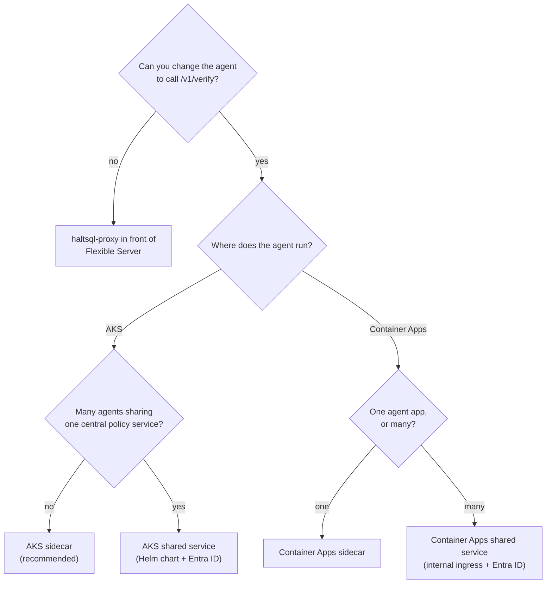
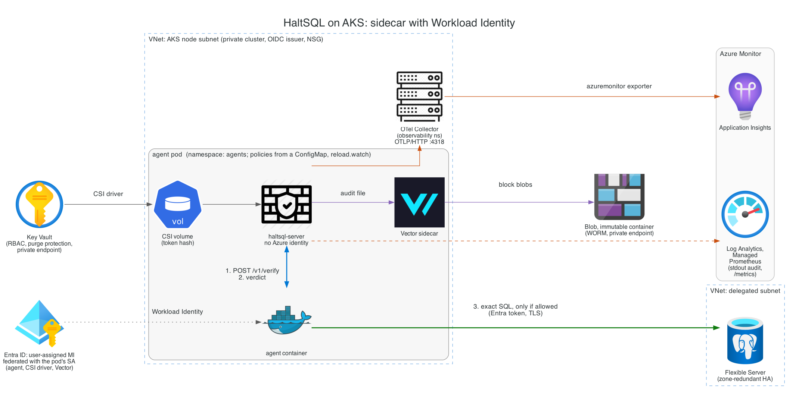
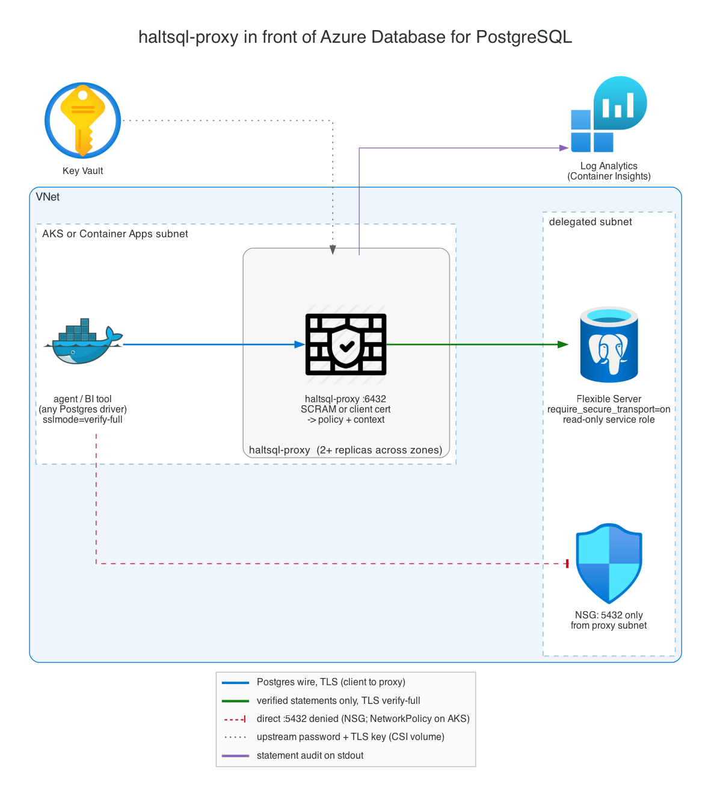
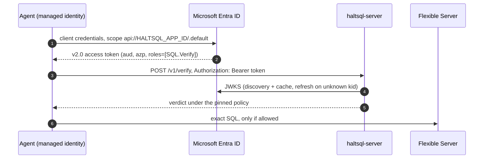
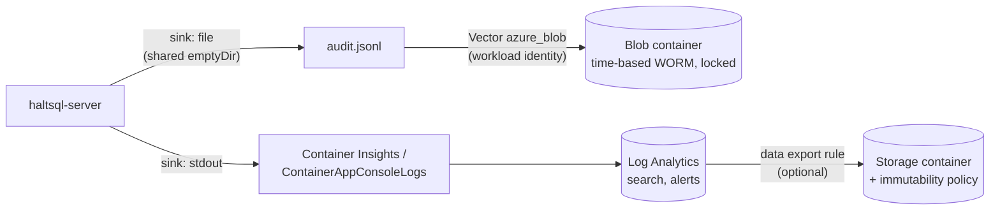

# Deploying HaltSQL on Microsoft Azure

This guide covers three ways to run HaltSQL on Azure:

1. **AKS sidecar** (recommended): `haltsql-server` runs in the agent's pod.
2. **Azure Container Apps**: as a sidecar container in the agent's app, or as
   a shared internal service.
3. **`haltsql-proxy` in front of Azure Database for PostgreSQL Flexible
   Server**, for agents you cannot change.

Ready-to-edit manifests are in
[`deploy/cloud/azure/`](../deploy/cloud/azure/). The general deployment
guidance in [deployment.md](deployment.md) and
[how-it-works/deployment-modes.md](how-it-works/deployment-modes.md) also
applies here.

> **Read this first: HaltSQL has no Azure-native integrations yet.**
> HaltSQL reads secrets from environment variables, files, HashiCorp Vault,
> AWS Secrets Manager and Google Secret Manager. Its object-store audit sinks
> are S3 and GCS. It cannot call Azure Key Vault, write to Azure Blob Storage,
> or use a managed identity. This guide gets the same results with standard
> Azure tooling: the Key Vault CSI driver or Container Apps secret references
> (exposed to HaltSQL as files), a log shipper for Blob, and an OpenTelemetry
> Collector for Azure Monitor. The full list of gaps is in
> [Current limitations on Azure](#current-limitations-on-azure).

What does work without changes on Azure:

- **Microsoft Entra ID as the OIDC issuer.** HaltSQL's JWT authentication is
  generic OIDC, so it accepts Entra ID access tokens, including tokens that
  agents get through AKS Workload Identity or a Container Apps managed
  identity.
- **Built-in TLS and mTLS**, signed policy bundles, Prometheus metrics and
  OTLP/HTTP export.

`haltsql-server` never connects to the database, and it needs no Azure
permissions of its own. In both server patterns, the only Azure identities
belong to the agent, the CSI driver or Container Apps platform (to read Key
Vault), and the log shipper (to write Blob). Keep the `haltsql` container out
of every identity binding.

> **Terraform.** To provision these patterns as code, use the modules in
> [`deploy/terraform`](../deploy/terraform/) ([terraform.md](terraform.md)):
> `haltsql-azure` runs `haltsql-server` on Container Apps, and `haltsql-kubernetes` installs
> the Helm chart on any cluster. This guide explains the architecture and the
> settings those modules expose; the manifests in
> [`deploy/cloud/azure/`](../deploy/cloud/azure/) are the equivalent by hand.

## Choosing a pattern



| Pattern | Latency | Isolation | Auth | Ops effort | Best for |
|---|---|---|---|---|---|
| AKS sidecar | loopback, sub-millisecond | per pod; policy ships with the agent | static token from Key Vault (or Entra ID) | low | most production agents |
| AKS shared service | one in-cluster hop | central; one policy rollout for all agents | Entra ID JWT, TLS | medium | platform teams serving many agents |
| Container Apps sidecar | loopback | per replica | static token from Key Vault | low | serverless agents |
| Container Apps shared service | ingress hop (Envoy) | central | Entra ID JWT, TLS at ingress | low | many small agent apps |
| `haltsql-proxy` | one Postgres hop | enforced: the agent cannot skip it | SCRAM or client certificates | medium | agents and BI tools you cannot change |

## Prerequisites

- Azure CLI 2.60 or later, with the `containerapp` extension for Container
  Apps (`az extension add -n containerapp --upgrade`), plus `kubectl` and
  Helm 3 for AKS.
- Permission to create resource groups, managed identities, role assignments
  (Owner or User Access Administrator on the resource group) and an Entra ID
  app registration (Application Developer or higher), if you use Entra ID
  authentication.
- A VNet with separate subnets: AKS nodes (or the Container Apps
  environment, delegated to `Microsoft.App/environments`), private endpoints,
  and Flexible Server (delegated to
  `Microsoft.DBforPostgreSQL/flexibleServers`).
- Policies that pass `haltsql validate` and `haltsql test` in CI (see
  [policy-ci.md](policy-ci.md)).
- The image `ghcr.io/haltsql/haltsql:<version>`. Import it into your
  Azure Container Registry so nodes do not pull from the internet, and pin it
  by digest:

  ```sh
  az acr import -n "$ACR" --source ghcr.io/haltsql/haltsql:0.1.0 --image haltsql:0.1.0
  ```

  To verify the signature first, see
  [deployment.md](deployment.md#verifying-release-artifacts).

The commands below use these shell variables:

```sh
RG=rg-haltsql
LOC=westeurope
AKS=aks-agents
KV=kv-haltsql-prod            # globally unique
ST=sthaltsqlaudit             # globally unique, 3-24 lowercase letters/digits
ACR=acragents                 # globally unique
TENANT_ID=$(az account show --query tenantId -o tsv)
```

## Pattern 1: AKS sidecar (recommended)



The agent calls `http://127.0.0.1:8080/v1/verify` inside its own pod. The
call never leaves the pod. The agent runs the exact SQL it verified against
Flexible Server, using its own Entra ID identity. HaltSQL never sees database
credentials.

| Container | Azure identity | Reads | Writes |
|---|---|---|---|
| `agent` | user-assigned managed identity (Workload Identity) | raw HaltSQL token (CSI volume) | SQL to Flexible Server |
| `haltsql` | **none** (excluded with `azure.workload.identity/skip-containers`) | token hash (CSI volume), ConfigMap | audit file, stdout, OTLP |
| `vector` | same managed identity, Blob write only | audit file (read-only mount) | Blob (immutable container) |

The CSI driver reads Key Vault with the pod's identity before any container
starts.

### 1. Cluster with Workload Identity, the Key Vault CSI driver and monitoring

```sh
az group create -n "$RG" -l "$LOC"

az aks create -g "$RG" -n "$AKS" \
  --zones 1 2 3 \
  --enable-oidc-issuer --enable-workload-identity \
  --enable-addons azure-keyvault-secrets-provider,monitoring \
  --enable-secret-rotation \
  --enable-azure-monitor-metrics \
  --network-plugin azure --network-plugin-mode overlay \
  --network-dataplane cilium --network-policy cilium \
  --enable-private-cluster \
  --vnet-subnet-id "$AKS_SUBNET_ID" \
  --attach-acr "$ACR" \
  --generate-ssh-keys

ISSUER=$(az aks show -g "$RG" -n "$AKS" --query oidcIssuerProfile.issuerUrl -o tsv)
```

`monitoring` turns on Container Insights (logs to Log Analytics), and
`--enable-azure-monitor-metrics` turns on Managed Prometheus. A network policy
engine is required for the NetworkPolicy in the manifest.

### 2. Managed identity, federated with the agent's ServiceAccount

```sh
az identity create -g "$RG" -n id-analytics-agent
MI_CLIENT_ID=$(az identity show -g "$RG" -n id-analytics-agent --query clientId -o tsv)
MI_PRINCIPAL_ID=$(az identity show -g "$RG" -n id-analytics-agent --query principalId -o tsv)

az identity federated-credential create -g "$RG" \
  --identity-name id-analytics-agent --name fc-analytics-agent \
  --issuer "$ISSUER" \
  --subject system:serviceaccount:agents:analytics-agent \
  --audience api://AzureADTokenExchange
```

### 3. Key Vault and the token secrets

Generate the agent's bearer token and its hash. Store both in Key Vault. The
agent container mounts only the token; the `haltsql` container mounts only
the hash.

```sh
az keyvault create -g "$RG" -n "$KV" -l "$LOC" \
  --enable-rbac-authorization true --enable-purge-protection true \
  --public-network-access Disabled
KV_ID=$(az keyvault show -n "$KV" --query id -o tsv)

# Run from a host with private access to the vault (or open access briefly).
TOKEN="$(openssl rand -hex 32)"
az keyvault secret set --vault-name "$KV" -n haltsql-agent-token --value "$TOKEN" -o none
az keyvault secret set --vault-name "$KV" -n haltsql-token-sha256 \
  --value "$(printf '%s' "$TOKEN" | sha256sum | cut -d' ' -f1)" -o none
unset TOKEN

# Least privilege: only these two secrets, read-only.
for s in haltsql-agent-token haltsql-token-sha256; do
  az role assignment create --assignee-object-id "$MI_PRINCIPAL_ID" \
    --assignee-principal-type ServicePrincipal \
    --role "Key Vault Secrets User" --scope "$KV_ID/secrets/$s"
done
```

Create a private endpoint for the vault (`az network private-endpoint create
... --group-id vault`) in the private endpoint subnet, with the
`privatelink.vaultcore.azure.net` private DNS zone linked to the VNet.

### 4. Immutable Blob container for audit records

```sh
az storage account create -g "$RG" -n "$ST" -l "$LOC" \
  --sku Standard_ZRS --kind StorageV2 --min-tls-version TLS1_2 \
  --allow-blob-public-access false --allow-shared-key-access false \
  --public-network-access Disabled
ST_ID=$(az storage account show -g "$RG" -n "$ST" --query id -o tsv)

az storage container-rm create -g "$RG" --storage-account "$ST" -n haltsql-audit

# Time-based retention (WORM): blobs cannot be modified or deleted for 365 days.
az storage container immutability-policy create -g "$RG" --account-name "$ST" \
  -c haltsql-audit --period 365
```

Test the pipeline end to end, then **lock** the policy. A locked policy cannot
be shortened or removed (this is what auditors ask for, for example for SEC
17a-4(f)):

```sh
ETAG=$(az storage container immutability-policy show -g "$RG" --account-name "$ST" \
  -c haltsql-audit --query etag -o tsv)
az storage container immutability-policy lock -g "$RG" --account-name "$ST" \
  -c haltsql-audit --if-match "$ETAG"
```

Give the shipper write access to that container only:

```sh
az role assignment create --assignee-object-id "$MI_PRINCIPAL_ID" \
  --assignee-principal-type ServicePrincipal \
  --role "Storage Blob Data Contributor" \
  --scope "$ST_ID/blobServices/default/containers/haltsql-audit"
```

`Storage Blob Data Contributor` includes delete, which the immutability
policy blocks anyway. For a strictly create-only identity, define a custom
role with only the data actions
`Microsoft.Storage/storageAccounts/blobServices/containers/blobs/write` and
`.../blobs/add/action`, and set `healthcheck.enabled: false` on the Vector
sink, because its health check needs read access.

Add a private endpoint with `--group-id blob` and the
`privatelink.blob.core.windows.net` zone.

### 5. Deploy

Edit the `REPLACE_*` values in
[`aks/secretproviderclass.yaml`](../deploy/cloud/azure/aks/secretproviderclass.yaml),
[`aks/agent-sidecar.yaml`](../deploy/cloud/azure/aks/agent-sidecar.yaml) and
[`aks/otel-collector.yaml`](../deploy/cloud/azure/aks/otel-collector.yaml),
then:

```sh
az aks get-credentials -g "$RG" -n "$AKS"
kubectl create namespace agents
kubectl create namespace observability
kubectl -n observability create secret generic appinsights \
  --from-literal=connection-string="$APPINSIGHTS_CONNECTION_STRING"

kubectl apply -f deploy/cloud/azure/aks/otel-collector.yaml
kubectl apply -f deploy/cloud/azure/aks/secretproviderclass.yaml
kubectl apply -f deploy/cloud/azure/aks/agent-sidecar.yaml
kubectl -n agents rollout status deploy/analytics-agent
```

The haltsql configuration in `agent-sidecar.yaml`, abridged:

```yaml
server:
  auth:
    tokens:
      - name: analytics-agent
        token_sha256: ${file:/mnt/secrets/haltsql/haltsql-token-sha256}   # CSI-mounted from Key Vault
        policy: analytics-agent
reload: { watch: true }
audit:
  sinks:
    - type: file                         # shipped to immutable Blob by Vector
      path: /var/log/haltsql/audit.jsonl
      on_error: fail_closed
    - type: stdout                       # Container Insights, for search and alerts
telemetry:
  otlp:
    endpoint: http://otel-collector.observability.svc.cluster.local:4318
```

Every key is a standard HaltSQL config key (see
[config-reference.md](config-reference.md)). There is nothing
Azure-specific in the config itself.

### AKS shared service (Helm)

For a central service, install the chart with
[`aks/values-aks.yaml`](../deploy/cloud/azure/aks/values-aks.yaml). It sets
up Entra ID authentication, built-in TLS 1.3, three replicas spread across
zones, a PodDisruptionBudget and an HPA.

```sh
kubectl create namespace haltsql
kubectl apply -f deploy/cloud/azure/aks/networkpolicy-shared.yaml
helm upgrade --install haltsql deploy/helm/haltsql -n haltsql \
  -f deploy/cloud/azure/aks/values-aks.yaml
```

The overlay has to work around three chart limitations:

- **The chart's NetworkPolicy denies all egress.** OIDC must fetch the JWKS
  from `login.microsoftonline.com`, so the overlay turns off the chart's
  NetworkPolicy, and `networkpolicy-shared.yaml` replaces it (DNS, HTTPS,
  OTLP).
- **The chart's ServiceMonitor uses the `monitoring.coreos.com` group, but
  Managed Prometheus only reads `azmonitoring.coreos.com`.** The overlay turns
  it off, and `networkpolicy-shared.yaml` adds a PodMonitor instead.
- **The chart has no `extraVolumes`.** You cannot mount a CSI volume into it.
  The TLS Secret `haltsql-tls` must come from cert-manager, or from Key Vault
  through External Secrets Operator
  ([`aks/externalsecret-tls.yaml`](../deploy/cloud/azure/aks/externalsecret-tls.yaml)).
  With Entra ID authentication, the service needs no other secrets.

## Pattern 2: Azure Container Apps

Container Apps runs all containers of an app in one replica, so they share
`localhost`. There are no ConfigMaps, so build a small image that adds your
config and policies on top of the HaltSQL image
([`containerapps/Dockerfile`](../deploy/cloud/azure/containerapps/Dockerfile)).
The image is immutable and versioned, and it is the unit you roll back.
Secrets stay out of the image: they are Key Vault references that the
platform reads with the app's managed identity and mounts as files.

### Environment

```sh
az containerapp env create -g "$RG" -n cae-agents -l "$LOC" \
  --infrastructure-subnet-resource-id "$CAE_SUBNET_ID" \
  --internal-only true \
  --enable-workload-profiles \
  --zone-redundant \
  --logs-destination log-analytics \
  --logs-workspace-id "$LAW_CUSTOMER_ID" --logs-workspace-key "$LAW_KEY"

az identity create -g "$RG" -n id-analytics-agent
# Grant it "Key Vault Secrets User" on the secrets (as in Pattern 1)
# and "AcrPull" on the registry.

az acr build -r "$ACR" -t haltsql-analytics:1.0.0 \
  --build-arg CONFIG=sidecar.yaml deploy/cloud/azure/containerapps
```

### Option A: sidecar ([`containerapps/app.yaml`](../deploy/cloud/azure/containerapps/app.yaml))


```sh
az containerapp create -g "$RG" -n analytics-agent \
  --yaml deploy/cloud/azure/containerapps/app.yaml
```

- `haltsql` serves the verify API on `127.0.0.1:8080` only. Platform probes
  use `--health-listen 0.0.0.0:8081`, which serves only `/healthz` and
  `/readyz`.
- Ingress targets the agent's port, never HaltSQL.
- The token hash is mounted at `/mnt/secrets/haltsql-token-sha256` from a Key
  Vault reference (`storageType: Secret` volume). The raw token reaches only
  the agent, as an environment variable.
- `otel-collector` is a third container. It receives OTLP/HTTP on
  `127.0.0.1:4318` and exports to Application Insights. You need it because
  the Container Apps managed OpenTelemetry agent accepts only gRPC, and
  HaltSQL exports OTLP over HTTP with JSON encoding.
- Size the containers together: 0.5 + 0.25 + 0.25 vCPU and 1 + 0.5 + 0.5 GiB
  adds up to an allowed Consumption combination (1 vCPU, 2 GiB).

### Option B: shared internal service ([`containerapps/shared-service.yaml`](../deploy/cloud/azure/containerapps/shared-service.yaml))


```sh
az acr build -r "$ACR" -t haltsql-shared:1.0.0 \
  --build-arg CONFIG=shared.yaml deploy/cloud/azure/containerapps
az containerapp create -g "$RG" -n haltsql \
  --yaml deploy/cloud/azure/containerapps/shared-service.yaml
```

Agents call `https://haltsql.internal.<environment default domain>/v1/verify`
with an Entra ID access token (see [Identity](#identity-and-least-privilege)).
Ingress terminates TLS. To encrypt traffic between replicas inside the
environment too, turn on peer-to-peer encryption:

```sh
az containerapp env update -g "$RG" -n cae-agents --enable-peer-to-peer-encryption
```

`minReplicas: 2` keeps the firewall from scaling to zero. Do not let it scale
to zero: the agent would block on a cold start, or fail open if it was written
carelessly. `activeRevisionsMode: Multiple` lets you canary a new policy image
with traffic weights.

## Pattern 3: `haltsql-proxy` in front of Flexible Server



Use the proxy when the agent (or a BI tool) speaks plain Postgres and cannot
call `/v1/verify`. The proxy authenticates clients (SCRAM or client
certificates), maps each one to a policy and context, verifies **every**
statement, and forwards only allowed statements to Flexible Server over
`verify-full` TLS. See [proxy.md](proxy.md).

[`aks/proxy.yaml`](../deploy/cloud/azure/aks/proxy.yaml) runs two replicas
spread across zones, with secrets from Key Vault via CSI. The database side:

```sh
az postgres flexible-server create -g "$RG" -n "$PG" -l "$LOC" \
  --tier GeneralPurpose --sku-name Standard_D2ds_v5 --version 16 \
  --high-availability ZoneRedundant --zone 1 --standby-zone 2 \
  --vnet "$VNET" --subnet snet-postgres --private-dns-zone "$PG_DNS_ZONE"
# Turn on Microsoft Entra authentication for human and agent access
# (check `az postgres flexible-server create --help` for the flag names in
# your CLI version). The proxy's own upstream role uses a password; see below.

az postgres flexible-server parameter set -g "$RG" -s "$PG" \
  -n require_secure_transport --value on
```

- Create a dedicated read-only role for the proxy (`haltsql_service`) with
  `SELECT` on the policy's tables only, and keep row-level security on (see
  [defense-in-depth.md](defense-in-depth.md)). Store its password in Key
  Vault as `pg-haltsql-service-password`.
- Download the CA certificates that Flexible Server currently chains to
  (DigiCert Global Root G2 and Microsoft RSA Root Certificate Authority 2017
  at the time of writing; check Microsoft's "TLS/SSL with Azure Database for
  PostgreSQL" page). Store them as the `azure-pg-ca` ConfigMap.
- On the NSG of the Flexible Server subnet, allow 5432 only from the subnet
  the proxy runs in. On AKS, also give agent pods a NetworkPolicy that blocks
  egress to 5432. Otherwise an agent can bypass the proxy.

## Identity and least privilege

| Principal | Role | Scope |
|---|---|---|
| Agent's managed identity | `Key Vault Secrets User` | the agent's token secret only |
| Agent's managed identity | app role `SQL.Verify` on the `haltsql` app (shared-service patterns) | the app registration |
| Agent's managed identity | Entra database role on Flexible Server | the agent's database and schema |
| Shipper identity (may be the same MI) | `Storage Blob Data Contributor`, or a custom create-only role | the `haltsql-audit` container |
| Container Apps app identity | `Key Vault Secrets User`, `AcrPull` | its secrets; the registry |
| Proxy's identity (CSI only) | `Key Vault Secrets User` | proxy secrets |
| `haltsql-server` | **nothing** | - |

### Entra ID as the OIDC issuer

The shared-service patterns authenticate agents with Entra ID access tokens.
Each agent's managed identity gets a token for the `haltsql` app
registration. HaltSQL checks the issuer, audience, signature, expiry,
`azp` and `roles` claims, then pins the caller's policy.



Create the app registration once:

```sh
APP_ID=$(az ad app create --display-name haltsql --query appId -o tsv)
az ad app update --id "$APP_ID" --identifier-uris "api://$APP_ID"
# v2.0 tokens: iss = https://login.microsoftonline.com/<tenant>/v2.0, aud = APP_ID
az ad app update --id "$APP_ID" --set api.requestedAccessTokenVersion=2
cat > roles.json <<EOF
[{"allowedMemberTypes": ["Application"], "description": "Call HaltSQL /v1/verify",
  "displayName": "SQL.Verify", "isEnabled": true, "value": "SQL.Verify",
  "id": "$(uuidgen)"}]
EOF
az ad app update --id "$APP_ID" --app-roles @roles.json
az ad sp create --id "$APP_ID"
# Only identities with an assigned app role can get a token for this app.
az ad sp update --id "$APP_ID" --set appRoleAssignmentRequired=true

# Assign the role to an agent's managed identity.
HALTSQL_SP=$(az ad sp show --id "$APP_ID" --query id -o tsv)
ROLE_ID=$(az ad app show --id "$APP_ID" --query "appRoles[?value=='SQL.Verify'].id | [0]" -o tsv)
az rest --method POST \
  --uri "https://graph.microsoft.com/v1.0/servicePrincipals/$MI_PRINCIPAL_ID/appRoleAssignments" \
  --body "{\"principalId\":\"$MI_PRINCIPAL_ID\",\"resourceId\":\"$HALTSQL_SP\",\"appRoleId\":\"$ROLE_ID\"}"
```

The matching HaltSQL config (also in `values-aks.yaml` and
`containerapps/haltsql/shared.yaml`):

```yaml
server:
  auth:
    oidc:
      - name: entra-analytics-agent
        issuer: https://login.microsoftonline.com/<TENANT_ID>/v2.0
        audiences: [<HALTSQL_APP_CLIENT_ID>]
        algorithms: [RS256]
        policy: analytics-agent              # pinned
        required_claims:
          azp: <AGENT_MI_CLIENT_ID>          # which identity
          roles: SQL.Verify                  # element of the roles array
        request_context_fields: [tenant_id]
```

Notes that are easy to get wrong:

- **Token version.** Without `requestedAccessTokenVersion = 2`, Entra ID
  issues v1.0 tokens whose `iss` is `https://sts.windows.net/<tenant>/`, and
  HaltSQL rejects them because `iss` must equal `issuer` exactly. (You could
  instead configure the v1 issuer, with `jwks_uri` set to
  `https://login.microsoftonline.com/<tenant>/discovery/keys` and the App ID
  URI as the audience. Do not mix the two.)
- **Selecting a policy.** `policy_claim` needs a string claim, and Entra's
  `roles` claim is an array. Add one provider entry per agent identity
  instead: the same issuer, a different `required_claims.azp`, and a pinned
  `policy`. HaltSQL tries every provider whose issuer matches, in order, and
  uses the first that verifies.
- **Tenant context.** App-only tokens carry no end-user tenant. Either list
  `tenant_id` in `request_context_fields` (the agent sends it, as above), or
  use a separate identity per tenant with a static context. mTLS identities
  can carry a static context.
- **Egress.** JWKS is fetched from `login.microsoftonline.com:443`. Allow it
  in Azure Firewall, a Cilium FQDN policy or the NSG. If the keys cannot be
  refreshed for longer than `min(jwks_cache_seconds, 3600)` past expiry,
  requests get `503 AUTH_UNAVAILABLE`.

In the agent (Python, `azure-identity`):

```python
from azure.identity import DefaultAzureCredential   # Workload Identity or managed identity
token = DefaultAzureCredential().get_token(f"api://{HALTSQL_APP_ID}/.default").token
requests.post(f"{HALTSQL_URL}/v1/verify", json=body,
              headers={"Authorization": f"Bearer {token}"}, timeout=2)
```

## Networking

- **No public endpoints.** Use a private AKS cluster, an internal Container
  Apps environment, Flexible Server with VNet integration (or a private
  endpoint), and private endpoints for Key Vault, Blob and ACR, each with its
  `privatelink.*` DNS zone linked to the VNet. Disable public network access
  on the vault and the storage account.
- **NSGs.** On the Flexible Server subnet, allow inbound 5432 only from the
  agent subnet (or only from the proxy subnet in Pattern 3). On the private
  endpoint subnet, allow 443 only from the workload subnets. On the AKS or
  Container Apps subnet, send egress through Azure Firewall (a UDR to the
  firewall) with FQDN rules: `login.microsoftonline.com` (Entra ID OIDC and
  token exchange), your Application Insights ingestion endpoint, and
  `mcr.microsoft.com` plus your ACR for images.
- **Inside the cluster.** The sidecar manifest lets only `kube-system`
  (Managed Prometheus) reach port 8080 from outside the pod. The
  shared-service policy admits only the `agents` namespace.
- **HaltSQL's own traffic.** The sidecar with static tokens makes no outbound
  calls except OTLP to the collector. Entra ID authentication adds HTTPS to
  `login.microsoftonline.com`. The proxy needs only Flexible Server.

## TLS

| Hop | How |
|---|---|
| agent to sidecar | loopback inside the pod or replica; no TLS needed |
| agent to AKS shared service | built-in TLS (`tls.enabled`, `minVersion: "1.3"`); certificate from cert-manager or Key Vault (ESO); hot-reloaded on rotation |
| agent to Container Apps shared service | Container Apps ingress (managed certificate for the internal domain); turn on peer-to-peer encryption for traffic inside the environment |
| agent to `haltsql-proxy` | proxy `tls` with `required: true`; clients use `sslmode=verify-full` |
| proxy or agent to Flexible Server | `require_secure_transport=on`; `verify-full` against the Azure CA bundle |

TLS files referenced by path (`server.tls.cert`, `key`, `client_ca`) are
watched and reloaded. Secrets read through `${file:...}` placeholders are
read only at startup and on reload. See
[Current limitations](#current-limitations-on-azure).

## Audit retention

HaltSQL audit records are hash-chained JSON lines (see
[audit-sinks.md](audit-sinks.md)). There is no native Blob sink, so use one
of these routes:



| Route | Byte-exact chain | Retention | Use for |
|---|---|---|---|
| **file sink + Vector to Blob** (AKS) | yes: Vector's `text` codec writes each line unchanged; concatenating a pod's blobs in name order reproduces the file | locked time-based immutability on the container | the compliance record |
| **stdout to Log Analytics** (AKS and Container Apps) | **no**: Container Insights parses JSON lines into columns, so the original bytes (and the hash input) are not guaranteed to survive | workspace and table retention, up to 12 years with long-term retention | search, dashboards, alerts |
| **Log Analytics data export to Storage** | no (as above) | immutability policy on the export container | low-effort archive when a verifiable chain is not required |

Operational notes for the file and Vector route:

- Each haltsql process has its own chain, and each pod writes under
  `haltsql/audit/<namespace>/<pod>/` in Blob. When a pod restarts in place,
  the chain continues: `file` resumes from the last line, and the emptyDir
  outlives container restarts. A new pod starts a new chain at genesis.
- HaltSQL does not rotate the audit file. Size the emptyDir for the pod's
  lifetime (the manifest uses 2 GiB; a record is about 400 bytes) and alert
  on `haltsql_audit_errors_total`. With `on_error: fail_closed`, a full disk
  turns into `503`s rather than unaudited verifies.
- Verify a day's chain by downloading one pod's blobs
  (`az storage blob download-batch --auth-mode login ...`), concatenating them
  in name order, and running the script in
  [audit-sinks.md](audit-sinks.md#verifying-a-chain).
- On Container Apps, only the stdout route is available. A shipper container
  can share an `EmptyDir` volume, but replicas are replaced freely, so files
  are lost more often than on AKS.

## Observability

| Signal | AKS | Container Apps |
|---|---|---|
| Metrics | Managed Prometheus scrapes `/metrics` through a PodMonitor (`azmonitoring.coreos.com/v1`); Managed Grafana for dashboards. OTLP metrics also go to App Insights through the collector. | OTLP metrics through the collector sidecar to App Insights. There is no Prometheus scraping. |
| Traces | OTLP/HTTP to the in-cluster OpenTelemetry Collector, then the `azuremonitor` exporter, then Application Insights | the same, with the collector as a sidecar on `localhost:4318` |
| Logs | stderr JSON logs to Container Insights (`ContainerLogV2`) | `ContainerAppConsoleLogs` |
| Audit | see [Audit retention](#audit-retention) | stdout to Log Analytics |

Spans never contain SQL text. Join a span to its audit record on
`db.statement.sha256 = sql_sha256`. Recommended alerts (Managed Prometheus
alert rules, or Log Analytics alerts on the OTLP metrics):

| Condition | Action |
|---|---|
| `rate(haltsql_audit_errors_total[5m]) > 0` | Page: the audit sink is failing, and with `fail_closed` requests get 503. |
| `rate(haltsql_policy_reload_total{result="error"}[5m]) > 0` | Warn: a bad policy was rejected, and the last good one is still active. |
| `haltsql_policies_loaded == 0` | Page: the pod is not ready. |
| `histogram_quantile(0.99, rate(haltsql_verify_duration_seconds_bucket[5m])) > 0.05` | Investigate latency. |
| `rate(haltsql_otlp_spans_dropped_total[5m]) > 0` | The collector is unreachable. Verification is unaffected. |
| Vector `component_errors_total{component_id="audit_blob"}` | Blob shipping is failing. |

## Scaling and high availability

- **Zones.** Use AKS node pools across zones 1, 2 and 3 with
  `topologySpreadConstraints` on `topology.kubernetes.io/zone` (in both
  manifests), a zone-redundant Container Apps environment, ZRS storage, and
  zone-redundant HA on Flexible Server.
- **Sidecar.** It scales with the agent automatically. HaltSQL is stateless
  and CPU-bound. 50m CPU and 32 MiB of memory are enough for most agents.
- **Shared service.** At least 3 replicas on AKS (2 on Container Apps), with
  a PDB `minAvailable: 2`, an HPA on CPU (or the Container Apps HTTP
  concurrency rule), and `maxUnavailable: 0` rolling updates (the chart's
  default).
- **Policy rollout.** On AKS, ConfigMap updates are hot-reloaded
  (`reload.watch`). The swap is atomic, and a bad policy is rejected. On
  Container Apps, ship a new image revision and shift traffic with weights.
  Signed policy bundles ([policy-bundles.md](policy-bundles.md)) work the same
  on both.
- **Failure mode.** If HaltSQL is unavailable, agents must fail closed: run
  no SQL. The SDKs do this by default.

## Cost notes

Prices change and vary by region, so these are relative.

- **HaltSQL itself** costs little: about 50m CPU and 32 MiB per sidecar, or
  0.25 vCPU and 0.5 GiB per Container Apps replica. A shared service of three
  small replicas is usually the cheapest option for dozens of agents. On
  Container Apps, keeping `minReplicas: 2` means you pay for idle time.
- **Log Analytics ingestion is usually the largest line item.** An audit
  record is about 400 bytes, so 10 million verifies a day is about 4 GB a day
  of audit data, before application logs. Consider the Basic table plan for
  `ContainerLogV2`, and keep the full-fidelity copy in Blob.
- **Blob** with the Cool access tier is inexpensive for append-once audit
  data. Immutability policies cost nothing extra, but locked data cannot be
  deleted early, so set the retention period deliberately.
- **Private endpoints** are billed per hour and per GB. Azure Firewall has a
  significant fixed hourly cost. Share both through a hub VNet.
- **Application Insights** bills by ingestion. Sample traces in the collector
  (`probabilistic_sampler`) for high-volume agents. HaltSQL honors the
  caller's sampled flag.
- **Managed Prometheus** bills by samples ingested. One scrape every 30
  seconds per pod is negligible.

## Production checklist

- [ ] Image imported into ACR, pinned by digest, signature verified.
- [ ] Policies validated and tested in CI; `mode: enforce` (or a planned
      `shadow` period first).
- [ ] `allow_unauthenticated: false`; every identity pinned to one policy.
- [ ] Sidecar: the token in Key Vault, the agent mounts the token, `haltsql`
      mounts only the hash; Workload Identity skipped for the `haltsql`
      container.
- [ ] Shared service: Entra app with `requestedAccessTokenVersion = 2`,
      `appRoleAssignmentRequired = true`, one provider per agent (`azp` +
      `roles`); TLS 1.3 on; egress to `login.microsoftonline.com` allowed.
- [ ] Key Vault: RBAC mode, purge protection, private endpoint, per-secret
      role assignments.
- [ ] Storage: private endpoint, shared key access disabled, immutability
      policy **locked** after testing, shipper scoped to one container.
- [ ] `audit.log_raw_sql: false` unless approved; `on_error: fail_closed`.
- [ ] Flexible Server: private access only, `require_secure_transport=on`,
      zone-redundant HA, agent roles with least privilege, RLS on.
- [ ] Agents cannot reach 5432 directly when the proxy is the enforcement
      point.
- [ ] NetworkPolicies (AKS) and NSGs in place; network policy engine
      enabled.
- [ ] Alerts on audit errors, reload errors and readiness; Blob shipping
      errors alerted.
- [ ] Tested: a denied query never runs; HaltSQL down means the agent runs
      nothing; secret rotation procedure rehearsed (see below).
- [ ] A chain verified end to end from Blob with the
      [verification script](audit-sinks.md#verifying-a-chain).

## Current limitations on Azure

These are gaps in HaltSQL itself, not configuration choices. Each has a
workaround above.

| Gap | Status | Workaround |
|---|---|---|
| **Azure Key Vault secret provider** (a `${azure-kv:...}` placeholder) | Not supported natively yet. Supported schemes are `env`, `file`, `vault`, `aws-sm` and `gcp-sm`. | Key Vault CSI driver (AKS) or Container Apps Key Vault references, read via `${file:...}`. Or HashiCorp Vault with Azure auth. |
| **Azure Blob Storage audit sink** | Not supported natively yet. Object sinks are `s3` and `gcs` only. Azure Blob has no S3-compatible API, so the `s3` sink's `endpoint` cannot target it. | `file` sink plus a Vector `azure_blob` shipper (Vector 0.55.0 or later for Workload Identity), or stdout plus Log Analytics export. |
| **Managed identity / Workload Identity credentials** | Not supported natively yet. HaltSQL has credential chains only for AWS (env, IRSA, IMDSv2) and GCP (metadata, key file). | HaltSQL needs no Azure credential in the patterns above. Identity belongs to the CSI driver, the platform and the shipper. |
| **Azure Monitor exporter** | Not supported natively yet. Telemetry is Prometheus plus OTLP over HTTP with JSON encoding only. | OpenTelemetry Collector (`otlp` receiver, `azuremonitor` exporter) in the cluster or as a sidecar. |
| **Container Apps managed OpenTelemetry agent** | Incompatible: it accepts gRPC only, and HaltSQL exports OTLP/HTTP. | Collector sidecar on `localhost:4318`. |
| **Secret rotation for `${file:...}` values** | Files referenced by placeholders are read at startup and on reload (`SIGHUP`, or a change to a watched config, policy or TLS file), not watched. The distroless image has no shell to send `SIGHUP` from a sidecar. | Add the new token hash as a second token entry, roll the pods (`kubectl rollout restart`, or a new Container Apps revision), then remove the old entry. TLS files referenced by path *are* watched. |
| **Audit file rotation** | The `file` sink appends forever. | Size the volume for the pod's lifetime; rely on pod replacement; alert on audit errors. |
| **Entra `roles` as the policy selector** | `policy_claim` requires a string claim, and `roles` is an array. | One OIDC provider entry per identity, keyed by `azp`, with a pinned `policy`. |
| **Helm chart on AKS** | No `extraVolumes`, `extraEnv` or `extraContainers` (so no CSI volume and no shipper sidecar); no `telemetry.otlp` value; the NetworkPolicy blocks the egress that OIDC needs; the ServiceMonitor uses `monitoring.coreos.com`, not `azmonitoring.coreos.com`. | Use the raw sidecar manifest; for the chart, use `values-aks.yaml` plus `networkpolicy-shared.yaml` (Managed Prometheus scraping instead of OTLP), and ESO or cert-manager for TLS. |
| **`haltsql-proxy` upstream Entra ID auth** | Not supported. The upstream password is read once at startup, and Entra tokens expire after about an hour. | A password-authenticated, read-only service role, with the password in Key Vault via CSI. |
| **`haltsql-proxy` operations** | No metrics endpoint and no HTTP health endpoint. Audit goes only to `stdout` or `file`. | TCP probes; the audit stream in Log Analytics. |
| **Byte-exact chain via Log Analytics** | Container Insights parses JSON log lines, so the exact bytes are not guaranteed to be preserved. | Use the file and Blob route for the verifiable record. |

## Console

To run `haltsql-console` (the control plane) next to these deployments: on
AKS with the `haltsql-console` chart, Workload Identity, the Key Vault CSI
driver for its secrets (Key Vault is not a console secrets provider yet), an
Azure Files share for the verifiers' audit files, Entra ID sign-in through an
oauth2-proxy sidecar behind Application Gateway, and an Azure Disk for its
state; or on Azure Container Apps as a single replica with Azure Files. See
[console/deploy.md](console/deploy.md#azure) and
[`deploy/cloud/azure/console/`](../deploy/cloud/azure/console/). Each
verifier needs `server.admin` enabled with the console's token in
`server.admin.callers`.

## Regenerating the diagrams

The architecture images on this page are drawn as code with
[mingrammer/diagrams](https://github.com/mingrammer/diagrams), one script per
diagram: [`deploy/diagrams/azure_*.py`](../deploy/diagrams/). Every other
diagram on this page is Mermaid, inline in the Markdown. You need Graphviz
(`dot`). From the repository root:

```sh
make diagrams                                     # every cloud, in a managed virtualenv
deploy/diagrams/.venv/bin/python deploy/diagrams/azure_<name>.py   # one diagram
```

Each script writes the matching `docs/assets/cloud/azure-<name>.png`. Commit
the PNG together with the script change. See
[`deploy/diagrams/README.md`](../deploy/diagrams/README.md) for the shared style.
