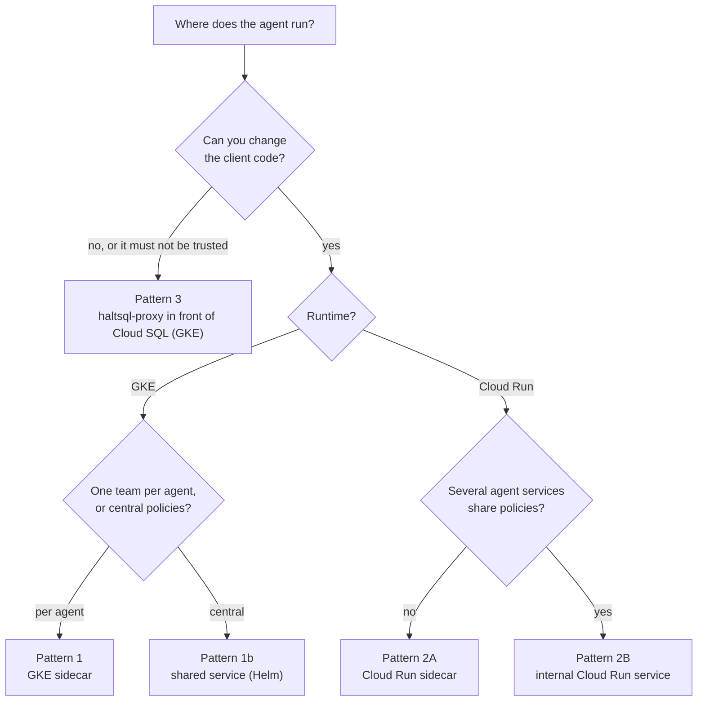
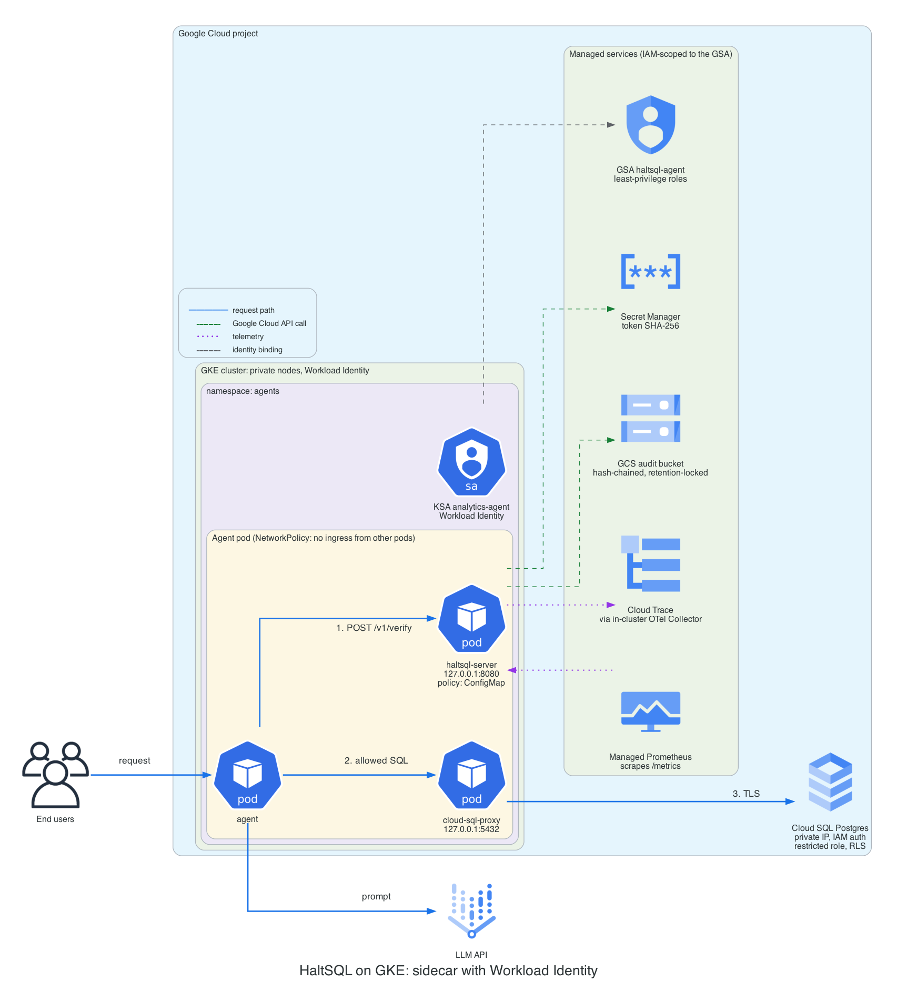
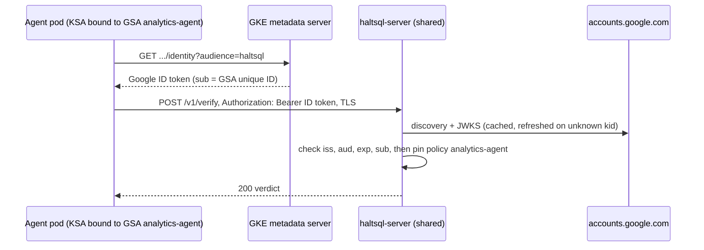
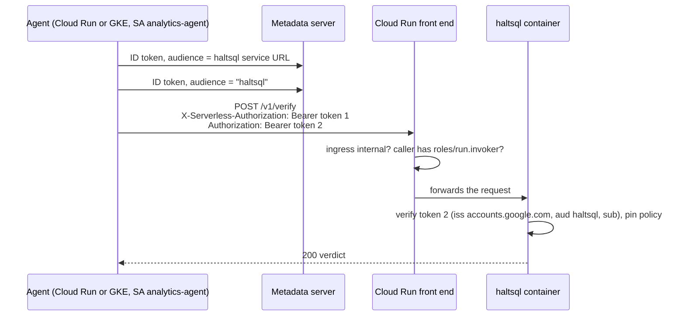
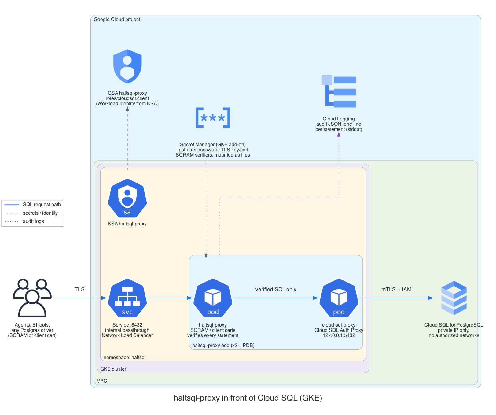

# Deploying on Google Cloud

This guide shows how to run HaltSQL on Google Cloud with keyless
authentication (Workload Identity and the metadata server), secrets in Secret
Manager, a write-once audit trail in Cloud Storage, and traces and metrics in
Cloud Trace and Cloud Monitoring. The manifests it refers to are in
[`deploy/cloud/gcp/`](../deploy/cloud/gcp/).

Read [deployment.md](deployment.md) first for the general model. In short:
`haltsql-server` only answers "is this SQL allowed?" and never connects to the
database; the agent runs the exact SQL it verified. `haltsql-proxy` sits in
front of PostgreSQL and enforces the answer itself.

| Pattern | Runs on | Use it when |
|---|---|---|
| [GKE sidecar](#pattern-1-gke-sidecar) | GKE (Standard or Autopilot) | Your agents run on GKE. One `haltsql-server` per agent pod, on `127.0.0.1`. The default recommendation. |
| [GKE shared service](#pattern-1b-shared-service-on-gke) | GKE, Helm chart | Many agents, central policy management, Google ID tokens instead of shared secrets. |
| [Cloud Run](#pattern-2-cloud-run) | Cloud Run | Your agents run on Cloud Run: either a sidecar container in the agent's service, or one internal haltsql service shared by several agents. |
| [Proxy in front of Cloud SQL](#pattern-3-haltsql-proxy-in-front-of-cloud-sql) | GKE | You cannot change the client (BI tools, vendor agents), or you do not trust the application to honor verdicts. |



Whatever you pick, keep the database-side controls of
[defense-in-depth.md](defense-in-depth.md): a least-privilege database role
and row-level security on Cloud SQL.

## How HaltSQL gets Google credentials

HaltSQL calls two Google APIs: Secret Manager (to resolve `${gcp-sm:...}`
placeholders when the config loads) and Cloud Storage (the `gcs` audit sink).
Both use an OAuth2 access token with the `cloud-platform` scope, cached and
refreshed 60 seconds before it expires. The token comes from:

| Caller | Source, in order |
|---|---|
| `${gcp-sm:...}` resolver | `GOOGLE_APPLICATION_CREDENTIALS` if set (a **service-account key** JSON file), otherwise the metadata server. |
| `gcs` audit sink | `credentials.source` in the sink config: `metadata` (default) or `service_account_file` with `file`. It does not read `GOOGLE_APPLICATION_CREDENTIALS`. |

The metadata server is `http://metadata.google.internal` (override with
`GCE_METADATA_HOST`). HaltSQL sends `Metadata-Flavor: Google` and rejects a
response that does not carry the same header. On GKE with Workload Identity
the GKE metadata server answers with the token of the Google service account
(GSA) bound to the pod's Kubernetes service account (KSA). On Cloud Run it
answers with the token of the revision's service account.

**Use the metadata server everywhere on Google Cloud. Do not create
service-account keys.** The key-file option exists for running outside Google
Cloud; HaltSQL does not support Workload Identity Federation credential
configuration files (`"type": "external_account"`), so outside Google Cloud a
key is currently the only way (see [Limitations](#limitations-on-google-cloud)).

`haltsql-proxy` makes no Google API calls. Its secrets reach it as files
(`${file:...}`).

## Prerequisites

- A project with billing, and `gcloud` authenticated as someone who can
  create service accounts, secrets and buckets and grant IAM roles on them.
- For GKE: a cluster with Workload Identity Federation for GKE enabled
  (Autopilot enables it by default; on Standard,
  `gcloud container clusters update CLUSTER --workload-pool=PROJECT_ID.svc.id.goog`
  and node pools with `--workload-metadata=GKE_METADATA`). Native sidecars
  (used by the manifests) need GKE 1.29 or later.
- A Cloud SQL for PostgreSQL instance with **private IP only** in the same
  VPC (Private Services Access), and IAM database authentication enabled
  (`cloudsql.iam_authentication=on`) if the agent logs in as its service
  account.
- The tools: `gcloud`, `kubectl`, `helm` (shared service), `openssl`.

Enable the APIs and create the audit bucket once per project:

```sh
export PROJECT_ID=my-project REGION=europe-west1
deploy/cloud/gcp/iam/setup.sh apis
deploy/cloud/gcp/iam/setup.sh audit-bucket   # bucket with an (unlocked) retention policy
```

`setup.sh` has one subcommand per pattern. Each creates the service account,
secrets and IAM bindings that pattern needs and nothing else. Read a
subcommand before running it in production.

## Pattern 1: GKE sidecar



The agent pod has three containers:

- **agent**: your code. It calls `http://127.0.0.1:8080/v1/verify` and runs
  only allowed SQL.
- **haltsql** (native sidecar, starts first): `haltsql-server` with the
  policy from a ConfigMap. The token hash comes from Secret Manager; audit
  batches go to GCS; spans go to an OpenTelemetry Collector; Managed Service
  for Prometheus scrapes `/metrics`.
- **cloud-sql-proxy** (native sidecar): the Cloud SQL Auth Proxy on
  `127.0.0.1:5432`, connecting to the instance's private IP with IAM database
  authentication. `haltsql-server` never uses it.

The KSA `analytics-agent` is annotated with
`iam.gke.io/gcp-service-account: haltsql-agent@PROJECT_ID.iam.gserviceaccount.com`,
and that GSA holds exactly the roles in the [IAM reference](#iam-reference).

### Steps

1. Create the GSA, secrets and bindings. This generates a random token, stores
   it in secret `haltsql-analytics-agent-token` (for the agent) and its
   SHA-256 in `haltsql-analytics-agent-token-sha256` (for haltsql). The token
   is never printed.

   ```sh
   deploy/cloud/gcp/iam/setup.sh gke-sidecar
   deploy/cloud/gcp/iam/setup.sh collector
   ```

   The Workload Identity binding it creates is:

   ```sh
   gcloud iam service-accounts add-iam-policy-binding \
     haltsql-agent@$PROJECT_ID.iam.gserviceaccount.com \
     --role roles/iam.workloadIdentityUser \
     --member "serviceAccount:$PROJECT_ID.svc.id.goog[agents/analytics-agent]"
   ```

2. Fill in the manifests and apply them:

   ```sh
   grep -n REPLACE_ME deploy/cloud/gcp/gke/sidecar.yaml deploy/cloud/gcp/gke/otel-collector.yaml
   kubectl apply -f deploy/cloud/gcp/gke/otel-collector.yaml
   kubectl apply -f deploy/cloud/gcp/gke/sidecar.yaml
   ```

3. Check that haltsql loaded its policy and can write audit objects:

   ```sh
   kubectl -n agents logs deploy/analytics-agent -c haltsql | head
   kubectl -n agents port-forward deploy/analytics-agent 8080:8080 &
   curl -s localhost:8080/readyz
   curl -s localhost:8080/metrics | grep haltsql_audit_sink_healthy
   ```

The haltsql part of the config (in the ConfigMap):

```yaml
server:
  auth:
    tokens:
      - name: analytics-agent
        token_sha256: ${gcp-sm:haltsql-analytics-agent-token-sha256}
        policy: analytics-agent
audit:
  sinks:
    - type: gcs
      bucket: ${env:HALTSQL_AUDIT_BUCKET}
      prefix: haltsql/audit/analytics-agent/
      credentials: { source: metadata }
      spool_dir: /var/spool/haltsql
      on_error: fail_closed
telemetry:
  metrics: { prometheus: true }
  otlp:
    endpoint: http://otel-collector.observability.svc.cluster.local:4318
    service_name: haltsql-analytics-agent
    metrics: false
secrets:
  gcp:
    project: ${env:GCP_PROJECT}
```

The pod identity is shared by all three containers, so the agent can also
create objects in the audit bucket. It cannot read, overwrite or delete any
(the role is `roles/storage.objectCreator` and objects are create-only), and
objects that do not continue the chain stand out when you verify it. If
that is not acceptable, use the [shared service](#pattern-1b-shared-service-on-gke),
which has its own identity.

## Pattern 1b: shared service on GKE

The Helm chart in [`deploy/helm/haltsql`](../deploy/helm/haltsql/) runs a
`haltsql-server` Deployment behind a Service. On GKE the cleanest
authentication is **Google-signed ID tokens**: each agent asks its own
metadata server for an ID token with audience `haltsql`, and haltsql verifies
it as an OIDC token from `https://accounts.google.com`. No secret is shared or
rotated.



`values-gke.yaml` sets, among other things:

```yaml
serviceAccount:
  name: haltsql
  annotations:
    iam.gke.io/gcp-service-account: haltsql-server@PROJECT_ID.iam.gserviceaccount.com
  automountServiceAccountToken: false
oidc:
  - name: google-analytics-agent
    issuer: https://accounts.google.com
    audiences: [haltsql]
    algorithms: [RS256]
    policy: analytics-agent
    required_claims:
      sub: "112233445566778899000"    # unique ID of the agent's GSA
    request_context_fields: [tenant_id]
```

- Add one `oidc` entry per calling GSA. Entries with the same issuer are tried
  in order, and the first that accepts the token decides the policy. Pin on
  `sub`, the GSA's numeric unique ID
  (`gcloud iam service-accounts describe EMAIL --format='value(uniqueId)'`).
  `email` is only in the token when the caller requests `format=full`.
- Agents on GKE should use the GSA annotation on their KSA: ID tokens from
  the metadata server are issued for the impersonated GSA. Check that your
  setup issues them before relying on direct principal bindings without a GSA.
- Google ID tokens carry no tenant, so `request_context_fields: [tenant_id]`
  lets the calling service supply it from its own session, exactly as with a
  static token. If the tenant must come from the identity, use one GSA per
  tenant, or mTLS identities with a static `context`.

In the agent, fetch and cache the token (it is valid for one hour):

```python
import google.auth.transport.requests
import google.oauth2.id_token

token = google.oauth2.id_token.fetch_id_token(
    google.auth.transport.requests.Request(), "haltsql")
```

Steps:

```sh
deploy/cloud/gcp/iam/setup.sh gke-shared
kubectl create namespace haltsql
# TLS: a kubernetes.io/tls Secret named haltsql-tls (cert-manager, Google CAS, ...)
helm upgrade --install haltsql deploy/helm/haltsql -n haltsql \
  -f deploy/cloud/gcp/gke/values-gke.yaml \
  --set-file 'policies.analytics-agent\.yaml=policies/analytics-agent.yaml'
kubectl apply -n haltsql -f deploy/cloud/gcp/gke/shared-extras.yaml
```

The chart's NetworkPolicy denies all egress by default. `values-gke.yaml`
opens DNS, TCP 443 (GCS and Google's JWKS), the GKE metadata server and the
collector. Keep `server.port: 8080`: the image sets
`HALTSQL_LISTEN=0.0.0.0:8080`, which outranks the listen address the chart
writes into the config, so change the Service port instead.

## Pattern 2: Cloud Run

Cloud Run can pull images only from Artifact Registry, Container Registry and
Docker Hub. Mirror the image through an Artifact Registry remote repository
first:

```sh
deploy/cloud/gcp/iam/setup.sh image
# image: $REGION-docker.pkg.dev/$PROJECT_ID/ghcr/ardada2468/haltsql:0.1.0
```

Settings that matter on Cloud Run, for both variants:

- **`run.googleapis.com/cpu-throttling: "false"`** (instance-based billing).
  The GCS sink closes batches and retries uploads in the background, and the
  OTLP exporter sends spans in the background. With request-based billing,
  CPU is throttled between requests and both stall until the next request.
- **Spool directory.** Cloud Run has no persistent disk; the manifests use an
  in-memory `emptyDir`. It protects records across a container restart within
  an instance, but each new instance starts a new chain. Verify each run's
  objects on its own (see [Audit](#audit-retention-and-verification)). On
  `SIGTERM`, haltsql flushes the open batch before exiting, within Cloud Run's
  10-second shutdown window.
- **Configuration** is mounted from Secret Manager (`config.yaml`, policies)
  or a read-only Cloud Storage volume (signed bundles). Set
  `reload.watch: false` and roll out changes as new revisions: each revision
  then pins one config version, which is what you want for audits.

### 2A: sidecar in the agent's service


[`cloudrun/service-sidecar.yaml`](../deploy/cloud/gcp/cloudrun/service-sidecar.yaml)
has three containers: `agent` (the ingress container, port 8080), `haltsql`
(listening on `0.0.0.0:8081`; only the ingress container's port is reachable
from outside the instance) and `otel-collector`.
`run.googleapis.com/container-dependencies` starts haltsql, and waits for its
startup probe on `/readyz`, before the agent.

```sh
export POLICY_FILE=policies/analytics-agent.yaml
deploy/cloud/gcp/iam/setup.sh cloud-run-sidecar     # SA, token, config/policy secrets, IAM
gcloud run services replace deploy/cloud/gcp/cloudrun/service-sidecar.yaml --region $REGION
```

The agent receives its raw token from Secret Manager as `HALTSQL_TOKEN`
(`secretKeyRef`), and haltsql receives the hash as `HALTSQL_TOKEN_SHA256`,
used by `token_sha256: ${env:HALTSQL_TOKEN_SHA256}`. Both are resolved by
Cloud Run when the instance starts.

The collector config
([`otel-collector-config.yaml`](../deploy/cloud/gcp/cloudrun/otel-collector-config.yaml))
receives spans on `localhost:4318` and scrapes `localhost:8081/metrics`, so
the `haltsql_audit_sink_*` gauges (which OTLP does not carry) reach Managed
Service for Prometheus too.

### 2B: shared internal service


[`cloudrun/service-internal.yaml`](../deploy/cloud/gcp/cloudrun/service-internal.yaml)
runs `haltsql-server` as its own service with `ingress: internal` and no
`allUsers` invoker. Requests pass two checks:



- `X-Serverless-Authorization` is checked by Cloud Run (IAM invoker), which
  leaves `Authorization` for haltsql. Cloud Run removes the signature from the
  `X-Serverless-Authorization` token before forwarding it, so haltsql never
  relies on that header.
- haltsql's providers are in
  [`haltsql-internal-config.yaml`](../deploy/cloud/gcp/cloudrun/haltsql-internal-config.yaml),
  one per calling service account, as in pattern 1b.
- Policies come from a signed bundle on a read-only Cloud Storage volume
  (`gcsfuse.run.googleapis.com`, which needs the second-generation execution
  environment). The trusted public key is in the config, which lives in
  Secret Manager, so write access to the policy bucket is not enough to change
  policies. See [policy-bundles.md](policy-bundles.md).
- **Internal ingress and callers.** A request counts as internal when it
  comes from a VPC network of the project (for example GKE pods, with Private
  Google Access on the subnet) or from a Cloud Run service whose egress goes
  through the VPC with `--vpc-egress=all-traffic`. A Cloud Run caller with
  `private-ranges-only` egress reaches the `run.app` URL over the internet and
  is refused. With `all-traffic`, the caller needs Cloud NAT for any other
  internet destination (the LLM API, for example).

```sh
deploy/cloud/gcp/iam/setup.sh cloud-run-internal
gcloud storage cp dist/prod.haltsqlbundle dist/prod.haltsqlbundle.sig gs://$PROJECT_ID-haltsql-policies/
gcloud run services replace deploy/cloud/gcp/cloudrun/service-internal.yaml --region $REGION
gcloud run services add-iam-policy-binding haltsql --region $REGION \
  --member serviceAccount:analytics-agent@$PROJECT_ID.iam.gserviceaccount.com \
  --role roles/run.invoker
```

Cloud Run terminates TLS in front of the container, so `server.tls` is not
used here. The hop from the Google front end to the container is inside
Google's network.

## Pattern 3: haltsql-proxy in front of Cloud SQL



`haltsql-proxy` speaks the Postgres wire protocol, so it needs a TCP load
balancer: run it on GKE (or Compute Engine). Cloud Run accepts only HTTP(S),
gRPC and WebSockets.

- Clients connect to the `haltsql-proxy` Service (internal passthrough
  Network Load Balancer, port 6432, TLS required) with a proxy user and
  password (SCRAM-SHA-256) or a client certificate. Each user is bound to one
  policy and one tenant context in the proxy config.
- Every `Query` and `Parse` is verified; tenancy parameters in every `Bind`
  are overwritten with the session's context. Only verified SQL is forwarded.
- The upstream hop goes to the Cloud SQL Auth Proxy on `127.0.0.1:5432`
  (in the same pod), which connects to the instance's private IP over mTLS,
  authorized by IAM (`roles/cloudsql.client`). Give the instance no public IP
  and no authorized networks, so only this path exists.
- Secrets (upstream password, TLS key and certificate, SCRAM verifiers) come
  from Secret Manager through the GKE Secret Manager add-on and are read with
  `${file:...}` or as file paths. `haltsql-proxy` does not resolve
  `${gcp-sm:...}` itself. Note that `tls.key` and `tls.cert` must be file
  paths, not `${file:...}` placeholders.

```sh
gcloud container clusters update CLUSTER --location $REGION --enable-secret-manager
printf '%s' "$UPSTREAM_PASSWORD" | gcloud secrets create haltsql-proxy-upstream-password --data-file=-
haltsql-proxy scram-verifier | gcloud secrets create haltsql-proxy-scram-analytics-agent --data-file=-
gcloud secrets create haltsql-proxy-tls-crt --data-file=tls.crt
gcloud secrets create haltsql-proxy-tls-key --data-file=tls.key
deploy/cloud/gcp/iam/setup.sh proxy
kubectl apply -f deploy/cloud/gcp/proxy/haltsql-proxy.yaml
psql "host=PROXY_ILB_IP port=6432 dbname=app user=analytics-agent sslmode=verify-full sslrootcert=ca.crt"
```

The proxy writes one JSON audit line per statement to stdout (Cloud
Logging). It has no metrics or HTTP health endpoint, so the manifest probes
the TCP port. See [proxy.md](proxy.md) for the full reference.

## IAM reference

Grant roles on the narrowest resource that supports them. Nothing in HaltSQL
needs a project-wide Storage or Secret Manager role.

| Identity | Role | On | Why |
|---|---|---|---|
| haltsql (any pattern with a `gcs` sink) | `roles/storage.objectCreator` | the audit bucket | Create audit objects. No read, list, overwrite or delete. HaltSQL uploads with `ifGenerationMatch=0` and treats `412` as "already stored", so it never needs `storage.objects.get`. |
| haltsql (with `${gcp-sm:...}`) | `roles/secretmanager.secretAccessor` | each referenced secret | Read secret payloads at load and reload. |
| haltsql, Cloud Run 2B | `roles/storage.objectViewer` | the policy bucket | Read signed bundles through the Cloud Storage volume. |
| haltsql, Cloud Run | `roles/secretmanager.secretAccessor` | the config / policy / token-hash secrets | Cloud Run mounts them with the revision's service account. |
| OTel Collector | `roles/cloudtrace.agent` | project | Write spans. |
| OTel Collector (Cloud Run 2A) | `roles/monitoring.metricWriter` | project | Write scraped metrics to Managed Prometheus. |
| Cloud SQL Auth Proxy | `roles/cloudsql.client` | project (add an IAM condition on the instance name to narrow it) | Connect to the instance. |
| Agent logging in with IAM DB auth | `roles/cloudsql.instanceUser` | project (conditionable) | IAM database login. |
| KSA (GKE) | `roles/iam.workloadIdentityUser` | the GSA | Lets `PROJECT.svc.id.goog[NAMESPACE/KSA]` impersonate the GSA. |
| Each caller of the internal service | `roles/run.invoker` | the `haltsql` Cloud Run service | Pass Cloud Run's IAM check. |

Example of a single-secret grant:

```sh
gcloud secrets add-iam-policy-binding haltsql-analytics-agent-token-sha256 \
  --member serviceAccount:haltsql-agent@$PROJECT_ID.iam.gserviceaccount.com \
  --role roles/secretmanager.secretAccessor
gcloud storage buckets add-iam-policy-binding gs://$PROJECT_ID-haltsql-audit \
  --member serviceAccount:haltsql-agent@$PROJECT_ID.iam.gserviceaccount.com \
  --role roles/storage.objectCreator
```

Nobody who operates haltsql day to day should hold `storage.objects.delete`
or `storage.buckets.update` on the audit bucket. Keep readers (auditors) in a
separate group with `roles/storage.objectViewer`.

## Networking

- **Verification traffic.** In the sidecar patterns it stays on loopback
  inside the pod or Cloud Run instance. In the shared patterns it stays inside
  the VPC: a ClusterIP Service, an internal passthrough load balancer
  (`networking.gke.io/load-balancer-type: "Internal"`), or Cloud Run with
  `ingress: internal`.
- **Outbound calls from haltsql-server.** Only what you configure: Secret
  Manager and Cloud Storage (`*.googleapis.com:443`), the metadata server, the
  OIDC issuer's discovery and JWKS URLs, and the OTLP collector. With private
  nodes, enable Private Google Access on the subnet; with VPC Service
  Controls, put Secret Manager, Cloud Storage and Cloud Trace in the
  perimeter and route `*.googleapis.com` to `restricted.googleapis.com`.
- **NetworkPolicy on GKE.** Workload Identity needs egress to the GKE
  metadata server: `169.254.169.252/32` port 988, or `169.254.169.254/32` port
  80 on GKE Dataplane V2 clusters. The manifests allow both. Without it, token
  requests time out and the server refuses to start (`${gcp-sm:...}`) or the
  audit sink turns unhealthy.
- **Database.** Cloud SQL with private IP only. Only the Cloud SQL Auth Proxy
  (agent pod, or proxy pod) reaches it on port 3307.

## TLS

| Hop | How it is protected |
|---|---|
| Agent to sidecar | Loopback; no TLS needed. A token is still required. |
| Agent to shared haltsql on GKE | Built-in TLS (`tls.enabled`, TLS 1.3), or a service mesh (Cloud Service Mesh) with mTLS. Certificates from cert-manager with a Google CAS issuer rotate without restarts (`reload.watch`). |
| Agent to internal Cloud Run service | HTTPS terminated by Cloud Run. |
| Client to haltsql-proxy | `tls.required: true`; client certificates with `auth.method: cert` if you want them. |
| haltsql-proxy / agent to Cloud SQL | Cloud SQL Auth Proxy (mTLS, ephemeral certificates). The loopback hop to it does not leave the pod. |
| haltsql to Google APIs | HTTPS with the system trust store. |

## Audit retention and verification

The `gcs` sink writes hash-chained batches (one object per
`batch.max_records` records or `batch.max_seconds` seconds) with
`ifGenerationMatch=0`, so an object is never overwritten, and checks the
`md5Hash` Cloud Storage returns. See [audit-sinks.md](audit-sinks.md) for the
object layout and the chain.

Make the bucket write-once:

1. Create it with a retention policy (`setup.sh audit-bucket` uses 400 days;
   set `AUDIT_RETENTION` for your requirement). Objects cannot be deleted or
   replaced until they are that old.
2. Once the period is right, **lock** it. Locking is irreversible: the
   policy can never be shortened or removed.

   ```sh
   gcloud storage buckets update gs://$PROJECT_ID-haltsql-audit --lock-retention-period
   ```

3. Optionally add a lifecycle rule that deletes objects after the retention
   period, and a default Cloud KMS key on the bucket if you need CMEK (the
   sink needs nothing extra for either).

HaltSQL sets no per-object retention or holds itself; WORM comes from the
bucket policy. Keep `spool_dir` on storage that survives restarts where you
can (on GKE an `emptyDir` survives container restarts but not pod deletion),
so the chain continues across restarts; otherwise each run starts at genesis.

To verify a day of one pod's objects:

```sh
gcloud storage cp -r "gs://$PROJECT_ID-haltsql-audit/haltsql/audit/analytics-agent/2026/11/08/" ./audit/
find ./audit -name 'analytics-agent-7f9c-*.jsonl' | sort | xargs cat > day.jsonl
python3 verify_chain.py day.jsonl    # script in audit-sinks.md
```

Without a persistent spool, group the objects by the `<run>` part of the name
and verify each group from genesis.

## Observability

| Signal | Path on Google Cloud |
|---|---|
| Prometheus metrics (`/metrics`) | Managed Service for Prometheus: `PodMonitoring` on GKE; the collector's `prometheus` receiver on Cloud Run. Includes `haltsql_audit_sink_*`. |
| Traces (`haltsql.verify` spans) | OTLP/HTTP (JSON) to an OpenTelemetry Collector, `googlecloud` exporter to Cloud Trace. haltsql cannot authenticate to Google's telemetry endpoints itself, so the collector is required. An incoming W3C `traceparent` is honoured, so spans join the agent's trace. |
| Logs | JSON lines on stderr, collected by Cloud Logging. haltsql writes `level` and `msg` (not `severity` and `message`), so filter on `jsonPayload.level`. |
| Audit | GCS (compliance copy); optionally also `stdout` for search in Cloud Logging. |

Set `telemetry.otlp.metrics: false` when Prometheus scraping is on, so the
same counters are not ingested twice.

Alerts worth creating (PromQL in Cloud Monitoring):

| Query | Meaning |
|---|---|
| `min(haltsql_audit_sink_healthy) == 0` | An audit sink refuses writes; with `fail_closed`, verify returns 503. |
| `rate(haltsql_audit_sink_upload_failures_total[5m]) > 0` | Uploads to GCS are failing (IAM, network, quota). |
| `max(haltsql_audit_sink_pending_objects) > 0` for 5 minutes | Batches are stuck. |
| `increase(haltsql_policy_reload_total{result="error"}[10m]) > 0` | A policy or secret change was rejected; the old set is still active. |
| `histogram_quantile(0.99, sum by (le) (rate(haltsql_verify_duration_seconds_bucket[5m]))) > 0.05` | Verification is slow. |
| `rate(haltsql_auth_total{result="unavailable"}[5m]) > 0` | Google's JWKS cannot be fetched (shared patterns). |

The SQL text is never exported in spans. Join a span to its audit record on
`db.statement.sha256` = `sql_sha256`.

## Scaling and high availability

- `haltsql-server` is stateless and CPU-bound; a verification usually takes
  well under a millisecond. As a sidecar it scales with the agent. 50m CPU and
  32-64 MiB is a reasonable request for one agent.
- **GKE shared service:** at least 3 replicas spread across zones
  (`topologySpreadConstraints`), a PodDisruptionBudget, and an HPA on CPU. Use
  a regional cluster.
- **Cloud Run:** `minScale` of 1 or more avoids cold starts on the verify
  path (startup includes resolving secrets and, for OIDC, fetching JWKS).
  haltsql handles high concurrency; `containerConcurrency` of 80-250 is
  fine. Cloud Run is regional; deploy one service per region if agents are
  multi-region, each with its own audit prefix.
- **Dependencies at runtime:** Secret Manager is needed only at startup and
  reload; a failed reload keeps the last good config. GCS is on the write
  path: with `on_error: fail_closed` an outage makes verify return 503 after
  the retries are exhausted; with `buffer`, records are held in memory (up to
  100 000) and uploaded later. Choose per your compliance requirements.
- **haltsql-proxy:** two or more replicas behind the internal load balancer.
  Size the Cloud SQL connection limit for `replicas x max_connections`.

## Cost notes

- **Sidecars** add a small, fixed CPU and memory request per agent pod or
  Cloud Run instance. A shared service is cheaper with many small agents.
- **Cloud Run instance-based billing** (`cpu-throttling: false`) charges for
  the whole instance lifetime. It is needed for timely audit flushes; keep
  `minScale` low and `containerConcurrency` high.
- **Cloud Storage:** one object per batch per instance (at least one per
  `max_seconds` while traffic flows). Raising `batch.max_seconds` and
  `max_records` lowers Class A operation counts. Retention means you pay for
  storage for at least the retention period; a lifecycle rule to a colder
  storage class reduces it (objects keep their retention).
- **Cloud Logging:** a `stdout` audit sink duplicates every record into
  Logging ingestion. Drop it when GCS is enough, or exclude it with a sink
  filter.
- **Cloud Trace and Managed Prometheus** bill per span and per sample.
  haltsql exports a span when the incoming `traceparent` has the sampled flag
  set, and always when there is no `traceparent`, so propagate your agent's
  sampling decision. Scrape every 30-60 seconds.

## Production checklist

- [ ] The image is pinned by digest, verified with cosign, and mirrored to
      Artifact Registry.
- [ ] No service-account keys anywhere; GKE uses Workload Identity, Cloud Run
      the revision's service account.
- [ ] Each GSA holds only the roles in the [IAM reference](#iam-reference),
      bound to single secrets and buckets.
- [ ] Audit bucket: uniform bucket-level access, public access prevention,
      retention policy **locked**, no delete permission for operators.
- [ ] `on_error` chosen deliberately (`fail_closed` for compliance), and
      `haltsql_audit_sink_healthy` alerts configured.
- [ ] `audit.log_raw_sql` stays `false` unless you have a reason and a data
      classification for it.
- [ ] Every token, OIDC provider and mTLS identity is pinned to one policy;
      `allow_unauthenticated` is `false`.
- [ ] Shared services: TLS on (or Cloud Run HTTPS), ingress limited to the
      agents' namespaces or `ingress: internal`, `run.invoker` only for the
      callers.
- [ ] NetworkPolicies allow the metadata server, Google APIs and the
      collector, and nothing else.
- [ ] Cloud SQL: private IP only, no authorized networks, a least-privilege
      role for the agent (or `haltsql_service` for the proxy), row-level
      security on.
- [ ] Policies ship as signed bundles (or through reviewed ConfigMap
      changes), and config changes roll out as new revisions on Cloud Run.
- [ ] `haltsql config show` (or `haltsql-proxy validate`) runs in CI against
      the exact config you deploy.
- [ ] The chain verification job runs regularly against the audit bucket.

## Limitations on Google Cloud

- Google credentials come only from the metadata server or a
  service-account key file. Workload Identity Federation credential files
  (`external_account`) are not supported, so running outside Google Cloud
  needs a key.
- The `gcs` sink does not read `GOOGLE_APPLICATION_CREDENTIALS`; set
  `credentials.source: service_account_file` explicitly.
- The `gcs` sink sets no per-object retention or holds; rely on a bucket
  retention policy.
- OTLP export cannot authenticate to Google endpoints; use a collector.
- Secret Manager values are read at load and reload only. A rotated secret
  takes effect after `SIGHUP`, a file change with `reload.watch`, or a new
  Cloud Run revision.
- Log lines use `level`/`msg`, not Cloud Logging's `severity`/`message`.
- `haltsql-proxy` has no `${gcp-sm:...}`, no GCS audit sink, no metrics and no
  HTTP health endpoint.

## Regenerating the diagrams

The architecture images on this page are drawn as code with
[mingrammer/diagrams](https://github.com/mingrammer/diagrams), one script per
diagram: [`deploy/diagrams/gcp_*.py`](../deploy/diagrams/). Every other
diagram on this page is Mermaid, inline in the Markdown. You need Graphviz
(`dot`). From the repository root:

```sh
make diagrams                                     # every cloud, in a managed virtualenv
deploy/diagrams/.venv/bin/python deploy/diagrams/gcp_<name>.py   # one diagram
```

Each script writes the matching `docs/assets/cloud/gcp-<name>.png`. Commit
the PNG together with the script change. See
[`deploy/diagrams/README.md`](../deploy/diagrams/README.md) for the shared style.
