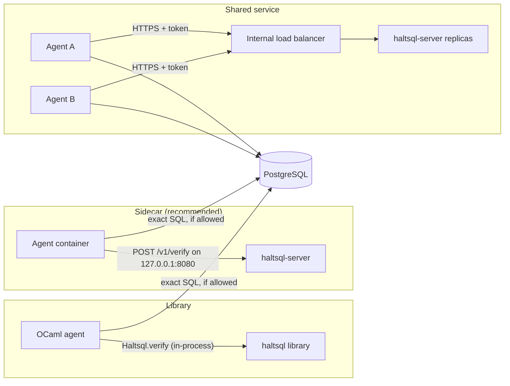

# Deployment

HaltSQL runs in one of three shapes:

| Shape | When to use |
|---|---|
| **Library** (`haltsql` OCaml package) | Your agent is written in OCaml. Lowest latency; no network hop. |
| **Sidecar** (`haltsql-server` next to the agent, on `127.0.0.1`) | Recommended for everything else. One instance per agent pod. |
| **Shared service** (`haltsql-server` behind a load balancer) | Many agents, central policy management. Needs TLS in front and tokens pinned to policies. |



`haltsql-server` never connects to the database: the agent runs the exact
string it verified. To verify every statement without changing the agent, put
[`haltsql-proxy`](proxy.md) in front of PostgreSQL instead.

In every shape, the database-side controls in
[defense-in-depth.md](defense-in-depth.md) still apply.

## Deploying to the cloud

Reference architectures, IAM policies and ready-to-edit manifests for each
cloud live in their own guides. Their architecture diagrams are generated from
code with [mingrammer/diagrams](https://github.com/mingrammer/diagrams)
(`make diagrams`, sources in [`deploy/diagrams/`](../deploy/diagrams/)).

| Cloud | Guide | Patterns covered | Manifests |
|---|---|---|---|
| AWS | [deploy-aws.md](deploy-aws.md) | EKS sidecar with IRSA, ECS Fargate shared service, proxy in front of RDS | [`deploy/cloud/aws/`](../deploy/cloud/aws/) |
| Google Cloud | [deploy-gcp.md](deploy-gcp.md) | GKE sidecar with Workload Identity, Cloud Run, proxy in front of Cloud SQL | [`deploy/cloud/gcp/`](../deploy/cloud/gcp/) |
| Azure | [deploy-azure.md](deploy-azure.md) | AKS sidecar with Workload Identity, Container Apps, proxy in front of Flexible Server | [`deploy/cloud/azure/`](../deploy/cloud/azure/) |

**TLS:** `haltsql-server` has built-in TLS 1.2/1.3 and optional mTLS
(`server.tls`, see [authentication.md](authentication.md)). As a sidecar bound
to `127.0.0.1` it can also run without TLS, or behind a proxy or service mesh
that terminates TLS.

## Docker

Images are published for `linux/amd64` and `linux/arm64`:

```
ghcr.io/ardada2468/haltsql:<version>     # e.g. 0.1.0
ghcr.io/ardada2468/haltsql:<major.minor> # e.g. 0.1
```

The image runs `haltsql-server` by default; the `haltsql` CLI is included.

```sh
docker run --rm -p 127.0.0.1:8080:8080 \
  -v "$PWD/policies:/etc/haltsql/policies:ro" \
  -v "$PWD/config.yaml:/etc/haltsql/config.yaml:ro" \
  -e HALTSQL_ANALYTICS_TOKEN_HASH \
  ghcr.io/ardada2468/haltsql:0.1.0 \
  --config /etc/haltsql/config.yaml --listen 0.0.0.0:8080
```

Inside a container, the server must listen on `0.0.0.0` to be reachable through
the published port; publish the port on `127.0.0.1` on the host as above, or
only to the agent's network.

Run the CLI from the same image:

```sh
docker run --rm -i -v "$PWD:/w" -w /w --entrypoint haltsql \
  ghcr.io/ardada2468/haltsql:0.1.0 validate policy.yaml
```

Pin images by digest in production (`ghcr.io/ardada2468/haltsql@sha256:...`)
and verify the signature (see below).

## Kubernetes: sidecar

Run `haltsql-server` as a second container in the agent's pod. The agent calls
`http://127.0.0.1:8080`. The server listens on `0.0.0.0:8080` so the kubelet
can probe it, and a NetworkPolicy blocks that port from other pods. Policies and config come
from a ConfigMap; token hashes from a Secret.

```yaml
apiVersion: v1
kind: ConfigMap
metadata:
  name: haltsql-config
data:
  config.yaml: |
    apiVersion: haltsql.dev/v1
    kind: Config
    server:
      listen: 0.0.0.0:8080
      auth:
        tokens:
          - name: analytics-agent
            token_sha256: ${file:/etc/haltsql/secrets/analytics-agent.sha256}
            policy: analytics-agent
    policies:
      - path: ./policies/analytics-agent.yaml
    reload: { watch: true }
    audit:
      sinks: [{ type: stdout }]
    logging: { level: info, format: json }
  policies-analytics-agent.yaml: |
    apiVersion: haltsql.dev/v1
    kind: Policy
    metadata: { name: analytics-agent }
    search_path: [app]
    statements: { allow: [select] }
    require_limit: { max: 1000 }
    tenancy: { mode: bound, keys: { tenant: "${ctx.tenant_id}" } }
    tables:
      app.orders:
        columns: [id, tenant_id, status, total_cents, created_at]
        tenant_column: tenant_id
    functions: { presets: [aggregates] }
---
apiVersion: v1
kind: Secret
metadata:
  name: haltsql-tokens
type: Opaque
stringData:
  analytics-agent.sha256: "<64 lower-case hex characters>"   # sha256 of the agent's token
---
apiVersion: apps/v1
kind: Deployment
metadata:
  name: analytics-agent
spec:
  replicas: 2
  selector:
    matchLabels: { app: analytics-agent }
  template:
    metadata:
      labels: { app: analytics-agent }
    spec:
      securityContext:
        runAsNonRoot: true
        seccompProfile: { type: RuntimeDefault }
      containers:
        - name: agent
          image: registry.example.com/analytics-agent:1.4.2
          env:
            - name: HALTSQL_URL
              value: http://127.0.0.1:8080
            - name: HALTSQL_TOKEN
              valueFrom:
                secretKeyRef: { name: analytics-agent-token, key: token }
        - name: haltsql
          image: ghcr.io/ardada2468/haltsql:0.1.0
          args: ["--config", "/etc/haltsql/config.yaml"]
          ports:
            - { name: http, containerPort: 8080 }
          readinessProbe:
            httpGet: { path: /readyz, port: 8080 }
            periodSeconds: 5
          livenessProbe:
            httpGet: { path: /healthz, port: 8080 }
            periodSeconds: 10
          resources:
            requests: { cpu: 50m, memory: 32Mi }
            limits: { cpu: "1", memory: 128Mi }
          securityContext:
            allowPrivilegeEscalation: false
            readOnlyRootFilesystem: true
            capabilities: { drop: ["ALL"] }
          volumeMounts:
            - name: config
              mountPath: /etc/haltsql/config.yaml
              subPath: config.yaml
            - name: config
              mountPath: /etc/haltsql/policies/analytics-agent.yaml
              subPath: policies-analytics-agent.yaml
            - name: tokens
              mountPath: /etc/haltsql/secrets
              readOnly: true
      volumes:
        - name: config
          configMap: { name: haltsql-config }
        - name: tokens
          secret: { secretName: haltsql-tokens }
---
# Deny ingress to the agent pods from other pods. Kubelet probes are not
# subject to NetworkPolicy in common CNI plugins; check yours.
apiVersion: networking.k8s.io/v1
kind: NetworkPolicy
metadata:
  name: analytics-agent-no-ingress
spec:
  podSelector:
    matchLabels: { app: analytics-agent }
  policyTypes: [Ingress]
  ingress: []
```

Notes:

- Tokens are required even inside the pod, so a compromised neighbor that
  reaches the port still cannot verify against a policy it holds no token for.
- If the agent pod must accept ingress (for example a web UI), narrow the
  NetworkPolicy to the agent's own ports instead of denying everything.
- ConfigMap updates mounted with `subPath` are not propagated to running pods.
  Mount the whole ConfigMap as a directory if you rely on `reload.watch`, or
  roll the deployment on policy changes (often the better audit trail).
- Scrape `/metrics` with your Prometheus setup, and alert on
  `haltsql_reasons_total{code="E_INTERNAL"}` and `haltsql_audit_errors_total`.

## systemd

For VMs or bare metal, install the static binary and run it as an unprivileged
service:

```sh
sudo install -m 0755 haltsql haltsql-server /usr/local/bin/
sudo useradd --system --no-create-home --shell /usr/sbin/nologin haltsql
sudo install -d -m 0750 -o root -g haltsql /etc/haltsql /etc/haltsql/policies
sudo install -d -m 0750 -o haltsql -g haltsql /var/log/haltsql
```

`/etc/systemd/system/haltsql.service`:

```ini
[Unit]
Description=HaltSQL policy firewall sidecar
After=network.target

[Service]
Type=simple
User=haltsql
Group=haltsql
ExecStart=/usr/local/bin/haltsql-server --config /etc/haltsql/config.yaml
ExecReload=/bin/kill -HUP $MAINPID
Restart=on-failure
RestartSec=2s
EnvironmentFile=-/etc/haltsql/haltsql.env

# Hardening
NoNewPrivileges=yes
ProtectSystem=strict
ProtectHome=yes
PrivateTmp=yes
PrivateDevices=yes
ProtectKernelTunables=yes
ProtectKernelModules=yes
ProtectControlGroups=yes
RestrictAddressFamilies=AF_INET AF_INET6 AF_UNIX
RestrictNamespaces=yes
LockPersonality=yes
MemoryDenyWriteExecute=yes
SystemCallArchitectures=native
CapabilityBoundingSet=
ReadOnlyPaths=/etc/haltsql
ReadWritePaths=/var/log/haltsql

[Install]
WantedBy=multi-user.target
```

```sh
sudo systemctl daemon-reload
sudo systemctl enable --now haltsql
sudo systemctl reload haltsql      # reload policies (SIGHUP)
journalctl -u haltsql -f
```

Put secrets referenced with `${env:...}` in `/etc/haltsql/haltsql.env`
(mode `0640`, group `haltsql`), or reference files with `${file:...}`.

## Rolling out a policy change

1. Change the policy in version control and run `haltsql validate` and
   `haltsql test` in CI.
2. For a stricter policy, deploy it first with `mode: shadow` and watch
   `shadow_reasons` in the audit log and `haltsql_verify_total{result="shadow_denied"}`.
3. Switch to `mode: enforce`.
4. Reload (`SIGHUP`, file watch, or a rollout). Check `/readyz`, the
   `policy.version` in new verdicts, and the reload metrics. A failed reload
   keeps the previous policies active.

## Verifying release artifacts

Each GitHub release has, for every archive:

- `SHA256SUMS`: checksums of all archives and the SBOM;
- `*.sigstore.json`: a keyless cosign signature bundle;
- a GitHub build-provenance attestation;
- `haltsql-<tag>.cdx.json`: a CycloneDX SBOM.

```sh
# Checksums
sha256sum -c SHA256SUMS --ignore-missing

# Signature (keyless, issued to this repository's release workflow)
cosign verify-blob \
  --bundle haltsql-v0.1.0-linux-amd64.tar.gz.sigstore.json \
  --certificate-identity-regexp '^https://github.com/ardada2468/HaltSQL/\.github/workflows/release\.yml@refs/tags/v' \
  --certificate-oidc-issuer https://token.actions.githubusercontent.com \
  haltsql-v0.1.0-linux-amd64.tar.gz

# Provenance (GitHub CLI)
gh attestation verify haltsql-v0.1.0-linux-amd64.tar.gz --repo ardada2468/HaltSQL

# Container image signature
cosign verify ghcr.io/ardada2468/haltsql:0.1.0 \
  --certificate-identity-regexp '^https://github.com/ardada2468/HaltSQL/\.github/workflows/release\.yml@refs/tags/v' \
  --certificate-oidc-issuer https://token.actions.githubusercontent.com
```

The Linux binaries are statically linked against musl and run on any Linux
distribution. The macOS binary links only system libraries.
