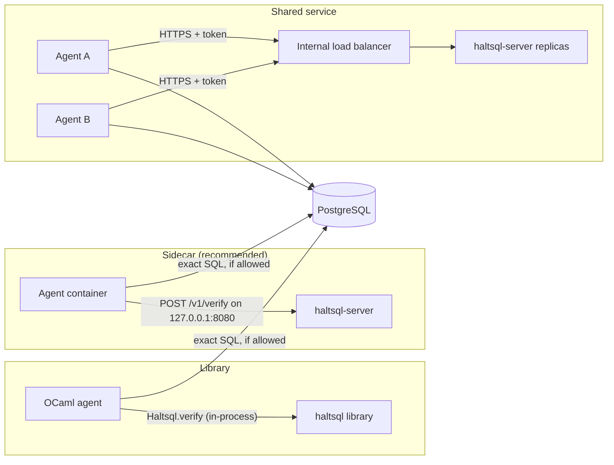

# Deployment

HaltSQL runs in one of three shapes:

| Shape | When to use |
|---|---|
| **Library** (`haltsql` OCaml package) | Your agent is written in OCaml. Lowest latency; no network hop. |
| **Sidecar** (`haltsql-server` next to the agent, on `127.0.0.1`) | Recommended for everything else. One instance per agent pod. |
| **Shared service** (`haltsql-server` behind a load balancer) | Many agents, central policy management. Needs TLS in front and tokens pinned to policies. |



`haltsql-server` never connects to the database: the agent runs the exact
string it verified. To verify every statement without changing the agent, put
[`haltsql-proxy`](proxy.md) in front of PostgreSQL instead.

In every shape, the database-side controls in
[defense-in-depth.md](defense-in-depth.md) still apply.

## Deploying to the cloud

Reference architectures, IAM policies and ready-to-edit manifests for each
cloud live in their own guides. Their architecture diagrams are generated from
code with [mingrammer/diagrams](https://github.com/mingrammer/diagrams)
(`make diagrams`, sources in [`deploy/diagrams/`](../deploy/diagrams/)).

| Cloud | Guide | Patterns covered | Manifests |
|---|---|---|---|
| AWS | [deploy-aws.md](deploy-aws.md) | EKS sidecar with IRSA, ECS Fargate shared service, proxy in front of RDS | [`deploy/cloud/aws/`](../deploy/cloud/aws/) |
| Google Cloud | [deploy-gcp.md](deploy-gcp.md) | GKE sidecar with Workload Identity, Cloud Run, proxy in front of Cloud SQL | [`deploy/cloud/gcp/`](../deploy/cloud/gcp/) |
| Azure | [deploy-azure.md](deploy-azure.md) | AKS sidecar with Workload Identity, Container Apps, proxy in front of Flexible Server | [`deploy/cloud/azure/`](../deploy/cloud/azure/) |

**TLS:** `haltsql-server` has built-in TLS 1.2/1.3 and optional mTLS
(`server.tls`, see [authentication.md](authentication.md)). As a sidecar bound
to `127.0.0.1` it can also run without TLS, or behind a proxy or service mesh
that terminates TLS.

## Docker

Images are published for `linux/amd64` and `linux/arm64`:

```
ghcr.io/ardada2468/haltsql:<version>     # e.g. 0.1.0
ghcr.io/ardada2468/haltsql:<major.minor> # e.g. 0.1
```

The image runs `haltsql-server` by default; the `haltsql` CLI is included.

```sh
docker run --rm -p 127.0.0.1:8080:8080 \
  -v "$PWD/policies:/etc/haltsql/policies:ro" \
  -v "$PWD/config.yaml:/etc/haltsql/config.yaml:ro" \
  -e HALTSQL_ANALYTICS_TOKEN_HASH \
  ghcr.io/ardada2468/haltsql:0.1.0 \
  --config /etc/haltsql/config.yaml --listen 0.0.0.0:8080
```

Inside a container, the server must listen on `0.0.0.0` to be reachable through
the published port; publish the port on `127.0.0.1` on the host as above, or
only to the agent's network.

Run the CLI from the same image:

```sh
docker run --rm -i -v "$PWD:/w" -w /w --entrypoint haltsql \
  ghcr.io/ardada2468/haltsql:0.1.0 validate policy.yaml
```

Pin images by digest in production (`ghcr.io/ardada2468/haltsql@sha256:...`)
and verify the signature (see below).

### What is in the image

| Path | Content |
|---|---|
| `/usr/local/bin/haltsql-server` | Entrypoint. Default command `--config /etc/haltsql/config.yaml`. |
| `/usr/local/bin/haltsql` | The CLI. |
| `/usr/local/bin/haltsql-proxy` | The PostgreSQL wire-protocol firewall ([proxy.md](proxy.md)). |
| `/var/log/haltsql` | Empty, writable by the image user, for file audit sinks. |
| `/etc/ssl/certs` | CA bundle (OIDC discovery, Vault, AWS, GCP). |
| `/usr/share/doc/haltsql` | `LICENSE`, `NOTICE`, `LICENSE.libpg_query`. |

The base image is `gcr.io/distroless/static-debian12:nonroot`. It has no
shell, no package manager and no libc, because the binaries are fully static.
It runs as uid/gid `65532` (`nonroot`). `HALTSQL_LISTEN=0.0.0.0:8080` is set.
Port 8080 is the server and 6432 the proxy. There is no `HEALTHCHECK`, because
the image has no shell or curl. Use orchestrator probes on `GET /healthz`
(liveness) and `GET /readyz` (readiness).

Run the proxy from the same image:

```sh
docker run --rm -p 127.0.0.1:6432:6432 \
  -v "$PWD/proxy:/etc/haltsql:ro" -e UPSTREAM_PASSWORD \
  --entrypoint /usr/local/bin/haltsql-proxy \
  ghcr.io/ardada2468/haltsql:0.1.0 run --config /etc/haltsql/proxy.yaml
```

Mounted files must be readable by uid 65532.

### Building the image locally

```sh
docker build -t haltsql-local:dev .                          # runtime image
docker build --target scratch -t haltsql-local:scratch .     # same binaries on scratch
docker buildx build --target dist --output type=local,dest=dist .  # just the binaries
```

The `Dockerfile` has four stages:

| Stage | What it does |
|---|---|
| `builder` | `ocaml/opam:alpine-3.22-ocaml-5.3`. Solves the dependencies against a pinned opam-repository commit (`OPAM_REPOSITORY_COMMIT`). Builds the three binaries with `HALTSQL_STATIC=1 dune build --profile release`, strips them, and fails unless `file` reports each one as statically linked, `ldd` finds no dynamic dependencies, and each binary runs. |
| `dist` | `scratch` holding only the binaries and licences. The release workflow exports it with `--output`. |
| `scratch` | The binaries on an empty filesystem. Its build runs `haltsql version` in exec form, so the build fails if anything is dynamically linked. |
| `runtime` (default) | The distroless image described above. |

Both the base image tag and the opam-repository commit are pinned, so a
rebuild solves the same dependency set. Change them on purpose, as their own
change.

`scripts/docker-smoke.sh` tests a built image end to end:

```sh
make -C lab up                    # Postgres 17 on localhost:5417 (for the proxy step)
SCRATCH_IMAGE=haltsql-local:scratch scripts/docker-smoke.sh
```

It checks the following:

- The image runs as non-root and has no shell.
- `haltsql version`, `validate` and `verify` work, with exit 0 for an allowed
  query and exit 1 for a denied one.
- `haltsql-server` answers `GET /healthz` and `POST /v1/verify` for both an
  allowed and a denied query, writes an audit record, and keeps raw SQL out of
  its output.
- `haltsql-proxy` runs against a real PostgreSQL, reached from the container as
  `host.docker.internal:5417`. Through `psql` from a `postgres:17-alpine`
  client container, an allowed query returns rows, while a cross-tenant query
  and a stacked `DROP TABLE` both get `ERROR 42501 ... denied by policy`, and
  the table is still intact afterwards.
- With `SCRATCH_IMAGE` set, all three binaries also run on the scratch image.

The script creates its own containers, network and database, all named after
its process id, and always removes them. Without a Docker daemon it prints
`SKIPPED` and exits 0. If PostgreSQL is unreachable, it skips the proxy step
with a message. Set `REQUIRE_PROXY=1` to make that a failure instead (CI does
this), or `SKIP_PROXY=1` to skip the proxy step on purpose. Set `PGHOST_FROM_DOCKER`, `PGPORT` and
`HALTSQL_PGPASSWORD` to point it at another server. The
`.github/workflows/build-images.yml` workflow runs it on amd64 and arm64 for
every pull request that touches the build.

### Static Linux binaries

The release tarballs (`haltsql-<tag>-linux-{amd64,arm64}.tar.gz`) hold the
output of the `dist` stage, built on a native runner for each architecture by
`.github/workflows/release.yml`. They are fully static musl executables with
no runtime dependencies. They run on any Linux distribution, glibc or musl,
and on `scratch`.

```sh
$ file haltsql-server
haltsql-server: ELF 64-bit LSB executable, ARM aarch64, version 1 (SYSV), statically linked, stripped
$ ldd haltsql-server
        not a dynamic executable
```

Static linking is opt-in in the build (`HALTSQL_STATIC=1`, read by
`bin/link_flags.ml`, which adds `-ccopt -static`). The default `dune build`
stays dynamic. A static build needs musl, because glibc's static NSS is not
usable. It also needs the static archives of the C libraries the binaries
link: `libgmp.a` from Alpine's `gmp-static` package for zarith, and the
vendored `libpg_query.a`, which dune builds. The mirage-crypto, digestif and
Unix stubs are compiled from source.

## Kubernetes: Helm chart

`deploy/helm/haltsql` deploys haltsql-server as its own Deployment and
Service, with the Config and policies in ConfigMaps, token hashes in a
Secret, and an optional PodDisruptionBudget, HorizontalPodAutoscaler,
NetworkPolicy and ServiceMonitor. `values.yaml` documents every value. For
settings the chart has no dedicated value for:

- `extraPolicies`: Config `policies[]` entries appended to the rendered ones,
  for example a signed `bundle_source` (see
  [policy-bundles.md](policy-bundles.md)). A `bundle_source` entry without
  `cache_dir` gets `<cache.mountPath>/bundles`, so a restarted pod can start
  from its last verified bundle while the source is down.
- `extraConfig`: Config keys deep-merged into the rendered Config (nested
  maps merge, `extraConfig` wins, lists and scalars replace), for example
  `opa`, `secrets`, `telemetry.otlp` or `audit.sinks`. `extraConfig.policies`
  is refused, because it would replace the chart's list; use
  `extraPolicies`.
- `cache`: the writable volume for bundle caches (`mountPath`, default
  `/var/cache/haltsql`, and `volume`, default an `emptyDir`). The root
  filesystem is read-only. Use a `persistentVolumeClaim` to keep the cache
  across rescheduling.

Secrets (registry passwords, API keys) belong in `${env:...}` or secret
provider placeholders, never inline in these values. For CRD-driven
deployments see the [Kubernetes operator](kubernetes-operator.md); for
Terraform see [terraform.md](terraform.md).

## Kubernetes: sidecar

Run `haltsql-server` as a second container in the agent's pod. The agent calls
`http://127.0.0.1:8080`. The server listens on `0.0.0.0:8080` so the kubelet
can probe it, and a NetworkPolicy blocks that port from other pods. Policies and config come
from a ConfigMap; token hashes from a Secret.

```yaml
apiVersion: v1
kind: ConfigMap
metadata:
  name: haltsql-config
data:
  config.yaml: |
    apiVersion: haltsql.dev/v1
    kind: Config
    server:
      listen: 0.0.0.0:8080
      auth:
        tokens:
          - name: analytics-agent
            token_sha256: ${file:/etc/haltsql/secrets/analytics-agent.sha256}
            policy: analytics-agent
    policies:
      - path: ./policies/analytics-agent.yaml
    reload: { watch: true }
    audit:
      sinks: [{ type: stdout }]
    logging: { level: info, format: json }
  policies-analytics-agent.yaml: |
    apiVersion: haltsql.dev/v1
    kind: Policy
    metadata: { name: analytics-agent }
    search_path: [app]
    statements: { allow: [select] }
    require_limit: { max: 1000 }
    tenancy: { mode: bound, keys: { tenant: "${ctx.tenant_id}" } }
    tables:
      app.orders:
        columns: [id, tenant_id, status, total_cents, created_at]
        tenant_column: tenant_id
    functions: { presets: [aggregates] }
---
apiVersion: v1
kind: Secret
metadata:
  name: haltsql-tokens
type: Opaque
stringData:
  analytics-agent.sha256: "<64 lower-case hex characters>"   # sha256 of the agent's token
---
apiVersion: apps/v1
kind: Deployment
metadata:
  name: analytics-agent
spec:
  replicas: 2
  selector:
    matchLabels: { app: analytics-agent }
  template:
    metadata:
      labels: { app: analytics-agent }
    spec:
      securityContext:
        runAsNonRoot: true
        seccompProfile: { type: RuntimeDefault }
      containers:
        - name: agent
          image: registry.example.com/analytics-agent:1.4.2
          env:
            - name: HALTSQL_URL
              value: http://127.0.0.1:8080
            - name: HALTSQL_TOKEN
              valueFrom:
                secretKeyRef: { name: analytics-agent-token, key: token }
        - name: haltsql
          image: ghcr.io/ardada2468/haltsql:0.1.0
          args: ["--config", "/etc/haltsql/config.yaml"]
          ports:
            - { name: http, containerPort: 8080 }
          readinessProbe:
            httpGet: { path: /readyz, port: 8080 }
            periodSeconds: 5
          livenessProbe:
            httpGet: { path: /healthz, port: 8080 }
            periodSeconds: 10
          resources:
            requests: { cpu: 50m, memory: 32Mi }
            limits: { cpu: "1", memory: 128Mi }
          securityContext:
            allowPrivilegeEscalation: false
            readOnlyRootFilesystem: true
            capabilities: { drop: ["ALL"] }
          volumeMounts:
            - name: config
              mountPath: /etc/haltsql/config.yaml
              subPath: config.yaml
            - name: config
              mountPath: /etc/haltsql/policies/analytics-agent.yaml
              subPath: policies-analytics-agent.yaml
            - name: tokens
              mountPath: /etc/haltsql/secrets
              readOnly: true
      volumes:
        - name: config
          configMap: { name: haltsql-config }
        - name: tokens
          secret: { secretName: haltsql-tokens }
---
# Deny ingress to the agent pods from other pods. Kubelet probes are not
# subject to NetworkPolicy in common CNI plugins; check yours.
apiVersion: networking.k8s.io/v1
kind: NetworkPolicy
metadata:
  name: analytics-agent-no-ingress
spec:
  podSelector:
    matchLabels: { app: analytics-agent }
  policyTypes: [Ingress]
  ingress: []
```

Notes:

- Tokens are required even inside the pod, so a compromised neighbor that
  reaches the port still cannot verify against a policy it holds no token for.
- If the agent pod must accept ingress (for example a web UI), narrow the
  NetworkPolicy to the agent's own ports instead of denying everything.
- ConfigMap updates mounted with `subPath` are not propagated to running pods.
  Mount the whole ConfigMap as a directory if you rely on `reload.watch`, or
  roll the deployment on policy changes (often the better audit trail).
- Scrape `/metrics` with your Prometheus setup, and alert on
  `haltsql_reasons_total{code="E_INTERNAL"}` and `haltsql_audit_errors_total`.

## systemd

For VMs or bare metal, install the static binary and run it as an unprivileged
service:

```sh
sudo install -m 0755 haltsql haltsql-server /usr/local/bin/
sudo useradd --system --no-create-home --shell /usr/sbin/nologin haltsql
sudo install -d -m 0750 -o root -g haltsql /etc/haltsql /etc/haltsql/policies
sudo install -d -m 0750 -o haltsql -g haltsql /var/log/haltsql
```

`/etc/systemd/system/haltsql.service`:

```ini
[Unit]
Description=HaltSQL policy firewall sidecar
After=network.target

[Service]
Type=simple
User=haltsql
Group=haltsql
ExecStart=/usr/local/bin/haltsql-server --config /etc/haltsql/config.yaml
ExecReload=/bin/kill -HUP $MAINPID
Restart=on-failure
RestartSec=2s
EnvironmentFile=-/etc/haltsql/haltsql.env

# Hardening
NoNewPrivileges=yes
ProtectSystem=strict
ProtectHome=yes
PrivateTmp=yes
PrivateDevices=yes
ProtectKernelTunables=yes
ProtectKernelModules=yes
ProtectControlGroups=yes
RestrictAddressFamilies=AF_INET AF_INET6 AF_UNIX
RestrictNamespaces=yes
LockPersonality=yes
MemoryDenyWriteExecute=yes
SystemCallArchitectures=native
CapabilityBoundingSet=
ReadOnlyPaths=/etc/haltsql
ReadWritePaths=/var/log/haltsql

[Install]
WantedBy=multi-user.target
```

```sh
sudo systemctl daemon-reload
sudo systemctl enable --now haltsql
sudo systemctl reload haltsql      # reload policies (SIGHUP)
journalctl -u haltsql -f
```

Put secrets referenced with `${env:...}` in `/etc/haltsql/haltsql.env`
(mode `0640`, group `haltsql`), or reference files with `${file:...}`.

## Rolling out a policy change

1. Change the policy in version control and run `haltsql validate` and
   `haltsql test` in CI.
2. For a stricter policy, deploy it first with `mode: shadow` and watch
   `shadow_reasons` in the audit log and `haltsql_verify_total{result="shadow_denied"}`.
3. Switch to `mode: enforce`.
4. Reload (`SIGHUP`, file watch, or a rollout). Check `/readyz`, the
   `policy.version` in new verdicts, and the reload metrics. A failed reload
   keeps the previous policies active.

## Verifying release artifacts

Each GitHub release has, for every archive:

- `SHA256SUMS`: checksums of all archives and the SBOM;
- `*.sigstore.json`: a keyless cosign signature bundle;
- a GitHub build-provenance attestation;
- `haltsql-<tag>.cdx.json`: a CycloneDX SBOM.

```sh
# Checksums
sha256sum -c SHA256SUMS --ignore-missing

# Signature (keyless, issued to this repository's release workflow)
cosign verify-blob \
  --bundle haltsql-v0.1.0-linux-amd64.tar.gz.sigstore.json \
  --certificate-identity-regexp '^https://github.com/ardada2468/HaltSQL/\.github/workflows/release\.yml@refs/tags/v' \
  --certificate-oidc-issuer https://token.actions.githubusercontent.com \
  haltsql-v0.1.0-linux-amd64.tar.gz

# Provenance (GitHub CLI)
gh attestation verify haltsql-v0.1.0-linux-amd64.tar.gz --repo ardada2468/HaltSQL

# Container image signature
cosign verify ghcr.io/ardada2468/haltsql:0.1.0 \
  --certificate-identity-regexp '^https://github.com/ardada2468/HaltSQL/\.github/workflows/release\.yml@refs/tags/v' \
  --certificate-oidc-issuer https://token.actions.githubusercontent.com
```

The Linux binaries are statically linked against musl and run on any Linux
distribution. The macOS binary links only system libraries.
