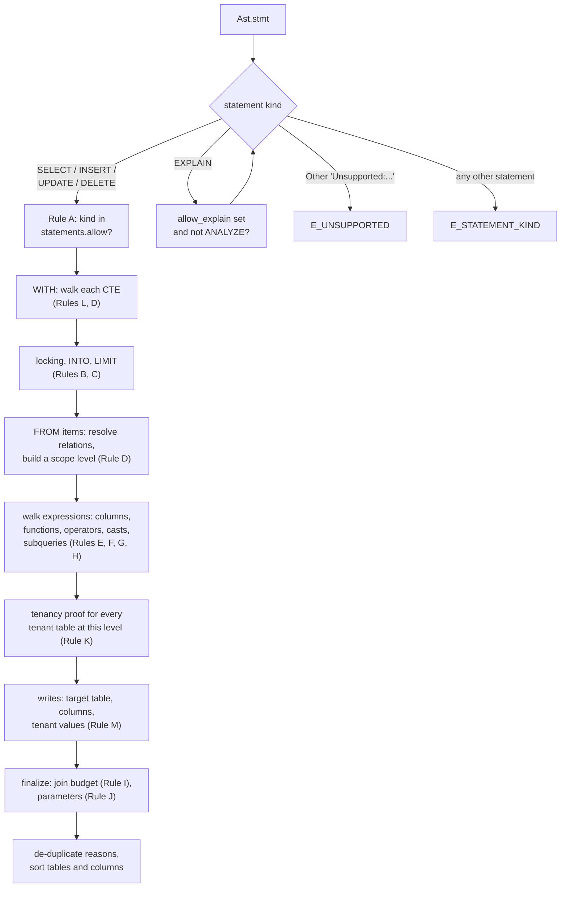
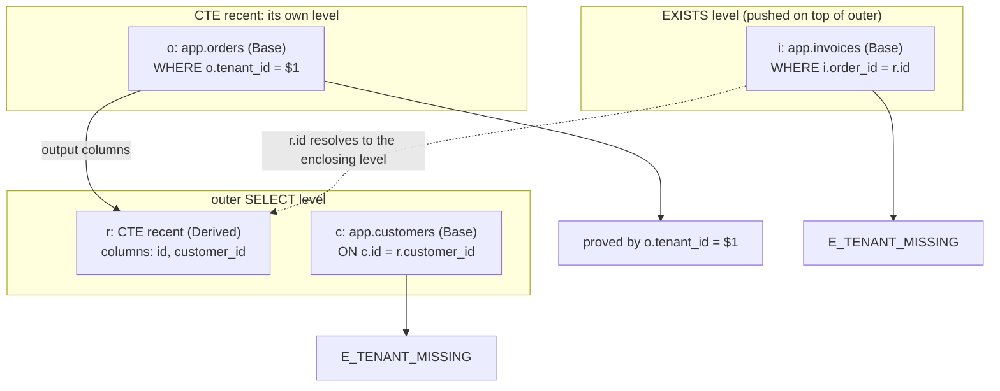
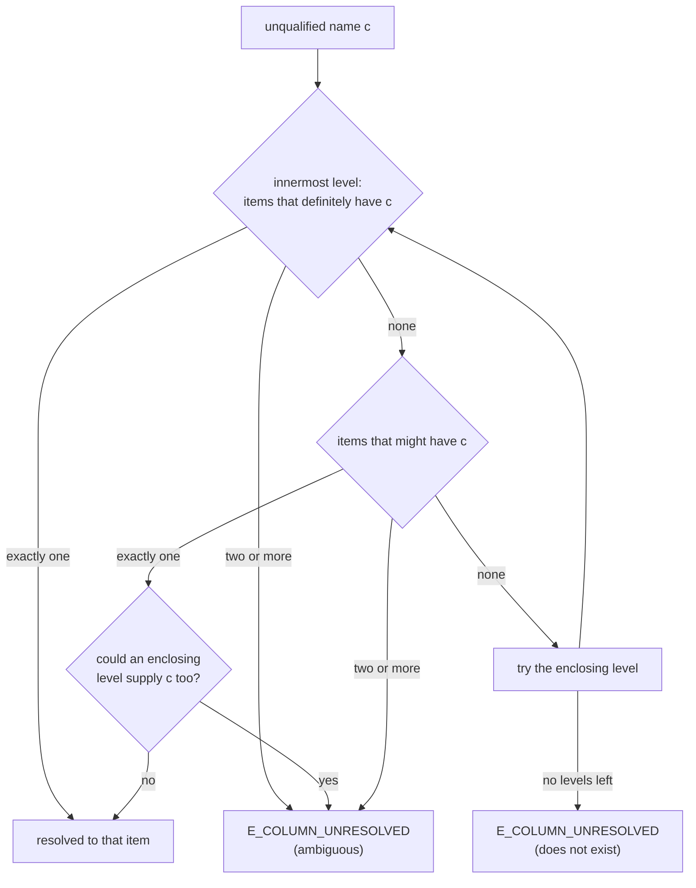
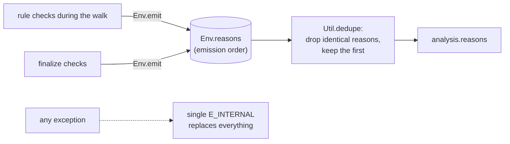

The analyzer (`lib/analyzer`) takes one parsed statement, a compiled policy, and
a request context, and produces the list of everything that is wrong with the
statement. It is deny by default: a statement is allowed only when the analyzer
finds no reason to deny it.

```ocaml
val analyze : Policy.t -> Context.t -> Ast.stmt -> analysis
(* analysis = { reasons; statement_kind; tables; columns; bind_params } *)
```

It runs after parsing (see [Parser](./parser.md)) inside every `verify` call
(see [Verification pipeline](./verification-pipeline.md)).

## Modules

| File | Responsibility |
|---|---|
| `analyzer.ml` | Entry point. Dispatches on the statement kind, then runs the end-of-walk checks (join budget, parameter rules) and builds the result. |
| `walk.ml` | The statement walker. Builds scopes level by level, resolves every relation and column, applies the per-node rules, and calls the tenancy prover for each `SELECT` or DML level. |
| `scope.ml` | Scopes and column-name resolution: what each `FROM` item is known to contain, and how an unqualified name is matched. |
| `rules.ml` | Context-free rules: statement kinds, functions, SQL value functions, operators, casts, and `LIMIT`. |
| `tenancy.ml` | Tenant isolation proofs for reads and tenant checks for `INSERT` values. See [Tenancy proof](./tenancy-proof.md). |
| `env.ml` | The per-call accumulator: reasons, tables, columns, parameters, tenant bindings, and the join count. |
| `ast_util.ml`, `util.ml` | Small pure helpers (locations, target names, de-duplication, integer normalization). |

### One accumulator per call

`Env.create` makes a fresh accumulator for each `analyze` call. Rules never
return early; they **emit** reasons into it and the walk continues. The
accumulator is never shared between calls or domains, and there is no global
mutable state anywhere in the analyzer, so `analyze` behaves as a pure function
from the outside and is safe to run in parallel.

`analyze` wraps everything in an exception handler. If anything raises, the
result is a single `E_INTERNAL` reason with the hint "This is a HaltSQL bug; the
statement is denied (fail closed)."

## The walk, step by step



A few properties of the walk:

- **The statement kind check does not stop the walk.** A `DELETE` under a
  `select`-only policy gets `E_STATEMENT_KIND`, and the rest of the statement is
  still analyzed, so the agent sees every problem in one round.
- **`EXPLAIN` is unwrapped.** If the policy has `allow_explain`, plain
  `EXPLAIN` of an allowed statement is analyzed as that statement.
  `EXPLAIN ANALYZE` executes the statement and is always `E_STATEMENT_KIND`.
- **Every subquery is walked.** CTE bodies, `FROM` subqueries, `EXISTS`,
  `IN (SELECT ...)`, scalar subqueries, `ARRAY(SELECT ...)`, and each arm of a
  set operation are all walked with the same rules.
- **Every match is exhaustive.** Each `match` over an AST type lists its
  constructors explicitly, with no wildcard arm. A new AST constructor breaks
  the build here instead of being silently accepted.

## Scopes

Name resolution is where many SQL firewalls go wrong, so HaltSQL models it
explicitly (`lib/analyzer/scope.ml`).

A **scope** is a stack of **levels**, innermost first. Each `SELECT` level, and
the target level of an `UPDATE`, `DELETE`, or `INSERT ... RETURNING`, pushes one
level holding its `FROM` items. Each **item** records:

- a unique id (one per occurrence, so the same table used twice is two items);
- the name usable as a qualifier (the alias, or the relation name);
- what is known about its columns;
- its source: a policy table (`Base`), a subquery, CTE, `VALUES`, or function
  (`Derived`), or a relation already reported as denied (`Denied`).

### What HaltSQL knows about an item's columns

| Knowledge | Meaning | Example |
|---|---|---|
| `Exact l` | The item has exactly the columns `l`. | A table with `columns: "*"` and a catalog snapshot; a derived table whose output HaltSQL computed. |
| `At_least l` | The item has the columns `l` and maybe others. | A policy table without a catalog snapshot; a set-returning function. |

Tables with an explicit column list are always treated as `At_least`, even with
a catalog, so a stale catalog can never cause a read of a denied column to be
attributed to another item.

### How scopes are built

| Construct | What the walker does |
|---|---|
| `FROM a, b` | Walks the items left to right and pushes one level with all of them. Each comma adds one to the join count. |
| `JOIN ... ON` | Walks left, then right, then the `ON` condition in a scope that contains both sides. Adds one to the join count. `JOIN ... USING (c)` records `c` as a merged column that reads both sides. |
| `LATERAL (subquery)` | The subquery sees the items to its left (the walker pushes the siblings processed so far). |
| Function in `FROM` | Implicitly `LATERAL`, as in Postgres. Its output is `At_least` its alias, column aliases, and function name. |
| Subquery in `FROM` | Walked in the enclosing scope (without siblings unless `LATERAL`). Becomes a `Derived` item whose columns are the subquery's output. |
| `WITH` | Each CTE is walked in order; later CTEs and the main query see earlier ones. A CTE name shadows a table of the same name, as in Postgres. |
| Subquery in an expression | Walked with the current scope stack, so a correlated reference to an outer column resolves to the enclosing level. |
| Set operations | Each arm is walked independently. The output columns come from the left arm. `ORDER BY` on the result sees only output columns. |

### Example scope tree

This query (run against `examples/policies/saas.yaml`) uses a CTE, a join, and a
correlated `EXISTS`:

```sql
WITH recent AS (
  SELECT o.id, o.customer_id FROM orders o
  WHERE o.tenant_id = $1 AND o.created_at > now() - interval '7 days'
)
SELECT c.name, r.id
FROM recent r JOIN customers c ON c.id = r.customer_id
WHERE EXISTS (SELECT 1 FROM invoices i WHERE i.order_id = r.id)
LIMIT 50
```



The actual verdict denies it with two reasons, one per unproven occurrence:

```json
[
  { "code": "E_TENANT_MISSING", "rule": "tenancy.predicate", "loc": 229,
    "message": "app.invoices (as i) has no provable tenant predicate on i.tenant_id in the same SELECT" },
  { "code": "E_TENANT_MISSING", "rule": "tenancy.predicate", "loc": 165,
    "message": "app.customers (as c) has no provable tenant predicate on c.tenant_id in the same SELECT" }
]
```

The tenant filter on `orders` inside the CTE does not cover `customers` or
`invoices`: every occurrence of a tenant-scoped table needs its own proof in its
own level. Adding `AND c.tenant_id = $1` to the `ON` clause and
`AND i.tenant_id = $1` to the `EXISTS` makes the query allowed, with
`bind_params: [{"param": 1, "value": "acme"}]`. The full proof rules are in
[Tenancy proof](./tenancy-proof.md) and [tenancy.md](../tenancy.md).

### Resolving an unqualified column

Postgres guarantees that an unqualified name that runs successfully matches
exactly one item at the innermost level that has it. HaltSQL mirrors that, but
never guesses:



Qualified names (`t.c`, `s.t.c`) look up the item by name at the innermost
level that has it. A bare name that matches no column but does match an item
name is a whole-row reference, which reads every column of that item.

## Rule families

`analyzer.ml` labels the rule families A to M. Each one lives in a specific
module.

### A: statement kinds

`SELECT`, `INSERT`, `UPDATE`, and `DELETE` must be listed in
`statements.allow` (`Rules.check_stmt_kind`). Every other statement node (DDL,
`DO`, `CALL`, `COPY`, `SET`, ...) is `E_STATEMENT_KIND`. `EXPLAIN` needs
`allow_explain`, and `EXPLAIN ANALYZE` is never allowed.

### B: SELECT hygiene

- `FOR UPDATE`, `FOR SHARE`, and the other locking clauses: `E_LOCKING_CLAUSE`.
- `SELECT ... INTO`: `E_SELECT_INTO` (it creates a table).
- `WITH RECURSIVE`: `E_UNSUPPORTED`. Recursion cannot be bounded by `LIMIT`,
  and an outer `LIMIT` does not bound the work of an aggregate, `ORDER BY`, or
  `DISTINCT` over it. The body is still analyzed so other problems are reported.
- Any `Unsupported` node from the parser: `E_UNSUPPORTED`. The walker also
  denies some mapped constructs it does not analyze: `NATURAL JOIN` (its column
  set depends on the schema), an alias on a `JOIN`, a column alias list on a
  base table, and sublink kinds other than `EXISTS`, `ANY`, `ALL`, scalar, and
  `ARRAY`.

### C: require_limit

When the policy sets `require_limit.max`, the **outermost** `SELECT` must have
a constant integer `LIMIT` between 0 and the maximum (`Rules.check_limit`).

| Situation | Code |
|---|---|
| No `LIMIT`, `LIMIT ALL`, or `LIMIT NULL` | `E_LIMIT_REQUIRED` |
| `LIMIT` larger than the maximum, negative, or not an integer constant | `E_LIMIT_TOO_HIGH` |

Casts around the constant are looked through (`LIMIT 10::int` is fine).
Subqueries do not need their own `LIMIT`.

### D and E: tables and columns

**Tables (`E_TABLE_DENIED`).** A schema-qualified name must match a policy
table exactly. An unqualified name walks the policy's `search_path`, with
`pg_catalog` searched first unless the policy places it explicitly:

- a name starting with `pg_` that is not a policy table resolves to the system
  catalog and is denied;
- a policy table in a later schema wins only if every earlier schema is known
  (from a trusted catalog snapshot) **not** to contain a relation with that
  name. Otherwise Postgres might resolve the name to something unlisted, so
  HaltSQL denies and asks for a schema-qualified name.

A denied relation still becomes a `Denied` item in the scope, so column
references to it do not produce a pile of confusing follow-up errors.

**Columns (`E_COLUMN_DENIED`).** Every column read is checked against the
table's `columns` list, wherever it appears: select list, `WHERE`, `JOIN ... ON`,
`GROUP BY`, `HAVING`, `ORDER BY`, window definitions, and `RETURNING`.

**`*` and whole-row references.** `SELECT *`, `t.*`, and a bare `t` read every
column of the item. HaltSQL needs to know every column to allow that:

| Table `columns` | Catalog snapshot | `*` result |
|---|---|---|
| `"*"` (all) | yes | allowed; each column recorded |
| `"*"` (all) | no | allowed; recorded as `schema.table.*` |
| explicit list | yes | allowed only if every catalog column is in the list |
| explicit list | no | `E_COLUMN_DENIED` |

A catalog entry counts only if it is **trusted**: at least one column carries a
type, as snapshots from `haltsql schema pull` always do. When a policy has no
snapshot, the loader derives untyped entries from the policy's own column lists,
and those prove nothing about the real table, so they are ignored. This is what
stops `SELECT *` from leaking a column the policy left out.

**Unresolvable references (`E_COLUMN_UNRESOLVED`).** Ambiguous names, unknown
names, too many qualifiers (cross-database references), and names that could be
either a column or a whole-row reference to a sensitive table are all denied.

### F, G, H: functions, operators, casts

| Rule | Check | Code |
|---|---|---|
| F | Function names must be in the policy's expanded function list. Unqualified and `pg_catalog.` names match by bare name; any other schema must be listed as `schema.fn`. | `E_FUNCTION_DENIED` |
| F | SQL value functions: only `CURRENT_DATE`, `CURRENT_TIME`, `CURRENT_TIMESTAMP`, `LOCALTIME`, and `LOCALTIMESTAMP`. Identity and session values (`CURRENT_USER`, `SESSION_USER`, `CURRENT_SCHEMA`, ...) are denied. | `E_FUNCTION_DENIED` |
| G | Operators (including `ANY`/`ALL`, `IN`, `LIKE`, `ILIKE`, `SIMILAR TO`) must be in the operator list. An operator qualified with a schema other than `pg_catalog` is always denied. Built-in syntax such as `BETWEEN`, `IS DISTINCT FROM`, and `NULLIF` is not an operator lookup. | `E_OPERATOR_DENIED` |
| H | A cast whose target type (last name part, lower case) is in `deny_casts`, such as `regclass`. | `E_CAST_DENIED` |

### I: join budget

The walker counts joins across the whole statement, including subqueries and
CTEs: each `JOIN` counts one, a `FROM` list of n items counts n - 1, and
`UPDATE ... FROM` and `DELETE ... USING` count one per item. After the walk, a
count above `limits.max_joins` (default 8) is `E_JOIN_BUDGET`.

### J: parameters

HaltSQL only allows a `$n` placeholder when it can supply the value itself in
`bind_params`, so the caller never binds something the model chose. The walker
records every `$n` it sees, with its location. The tenancy prover records a
**binding** each time a `$n` is the value side of a successful tenant proof.
After the walk, `finalize` applies four checks:

1. **Conflicting bindings.** If the same `$n` would have to be bound to two
   different tenant values, `E_TENANT_MISMATCH` (`tenancy.param_conflict`).
2. **Unbound parameters.** A `$n` with no binding is `E_PARAM_UNBOUND`
   (`params.unbound`). In literal tenancy mode, every placeholder is unbound.
3. **Tenant placeholder used elsewhere.** A tenant placeholder may appear
   **only** as the value of its tenant predicate. If `$1` is bound by
   `o.tenant_id = $1` but also appears anywhere else, for example
   `$1::float8 IS NOT NULL`, that is `E_PARAM_UNBOUND` (`params.tenant_reuse`),
   reported once per parameter. Any other use would let the query influence the
   type PostgreSQL infers for the parameter, and with it how the bound tenant
   value is compared.
4. The surviving bindings become `bind_params`, sorted by parameter number.

The check in step 3 compares locations: a `$n` occurrence is fine only if its
exact location is one that a tenant proof used. A real verdict:

```json
{
  "code": "E_PARAM_UNBOUND",
  "message": "tenant placeholder $1 is used outside a tenant predicate; it may only appear as the value of the tenant comparison",
  "rule": "params.tenant_reuse",
  "loc": 53,
  "hint": "Use each tenant placeholder only in its tenant predicate (e.g. o.tenant_id = $1); do not cast it or compare it to anything else."
}
```

for `SELECT o.id FROM orders o WHERE o.tenant_id = $1 AND $1::float8 IS NOT NULL LIMIT 10`.

### K: tenancy proofs

For every occurrence of a tenant-scoped table, in its own level, each tenant
column must be proven by a top-level `AND` conjunct of the level's `WHERE` or of
an eligible `JOIN ... ON`. The context must supply the tenant value
(`E_CONTEXT_MISSING` otherwise, reported once per tenancy key). A literal that
differs from the context is `E_TENANT_MISMATCH`; no proof at all is
`E_TENANT_MISSING`. This is the most important rule and has its own page:
[Tenancy proof](./tenancy-proof.md).

### L: data-modifying CTEs

A CTE containing `INSERT`, `UPDATE`, or `DELETE` whose kind is not in
`statements.allow` is `E_DATA_MODIFYING_CTE`. If the kind is allowed, the CTE is
analyzed with the write rules below.

### M: writes

Only reachable when the policy allows the statement kind.

| Check | Code |
|---|---|
| The target table lacks the matching `writes` permission (`insert`, `update`, `delete`) | `E_WRITE_DENIED` (`writes.table`) |
| `INSERT` without an explicit column list | `E_WRITE_DENIED` (`writes.columns`) |
| `INSERT` names a column not in the table's `columns` list | `E_WRITE_DENIED` |
| `UPDATE` assigns a column not in `writes.update` | `E_WRITE_DENIED` |
| `INSERT` into a tenant table does not set every tenant column to the tenant value in every `VALUES` row, or uses `DEFAULT VALUES` | `E_TENANT_WRITE` (`tenancy.write`) |
| `UPDATE` assigns a tenant column | `E_TENANT_WRITE` |
| `INSERT ... SELECT`, `INSERT ... ON CONFLICT` | `E_UNSUPPORTED` (only `INSERT ... VALUES` is analyzed) |

`UPDATE` and `DELETE` also go through the normal tenancy proof (Rule K), with
their target table and any `FROM` or `USING` items in the same level.

## Rule to reason code

The `rule` field of each reason names the check that produced it. Codes are
stable (see [reason-codes.md](../reason-codes.md)); rule ids are for debugging
and may change.

| Family | `rule` | Code | Emitted in |
|---|---|---|---|
| (parse) | `parse` | `E_PARSE`, `E_LIMIT`, `E_INTERNAL` | `lib/parse/pg_parse.ml` |
| (count) | `statement.count` | `E_EMPTY`, `E_MULTI_STATEMENT` | `lib/haltsql/haltsql.ml` |
| A | `statement.kind` | `E_STATEMENT_KIND` | `rules.ml`, `analyzer.ml` |
| A | `statement.explain` | `E_STATEMENT_KIND` | `analyzer.ml` |
| B | `select.locking` | `E_LOCKING_CLAUSE` | `walk.ml` |
| B | `select.into` | `E_SELECT_INTO` | `walk.ml` |
| B | `syntax.unsupported` | `E_UNSUPPORTED` | `walk.ml`, `analyzer.ml` |
| B | `syntax.recursive_cte` | `E_UNSUPPORTED` | `walk.ml` |
| C | `limit.required` | `E_LIMIT_REQUIRED` | `rules.ml` |
| C | `limit.max` | `E_LIMIT_TOO_HIGH` | `rules.ml` |
| D | `tables.allowlist` | `E_TABLE_DENIED` | `walk.ml` |
| D | `columns.resolve` | `E_COLUMN_UNRESOLVED` | `walk.ml` |
| E | `columns.denied` | `E_COLUMN_DENIED` | `walk.ml` |
| E | `columns.star` | `E_COLUMN_DENIED` | `walk.ml` |
| F | `functions.allowlist` | `E_FUNCTION_DENIED` | `rules.ml` |
| F | `functions.sql_value` | `E_FUNCTION_DENIED` | `rules.ml` |
| G | `operators.allowlist` | `E_OPERATOR_DENIED` | `rules.ml` |
| H | `casts.deny` | `E_CAST_DENIED` | `rules.ml` |
| I | `joins.budget` | `E_JOIN_BUDGET` | `analyzer.ml` |
| J | `params.unbound` | `E_PARAM_UNBOUND` | `analyzer.ml` |
| J | `params.tenant_reuse` | `E_PARAM_UNBOUND` | `analyzer.ml` |
| J | `tenancy.param_conflict` | `E_TENANT_MISMATCH` | `analyzer.ml` |
| K | `tenancy.predicate` | `E_TENANT_MISSING` | `tenancy.ml` |
| K | `tenancy.mismatch` | `E_TENANT_MISMATCH` | `tenancy.ml` |
| K | `tenancy.context` | `E_CONTEXT_MISSING` | `tenancy.ml` |
| L | `statement.data_modifying_cte` | `E_DATA_MODIFYING_CTE` | `walk.ml` |
| M | `writes.table` | `E_WRITE_DENIED` | `walk.ml` |
| M | `writes.columns` | `E_WRITE_DENIED` | `walk.ml` |
| M | `tenancy.write` | `E_TENANT_WRITE` | `walk.ml`, `tenancy.ml` |
| (guard) | `internal` | `E_INTERNAL` | `analyzer.ml`, `haltsql.ml` |

## How reasons are collected



- **All violations are reported.** Rules emit and keep going. One verdict can
  carry many reasons, so an agent can fix everything in a single retry.
- **Order is emission order.** Reasons come out in the order the walk found
  them, then the end-of-walk checks (join budget, parameters). The walk is
  deterministic, so the order is too.
- **Identical reasons are de-duplicated.** Two reasons are dropped as
  duplicates only when every field matches (code, message, rule, location, and
  hint), keeping the first. Distinct problems with the same code, such as two
  different tables missing a tenant predicate, are kept separately.
- **Some reasons are reported once by design.** `E_CONTEXT_MISSING` is reported
  once per tenancy key, and `params.tenant_reuse` once per parameter, so a
  single root cause does not flood the verdict.
- **`tables` and `columns` are recorded as they are resolved**, then sorted and
  de-duplicated. They may be partial for a denied query.

A real example with several reasons at once (policy
`examples/policies/saas.yaml`):

```sql
SELECT email, pg_sleep(1) FROM customers FOR UPDATE
```

| Order | Code | Why |
|---|---|---|
| 1 | `E_LOCKING_CLAUSE` | `FOR UPDATE` (checked as soon as the `SELECT` is entered, after its `WITH` clause) |
| 2 | `E_LIMIT_REQUIRED` | outermost `SELECT` has no `LIMIT` |
| 3 | `E_COLUMN_DENIED` | `email` is not in the readable columns of `app.customers` |
| 4 | `E_FUNCTION_DENIED` | `pg_sleep` is not in the function allowlist |
| 5 | `E_TENANT_MISSING` | `customers` has no tenant predicate |

What the analyzer returns then goes back to `verify`, which applies the policy
mode and builds the verdict. See
[Verification pipeline](./verification-pipeline.md).
