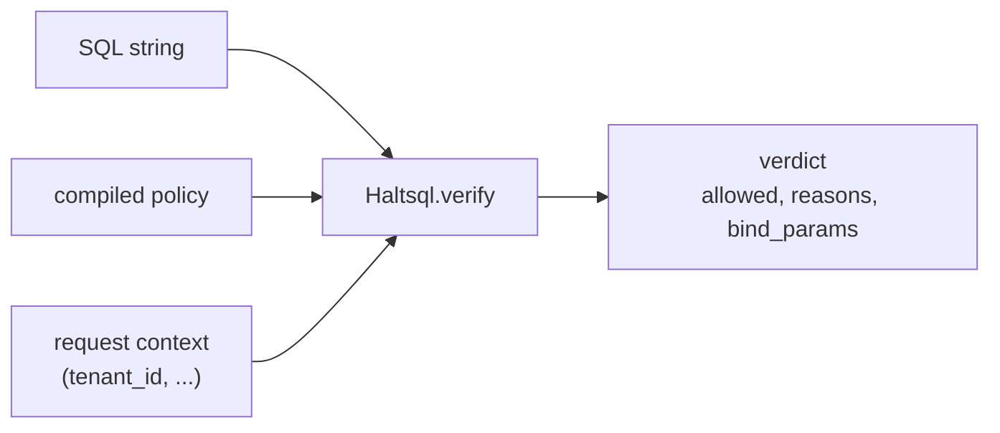
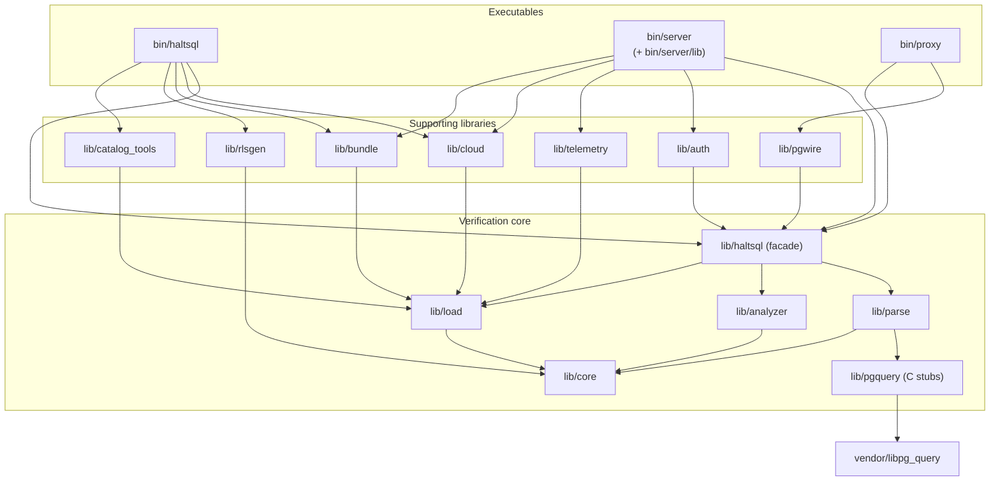
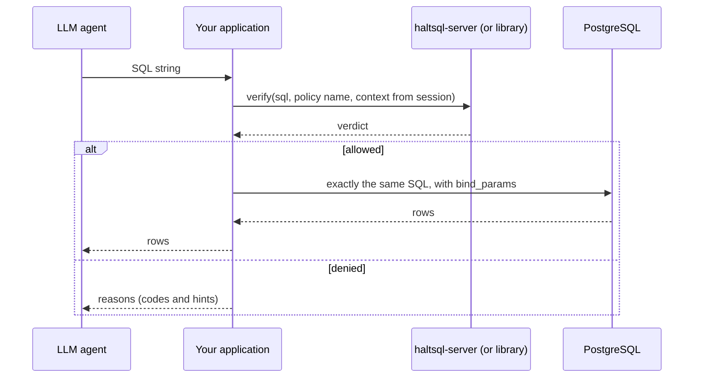
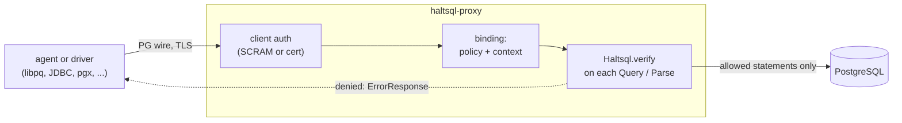

HaltSQL answers one question: **may this caller run this exact SQL string?** It
takes three inputs (a SQL string, a compiled policy, and a request context) and
returns a verdict. Everything else in the repository is a way to load those
inputs, deliver that answer, or act on it.

This page is the map. The other pages in this section zoom in:

| Page | What it covers |
|---|---|
| [Verification pipeline](./verification-pipeline.md) | One `verify` call, end to end |
| [Parser](./parser.md) | libpg_query, the worker pool, and the typed AST |
| [Analyzer](./analyzer.md) | Scopes, rule families, and how reasons are collected |
| [Tenancy proof](./tenancy-proof.md) | What HaltSQL must prove before it touches a tenant table |
| [Policies and config](./policies-and-config.md) | How documents become a compiled policy |
| [Deployment modes](./deployment-modes.md) | Library, CLI, sidecar, and proxy side by side |
| [Proxy internals](./proxy-internals.md) | The PostgreSQL wire-protocol firewall |
| [Server internals](./server-internals.md) | The HTTP sidecar |
| [Policy lifecycle](./policy-lifecycle.md) | Drafting, testing, signing, and rolling out policies |
| [Assurance](./assurance.md) | How the guarantees are tested |

## The core idea

`Haltsql.verify` is a pure function of its three inputs. It does not open a
socket, read a file, or look at the clock except to report `elapsed_us`. That is
what makes it cheap to embed, easy to test, and safe to run in parallel.

## Components

The repository is an OCaml (dune) monorepo. Libraries live in `lib/`,
executables in `bin/`, and client code in `clients/` and `integrations/`.

### The verification core

These libraries are all you need to verify SQL. None of them does network I/O.

| Component | Library name | Role |
|---|---|---|
| `lib/core` | `haltsql.core` | Shared types: `Ast` (the typed SQL AST), `Policy` (compiled policy), `Context`, `Catalog`, `Reason` (stable reason codes), `Verdict` (result and its JSON form). Depends only on `yojson`. |
| `lib/pgquery` | `haltsql.pgquery` | Thin C binding to the vendored libpg_query (Postgres 17 grammar). Parse to JSON and fingerprint, on a pool of big-stack worker threads. See [Parser](./parser.md). |
| `lib/parse` | `haltsql.parse` | `Pg_parse`: size and depth limits, then converts libpg_query's JSON into the typed `Ast`, failing closed on anything it does not map. |
| `lib/analyzer` | `haltsql.analyzer` | Applies the policy to one `Ast.stmt`: scopes and name resolution, the rule families, and tenancy proofs. Depends only on `haltsql.core`. See [Analyzer](./analyzer.md). |
| `lib/load` | `haltsql.load` | Reads YAML or JSON documents (`Policy`, `Config`, `Catalog`, `TestSuite`), validates them, and compiles a `Policy.t` with its `sha256:` version. See [Policies and config](./policies-and-config.md). |
| `lib/haltsql` | `haltsql` | The public facade. Re-exports the modules above and defines `verify` (in `lib/haltsql/haltsql.ml`) plus `Suite_runner` for policy test suites. |

Notice what the analyzer does **not** depend on: the parser. It only ever sees
the typed AST. That keeps the rule code independent of libpg_query's JSON shape.

### Delivery surfaces

| Component | Binary | Role |
|---|---|---|
| `bin/haltsql` | `haltsql` | The CLI: `verify`, `explain`, `validate`, `convert`, `schema`, `test`, `config show`, `version`, `lint-policy`, `policy draft`, `rls`, `bundle`. See [cli.md](../cli.md). |
| `bin/server` (+ `bin/server/lib`) | `haltsql-server` | HTTP sidecar: `POST /v1/verify`, `GET /v1/policies`, health, readiness, and `/metrics`. Adds authentication, audit, and telemetry around `Haltsql.verify`. See [Server internals](./server-internals.md) and [http-api.md](../http-api.md). |
| `bin/proxy` + `lib/pgwire` | `haltsql-proxy` | PostgreSQL wire-protocol (v3) firewall. Clients connect to it as if it were Postgres; every simple `Query` and every `Parse` goes through `Haltsql.verify`, and the proxy binds tenancy parameters itself. See [Proxy internals](./proxy-internals.md) and [proxy.md](../proxy.md). |

### Supporting libraries

| Component | Library name | Used by | Role |
|---|---|---|---|
| `lib/auth` | `haltsql-server.auth` | server | Caller authentication: JWT/JWK, OIDC discovery and JWKS caching, mTLS identities, and merging the authenticated context with the request body context. |
| `lib/telemetry` | `haltsql-server.telemetry` | server | OpenTelemetry (OTLP/HTTP JSON) exporter for traces and metrics, with a bounded non-blocking queue. |
| `lib/cloud` | `haltsql.cloud` | CLI, server | Audit hash chain, S3 and GCS audit sinks, and secret resolvers for Vault, AWS Secrets Manager, and GCP Secret Manager. |
| `lib/bundle` | `haltsql.bundle` | CLI, server | Signed policy bundles: canonical JSON, Ed25519 signatures, digest checks. See [policy-bundles.md](../policy-bundles.md). |
| `lib/rlsgen` | `haltsql.rlsgen` | CLI | Generates role, grant, and row-level-security DDL that mirrors a policy, and checks a live database for drift. See [rls-generation.md](../rls-generation.md). |
| `lib/catalog_tools` | `haltsql.catalog_tools` | CLI | Catalog snapshots from a live Postgres (`schema pull`), PII metadata importers, and the starter policy drafter. See [schema-and-pii.md](../schema-and-pii.md). |

### Clients and integrations

| Directory | What it is |
|---|---|
| `clients/python` | Python SDK: sync and async clients, guarded execution for psycopg 3, asyncpg and SQLAlchemy, and a local CLI verifier. |
| `clients/typescript` | `@haltsql/client` for Node.js, with `guardedTransaction` and `guardedQuery` for node-postgres. |
| `clients/go` | Go client with `GuardedQueryTx` and `GuardedQuery` for `database/sql`. |
| `clients/java` | `com.haltsql:haltsql-client` with `JdbcGuard` for PgJDBC. |
| `clients/mcp` | `haltsql-mcp`, a Model Context Protocol server that gives an agent verified, read-only SQL access. |
| `clients/testvectors` | Shared request and verdict vectors that every client is tested against. |
| `integrations/langchain`, `integrations/llamaindex`, `integrations/vanna` | Agent framework wrappers built on the Python SDK. |

The clients talk to `haltsql-server` over HTTP. They all follow the same rules:
fail closed, check that the verdict's `sql_sha256` matches the SQL they sent,
and execute exactly the verified string with `bind_params`. See
[integrations.md](../integrations.md).

## Dependency graph

The arrows point from a component to what it depends on (taken from the `dune`
files).

Two things this graph guarantees:

- **The core has no network code.** `haltsql.core`, `haltsql.parse`,
  `haltsql.analyzer`, and `haltsql.load` pull in no HTTP or TLS libraries.
  Network code lives in the supporting libraries, which the core never imports.
- **Every surface uses the same verifier.** The CLI, the sidecar, and the proxy
  all call the same `Haltsql.verify`. A policy that passes `haltsql test` in CI
  behaves the same way in the sidecar and the proxy.

## Where HaltSQL sits in your stack

HaltSQL sits between the code that **produces** SQL (an LLM agent) and the code
that **runs** it. There are two ways to place it.

### Advisory: library, CLI, or sidecar

Your application asks HaltSQL, then acts on the answer. This is the most common
setup.

The context (for example `tenant_id`) comes from your authenticated session,
never from the model. The SDKs implement this loop for you.

### Enforcing: the wire-protocol proxy

When you cannot change the code that runs the SQL (a BI tool, an unmodified
driver), put `haltsql-proxy` in front of the database. The proxy authenticates
each client, maps it to a policy and context, verifies every statement, and only
forwards what is allowed.

In both setups, run the SQL as a restricted database role with row-level
security as a second layer. `haltsql rls generate` can produce that DDL from the
same policy. See [defense-in-depth.md](../defense-in-depth.md) and
[Deployment modes](./deployment-modes.md).

## Design principles

### It never rewrites SQL

HaltSQL returns allow or deny. It never adds a `WHERE` clause, injects a
`LIMIT`, or rewrites a table name. A rewriter would have to be correct for every
query it touches, and a subtle bug would silently change what runs. A verifier
only has to be correct about what it allows, and its mistakes show up as
visible denials. The caller runs the exact string that was verified, and
`sql_sha256` in the verdict lets anyone check that.

(The proxy fills in tenancy parameter values at `Bind` time, using the values
from the verdict. It does not change the SQL text.)

### It never connects to the database to verify

Verification uses only the policy, the optional catalog snapshot inside it, and
the context. There is no round trip to Postgres. That keeps latency in
microseconds, keeps the verifier free of database credentials, and makes a
verdict reproducible offline. Schema knowledge comes from a snapshot taken ahead
of time by `haltsql schema pull` and committed next to the policy. The tools
that do talk to a database (`schema pull`, `rls check`, and the proxy's upstream
connection) are separate from the verification path.

### It fails closed

Anything HaltSQL does not fully understand is denied:

- SQL the converter does not map becomes an explicit `Unsupported` node, which
  the analyzer denies with `E_UNSUPPORTED`. See [Parser](./parser.md).
- A statement kind outside the policy is `E_STATEMENT_KIND`.
- A column it cannot resolve unambiguously is `E_COLUMN_UNRESOLVED`. It never
  guesses.
- Any exception inside `verify` becomes a single `E_INTERNAL` denial.
  `verify` is total: it always returns a verdict.
- Rule code matches AST constructors without wildcard arms, so adding a
  construct to the AST is a compile error until every rule handles it.

See [ADR-0002](../adr/0002-typed-ast-fail-closed.md).

### Reason codes are stable

Every denial carries one or more reasons with a machine-readable `code` such as
`E_TENANT_MISSING`. Codes are part of the public API: never renamed, never
reused. Messages and hints can improve between releases; codes cannot. Agents
and dashboards match on `code`. See [reason-codes.md](../reason-codes.md) and
[ADR-0004](../adr/0004-verdict-schema-and-reason-codes.md).

### It is deterministic

For the same SQL, policy, and context, `allowed`, the reason codes, `tables`,
`columns`, and `bind_params` are always the same. The analyzer keeps all its
state in a per-call accumulator (`lib/analyzer/env.ml`) and has no global
mutable state, so parallel calls cannot interfere. Only `elapsed_us` varies. The
policy's `version` is a content hash, so a logged verdict names exactly the
policy that produced it.

### It uses the real Postgres parser

HaltSQL parses with libpg_query, which is the actual PostgreSQL grammar
extracted into a C library. A hand-written grammar would drift from the server,
and any difference between how HaltSQL and Postgres read a string is a potential
bypass. See [ADR-0001](../adr/0001-parser-libpg-query.md).
