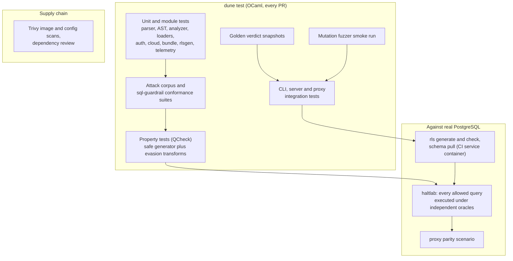
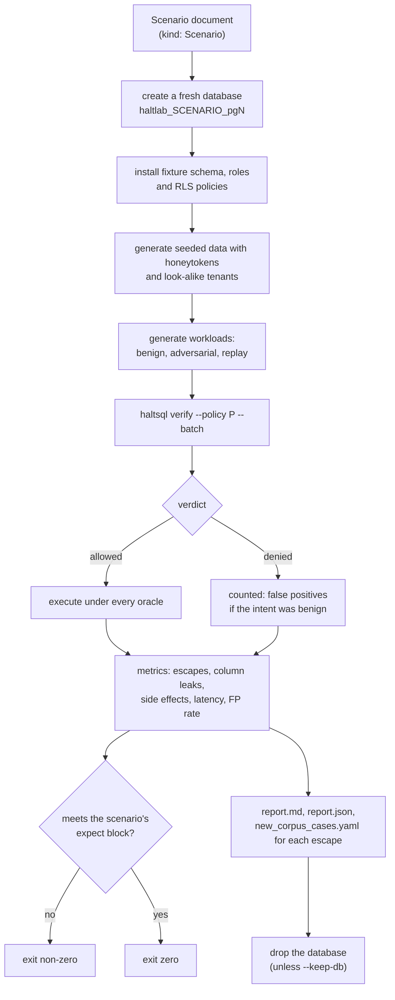
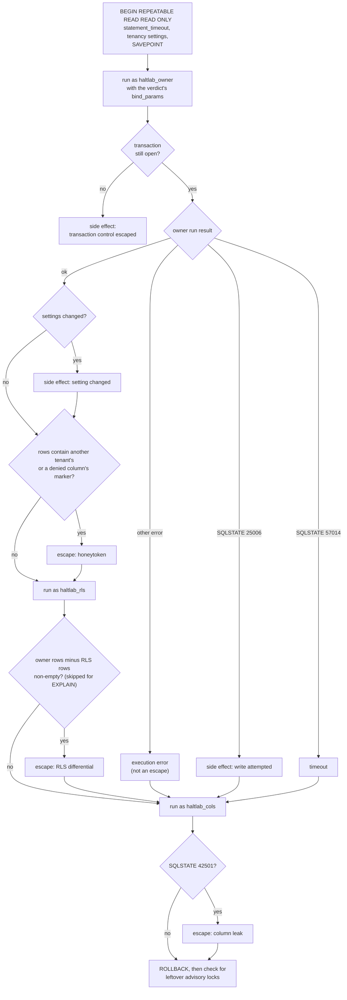
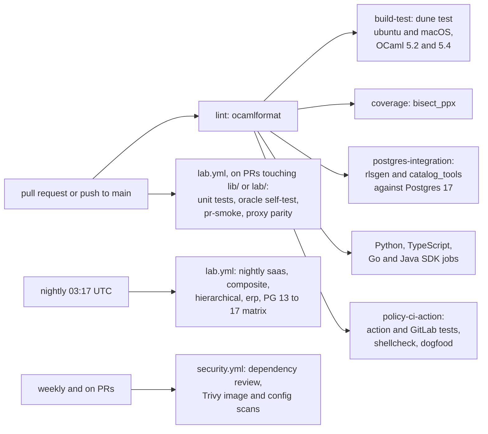

A firewall is only useful if you can trust what it allows. HaltSQL is tested
in layers, and each layer answers a different question. The most important
one, the haltlab enterprise lab, does not trust HaltSQL at all: it runs every
query HaltSQL allows against a real database and lets the database decide
whether the query was safe.

For writing tests for your *own* policies, see
[testing.md](../testing.md#policy-test-suites) and
[policy-lifecycle.md](./policy-lifecycle.md).

## The layers

The arrows show the direction of increasing realism. Unit tests are fast and
precise. The lab is slow but answers the question that matters: *did anything
actually leak?*

As of this writing there are about 3,300 OCaml test cases across 19 Alcotest
suites (one per `test/*/test_*.ml` executable plus the corpus runner),
together with the fuzzer smoke run. Exact counts change with every change.

## Unit and analyzer tests

Each OCaml library has its own suite under `test/`:

| Directory | Covers |
|---|---|
| `test/pgquery`, `test/parse` | The libpg_query bridge and the conversion to the typed AST |
| `test/analyzer` | Every rule family, with positive and negative cases, against the fixture policies in `test/fixtures/policies/` |
| `test/load` | YAML/JSON reading, typing, positions, policy and config decoding |
| `test/auth`, `test/cloud`, `test/telemetry` | JWT/OIDC/mTLS, secret providers and object sinks (with fake HTTP), OTLP export |
| `test/bundle` | Bundle build, signing and every verification step, including tampered bytes, wrong keys and non-canonical encodings |
| `test/catalog_tools`, `test/rlsgen` | Schema pull, PII import, policy draft, RLS generation (unit, golden and live) |

## The attack corpus and conformance

The attack corpus (`test/corpus/`) is a set of `TestSuite` files, one per
threat class: statement smuggling, data-modifying CTEs, side-effect functions,
system catalogs, identifier confusion, comments and quoting, casts, resource
limits, writes, and one file per tenancy shape (`tenancy_joins`,
`tenancy_scoping`, `tenancy_setops`, `tenancy_subqueries`, `tenancy_sets`,
and more). It has roughly 40 suite files and more than 1,200 cases. Every
fixed bypass gets a case so it cannot come back.

`test/conformance/` ports the test cases of the MIT-licensed sql-guardrail
project: 487 cases (180 allow, 307 deny), each tagged with its source test.
Intentional differences are tagged (`differs`, `differs-code`) rather than
hidden. See `test/conformance/README.md`.

Both directories are run by one runner, `test/runner/corpus.ml`. It discovers
every `*.suite.yaml` and `*.suite.json`, runs each case through
`Haltsql.verify`, prints a summary per threat class, and reports one Alcotest
case per corpus case. Because suites are ordinary `TestSuite` documents, a
corpus case looks exactly like a test a user would write.

## Property tests

`test/property/test_property.ml` uses QCheck over the `saas` fixture policy:

1. **Safe generator.** Random queries with a correct tenant predicate on every
   occurrence, allowed columns and functions, and a constant `LIMIT`. They
   must be allowed with `bind_params = [(1, tenant)]`.
2. **Evasion transforms.** Meaning-preserving transforms (CTE or derived-table
   wrapping, case, quoting, `U&""` escapes, comments, schema qualification,
   filtered `UNION` branches) must keep the query allowed.
   Isolation-breaking transforms must deny it with the expected code.
3. **Determinism.** Verifying twice gives identical verdict JSON (apart from
   `elapsed_us`), and the YAML policy and its JSON twin give identical
   verdicts, including `policy_version`.
4. **Totality.** Random bytes and SQL token soup never raise, and any denial
   uses only known reason codes, never `E_INTERNAL`.

The seed is fixed (default `20261107`) and printed, so a failure can be
replayed. `HALTSQL_QCHECK_SEED` and `HALTSQL_QCHECK_COUNT` override it.

## Golden tests

`test/golden/test_golden.ml` checks the full verdict JSON (minus
`elapsed_us`) for a set of representative queries against snapshots in
`test/golden/expected/`. Any change to a message, hint, location or field
shows up as a diff in review. `HALTSQL_GOLDEN_UPDATE=1` rewrites the
snapshots deliberately.

## Fuzzing

`test/fuzz/fuzz.ml` is a mutation fuzzer. Its seeds are every SQL string in
the corpus and conformance suites, plus the text of every policy, suite and
catalog document. Each iteration applies 1 to 8 random mutations (bit flips,
insertions, splicing, SQL-token insertion, truncation, deep nesting) and
checks:

- `Haltsql.verify` never raises; a denial has at least one reason, every code
  is a known code, and never `E_INTERNAL`; an allowed verdict has no reasons;
  each verify takes under 2 seconds;
- the YAML and JSON readers and the policy loader never raise.

`dune test` runs a short pass (3,000 iterations by default). Long runs use
`HALTSQL_FUZZ_ITERS`. A failing input is minimized and written to
`test/fuzz/crashes/`.

## Integration tests

| Suite | What it drives |
|---|---|
| `test/cli/test_cli.ml` | The built `haltsql` binary: commands, exit codes, JSON output |
| `test/server/` | `haltsql-server` in process and as a subprocess: HTTP API, auth end to end, signals, reload, integrations |
| `test/proxy/test_pgwire_unit.ml` | Wire-protocol parsing and proxy state, without a database |
| `test/proxy/test_proxy_integration.ml` | The `haltsql-proxy` binary against Postgres 17, with a real driver (psycopg) and a raw protocol client |
| `test/rlsgen/t_integration.ml` | Applies generated RLS to a live database twice (idempotence), checks isolation as the generated role, and checks that `rls check` finds exactly the injected drift |

Tests that need Postgres skip cleanly when it is not reachable, so `dune test`
works on a laptop. CI runs them with a Postgres service.

## haltlab: the database is the judge

`lab/` is a Python harness (see `lab/README.md` in the repository). It is
kept outside the OCaml build on purpose: the verifier under test and the judge
share no code.

### A run, start to finish

The fixtures are synthetic but shaped like real systems: `saas_shared`
(shared tables keyed by `tenant_id`, PII columns, a global table), `composite`
(`org_id`, `workspace_id`), `hierarchical` (a parent sees a list of child
tenants), and `erp_large` (400+ generated tables across 12 schemas, quoted and
reserved-word names, partitions, views). The data includes look-alike tenants
such as `ACME`, `acme ` with a trailing space, a Cyrillic `а`, and zero-width
spaces, plus `NULL` and empty tenant rows.

The adversarial workload applies evasion transforms from
`lab/generators/evasion.py` (wrap in a CTE, add an `OR true`, add an unfiltered
`UNION` branch, and many more). Every escaping query is written out as a
ready-to-use `TestSuite` case, so lab findings flow straight into the attack
corpus.

### The oracles for one allowed query

Each allowed query runs inside one `REPEATABLE READ READ ONLY` transaction
that is always rolled back (`check_item` in `lab/harness/oracles.py`). The
tenancy settings that the fixture's RLS policies read (`app.<context field>`)
are set with `set_config(..., true)`, and the query is run under three roles:

| Role | Property | Used to detect |
|---|---|---|
| `haltlab_owner` | Owns the tables, not subject to RLS. What production would return. | Reference result, honeytokens, side effects |
| `haltlab_rls` | `NOBYPASSRLS`, filtered by RLS to the caller's tenancy | Rows the owner saw that RLS hides |
| `haltlab_cols` | `SELECT` only on the policy's allowed columns | Allowed queries that read a denied column |

Why each oracle exists:

- **RLS differential.** Repeatable read gives all runs the same snapshot, so a
  legitimate query returns the same multiset of rows as owner and as the RLS
  role. Any extra row the owner sees is another tenant's row. The comparison
  is a multiset difference, so duplicates count.
- **Honeytokens.** Every tenant's rows carry unique markers
  (`HT-<tenant>-<table>-<n>`), and so does every column the policy denies
  (`HTCOL-<table>-<column>-<n>`). Finding one in the output is proof of a
  leak, even through aggregates or string functions that RLS comparison might
  not explain.
- **Column privileges.** If Postgres raises "permission denied" for a role
  that can only read the allowed columns, HaltSQL allowed a column it should
  not have.
- **Side effects.** A read-only transaction turns writes into SQLSTATE 25006.
  Settings are compared before and after. A query that ends the harness
  transaction, or leaves a session-level advisory lock (which survives
  `ROLLBACK`), is flagged.
- **Timeouts.** A query that exceeds `statement_timeout` (2 seconds by
  default) is resource abuse.

Only RLS, honeytoken and column findings count as **escapes**. Errors that
are none of the above, such as a query the generator built wrongly, are
counted as execution errors.

### Testing the judge: the oracle self-test

An oracle that never fires looks exactly like a firewall that never leaks.
So the lab tests its own oracles. `lab/harness/fake_verifier.py` is a stand-in
for `haltsql verify --batch` that **allows everything** and binds `$n` to the
tenancy context values. Run against the adversarial workload, it must leak.

`lab/tests/test_integration.py` asserts that, with the allow-everything
verifier, the run reports more than 50 escapes, at least one column leak and
at least one side effect. It also checks per transform: leaky ones
(`union_unfiltered_branch`, `or_true`, `left_join_preserved_side`,
`star_over_pii`) must produce escapes, and meaning-preserving ones
(`wrap_cte`, `wrap_subquery`, `quoted_identifiers`, `explain_plain`) must not,
so the oracles are not just flagging everything. Finally, a corpus file must
be written. A second
test uses a deny-everything verifier and asserts that nothing is executed. A
third runs the real `haltsql` binary through the smoke scenario and asserts
that it passes. `make selftest` runs
`scenarios/oracle-selftest.yaml --fake-verifier allow` by hand.

### Proxy parity

`lab/proxy/` runs the same scenarios through a live `haltsql-proxy`. It sends
every query with **another tenant's ID** in each tenancy parameter, and checks
that the proxy's decision equals the CLI verdict, that allowed queries return
the same rows as the SQL run directly with the CLI's `bind_params`, and that
no foreign honeytoken appears. See
[proxy-internals.md](./proxy-internals.md).

## CI

| Workflow | When | What |
|---|---|---|
| `.github/workflows/ci.yml` | Pushes to `main`, every PR, and on demand | Formatting first; every other job waits for it: build and `dune test` on a 2 x 2 OS and OCaml matrix, coverage, Postgres integration, SDK jobs, policy-CI action self-test |
| `.github/workflows/lab.yml` | Nightly, on PRs touching `lab/`, `lib/` or the workflow, and on demand | Lab unit tests, the oracle self-test, scenarios (`pr-smoke` on PRs, the nightly set and the version matrix on schedule), proxy parity and proxy integration tests; reports uploaded as artifacts |
| `.github/workflows/security.yml` | Every PR, weekly (Mondays), and on demand | Dependency review, Trivy image and configuration scans |
| `.github/workflows/pages.yml` | Pushes to `main` and PRs touching `docs/` or `website/`, and on demand | Builds this docs site; deploys it to GitHub Pages from `main` |
| `.github/workflows/release.yml` | `v*` tags, and on demand for an existing tag | Release build and artifacts |

## Where to go next

- [tenancy-proof.md](./tenancy-proof.md) explains the rules most of these
  tests exercise.
- [threat-model.md](../threat-model.md) lists the threats the corpus classes
  map to.
