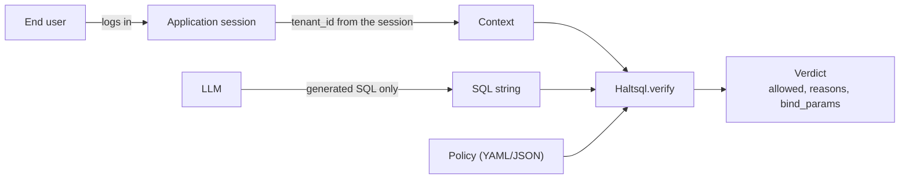
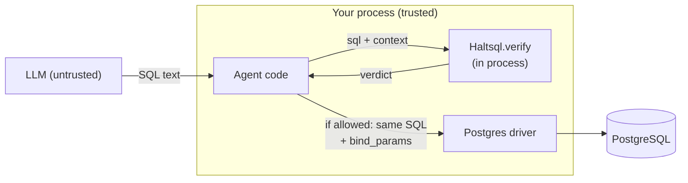
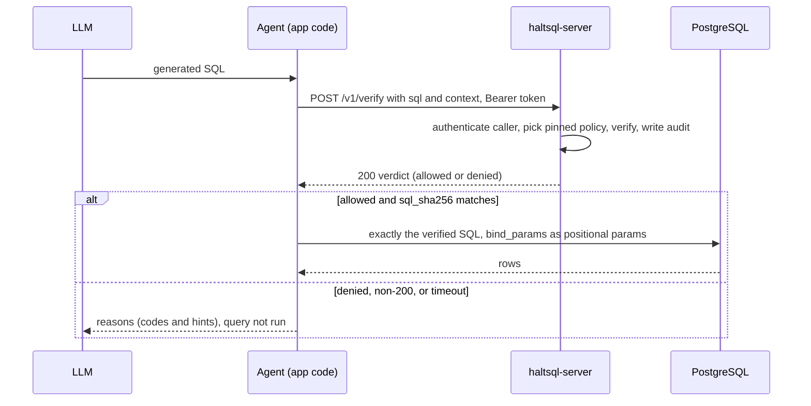
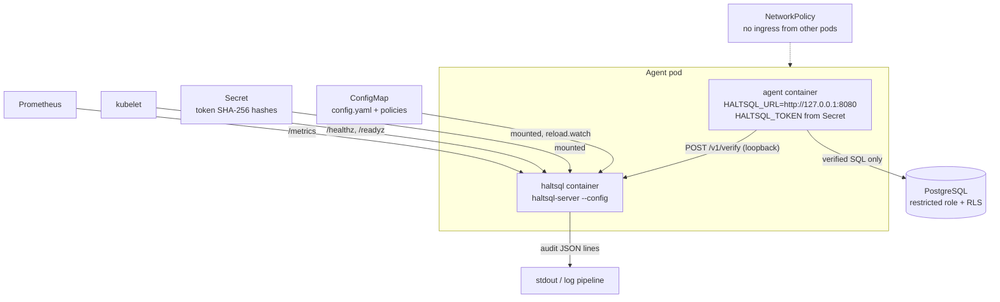
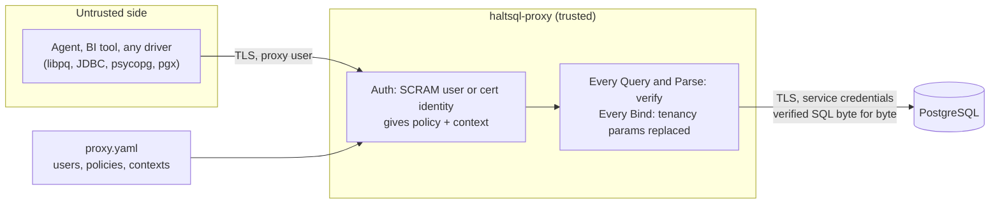
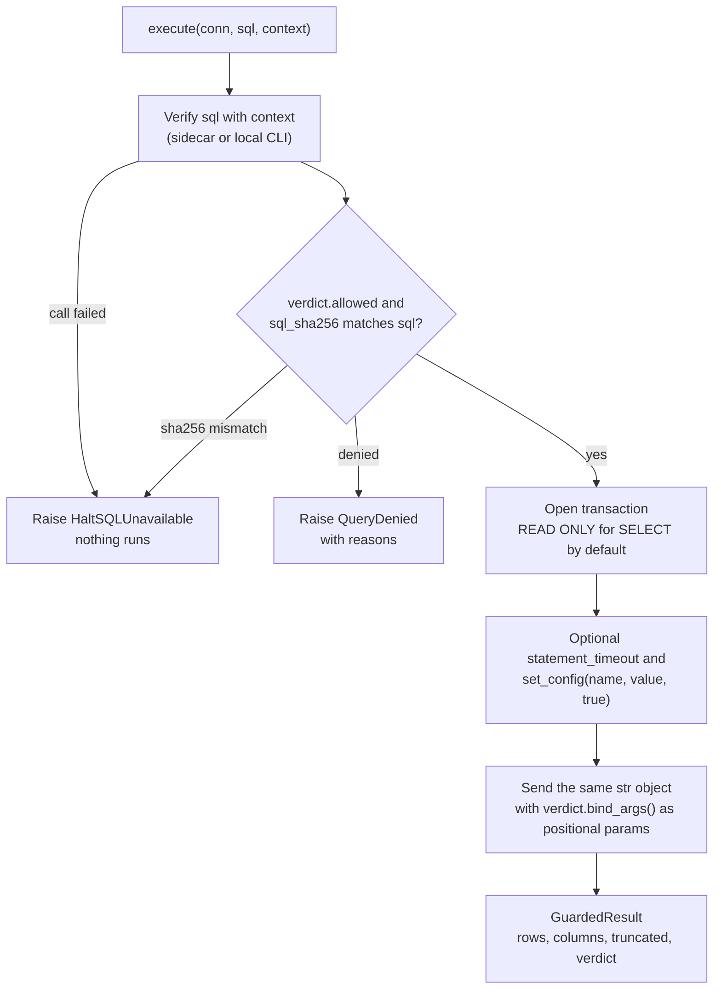
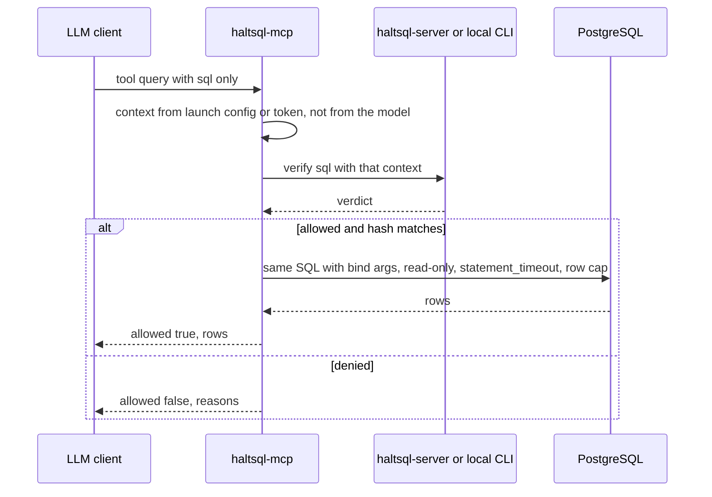

HaltSQL has one verification core, `Haltsql.verify policy context sql`, and
four ways to reach it. They differ in where the check runs, who binds the
tenant values, where the context comes from, and whether the application can
skip the check.

| Mode | Binary or package | Who enforces the verdict |
|---|---|---|
| Embedded library / CLI | `haltsql` OCaml library, `haltsql` CLI (`bin/haltsql`) | Your code |
| HTTP sidecar | `haltsql-server` (`bin/server`) | Your code (the server only answers) |
| Wire proxy | `haltsql-proxy` (`bin/proxy`, `lib/pgwire`) | The proxy itself |
| SDKs and MCP | `clients/*`, `integrations/*` (on top of the sidecar or the CLI) | The SDK's guarded-execute helper |

The first two modes answer the question "is this SQL allowed?". The caller
must act on the answer. The proxy enforces the answer: the SQL never reaches
the database unless it was verified. The SDKs sit in between: they enforce
the answer for you, as long as your code goes through them.

## The rule that applies to every mode

The **context** (tenant id, user id, and so on) decides which rows a query may
touch. It must come from something the model cannot influence: the
authenticated session, a verified token, a client certificate, or a config
file. It must never come from the prompt, from a tool argument the model
fills in, or from the generated SQL.

If the model could set the context, a bound tenancy policy would prove the
query is scoped to whatever tenant the model chose. See
[tenancy-proof.md](./tenancy-proof.md) for what the proof covers.

Each mode has its own trusted source of context:

| Mode | Context comes from |
|---|---|
| Library / CLI | The `Context.t` your code builds, or `--context` / `--context-file` |
| Sidecar, static token | The request body's `context` (the calling service is trusted to fill it from its session) |
| Sidecar, OIDC | `context_claims` of the verified JWT, plus only the body fields in `request_context_fields` |
| Sidecar, mTLS | The identity's static `context`, plus only the body fields in `request_context_fields` |
| Proxy | The `context` of the SCRAM user or certificate identity in the proxy config |
| MCP server | `HALTSQL_MCP_CONTEXT` / `--context-file` (stdio) or the tokens file (HTTP); never a tool argument |

## Mode 1: embedded library or CLI

The OCaml library runs the whole pipeline in your process: parse with the
vendored libpg_query, convert to the typed AST, analyze against the policy,
return a verdict. There is no network hop and no extra process.

The `haltsql` CLI wraps the same call. `haltsql verify` exits `0` when the
query is allowed, `1` when it is denied, and `2` when the policy, context or
input cannot be loaded (see [../cli.md](../cli.md)). With `--batch` it reads
JSON lines on stdin and writes one verdict per line, which is how the Python
`LocalVerifier` (`clients/python/src/haltsql/local.py`) uses it.

Your code owns every step after the verdict: refusing a denied query, running
exactly the verified string, and binding `bind_params` as positional `$n`
parameters. Nothing stops buggy code from running the SQL anyway, so wrap the
call in one helper and use only that helper.

## Mode 2: HTTP sidecar

`haltsql-server` exposes `POST /v1/verify` (see [../http-api.md](../http-api.md)).
The agent sends the SQL, and the server returns the same verdict JSON the
library produces. The server never connects to a database.

Trust boundaries in this mode:

- The **server** trusts its config: policies, token hashes, OIDC providers,
  mTLS identities. Each caller is pinned to exactly one policy, so it cannot
  ask for a looser one (`403 FORBIDDEN`).
- The **agent** is trusted to run only allowed SQL and to bind the values from
  `bind_params`. A compromised agent can still skip the check. That is why
  the database-side controls in [../defense-in-depth.md](../defense-in-depth.md)
  (a restricted role, row-level security) still matter.
- A denial is a normal `200` response with `allowed: false`. Any non-200
  status, timeout or connection error must be treated as a denial.

How the server works inside is described in
[server-internals.md](./server-internals.md).

### Kubernetes sidecar topology

The recommended shape is one `haltsql-server` container per agent pod. The
agent calls `http://127.0.0.1:8080`, so verification traffic never leaves the
pod. `deploy/k8s/sidecar-example.yaml` and [../deployment.md](../deployment.md)
show the full manifests.

Points worth knowing:

- Tokens are required even inside the pod, so a neighbor that reaches the
  port still cannot verify against a policy it holds no token for.
- ConfigMaps mounted with `subPath` are not updated in running pods. Mount the
  ConfigMap as a directory if you rely on `reload.watch`, or roll the
  deployment on policy changes.
- The Helm chart in `deploy/helm/haltsql` deploys the other shape: a shared
  `haltsql-server` Deployment behind a Service, with a PodDisruptionBudget,
  HPA, NetworkPolicy (`networkPolicy.ingressFrom`) and ServiceMonitor. Use it
  when many agents share central policy management. Then turn on built-in TLS
  (`tls.enabled`) or terminate TLS in front of it, and pin every token or
  identity to its policy.

## Mode 3: wire proxy

`haltsql-proxy` speaks the PostgreSQL v3 wire protocol. Clients connect to it
as if it were Postgres. It authenticates them (SCRAM-SHA-256 or a TLS client
certificate), connects upstream with its own service credentials, verifies
every `Query` and `Parse`, and overwrites tenancy parameters in every `Bind`.

What changes compared to the sidecar:

- **No application changes** beyond the connection string. Drivers that cannot
  be modified still get enforcement.
- **The client never sees the database credentials** and cannot pick its
  policy or its tenant. The context is bound to the proxy user in the config.
- **The proxy binds tenant values.** Whatever the client sends for a tenancy
  parameter is replaced with the session's context value.
- Queries that need bound tenancy parameters must use the extended protocol
  (prepared statements). Over the simple protocol they are denied with
  `E_PARAM_UNBOUND`, because there is no `Bind` message to rewrite.
- A denial arrives as an ordinary PostgreSQL `ERROR` (SQLSTATE `42501` by
  default), and the connection stays usable.

[proxy-internals.md](./proxy-internals.md) walks through the protocol
handling, and [../proxy.md](../proxy.md) is the configuration reference.

## Mode 4: SDKs and the MCP server

The official clients (`clients/python`, `clients/typescript`, `clients/go`,
`clients/java`) and the framework integrations (`integrations/langchain`,
`integrations/llamaindex`, `integrations/vanna`) call the sidecar, or the CLI
in local mode. They add a **guarded-execution** helper so application code
does not have to get the post-verdict steps right by hand. See
[../integrations.md](../integrations.md) and the per-language guides
([../sdk-python.md](../sdk-python.md), [../sdk-typescript.md](../sdk-typescript.md),
[../sdk-go.md](../sdk-go.md), [../sdk-java.md](../sdk-java.md)).

The Python helper (`clients/python/src/haltsql/guard.py`: `execute`,
`execute_async`, `execute_on_engine`) shows the flow every client follows:

Why each step exists:

- **The hash check** (`Verdict.matches_sql`) proves the verdict is for this
  exact string, not a verdict for a different query that got mixed up.
- **Running the same string** matters because any rewrite (quoting,
  placeholder conversion, formatting values into the SQL) would run SQL that
  was never verified. psycopg's `RawCursor` and asyncpg send the text
  unchanged with native `$n` placeholders.
- **`bind_args()`** supplies the tenant values the server computed from the
  context, in parameter order. The model never supplies them.
- **The read-only transaction** is a second layer: even if a policy allowed
  more than intended, a `SELECT` path cannot write.

`haltsql-mcp` (`clients/mcp`, see [../mcp.md](../mcp.md)) applies the same flow
behind Model Context Protocol tools (`query`, `explain_denial`,
`list_tables`, `describe_policy`). Its tenant context is never a tool
argument: extra arguments such as `tenant_id` are ignored. Over stdio there
is one context per process; over streamable HTTP each bearer token maps to
its own context in a tokens file.

## Comparison

| | Library / CLI | HTTP sidecar | Wire proxy | SDKs / MCP |
|---|---|---|---|---|
| Extra latency | None for the library (in process); one process spawn per CLI call or batch | One loopback HTTP round trip | Verification per `Query`/`Parse`, plus one extra network hop for every message | Same as the backend they use (sidecar or CLI) |
| Code changes | Call `Haltsql.verify` (OCaml only) or run the CLI | Call `/v1/verify`, act on the verdict | Change the connection string; use prepared statements for tenant-scoped queries | Replace your execute call with the guarded helper |
| Who binds tenant values | Your code, from `bind_params` | Your code, from `bind_params` | The proxy, overwriting client values in `Bind` | The SDK, from `verdict.bind_args()` |
| Where the context comes from | Your code | Body (static token) or the verified identity (OIDC, mTLS) | Proxy config, per SCRAM user or cert identity | Your app's session (SDK); launch config or token map (MCP) |
| Can the app skip the check? | Yes | Yes | No | Only by not using the helper |
| Failure mode | Fail closed is your job: deny on any error; CLI exit codes `1` and `2` both mean "do not run" | Any non-200, timeout or connection error is a denial; the server answers `503` when it cannot audit or authenticate | Denial is a SQL `ERROR`; upstream or auth problems are `FATAL`; nothing unverified is forwarded | `QueryDenied` or `HaltSQLUnavailable`; nothing runs |
| Audit | Yours | Hash-chained records per sink | JSON lines per statement | Through the sidecar's audit |

## Choosing a mode

- **Your agent is written in OCaml**: embed the library. Lowest latency, no
  moving parts. Build one helper that verifies and executes, and use only it.
- **Your agent is in Python, TypeScript, Go or Java**: run the sidecar and use
  the official SDK's guarded execute. This is the default recommendation.
- **The agent framework speaks MCP**: run `haltsql-mcp` against the sidecar.
  The model gets SQL tools, and the tenant stays out of its reach.
- **You cannot change the client** (a BI tool, a vendor agent, a JDBC app), or
  you do not trust the application code to honor verdicts: use the proxy.
  It is the only mode where a compromised client still cannot run
  unverified SQL or pick another tenant.
- **CI, notebooks and batch jobs**: the CLI, or the Python `LocalVerifier`,
  with no server to run.

Whatever you choose, keep the database-side controls: a role with the least
privilege that works, and row-level security as a second layer
([../defense-in-depth.md](../defense-in-depth.md)). HaltSQL proves things about
the SQL text. The database still enforces who may read what.

Related pages: [architecture.md](./architecture.md),
[verification-pipeline.md](./verification-pipeline.md),
[policies-and-config.md](./policies-and-config.md).
