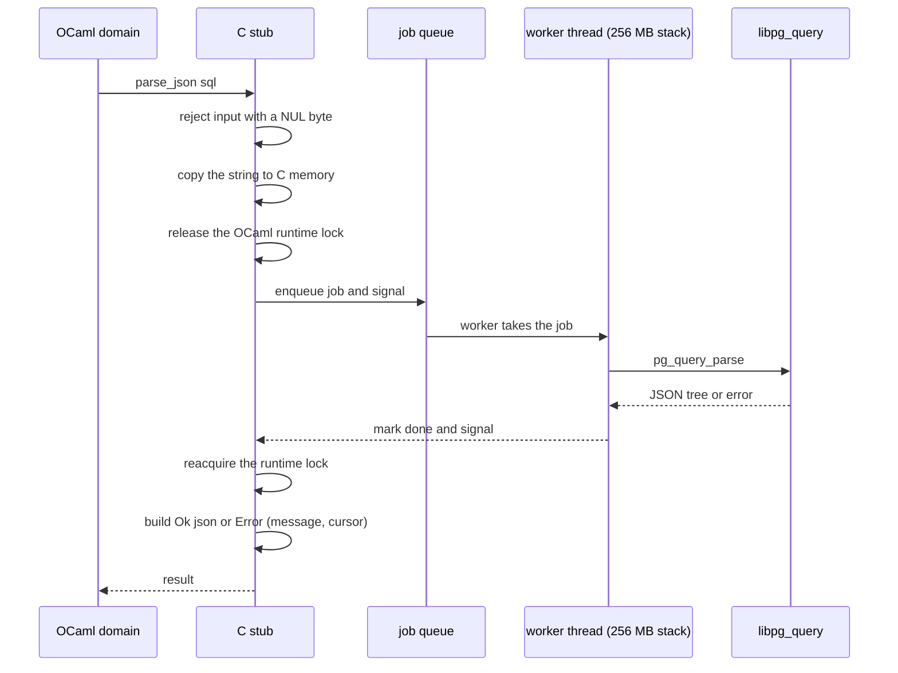
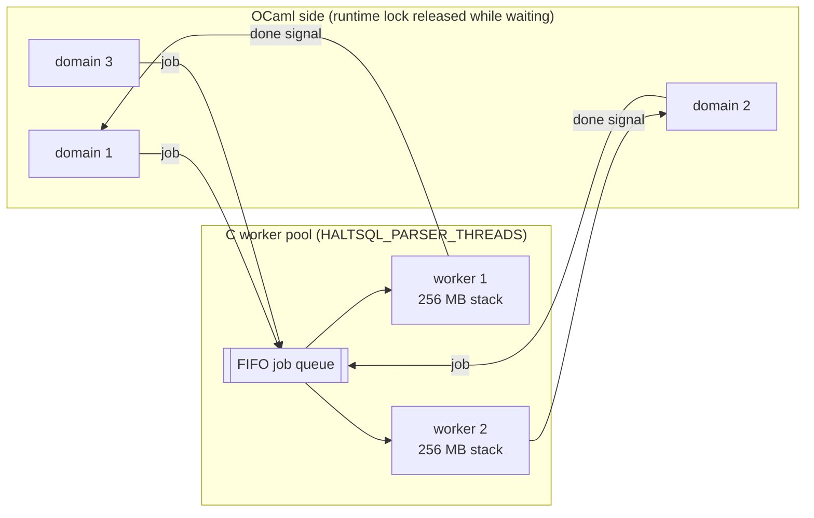
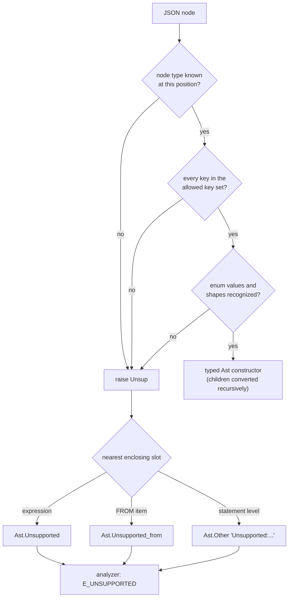

Parsing happens in two layers:

| Layer | Directory | Job |
|---|---|---|
| `Haltsql_pgquery` | `lib/pgquery` | A thin C binding to the vendored libpg_query. Turns a SQL string into libpg_query's JSON parse tree, or computes a fingerprint. |
| `Haltsql_parse.Pg_parse` | `lib/parse` | Enforces size and depth limits, then converts the JSON tree into HaltSQL's typed AST (`lib/core/ast.ml`), turning anything it does not understand into an explicit "unsupported" node. |

The analyzer never sees JSON. It only sees the typed AST. For where parsing fits
in a full `verify` call, see [Verification pipeline](./verification-pipeline.md).

## Why libpg_query

HaltSQL decides whether a string is safe to run on PostgreSQL. If HaltSQL read a
string differently from the server, an attacker could write SQL that looks
harmless to HaltSQL and does something else in Postgres. This is called a
**parser differential**, and it is the main reason HaltSQL does not have its
own grammar.

libpg_query extracts the actual Postgres parser (`gram.y`, the scanner, and the
code around them) into a C library. HaltSQL vendors **libpg_query 17-6.2.5**,
which tracks the **PostgreSQL 17.7** grammar, in `vendor/libpg_query`.
`haltsql version` prints the grammar version it was built with.

Why vendored, with our own stubs, instead of the opam `pg_query` bindings? The
reasons are recorded in [ADR-0001](../adr/0001-parser-libpg-query.md):

- the opam bindings bundle an old libpg_query (Postgres 13 grammar) that failed
  to build on current macOS toolchains and depend on ctypes and libffi;
- owning the stubs gives HaltSQL control over the OCaml runtime lock, thread
  stacks, and NUL-byte handling;
- the stubs expose only what HaltSQL needs: parse to JSON, fingerprint, and the
  Postgres version.

HaltSQL uses libpg_query's **JSON** output, not its protobuf output. JSON is
simpler to audit and keeps a protobuf decoder out of the trusted code. The AST
conversion isolates that choice, so it can change later.

Upgrading libpg_query is a deliberate event: replace the vendored tree, run the
full test suite and attack corpus, and write a new ADR for a new Postgres major.

## lib/pgquery: the C binding

The OCaml interface (`lib/pgquery/pgquery_raw.mli`) is small:

```ocaml
val parse_json : string -> (string, string * int) result
(* Ok json, or Error (message, cursorpos) where cursorpos is 1-based (0 if unknown) *)

val fingerprint : string -> (string, string) result
val pg_version : string      (* e.g. "17.7" *)
val pg_version_num : int     (* e.g. 170007 *)
```

### Why a worker pool

libpg_query keeps parser state in thread-local memory, so it is thread-safe. But
two properties make calling it directly from OCaml unsafe. Both are described
at the top of `lib/pgquery/pgquery_stubs.c`:

1. **Unbounded recursion.** libpg_query's JSON writer and fingerprinter recurse
   over the parse tree with no stack-depth check. OCaml 5 domains run on
   secondary threads, which get small stacks (512 KB on macOS). A small but
   deeply nested input such as `SELECT 1+1+1+...+1` could crash the process.
2. **A limited number of thread keys.** libpg_query creates one pthread key per
   thread it sees, and the number of keys is limited (512 on macOS). Calling it
   from many short-lived threads would run out.

So every libpg_query call runs on a **fixed pool of long-lived worker threads**
with **256 MB stacks**. The stack is virtual memory; only pages that are
actually touched get committed, so the cost is low.

| Setting | Value |
|---|---|
| Stack per worker | 256 MB (`PGQ_STACK_BYTES`) |
| Pool size | number of online CPUs by default |
| Override | `HALTSQL_PARSER_THREADS`, clamped to 1 to 64 |
| Start | lazily, on the first parse or fingerprint (`pthread_once`) |
| Queue | one FIFO job queue protected by a mutex and condition variable |

### What happens in one call



The details matter for safety:

- **The input is copied** before the runtime lock is released. While the lock is
  released, the OCaml garbage collector may move or free the original string.
- **The runtime lock is released while waiting.** Other OCaml domains and
  threads keep running, so parsing scales across cores. For example, the CLI's
  `verify --batch --jobs N` verifies on N OCaml domains that parse in parallel.
- **NUL bytes are rejected first.** A C string ends at the first NUL, so text
  after it would be invisible to the parser but might still reach the server
  through a driver that sends the whole buffer. The stub returns
  `query contains a NUL byte`, which becomes `E_PARSE`.
- **No workers means deny.** If no worker thread could be started, the stub
  returns an error (`parser worker threads unavailable`) and the query is
  denied. It never falls back to parsing on the caller's small stack.

### Many callers, few workers



Each job has its own condition variable, so a caller wakes only when its own job
is done.

### Fingerprinting

`fingerprint` runs libpg_query's fingerprinter on the same pool. Two queries get
the same fingerprint when they differ only in literal values, which makes it
useful for grouping queries in logs and dashboards. It is a full second parse,
so `verify` only computes it for input that already parsed into exactly one
statement. `Pg_parse.fingerprint` also refuses very long input and input that
fails the bracket prescan, and any error gives `null` rather than a failure.
The fingerprint is informational: no rule depends on it.

## lib/parse: limits before conversion

`Pg_parse.parse ~limits sql` (`lib/parse/pg_parse.ml`) applies the policy's
`limits` around the C call. The order is chosen so that expensive or recursive
work only runs on input that is already known to be bounded:

1. **Bytes.** Longer than `limits.max_bytes` (default 16,384): `E_LIMIT`.
2. **Bracket prescan.** More than 10,000 levels of `(` or `[` nesting:
   `E_LIMIT`. Brackets are counted everywhere, including inside literals and
   comments, so this can only over-count. It is a cheap backstop that keeps
   absurd input away from the C parser and the JSON reader.
3. **Parse** on the worker pool. A syntax error is `E_PARSE`, with `loc` set to
   the parser's cursor position (converted to a 0-based byte offset).
4. **Read the JSON.** Unreadable parser output is `E_INTERNAL`.
5. **Measure the tree iteratively.** Depth over `limits.max_depth` (default 64)
   or node count over `limits.max_nodes` (default 20,000): `E_LIMIT`. This walk
   uses an explicit stack, not recursion, and stops as soon as a limit is
   crossed.
6. **Convert** to the typed AST.

`parse` also catches `Stack_overflow` and `Out_of_memory` (both become
`E_LIMIT`) and any other exception (`E_INTERNAL`), so it never raises.

## From JSON to the typed AST

libpg_query knows roughly 250 node types. A rule engine that walked that raw
tree generically ("find all `RangeVar` nodes") would be easy to fool: a node
type the author never thought about could carry a table reference, a function
call, or a subquery that the rules never inspect. New Postgres releases add node
types, so that gap would grow over time.

Instead, HaltSQL converts the tree into its own **typed AST** that covers
exactly the subset of SQL it understands
([ADR-0002](../adr/0002-typed-ast-fail-closed.md)). The key rule:

> **Note:** nothing that could carry meaning is ever silently dropped. Anything
> the converter does not map precisely becomes an explicit "unsupported" node,
> and the analyzer denies every such node.

### How unknowns are caught

Every converter function first checks the node's keys against the exact set of
keys it understands (`check_keys`). An unknown key, an unknown enum value, an
unknown node type, or a malformed shape raises an internal `Unsup` exception
carrying a description and a location. That exception is caught at the
**nearest** enclosing place in the AST that has a slot for "unsupported":

| Where the unknown is found | What it becomes | How the analyzer reports it |
|---|---|---|
| Inside an expression | `Ast.Unsupported { node; loc }` | `E_UNSUPPORTED` ("expression node ...") |
| Inside a `FROM` item | `Ast.Unsupported_from { node; loc }` | `E_UNSUPPORTED` ("FROM item ...") |
| Anywhere else in a statement | `Ast.Other { kind = "Unsupported:<what>"; loc }` | `E_UNSUPPORTED` |
| A statement node that is not `SELECT`, `INSERT`, `UPDATE`, `DELETE`, or `EXPLAIN` | `Ast.Other { kind = "<NodeName>"; loc }` | `E_STATEMENT_KIND` |
| A sublink kind HaltSQL does not handle (`ROWCOMPARE`, `MULTIEXPR`, `CTE`) | `Ast.Other_sublink name` | `E_UNSUPPORTED` |

Catching at the nearest slot keeps the damage local: one odd expression turns
into one `E_UNSUPPORTED` reason, and the rest of the query is still analyzed so
the agent sees every other problem too.



### Statements

At the top, `stmt_of_node` maps exactly five statement nodes:

| libpg_query node | AST |
|---|---|
| `SelectStmt` | `Ast.Select` |
| `InsertStmt` | `Ast.Insert` |
| `UpdateStmt` | `Ast.Update` |
| `DeleteStmt` | `Ast.Delete` |
| `ExplainStmt` | `Ast.Explain` |
| anything else (`CreateStmt`, `DoStmt`, `CopyStmt`, `VariableSetStmt`, ...) | `Ast.Other { kind = node name }` |

The libpg_query wrapper around each statement (`RawStmt`) is checked too: an
unknown key there becomes `Unsupported:RawStmt.<key>`.

### Real examples

From `haltsql verify --json` with `examples/policies/saas.yaml`:

| SQL fragment | Caught as | Reason |
|---|---|---|
| `... TABLESAMPLE SYSTEM (10)` | FROM item `RangeTableSample` | `E_UNSUPPORTED`: FROM item RangeTableSample is not supported ... |
| `GROUP BY ROLLUP(o.status)` | expression node `GroupingSet` | `E_UNSUPPORTED`: expression node GroupingSet is not supported ... |
| `SELECT xmlelement(name foo)` | expression node `XmlExpr` | `E_UNSUPPORTED`: expression node XmlExpr is not supported ... |
| `ORDER BY o.id FETCH FIRST 5 ROWS WITH TIES` | statement level, unknown enum value | `E_UNSUPPORTED`: SelectStmt.limitOption=LIMIT_OPTION_WITH_TIES is not supported ... |
| `CREATE TABLE x (a int)` | statement node `CreateStmt` | `E_STATEMENT_KIND`: CreateStmt statements are not allowed |

### Conventions the converter relies on

A few properties of the typed AST are worth knowing when reading rule code:

- **Identifiers are exactly as Postgres's scanner produced them.** Unquoted
  identifiers are already folded to lower case, quoted identifiers keep their
  case, and `U&"..."` escapes are already decoded. HaltSQL never re-implements
  case folding.
- **Integer constants are kept as text** (`Int of string`) to avoid overflow.
  The analyzer normalizes them when it needs to compare values.
- **Locations are byte offsets** into the original SQL, or `-1` when unknown.
  They become the `loc` field of a reason.
- **Catalog-qualified names** (`db.schema.table`) are not mapped; they become
  `Unsupported_from`.
- **No wildcard matches downstream.** The analyzer matches every AST type
  exhaustively, without `_ ->` arms. Adding a constructor to `lib/core/ast.ml`
  is a compile error in every rule that must consider it, so a new construct
  cannot be accepted by accident.

## Fail closed, end to end

Putting the two layers together:

| What goes wrong | Result |
|---|---|
| Input too long or too deeply bracketed | `E_LIMIT` before any C code runs |
| NUL byte in the input | `E_PARSE` |
| Not valid PostgreSQL 17 syntax | `E_PARSE` with `loc` |
| Parse tree too deep or too large | `E_LIMIT` before conversion |
| Parser output unreadable, or an unexpected exception | `E_INTERNAL` |
| Worker threads unavailable | denied (no fallback to the caller's stack) |
| Syntax HaltSQL does not map | an unsupported node, then `E_UNSUPPORTED` |
| A statement kind outside the five mapped ones | `E_STATEMENT_KIND` |

The cost of this design is that some valid, safe SQL is denied until support is
added. That is deliberate: a false positive is visible and fixable, while a
silently ignored node could be a bypass. Adding support for a construct is an
explicit change to the AST, the converter, the rules, the tests, and the docs.

Next: [Analyzer](./analyzer.md) explains what happens to the typed AST.
