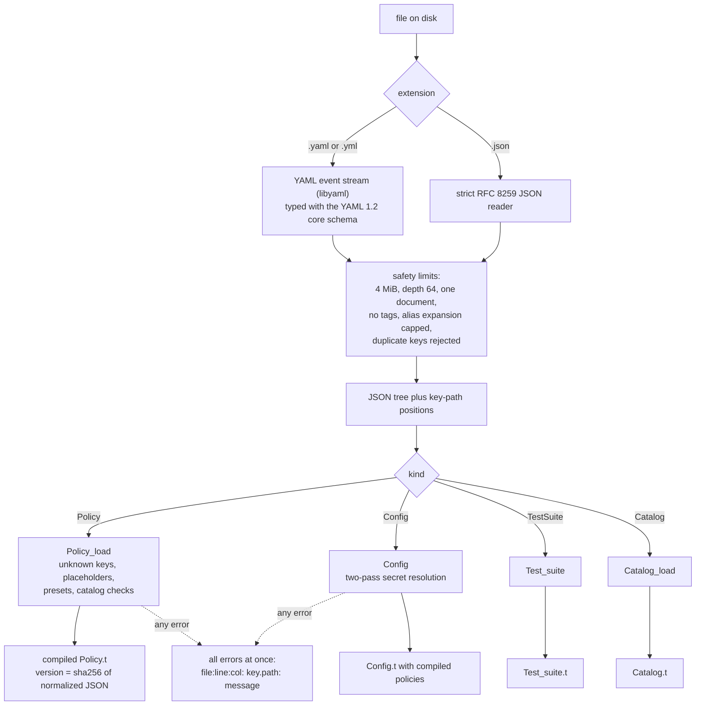
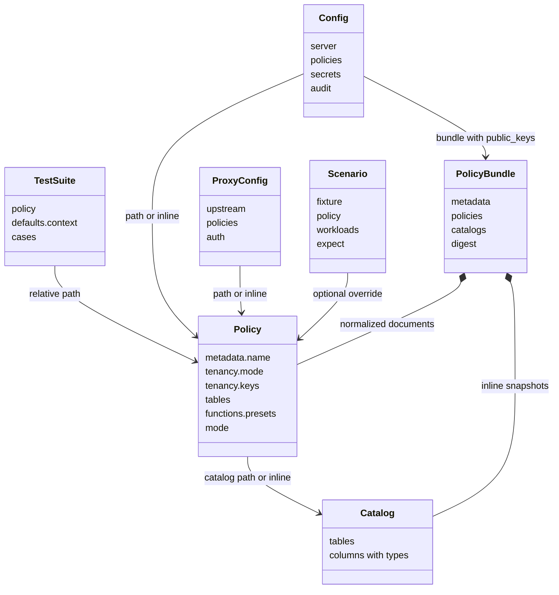
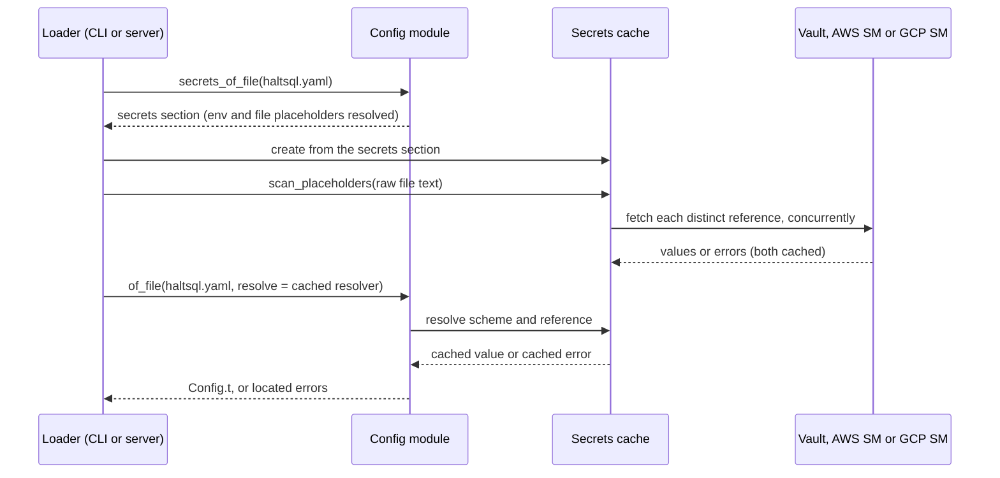
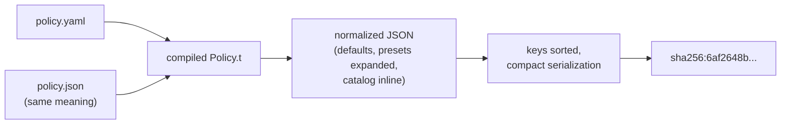

Every HaltSQL behaviour starts from a document: a policy that says what an
agent may do, a config that says how the server runs, a test suite, a schema
snapshot. This page explains how those documents get from a file on disk to a
typed, validated value in memory, and why the loader is so strict.

The loaders live in `lib/load/`. The reference pages for each document are
[policy-reference.md](../policy-reference.md),
[config-reference.md](../config-reference.md) and [secrets.md](../secrets.md).

## Why the loader is strict

A policy is a security control. A loader that guesses would turn typos into
silent holes. A misspelled `tenant_colum` that is quietly ignored makes a
tenant table global. A YAML 1.1 reader that turns `no` into `false`, or `012`
into `10`, changes values behind your back. So HaltSQL's loader follows one
principle: **anything it does not fully understand is an error, reported with
its exact location.**

## The load pipeline

All document kinds share the same front half. `Docload` (backed by
`lib/load/docpos.ml`) turns bytes into a `Yojson.Safe.t` tree plus a table of
source positions. Then a kind-specific decoder validates and compiles it.



The decoders collect errors instead of stopping at the first one, so one run
of `haltsql validate` shows everything that is wrong:

```text
policy.yaml:14:5: tables."app.orders".tenant_column: unknown column
```

### YAML typing

Only plain (unquoted) YAML scalars are typed. Quoted, literal and folded
scalars are always strings. The rules come from the YAML 1.2 core schema, with
a few deliberate choices (see the header of `lib/load/docpos.ml`):

| Input | Becomes | Why |
|---|---|---|
| `true`, `False`, `TRUE` | boolean | core schema |
| `yes`, `no`, `on`, `off`, `y`, `n` | string | no "Norway problem" |
| `~`, `null`, empty | null | core schema |
| `42`, `0o17`, `0x1F` | integer | core schema |
| `012`, `-007` | **string** | almost always an identifier (zip code, account number), and YAML 1.1 tools would read it as octal, so neither number is safe |
| `1.5`, `-2e3` | float | core schema |
| `.inf`, `.nan` | error | cannot be represented in JSON |
| `!!str x`, `!custom x` | error | every explicit tag is rejected |

Aliases are expanded, but at most 10,000 nodes may be produced by alias
expansion in total, which stops "billion laughs" documents. A stream must hold
exactly one document. JSON input is read strictly, with duplicate-key
detection and the same depth limit.

The YAML printer used by `haltsql convert` quotes any string a YAML 1.1 tool
might retype, so converted files mean the same thing everywhere.

## Document kinds

Every document has `apiVersion: haltsql.dev/v1` and a `kind`. These kinds
exist in the code today:

| Kind | Loaded by | Purpose |
|---|---|---|
| `Policy` | `lib/load/policy_load.ml` | What one agent may do. See [policy-reference.md](../policy-reference.md). |
| `Config` | `lib/load/config.ml` | How `haltsql-server` and the CLI run: listen address, auth, policies, audit, telemetry, secrets. See [config-reference.md](../config-reference.md). |
| `TestSuite` | `lib/load/test_suite.ml` | Allow/deny cases for one policy, run by `haltsql test`. |
| `Catalog` | `lib/load/catalog_load.ml` | A schema snapshot: the complete, typed column list of each table. `kind` is optional here; `haltsql validate` treats a document with only `tables` as a catalog. |
| `Scenario` | `lab/harness/scenario.py` (full), `bin/haltsql/cmds.ml` (top-level keys only) | A haltlab test scenario. |
| `PolicyBundle` | `lib/bundle/haltsql_bundle.ml` | Signed, canonical package of normalized policies and catalogs. See [policy-bundles.md](../policy-bundles.md). |
| `ProxyConfig` | `lib/pgwire/proxy_config.ml` | Configuration of `haltsql-proxy`. See [proxy.md](../proxy.md). |

`haltsql validate` understands `Policy`, `Config`, `TestSuite`, `Catalog` and
`Scenario`. Bundles are checked with `haltsql bundle verify`, and a proxy
config is checked when `haltsql-proxy` starts.

How they refer to each other:



## Placeholders: two different worlds

HaltSQL has two kinds of placeholders, and they are kept strictly apart.

| Placeholder | Allowed in | Resolved | Purpose |
|---|---|---|---|
| `${ctx.NAME}` | Policies, only in `tenancy.keys` | At verify time, from the request context | Says which context field holds each tenancy key |
| `${env:NAME}`, `${file:/path}` | `Config` and `ProxyConfig` | At load time | Keep values out of the file |
| `${vault:...}`, `${aws-sm:...}`, `${gcp-sm:...}` | `Config` only, outside the `secrets` section | At load time, by a resolver | Pull secrets from a secret manager |
| `$${` | Where placeholders are allowed | At load time | A literal `${` |

Why can a policy not use `${env:...}`? Because then the same policy file could
mean different things on different machines, and its version hash would no
longer describe its behaviour. `Policy_load` scans every string and rejects
`${env:` and `${file:` with "only allowed in Config documents", and rejects any
other `${` outside `tenancy.keys`. Config placeholders are never resolved
inside an inline policy: an inline policy follows the policy rules, even
though it sits in a config file.

## Two-pass secret resolution

Provider placeholders raise a chicken-and-egg problem: the Vault address and
login method are themselves in the config file. HaltSQL solves it with two
passes (see the module doc in `lib/load/config.mli` and
`lib/cloud/secrets.mli`).

1. **Pass one** decodes only the `secrets` section
   (`Config.secrets_of_file`). That section may use `${env:}` and `${file:}`,
   but not provider placeholders, since a provider cannot configure itself.
2. A `Secrets.t` is built from those settings. It scans the raw file text for
   every provider placeholder and fetches them **concurrently**, each distinct
   `(scheme, reference)` once.
3. **Pass two** decodes the whole document (`Config.of_file ~resolve`). The
   resolver only serves values from the cache filled in step 2.



Why this shape?

- **`lib/load` stays pure.** The config module never talks to the network.
  Only `lib/cloud` does, through the `?resolve` hook.
- **It is safe inside the server's event loop.** `Config.of_file` is
  synchronous. Serving it from a prefetched cache means a reload never needs a
  nested `Lwt_main.run` (see `reload_lwt` in `bin/server/lib/state.ml`).
- **Rotation works.** Each load builds a fresh cache, so a reload picks up
  rotated secrets.
- **Errors are located and never leak.** A failed fetch becomes a normal load
  error at the placeholder's line and column. Error messages name the
  reference, never the value.

A provider placeholder with no resolver configured is the located error
"secret provider not configured". An unresolvable placeholder is always an
error; HaltSQL never substitutes an empty string.

After loading, settings are layered: command-line flags beat `HALTSQL_*`
environment variables, which beat the file, which beats built-in defaults.
`haltsql config show` prints the merged result with secrets replaced by
`"<redacted>"`.

## Compiling a policy

After the generic checks, `Policy_load` turns a policy document into a
`Policy.t`:

- **Unknown keys are errors** at every level, as are wrong types and
  duplicates.
- **Identifiers follow Postgres rules.** Unquoted names fold to lower case,
  and unqualified table names get the first `search_path` entry.
- **Function presets are expanded.** `functions.presets: [aggregates, math]`
  becomes the explicit list from `Policy_load.function_presets`. An unknown
  preset name is a load error. Presets never include functions with side
  effects.
- **The catalog is loaded** from a path (relative to the policy file) or an
  inline snapshot, and every table, allowed column and tenant column the
  policy names is checked against it ("table ... is not in the catalog
  snapshot", "column ... does not exist in ... according to the catalog").

### The catalog is never derived from the allowlist

The catalog snapshot must list the *complete* columns of each real table,
with types. HaltSQL never builds one from the `columns` lists in `tables`.
The allowlist is what the agent may read, and the real table usually has more
columns than that. If the loader treated the allowlist as the full table,
`SELECT *` would expand to "only allowed columns" and pass, while Postgres
would actually return the hidden ones too.

So without a snapshot, the analyzer is conservative: `SELECT *` and whole-row
references are allowed only on tables with `columns: "*"`. With a snapshot,
`*` is expanded against the real column list and denied if it would read a
column the policy leaves out. Snapshots come from `haltsql schema pull`, which
reads `pg_catalog` rather than `information_schema` so that a restricted role
cannot produce an incomplete snapshot (see
[schema-and-pii.md](../schema-and-pii.md)).

### The policy version

Every compiled policy has a `version` of the form `sha256:<hex>`. It is
computed in `lib/load/policy_impl.ml`:

1. `Policy_load.to_json` renders the compiled policy in a normalized form:
   defaults filled in, presets expanded, the catalog inline, identifiers
   rendered canonically.
2. Object keys are sorted recursively.
3. The compact JSON string is hashed with SHA-256.



Because the hash is taken over meaning, not bytes, the YAML policy and its
JSON twin get the same version, and so does a reformatted file. A change that
alters behaviour, such as adding a column, a preset function or a catalog
column, changes the version. Every verdict carries the version, every audit
record can be traced back to an exact policy, and a [signed
bundle](../policy-bundles.md) stores exactly this normalized document.

## Where to go next

- [policy-lifecycle.md](./policy-lifecycle.md) follows a policy from a schema
  snapshot through tests, CI and signing to a running server.
- [server-internals.md](./server-internals.md) covers how the server holds and
  reloads these loaded values.
