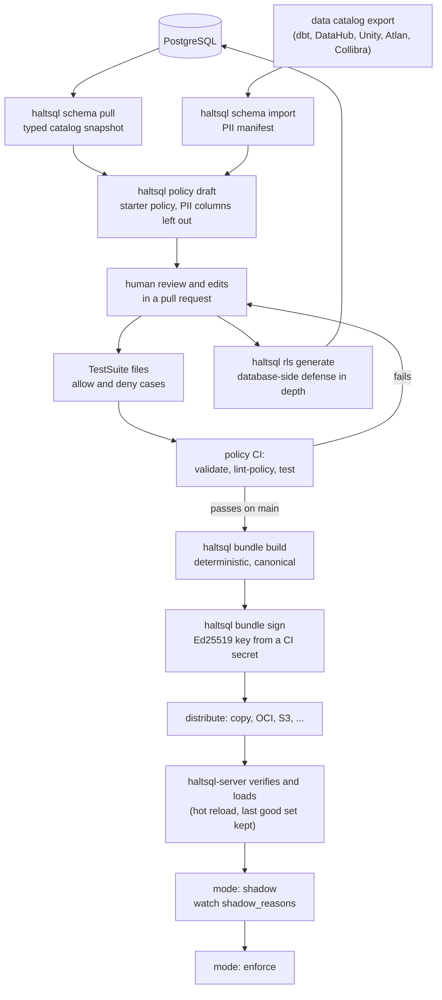
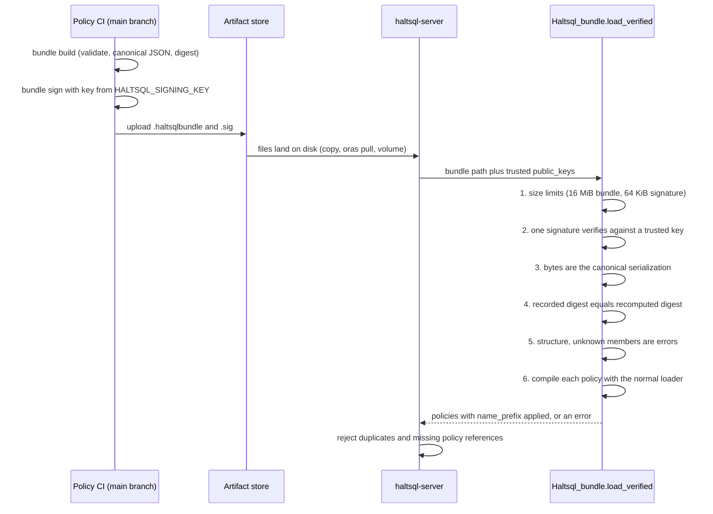
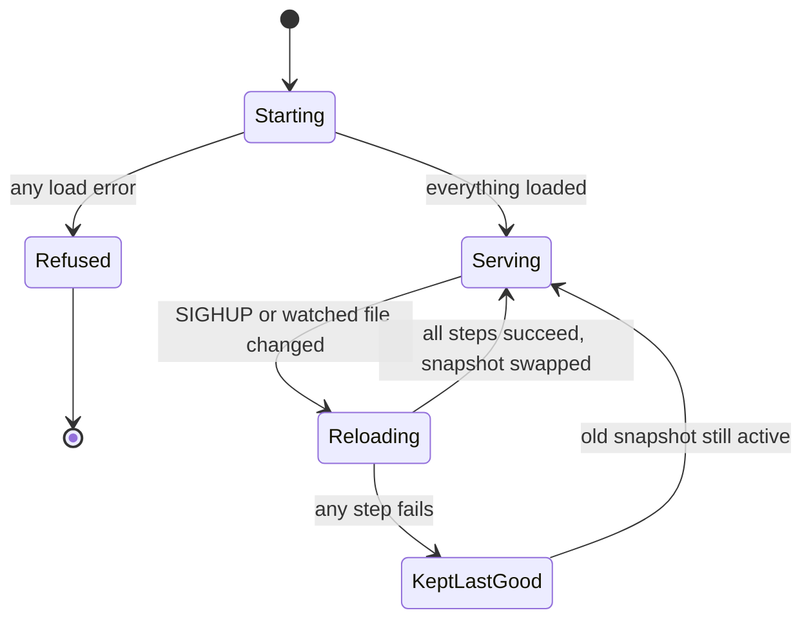

A HaltSQL policy is code. It is drafted from the real schema, reviewed in a
pull request, tested by CI, packaged into a signed bundle, and loaded by
servers that refuse anything they cannot verify. This page walks through each
stage and explains what each one protects against.

## The whole path



## 1. Draft from the schema

Writing a policy by hand from memory is how columns get missed. HaltSQL
starts from the database instead. The three commands are documented in
[schema-and-pii.md](../schema-and-pii.md) and implemented in
`lib/catalog_tools/`.

| Step | Command | Output | Why it matters |
|---|---|---|---|
| Snapshot | `haltsql schema pull --dsn ... --schema app -o catalog.json` | `kind: Catalog`, the complete typed column list of every relation | The analyzer expands `SELECT *` against this list, so it must be complete. It reads `pg_catalog`, not `information_schema`, so a restricted role cannot produce a short list. |
| Classify | `haltsql schema import --from dbt manifest.json -o pii.json` | A PII manifest | Reuses the sensitivity tags your data catalog already has. |
| Draft | `haltsql policy draft --catalog catalog.json --pii pii.json --tenant-column tenant_id -o agent.yaml` | A `kind: Policy` file | Every table gets an explicit column list with flagged columns removed and a comment saying why. |

The draft is safe by construction: bound tenancy, `select` only,
`require_limit: {max: 1000}`, a few function presets, `mode: enforce`, and a
`catalog:` reference. Tables with the tenant column get `tenant_column`, and
the others are marked `# GLOBAL`. The draft is loaded with the normal policy
loader before it is written, so a draft that would not load is never written.

A draft is a starting point. Someone still has to remove tables the agent
does not need and check every `GLOBAL` table by hand.

## 2. Write tests

A `TestSuite` document pins down what the policy must allow and deny. Each
case has an exact SQL string, a context, and an expectation. Deny cases can
list the reason codes that must appear. Allow cases can list the exact
`bind_params` that must come back. The format is in
[testing.md](../testing.md#policy-test-suites).

```yaml
apiVersion: haltsql.dev/v1
kind: TestSuite
metadata:
  name: tenancy-basic
policy: ../policies/analytics-agent.yaml
defaults:
  context: { tenant_id: acme }
cases:
  - name: filtered select is allowed
    sql: SELECT id FROM orders WHERE tenant_id = $1 LIMIT 10
    expect: allow
    bind: [{ param: 1, value: acme }]
  - name: missing tenant filter
    sql: SELECT id FROM orders LIMIT 10
    expect: deny
    codes: [E_TENANT_MISSING]
```

`haltsql test` runs suites through the same `Haltsql.verify` the server uses
(`lib/haltsql/suite_runner.ml`). For a policy in shadow mode, cases are
checked against `shadow_reasons`, so the same suite keeps working when the
policy later switches to `enforce`.

Good suites cover, for each tenant table, one allowed query and the common
bypass shapes (missing filter, `OR`, outer-only filter, `UNION` branch,
`LEFT JOIN` preserved side), plus a denied-column case for each sensitive
column. See [tenancy-proof.md](./tenancy-proof.md) for why each shape is
denied.

## 3. Policy CI

CI makes every policy change go through the same checks you run locally. All
integrations call the same CLI commands, so CI and your laptop always agree.
Details are in [policy-ci.md](../policy-ci.md).

| Integration | Where | What it runs |
|---|---|---|
| GitHub Action | `action.yml` at the repository root, scripts in `.github/actions/policy-ci/` | install (checksum-verified), validate, lint-policy, test, job summary, optional bundle |
| GitLab CI | `ci/gitlab/haltsql.gitlab-ci.yml` (hidden jobs `.haltsql-check`, `.haltsql-bundle`) | the same, plus a JUnit report |
| pre-commit | `.pre-commit-hooks.yaml` | validate, lint-policy, test |

The order matters. Validation catches documents that do not load.
`lint-policy` catches documents that load but are risky. Tests catch policies
that behave differently than intended. A bundle is built only after all three
pass.

The project dogfoods the action in its own CI (`policy-ci-action` job in
`.github/workflows/ci.yml`): it runs the action against `examples/policies`
and `examples/suites` and builds and signs a bundle with a throwaway key.

## 4. Build and sign a bundle

A server should not have to trust the file system, the copy step, or the
artifact store between CI and production. A signed bundle removes that trust.
The format is in [policy-bundles.md](../policy-bundles.md), and the code is
`lib/bundle/`.

- `haltsql bundle keygen -o policy-signing.key` creates an Ed25519 key pair.
  The private key goes into a CI secret. The `.pub` file is safe to commit.
- `haltsql bundle build` loads and validates every policy and catalog, then
  writes **canonical JSON**: sorted keys, no extra whitespace, one trailing
  newline, a `sha256:` digest over everything else. The same inputs always
  give byte-identical output, with no timestamps, so you can rebuild from a
  commit and compare.
- `haltsql bundle sign` refuses to sign a bundle that does not load, then
  writes `BUNDLE.sig`. The signature covers the domain separator
  `haltsql.dev/v1 PolicyBundle signature` plus a newline, followed by the exact
  bundle bytes.
- `haltsql bundle verify` and `haltsql bundle inspect` run the server's
  checks from the command line.

The server verifies in a fixed order and stops at the first failure. Nothing
in the bundle is parsed until a signature has verified.



Key rotation works by listing both public keys on the servers, optionally
dual-signing with `--append`, switching CI to the new key, and then removing
the old public key. Removing a compromised key and reloading makes every
bundle signed only by that key stop loading at once.

## 5. Distribution and hot reload

`haltsql-server` loads policies from its config: plain files, inline
documents, and bundles. The reload logic is in `bin/server/lib/state.ml`.

A reload is triggered by `SIGHUP`, or by the file watcher when
`reload.watch: true`. The watcher polls the config file, every policy file,
each bundle and its `.sig`, and the TLS files every 2 seconds (it compares
mtime, size and inode).

A reload rebuilds everything from scratch:

1. Load the config, with a fresh secrets cache (so rotated secrets are picked
   up).
2. Load and verify every bundle. A bundle policy may not duplicate a policy
   from the config file or from another bundle, so one signer cannot silently
   replace another's policy.
3. Load the `--policy` files given on the command line.
4. Check that every policy referenced by tokens, OIDC providers, mTLS
   identities and `default_policy` is loaded.
5. Reload TLS material and reconfigure telemetry.

Only if **every** step succeeds is the new snapshot swapped in, in one
assignment. Otherwise the server logs "reload failed; keeping the last good
configuration" and keeps serving the old set.



Two details make this robust.

- **No retry storm.** After a failed reload, the server records the new file
  signatures anyway, so it does not retry the same broken file on every poll.
  It tries again when the files change once more.
- **Some changes need a restart.** Turning TLS on or off during a reload is
  rejected, because the listener was set up at startup. Certificates
  themselves can be rotated by reload.

Reloads are visible: `haltsql_policy_reload_total{result="success"}` and
`{result="error"}` in metrics, and a log line listing every loaded policy as
`name@version`. At startup, any load error makes the server refuse to start.
More about the server is in [server-internals.md](./server-internals.md).

## 6. Shadow mode rollout

A stricter policy can break a working agent. Shadow mode lets you measure
that before it happens. With `mode: shadow` in the policy:

- `allowed` is always `true`;
- every denial the policy *would* make is listed in `shadow_reasons`;
- the server counts them as `haltsql_verify_total{result="shadow_denied"}` and
  marks audit records with `"shadow": true`.

```json
{
  "allowed": true,
  "reasons": [],
  "shadow_reasons": [
    { "code": "E_TENANT_MISSING", "rule": "tenancy.predicate", "loc": 15,
      "message": "app.orders (as orders) has no provable tenant predicate on orders.tenant_id in the same SELECT" }
  ]
}
```

(Real output for `SELECT id FROM orders LIMIT 5` with
`test/fixtures/policies/shadow.yaml`, trimmed.)

The rollout is: deploy with `mode: shadow`, review the shadow denials, fix the
policy or the agent, then switch to `mode: enforce` and reload. Changing the
mode changes the policy version, so verdicts and audit records show exactly
when enforcement began. A shadow policy enforces nothing, so never use it as
the only control. See [deployment.md](../deployment.md#rolling-out-a-policy-change).

## 7. Database-side defense in depth

HaltSQL checks queries before they run. If the application forgets to call
HaltSQL, or HaltSQL has a bug, the database should still hold the line.
`haltsql rls generate` (code in `lib/rlsgen/`, docs in
[rls-generation.md](../rls-generation.md)) turns the same policy into
PostgreSQL DDL:

- a `NOLOGIN NOBYPASSRLS` agent role, with column-level `GRANT SELECT` that
  matches the policy's column lists;
- write grants only where the policy allows the statement and the table;
- row-level security on every tenant-scoped table, with policies comparing
  each tenant column to a transaction-local setting such as
  `haltsql.tenant_id`. A missing setting matches no rows.

The application sets that setting from the same context it passed to HaltSQL,
in the same transaction, then runs the allowed SQL under the agent role:

```sql
BEGIN;
SELECT pg_catalog.set_config('haltsql.tenant_id', $1, true);   -- $1 = ctx.tenant_id
SET LOCAL ROLE haltsql_agent;
-- the exact SQL HaltSQL allowed, binding verdict.bind_params
COMMIT;
```

The output is deterministic and idempotent, so it can be committed and
reviewed next to the policy. `haltsql rls check` connects to a live database
and reports drift from the policy. See also
[defense-in-depth.md](../defense-in-depth.md).

## Where to go next

- [policies-and-config.md](./policies-and-config.md) explains how each of
  these documents is loaded and why the policy version is stable.
- [assurance.md](./assurance.md) explains how HaltSQL itself is tested.
