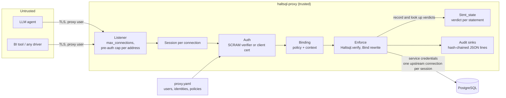
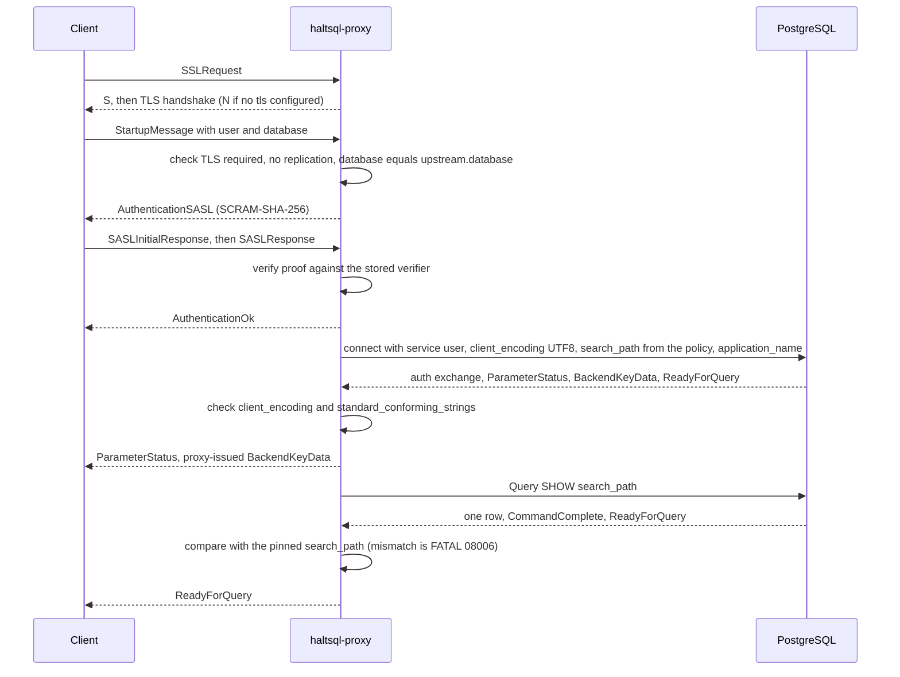
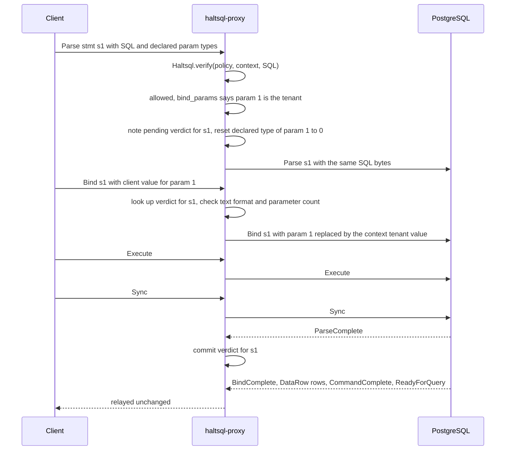
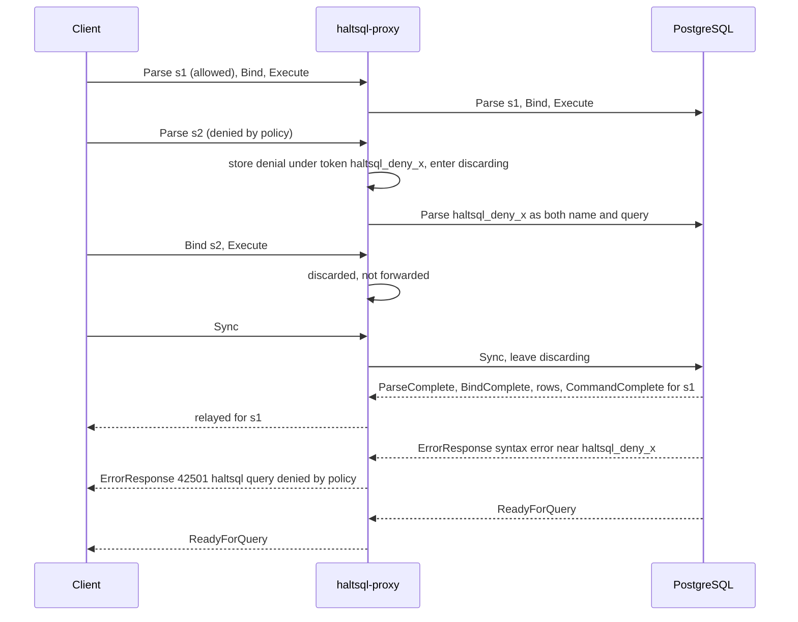
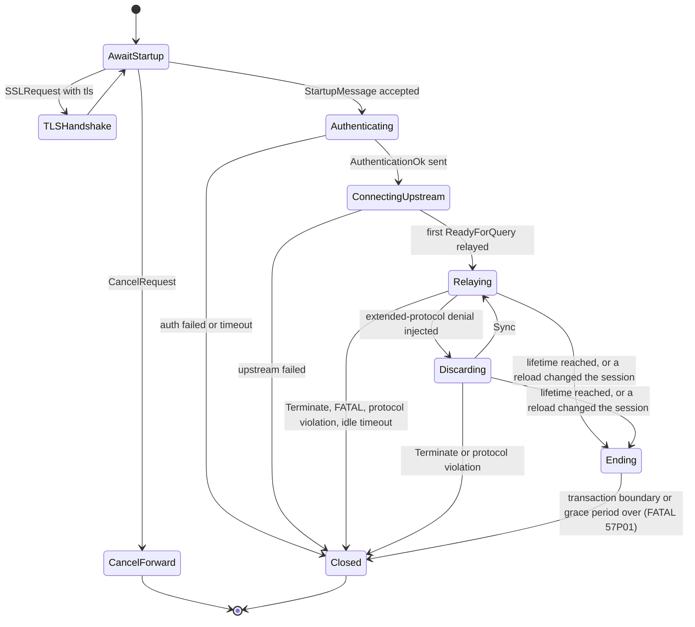

`haltsql-proxy` is a PostgreSQL wire-protocol (v3) firewall. This page
explains how it works inside. For configuration and operations, see
[../proxy.md](../proxy.md). For when to use it, see
[deployment-modes.md](./deployment-modes.md).

The code lives in `lib/pgwire` and `bin/proxy`:

| File | Role |
|---|---|
| `bin/proxy/main.ml` | CLI: `run`, `validate`, `scram-verifier`; signal handling |
| `lib/pgwire/proxy_config.ml` | Loads and validates `kind: ProxyConfig`; builds each user's or identity's binding (policy + context) |
| `lib/pgwire/server.ml` | Listener, connection limits (total and per-address before authentication), TLS server config, hot reload and which sessions it ends, graceful shutdown |
| `lib/pgwire/session.ml` | One client connection: startup, authentication, upstream `search_path` check, the enforcing relay, ending at a transaction boundary |
| `lib/pgwire/enforce.ml` | Decisions: verify, transaction-control allowlist, Bind rewriting, denial fields |
| `lib/pgwire/stmt_state.ml` | Prepared-statement bookkeeping across pipelined `Sync` segments |
| `lib/pgwire/wire.ml` | Message codecs |
| `lib/pgwire/scram.ml` | Server side of SCRAM-SHA-256 |
| `lib/pgwire/upstream.ml` | Connects to the real server (TLS, authentication, pinned `search_path`); forwards cancel requests |
| `lib/pgwire/paudit.ml` | The audit log: hash-chained records, sinks, failure policies |
| `lib/pgwire/offload.ml` | Bounded thread pool for verification and audit file writes |
| `lib/pgwire/plog.ml` | Operational JSON logs on stderr |

## Architecture and trust

The proxy sits on the only network path from untrusted clients to the
database. The client holds a proxy credential. Only the proxy holds the
database credential.



Four properties follow from this layout:

1. **The client cannot skip verification.** Every `Query` and `Parse` goes
   through `Haltsql.verify` before anything is forwarded.
2. **The client cannot choose its policy or tenant.** Both are bound to the
   authenticated identity in the config, not to anything in the startup
   packet or the SQL.
3. **The forwarded SQL is the verified SQL.** The SQL bytes sent upstream are
   always byte for byte the bytes that were verified. Only `Bind` parameter
   values for tenancy parameters are rewritten.
4. **The server reads names the way the verifier did.** The upstream
   session's `search_path` is set from the bound policy and confirmed before
   the first statement, and a session keeps one policy for its whole life.

## Startup and authentication

`Session.run` handles everything up to the first `ReadyForQuery`. Startup and
authentication together must finish within `limits.auth_timeout_seconds`
(default 30), otherwise the client gets `FATAL 08006`.



Details that matter for security:

- **Slots before authentication.** A connection counts against
  `limits.max_connections` from accept. Until it has authenticated it also
  counts against `limits.max_unauthenticated_per_ip` (default 20) for its
  source address; the connection over that cap is refused at accept with
  `FATAL 53300`. `Server` keeps the per-address counter and decrements it
  when `Session` reports a successful authentication or the connection ends.
- **TLS.** An `SSLRequest` is answered with `S` and a TLS handshake when
  `tls` is configured, otherwise `N`. Plaintext bytes pipelined after the
  `SSLRequest` are a protocol violation (CVE-2021-23214). `GSSENCRequest` is
  always refused with `N`. With `tls.required: true` (the default), a client
  that did not upgrade gets `FATAL 28000`.
- **Startup parameters.** `user` is required. `database` must equal
  `upstream.database` (otherwise `3D000`). Any `replication` parameter is
  refused. Only a printable `application_name` (63 bytes or less) is
  forwarded. `options` and every other parameter are ignored, so a client
  cannot set GUCs such as `search_path`. A newer protocol minor version or
  `_pq_.*` options get `NegotiateProtocolVersion` for 3.0.
- **SCRAM** (`auth.method: scram`). The proxy implements the server side of
  SCRAM-SHA-256 (no channel binding) and stores only verifiers in
  PostgreSQL's format (`haltsql-proxy scram-verifier` makes one). An unknown
  user goes through a full fake exchange using a per-process mock secret, so
  user names cannot be probed. Every failure is the same
  `FATAL 28P01 password authentication failed for user "..."`.
- **Client certificates** (`auth.method: cert`). The TLS layer verifies the
  chain against `tls.client_ca`. The proxy then matches the leaf's subject CN
  or a URI SAN (`spiffe_id`) against `auth.identities`. The startup user name
  is not used for authorization.
- **The binding.** Authentication returns a `binding`: the policy name, the
  loaded `Policy.t`, and the `Context.t` from the config. Validation already
  checked that the context supplies every value the policy's tenancy needs.
  Everything after this point uses only the binding.
- **Upstream sanity.** The proxy always sends `client_encoding=UTF8`. If the
  server ever reports a different `client_encoding`, or
  `standard_conforming_strings` other than `on`, the session is terminated.
  The verified bytes must mean the same thing to Postgres as they did to the
  parser.
- **Pinned `search_path`.** The verifier resolves an unqualified name through
  the policy's `search_path` (`pg_catalog` first unless the policy places it).
  PostgreSQL resolves it through the session's `search_path`, which by
  default comes from `ALTER ROLE` / `ALTER DATABASE` or `postgresql.conf` and
  has nothing to do with the policy. So `Upstream.connect` puts
  `search_path` in the upstream startup packet (which overrides role and
  database settings): the policy's schemas, each double-quoted, then
  `pg_temp`. `pg_temp` is explicit and last because PostgreSQL otherwise
  searches temporary tables before everything else. When the upstream
  reports `ReadyForQuery`, `Session.confirm_search_path` sends
  `SHOW search_path`, parses the answer the way PostgreSQL parses the
  setting (`Upstream.parse_search_path`) and compares the schema lists. The
  client's `ReadyForQuery` is held back until the comparison passed, so no
  client statement can be forwarded before it; a mismatch ends the session
  with `FATAL 08006`. PostgreSQL 18 and later also report the setting as a
  `ParameterStatus`, at startup and on every change, and a reported value
  that differs ends the session. The path belongs to the session's binding,
  which never changes (see [Lifecycle](#lifecycle)).
- **Upstream transport.** `upstream.tls.mode` is `disable` (the default),
  `require` (encrypted, any certificate accepted) or `verify-full` (chain
  and host verified); only the last authenticates the database. The proxy
  never sends a cleartext password without TLS, and refuses MD5
  authentication without TLS unless `upstream.allow_insecure_auth` is set.
  `Proxy_config.transport_notes` produces the warning logged at start when
  TLS is off towards a host that is not a loopback address.

## The enforcing relay

After startup, four promises run side by side (`Lwt.pick`; the first to finish
ends the session):

- `client_loop` reads one frontend message at a time and passes it to
  `handle_client_message`, which verifies, rewrites, replaces or drops it.
- `upstream_loop` reads backend messages, updates statement bookkeeping, swaps
  injected errors for denial errors, and relays everything else.
- `lifetime_timer` asks the session to end after
  `limits.max_session_lifetime_seconds`.
- `terminator` waits for such a request (from the timer or from a reload) and
  ends the session at the next transaction boundary (see
  [Lifecycle](#lifecycle)).

### Threads

The proxy is one Lwt event loop: code that blocks blocks every session. Two
things would, so they run on a bounded pool of system threads (`Offload`,
`limits.worker_threads`, default the number of CPUs clamped to 2..8):

- **Verification.** `Haltsql.verify` waits for the parser's own worker pool
  and then analyses the statement. `handle_client_message` hands
  `Enforce.simple` / `Enforce.parse` to the pool and waits for the verdict.
- **Audit writes** to `stdout` and `file` sinks, which are blocking `write`
  calls (see [Audit and logs](#audit-and-logs)).

Ordering does not change. `client_loop` handles one message at a time and
does not read the next one until the current one is verified, audited and
forwarded (or replaced), so pipelined `Parse` / `Bind` / `Execute` reach the
upstream in the client's order; only *other* sessions run while one waits.
`upstream_loop` keeps relaying responses to earlier segments meanwhile, which
is the same interleaving `Stmt_state` already handled for a `Bind` waiting on
an earlier `Parse`. A pool job cannot be cancelled: if the session ended
while its job ran, the result is discarded and nothing is forwarded.

### Simple protocol

A `Query` message is verified as a whole (`Enforce.simple`). It is denied if
the verdict denies, or if the verdict has `bind_params`: the simple protocol
has no `Bind` message, so the proxy has no way to supply tenant values. The
denial carries `E_PARAM_UNBOUND` and a hint to use a prepared statement.

When `allow_transaction_control` is on (the default), plain `BEGIN`,
`START TRANSACTION [modes]`, `COMMIT`, `END`, `ROLLBACK` and `ABORT` pass
without a policy check, so drivers work outside autocommit. The match is exact
token by token (`Enforce.transaction_control`): comments, quotes, savepoints,
`AND CHAIN` and `PREPARE TRANSACTION` do not match and go to the policy.

### Extended protocol

This is where tenancy is enforced. The policy proves that each tenancy
predicate compares the tenant column with a parameter such as `$1`, and the
verdict's `bind_params` names those parameter positions. The proxy then fills
those positions itself.



**Parse.** `Enforce.parse` verifies the SQL and the verdict is audited.

- Denied: the message is replaced by a denial (see below).
- Allowed, but the named statement already exists: refused with
  `42P05 PROXY_STATEMENT_EXISTS`. The proxy never lets a second `Parse`
  silently change what an existing name means.
- Allowed: the verdict is recorded as pending for that statement name, and
  the `Parse` is forwarded.

**Declared parameter types.** A `Parse` may declare a type for each
parameter, and PostgreSQL decodes the `Bind` value with that type. A declared
type such as `float8`, `name` or `"char"` could change how the injected tenant
value is read (rounding, truncation). So
`Enforce.reset_tenancy_param_types` sets the declared type of every tenancy
parameter to `0` (unspecified), and the server infers it from the tenant
predicate. Other parameters keep their declared types. If nothing changed,
the original bytes are forwarded.

**Bind.** The proxy looks up the statement's verdict. An unknown statement is
refused with `26000 PROXY_STATEMENT_UNKNOWN`. If the verdict has no
`bind_params`, the `Bind` is forwarded unchanged. Otherwise `Enforce.bind`:

1. checks that the `Bind` supplies every tenancy parameter position;
2. refuses binary format for a tenancy parameter (only text format is
   allowed, so the value cannot be reinterpreted);
3. refuses conflicting tenancy values for one position;
4. **replaces** each tenancy parameter's value with the session's context
   value, whatever the client sent. A single value is sent as is. A set of
   values is sent as a PostgreSQL array literal (`{"a","b"}`).

A problem in steps 1 to 3 is a denial with `E_PARAM_UNBOUND`. The client
cannot make the proxy skip the rewrite: any shape it cannot rewrite safely is
refused.

**Execute.** A verdict is recorded at `Parse`, but a prepared statement can
run any number of times. Each `Execute` therefore writes an `execute` audit
record before it is forwarded: the portal, the statement the portal was bound
from, that statement's `sql_sha256` and fingerprint, and the row limit, never
parameter values. The session keeps a small portal table for this (filled at
`Bind`, emptied on `Close`, when the statement is closed, and when the
transaction that owned the portal has ended), so a portal the proxy did not
bind is recorded with a `null` statement instead of a guessed one. If the
record cannot be written under `fail_closed`, the `Execute` is replaced by a
denial like any other refused message.

**Other messages.** `Describe`, `Close`, `Flush` and `Sync` are validated and
relayed. `Close` of a statement removes its verdict right away (removing
early is safe, because a missing entry can only cause a denial).

## Denials and ordering

Clients pipeline. A driver may send `Parse`, `Bind`, `Execute` for three
statements and one `Sync` before reading anything. If the proxy wrote an
error to the client directly, it could overtake the responses to earlier
messages that the server has not answered yet. The driver would then pair
responses with the wrong requests.

Instead, the proxy lets PostgreSQL produce the error at the right position:

1. It generates a random token `haltsql_deny_<16 random bytes in hex>` and
   stores it, with the denial's error fields, on the current segment.
2. It forwards a message that cannot parse in place of the denied one:
   - simple protocol: a `Query` whose text is the token;
   - extended protocol: a `Parse` whose statement name and query are the
     token. The session then enters **discarding** mode and drops every
     client message up to the next `Sync`, as PostgreSQL itself does after an
     error.
3. PostgreSQL answers with a syntax error at exactly that point in the
   stream, and skips to `Sync` on its own.
4. `upstream_loop` sees an `ErrorResponse` whose message contains the token,
   and sends the stored denial fields to the client instead.



The client sees a normal PostgreSQL error, in the right position, and the
connection stays usable. Inside a transaction the denial aborts the
transaction, exactly like a real permission error. The random token is new for
every denial and never reaches the client.

The error the client sees:

| Field | Value |
|---|---|
| `S`, `V` | `ERROR` |
| `C` | `deny_sqlstate` (default `42501`) |
| `M` | `haltsql: query denied by policy "<name>": <first reason>` |
| `D` | `HaltSQL reasons: <codes>` |
| `H` | the first reason's hint, when there is one |

## Statement bookkeeping

The proxy must know, for every `Bind`, which verdict applies to the statement
it names. That is harder than it sounds: a `Parse` only takes effect when the
server answers `ParseComplete`, and after an error the server ignores
messages until `Sync`. `Stmt_state` models this exactly.

- Messages are grouped into **segments**: everything up to a `Sync` (or one
  simple `Query`) is one segment.
- `Parse` and `Close` are queued as pending operations of the current segment.
- `ParseComplete` commits the head operation's verdict to the committed table.
  `CloseComplete` removes one.
- `ErrorResponse` drops the remaining pending operations of the head segment
  (the server will ignore them). `ReadyForQuery` closes the head segment.
- A `Bind` looks in the current segment first, then the committed table. If
  the name has a pending operation in an **earlier** segment, the `Bind` waits
  until the server has answered it.
- A missing entry always denies. Bookkeeping can only err towards denial, and
  a client cannot get one statement's tenancy positions applied to another
  statement.
- A simple `Query` destroys the unnamed statement, as PostgreSQL does. An
  unnamed `Parse` replaces it.
- More than 10,000 pending segments or operations ends the session with
  `54000 too many pipelined statements`.



`ConnectingUpstream` includes the `SHOW search_path` round trip: the client
sees its first `ReadyForQuery` only after it. In `Ending` the relay works as
before (statements are still verified, under the session's own policy) until
the upstream reports `ReadyForQuery` with status idle and nothing is in
flight.

## Cancel requests

PostgreSQL cancels a running query through a separate connection that sends
the backend's (pid, key). The proxy must not hand out the upstream's real pid
and key, and must not let one client cancel another's queries.

- During startup, the upstream's `BackendKeyData` is replaced with a
  proxy-issued pair: a random non-zero 30-bit pid and a random 32-bit key.
  The process-wide cancel table maps it to the upstream pair.
- A `CancelRequest` is looked up by pid, and its key is compared in constant
  time. On a match, `Upstream.send_cancel` forwards the upstream pair over a
  fresh upstream connection (with TLS if configured). Wrong keys and unknown
  pids are logged and ignored.
- The entry is removed when the session ends.

## COPY, FunctionCall and other messages

| Message | Handling | Why |
|---|---|---|
| `FunctionCall` (fastpath) | Denied in-band with `PROXY_FUNCTION_CALL`, through the same token trick (a simple `Query` with the token) | It calls a function by OID without SQL, so there is nothing to verify |
| `CopyData`, `CopyDone`, `CopyFail` from the client | `FATAL 08P01`, connection closed | `COPY` statements are already denied by the policy (`E_STATEMENT_KIND`) |
| Upstream enters COPY mode anyway | `FATAL 08P01`, connection closed | Defense in depth |
| Unexpected `R`, `K`, `v` from upstream after startup | `FATAL 08P01` | The proxy has lost protocol sync |
| Unknown types, malformed or oversized messages | `FATAL 08P01` (oversize is checked against `limits.max_message_bytes`) | Never guess at bytes it cannot parse |
| `Terminate` | Forwarded, session ends | |

Idle sessions are closed after `limits.idle_timeout_seconds` (off by
default) with `FATAL 57P05`, but only when no request is in flight.

## Audit and logs

`Paudit` writes the audit log. Every verified statement produces one record,
including statements let through by the transaction-control allowlist, and
every forwarded `Execute` produces one more:

```json
{"ts":"...","event":"statement","session":"49fd05aacd53","user":"agent",
 "policy":"proxy-test","policy_version":"sha256:...","protocol":"extended",
 "allowed":false,"reasons":["E_COLUMN_DENIED"],"shadow_reasons":[],
 "sql_sha256":"...","fingerprint":"...","tables":["app.users"],
 "bind_params":[1],"statement":"","prev_hash":"<64 hex>","hash":"<64 hex>"}
{"ts":"...","event":"execute","session":"49fd05aacd53","user":"agent",
 "policy":"proxy-test","policy_version":"sha256:...","protocol":"extended",
 "portal":"","statement":"s1","sql_sha256":"...","fingerprint":"...",
 "max_rows":0,"prev_hash":"<64 hex>","hash":"<64 hex>"}
```

- `bind_params` lists parameter positions only, never values. `execute`
  records carry no parameter values either.
- Proxy-level refusals have their own events (`bind`, `parse`,
  `function_call`) with `reasons` and `message`.
- The SQL text appears only with `audit.log_raw_sql: true`.
- Operational logs (`Plog`) go to stderr as JSON lines. Neither stream
  contains passwords, verifiers, SCRAM messages, keys or bind values.

**Hash chain.** Records are sealed with the same `Audit_chain` code as the
`haltsql-server` audit log: `hash = sha256_hex(prev_hash ^ L)`, `L` being the
compact JSON of the record without `hash`, and the first record of a chain
has 64 zeros as `prev_hash`. Each sink (`stdout`, `file`, `s3`, `gcs`) keeps
its own chain; a file sink continues the chain of the existing file across
restarts, and refuses to start on a file whose last line is not a sealed
record. `haltsql audit verify` checks any of them.

**A record that cannot be written blocks the statement.** With the default
`on_error: fail_closed`, `Paudit.record_async` returns an error and the
session replaces the statement (or the `Execute`) with a refusal: `ERROR`,
SQLSTATE `58030`, `PROXY_AUDIT_UNAVAILABLE`, delivered in-band through the
same token mechanism as a policy denial. Nothing reaches the database without
its audit record, and a denial that cannot be recorded is refused the same
way. `buffer` queues records in memory up to `max_buffer_records` and refuses
beyond that; `drop` discards, counts and logs. See
[../proxy.md](../proxy.md#failure-policy-on_error).

**Order and threads.** `record_async` takes a process-wide FIFO lock, stamps
the record, and writes `stdout`/`file` sinks on an `Offload` thread; object
sinks append to their in-memory batch (and spool) on the event loop, where
their uploader lives. One writer at a time, served in arrival order, means
that in every sink the chain order, the timestamp order and the order in
which statements were accepted are the same. The session waits for the
outcome before it forwards, which is what keeps `fail_closed` true with the
write off the loop. The retry loop that drains a `buffer` and the final flush
at shutdown take the same lock.

## Lifecycle

- `haltsql-proxy run -c FILE` loads and validates the config. `SIGHUP`, or a
  change to the config or a file it pulls in with `reload.watch: true`,
  reloads it (`Server.reload`). A configuration that does not load or
  validate is rejected and the current one stays in force. The listen
  address and the audit sinks only change with a restart.
- **A session has one binding for life.** It keeps the configuration snapshot
  it was accepted under; a reload never swaps the policy of an open session,
  because its upstream `search_path` was pinned for that policy and its
  prepared statements were verified under it.
- **A reload ends the sessions it changes.** Each authenticated session is
  registered with the listener (`Session.live`: principal, credential,
  binding, snapshot). After a reload, `Session.stale` compares it with the
  new configuration: user or certificate identity removed, SCRAM verifier or
  client CA bundle changed, bound to another policy, policy content
  (`version`) or context changed, upstream changed, or
  `allow_transaction_control` changed. Such a session is asked to end; all
  others continue untouched. `reload.terminate_changed_sessions: false`
  turns this off.
- **Every session ends after `limits.max_session_lifetime_seconds`**
  (default one hour, `0` for no limit), which bounds how long anything a
  reload does not see can stay in effect.
- **Ending happens at a transaction boundary.** The session goes on until the
  upstream reports `ReadyForQuery` with transaction status idle and no
  segment is in flight (immediately, if it is already there). Then the
  client gets `FATAL 57P01` (`admin_shutdown`, what `pg_terminate_backend`
  produces, so drivers and pools reconnect) and both connections close. A
  client message that arrives at that point is neither verified nor
  forwarded. A session that does not get there within
  `limits.termination_grace_seconds` (default 30) is closed anyway, so
  holding a transaction open does not keep an old policy alive; the upstream
  rolls the transaction back.
- New connections above `limits.max_connections`, or above
  `limits.max_unauthenticated_per_ip` for their address, get `FATAL 53300`.
- On `SIGTERM` or `SIGINT` the proxy stops accepting, lets sessions finish
  for `shutdown_grace_seconds`, closes the rest, flushes the audit sinks and
  exits `0`.

Related pages: [deployment-modes.md](./deployment-modes.md),
[tenancy-proof.md](./tenancy-proof.md),
[verification-pipeline.md](./verification-pipeline.md),
[../defense-in-depth.md](../defense-in-depth.md).
