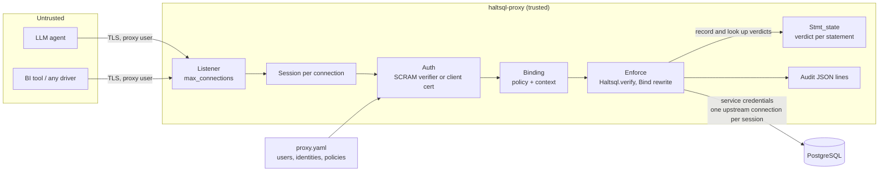
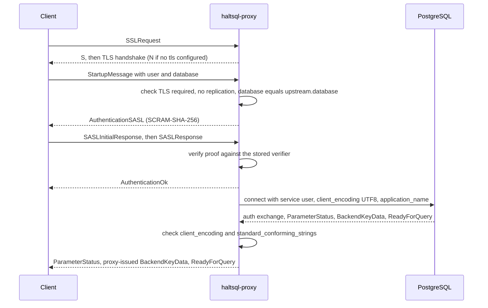
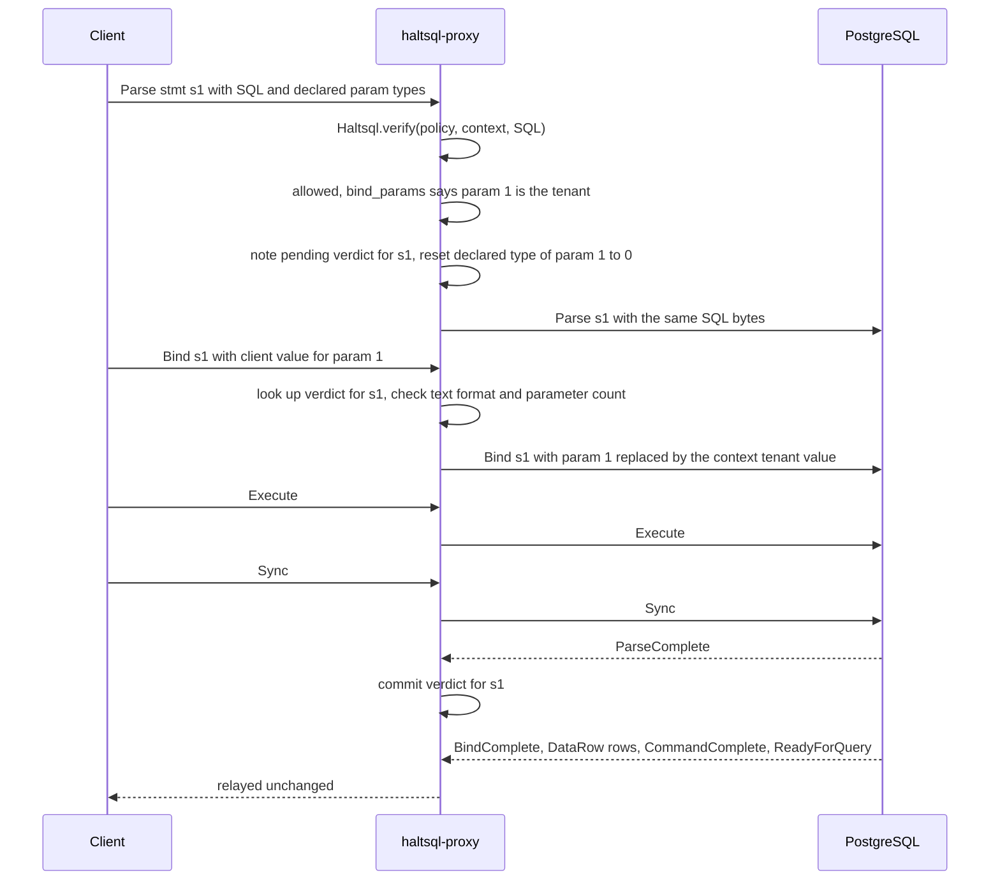
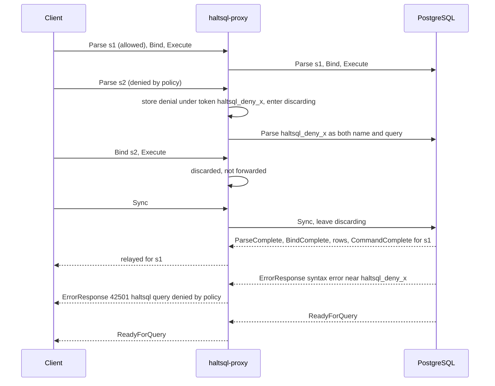
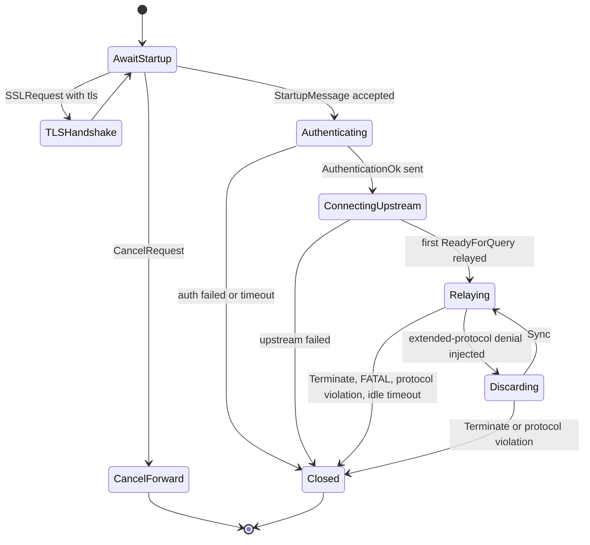

`haltsql-proxy` is a PostgreSQL wire-protocol (v3) firewall. This page
explains how it works inside. For configuration and operations, see
[../proxy.md](../proxy.md). For when to use it, see
[deployment-modes.md](./deployment-modes.md).

The code lives in `lib/pgwire` and `bin/proxy`:

| File | Role |
|---|---|
| `bin/proxy/main.ml` | CLI: `run`, `validate`, `scram-verifier`; signal handling |
| `lib/pgwire/proxy_config.ml` | Loads and validates `kind: ProxyConfig`; builds each user's or identity's binding (policy + context) |
| `lib/pgwire/server.ml` | Listener, connection limit, TLS server config, graceful shutdown |
| `lib/pgwire/session.ml` | One client connection: startup, authentication, the enforcing relay |
| `lib/pgwire/enforce.ml` | Decisions: verify, transaction-control allowlist, Bind rewriting, denial fields |
| `lib/pgwire/stmt_state.ml` | Prepared-statement bookkeeping across pipelined `Sync` segments |
| `lib/pgwire/wire.ml` | Message codecs |
| `lib/pgwire/scram.ml` | Server side of SCRAM-SHA-256 |
| `lib/pgwire/upstream.ml` | Connects to the real server; forwards cancel requests |
| `lib/pgwire/plog.ml` | JSON logs on stderr and the audit stream |

## Architecture and trust

The proxy sits on the only network path from untrusted clients to the
database. The client holds a proxy credential. Only the proxy holds the
database credential.



Three properties follow from this layout:

1. **The client cannot skip verification.** Every `Query` and `Parse` goes
   through `Haltsql.verify` before anything is forwarded.
2. **The client cannot choose its policy or tenant.** Both are bound to the
   authenticated identity in the config, not to anything in the startup
   packet or the SQL.
3. **The forwarded SQL is the verified SQL.** The SQL bytes sent upstream are
   always byte for byte the bytes that were verified. Only `Bind` parameter
   values for tenancy parameters are rewritten.

## Startup and authentication

`Session.run` handles everything up to the first `ReadyForQuery`. Startup and
authentication together must finish within `limits.auth_timeout_seconds`
(default 30), otherwise the client gets `FATAL 08006`.



Details that matter for security:

- **TLS.** An `SSLRequest` is answered with `S` and a TLS handshake when
  `tls` is configured, otherwise `N`. Plaintext bytes pipelined after the
  `SSLRequest` are a protocol violation (CVE-2021-23214). `GSSENCRequest` is
  always refused with `N`. With `tls.required: true` (the default), a client
  that did not upgrade gets `FATAL 28000`.
- **Startup parameters.** `user` is required. `database` must equal
  `upstream.database` (otherwise `3D000`). Any `replication` parameter is
  refused. Only a printable `application_name` (63 bytes or less) is
  forwarded. `options` and every other parameter are ignored, so a client
  cannot set GUCs such as `search_path`. A newer protocol minor version or
  `_pq_.*` options get `NegotiateProtocolVersion` for 3.0.
- **SCRAM** (`auth.method: scram`). The proxy implements the server side of
  SCRAM-SHA-256 (no channel binding) and stores only verifiers in
  PostgreSQL's format (`haltsql-proxy scram-verifier` makes one). An unknown
  user goes through a full fake exchange using a per-process mock secret, so
  user names cannot be probed. Every failure is the same
  `FATAL 28P01 password authentication failed for user "..."`.
- **Client certificates** (`auth.method: cert`). The TLS layer verifies the
  chain against `tls.client_ca`. The proxy then matches the leaf's subject CN
  or a URI SAN (`spiffe_id`) against `auth.identities`. The startup user name
  is not used for authorization.
- **The binding.** Authentication returns a `binding`: the policy name, the
  loaded `Policy.t`, and the `Context.t` from the config. Validation already
  checked that the context supplies every value the policy's tenancy needs.
  Everything after this point uses only the binding.
- **Upstream sanity.** The proxy always sends `client_encoding=UTF8`. If the
  server ever reports a different `client_encoding`, or
  `standard_conforming_strings` other than `on`, the session is terminated.
  The verified bytes must mean the same thing to Postgres as they did to the
  parser.

## The enforcing relay

After startup, two loops run side by side (`Lwt.pick`):

- `client_loop` reads one frontend message at a time and passes it to
  `handle_client_message`, which verifies, rewrites, replaces or drops it.
- `upstream_loop` reads backend messages, updates statement bookkeeping, swaps
  injected errors for denial errors, and relays everything else.

### Simple protocol

A `Query` message is verified as a whole (`Enforce.simple`). It is denied if
the verdict denies, or if the verdict has `bind_params`: the simple protocol
has no `Bind` message, so the proxy has no way to supply tenant values. The
denial carries `E_PARAM_UNBOUND` and a hint to use a prepared statement.

When `allow_transaction_control` is on (the default), plain `BEGIN`,
`START TRANSACTION [modes]`, `COMMIT`, `END`, `ROLLBACK` and `ABORT` pass
without a policy check, so drivers work outside autocommit. The match is exact
token by token (`Enforce.transaction_control`): comments, quotes, savepoints,
`AND CHAIN` and `PREPARE TRANSACTION` do not match and go to the policy.

### Extended protocol

This is where tenancy is enforced. The policy proves that each tenancy
predicate compares the tenant column with a parameter such as `$1`, and the
verdict's `bind_params` names those parameter positions. The proxy then fills
those positions itself.



**Parse.** `Enforce.parse` verifies the SQL and the verdict is audited.

- Denied: the message is replaced by a denial (see below).
- Allowed, but the named statement already exists: refused with
  `42P05 PROXY_STATEMENT_EXISTS`. The proxy never lets a second `Parse`
  silently change what an existing name means.
- Allowed: the verdict is recorded as pending for that statement name, and
  the `Parse` is forwarded.

**Declared parameter types.** A `Parse` may declare a type for each
parameter, and PostgreSQL decodes the `Bind` value with that type. A declared
type such as `float8`, `name` or `"char"` could change how the injected tenant
value is read (rounding, truncation). So
`Enforce.reset_tenancy_param_types` sets the declared type of every tenancy
parameter to `0` (unspecified), and the server infers it from the tenant
predicate. Other parameters keep their declared types. If nothing changed,
the original bytes are forwarded.

**Bind.** The proxy looks up the statement's verdict. An unknown statement is
refused with `26000 PROXY_STATEMENT_UNKNOWN`. If the verdict has no
`bind_params`, the `Bind` is forwarded unchanged. Otherwise `Enforce.bind`:

1. checks that the `Bind` supplies every tenancy parameter position;
2. refuses binary format for a tenancy parameter (only text format is
   allowed, so the value cannot be reinterpreted);
3. refuses conflicting tenancy values for one position;
4. **replaces** each tenancy parameter's value with the session's context
   value, whatever the client sent. A single value is sent as is. A set of
   values is sent as a PostgreSQL array literal (`{"a","b"}`).

A problem in steps 1 to 3 is a denial with `E_PARAM_UNBOUND`. The client
cannot make the proxy skip the rewrite: any shape it cannot rewrite safely is
refused.

**Other messages.** `Describe`, `Execute`, `Close`, `Flush` and `Sync` are
validated and relayed. `Close` of a statement removes its verdict right away
(removing early is safe, because a missing entry can only cause a denial).

## Denials and ordering

Clients pipeline. A driver may send `Parse`, `Bind`, `Execute` for three
statements and one `Sync` before reading anything. If the proxy wrote an
error to the client directly, it could overtake the responses to earlier
messages that the server has not answered yet. The driver would then pair
responses with the wrong requests.

Instead, the proxy lets PostgreSQL produce the error at the right position:

1. It generates a random token `haltsql_deny_<16 random bytes in hex>` and
   stores it, with the denial's error fields, on the current segment.
2. It forwards a message that cannot parse in place of the denied one:
   - simple protocol: a `Query` whose text is the token;
   - extended protocol: a `Parse` whose statement name and query are the
     token. The session then enters **discarding** mode and drops every
     client message up to the next `Sync`, as PostgreSQL itself does after an
     error.
3. PostgreSQL answers with a syntax error at exactly that point in the
   stream, and skips to `Sync` on its own.
4. `upstream_loop` sees an `ErrorResponse` whose message contains the token,
   and sends the stored denial fields to the client instead.



The client sees a normal PostgreSQL error, in the right position, and the
connection stays usable. Inside a transaction the denial aborts the
transaction, exactly like a real permission error. The random token is new for
every denial and never reaches the client.

The error the client sees:

| Field | Value |
|---|---|
| `S`, `V` | `ERROR` |
| `C` | `deny_sqlstate` (default `42501`) |
| `M` | `haltsql: query denied by policy "<name>": <first reason>` |
| `D` | `HaltSQL reasons: <codes>` |
| `H` | the first reason's hint, when there is one |

## Statement bookkeeping

The proxy must know, for every `Bind`, which verdict applies to the statement
it names. That is harder than it sounds: a `Parse` only takes effect when the
server answers `ParseComplete`, and after an error the server ignores
messages until `Sync`. `Stmt_state` models this exactly.

- Messages are grouped into **segments**: everything up to a `Sync` (or one
  simple `Query`) is one segment.
- `Parse` and `Close` are queued as pending operations of the current segment.
- `ParseComplete` commits the head operation's verdict to the committed table.
  `CloseComplete` removes one.
- `ErrorResponse` drops the remaining pending operations of the head segment
  (the server will ignore them). `ReadyForQuery` closes the head segment.
- A `Bind` looks in the current segment first, then the committed table. If
  the name has a pending operation in an **earlier** segment, the `Bind` waits
  until the server has answered it.
- A missing entry always denies. Bookkeeping can only err towards denial, and
  a client cannot get one statement's tenancy positions applied to another
  statement.
- A simple `Query` destroys the unnamed statement, as PostgreSQL does. An
  unnamed `Parse` replaces it.
- More than 10,000 pending segments or operations ends the session with
  `54000 too many pipelined statements`.



## Cancel requests

PostgreSQL cancels a running query through a separate connection that sends
the backend's (pid, key). The proxy must not hand out the upstream's real pid
and key, and must not let one client cancel another's queries.

- During startup, the upstream's `BackendKeyData` is replaced with a
  proxy-issued pair: a random non-zero 30-bit pid and a random 32-bit key.
  The process-wide cancel table maps it to the upstream pair.
- A `CancelRequest` is looked up by pid, and its key is compared in constant
  time. On a match, `Upstream.send_cancel` forwards the upstream pair over a
  fresh upstream connection (with TLS if configured). Wrong keys and unknown
  pids are logged and ignored.
- The entry is removed when the session ends.

## COPY, FunctionCall and other messages

| Message | Handling | Why |
|---|---|---|
| `FunctionCall` (fastpath) | Denied in-band with `PROXY_FUNCTION_CALL`, through the same token trick (a simple `Query` with the token) | It calls a function by OID without SQL, so there is nothing to verify |
| `CopyData`, `CopyDone`, `CopyFail` from the client | `FATAL 08P01`, connection closed | `COPY` statements are already denied by the policy (`E_STATEMENT_KIND`) |
| Upstream enters COPY mode anyway | `FATAL 08P01`, connection closed | Defense in depth |
| Unexpected `R`, `K`, `v` from upstream after startup | `FATAL 08P01` | The proxy has lost protocol sync |
| Unknown types, malformed or oversized messages | `FATAL 08P01` (oversize is checked against `limits.max_message_bytes`) | Never guess at bytes it cannot parse |
| `Terminate` | Forwarded, session ends | |

Idle sessions are closed after `limits.idle_timeout_seconds` (off by
default) with `FATAL 57P05`, but only when no request is in flight.

## Audit and logs

Every verified statement produces one audit record (`audit.type`: `stdout`,
`file` or `none`), including statements let through by the
transaction-control allowlist:

```json
{"ts":"...","event":"statement","session":"49fd05aacd53","user":"agent",
 "policy":"proxy-test","policy_version":"sha256:...","protocol":"extended",
 "allowed":false,"reasons":["E_COLUMN_DENIED"],"shadow_reasons":[],
 "sql_sha256":"...","fingerprint":"...","tables":["app.users"],
 "bind_params":[1],"statement":""}
```

- `bind_params` lists parameter positions only, never values.
- Proxy-level refusals have their own events (`bind`, `parse`,
  `function_call`) with `reasons` and `message`.
- The SQL text appears only with `audit.log_raw_sql: true`.
- Operational logs go to stderr as JSON lines. Neither stream contains
  passwords, verifiers, SCRAM messages, keys or bind values.

> **Note:** The proxy's audit stream is a plain JSON-lines log. Unlike the
> `haltsql-server` audit sinks, its records are not hash-chained, and a failed
> audit write does not block the statement (`lib/pgwire/plog.ml`). If you need
> tamper evidence for proxy traffic, ship the stream to append-only storage.

## Lifecycle

- `haltsql-proxy run -c FILE` loads and validates the config once. There is
  no hot reload: restart the proxy to change users, policies or contexts.
- New connections above `limits.max_connections` get `FATAL 53300`.
- On `SIGTERM` or `SIGINT` the proxy stops accepting, lets sessions finish
  for `shutdown_grace_seconds`, closes the rest and exits `0`.

Related pages: [deployment-modes.md](./deployment-modes.md),
[tenancy-proof.md](./tenancy-proof.md),
[verification-pipeline.md](./verification-pipeline.md),
[../defense-in-depth.md](../defense-in-depth.md).
