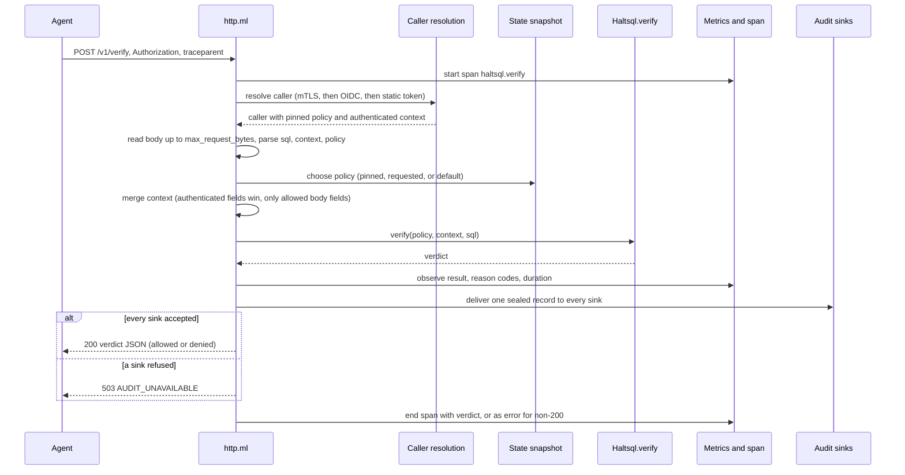
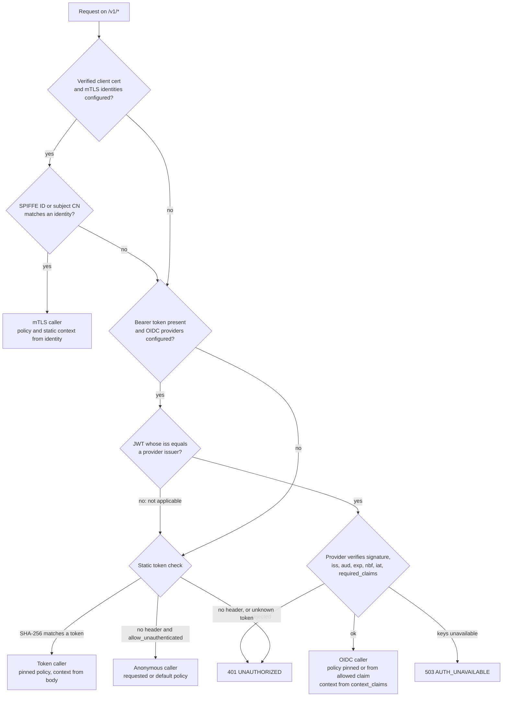
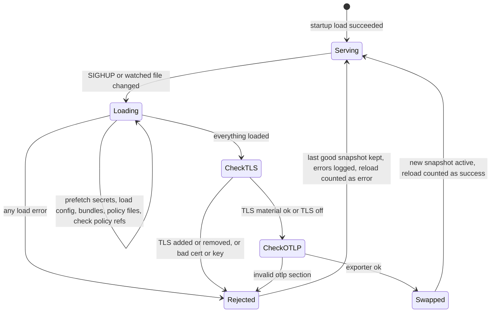
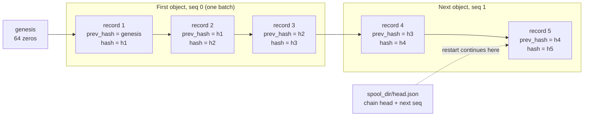

`haltsql-server` is the HTTP sidecar. It answers one question,
`POST /v1/verify`, for callers in any language. It never connects to a
database. This page explains what happens inside it. The HTTP contract is in
[../http-api.md](../http-api.md), and the auth configuration is in
[../authentication.md](../authentication.md).

The code lives in `bin/server/lib`, with shared libraries in `lib/auth` and
`lib/cloud`:

| File | Role |
|---|---|
| `bin/server/lib/server.ml` | Listener, accept loop (plain or TLS), signals, file watcher, shutdown |
| `bin/server/lib/http.ml` | Routing, caller resolution, `/v1/verify`, `/readyz`, `/metrics` |
| `bin/server/lib/state.ml` | Startup settings, the hot-reloadable snapshot, reload logic |
| `bin/server/lib/auth.ml` | Static bearer tokens (SHA-256, constant-time comparison) |
| `bin/server/lib/audit.ml` | Audit records, hash chaining, `stdout` and `file` sinks, `on_error` |
| `bin/server/lib/metrics.ml` | Prometheus counters and histograms (mirrored to OTLP) |
| `bin/server/lib/telemetry.ml` | The process-wide OTLP exporter; swapped on reload |
| `bin/server/lib/integrations.ml` | Wires in secrets providers, S3/GCS sinks and signed bundles |
| `lib/auth/*` | JWT/JWK verification, OIDC discovery and JWKS cache, mTLS identity matching, context merging |
| `lib/cloud/*` | Secrets resolvers (Vault, AWS SM, GCP SM), object-store audit sinks, chain verification |

## One verify request, end to end

`Http.handle_verify` wraps the request in an OTLP span, then
`handle_verify_inner` runs the steps in a fixed order. The caller is resolved
**before** the body is read, so an unauthenticated client cannot make the
server buffer a large body.



A denial is a normal `200` response. Errors that stop the request earlier:

| Step | Failure | Response |
|---|---|---|
| Caller resolution | missing or unknown token, JWT rejected | `401 UNAUTHORIZED` |
| Caller resolution | the IdP's keys cannot be fetched and no usable cache remains | `503 AUTH_UNAVAILABLE` with `Retry-After: 5` |
| Body | larger than `server.max_request_bytes` | `413 PAYLOAD_TOO_LARGE` |
| Body | not JSON, unknown fields, wrong types | `400 BAD_REQUEST` |
| Policy | requested policy differs from the pinned one | `403 FORBIDDEN` |
| Policy | no policies loaded | `503 NOT_READY` |
| Policy | pinned policy not loaded | `503 POLICY_UNAVAILABLE` |
| Context | body sets a field the identity does not allow | `403 CONTEXT_NOT_ALLOWED` |
| Audit | a sink refused the record | `503 AUDIT_UNAVAILABLE` |

Clients treat every non-200 answer as a denial, so each of these fails
closed.

## Who is calling

`Http.resolve_caller` tries three methods in order and stops at the first
one that applies. Each produces a `caller` record: a name for the audit log,
a type (`token`, `oidc`, `mtls`, `anonymous`), an optional subject, the
pinned policy, and an optional authenticated context with the body fields it
still allows.



**mTLS.** The TLS layer verifies the chain against `server.tls.client_ca`
during the handshake. `Haltsql_auth.Mtls.find_identity` then matches the
leaf: a `spiffe_id` must equal the certificate's single URI SAN (a
certificate with more than one URI SAN has no SPIFFE ID), and a `subject_cn`
must equal the common name exactly. The first match in config order wins. A
valid certificate that matches no identity falls through to bearer
authentication.

**OIDC.** `Oidc_client.authenticate` reads the token's unverified `iss`. Only
a provider whose `issuer` equals it may verify the token. A token from any
other issuer, or an opaque token, is "not applicable" and goes to the static
check. Once a provider claims a token, its rejection is final. The provider
checks the algorithm against its allowlist (`none` and HMAC are never
accepted), finds the key by `kid` in its JWKS, verifies the signature, and
checks `iss`, `aud`, `exp`/`nbf`/`iat` with leeway, and `required_claims`.

The JWKS cache in `lib/auth/oidc_client.ml` keeps the IdP off the hot path:

- keys are fetched at startup (in the background) and cached for
  `jwks_cache_seconds`;
- an unknown `kid` forces one refresh, at most once every 30 seconds per
  provider, so key rotation works without letting random `kid`s hammer the
  IdP;
- if a refresh fails, cached keys stay usable for at most
  `min(jwks_cache_seconds, 3600)` seconds past expiry, then the provider
  answers `503 AUTH_UNAVAILABLE` until the IdP is back;
- fetches are limited to 1 MiB and 5 seconds, and redirects are not followed.

**Static tokens.** `Auth.authenticate` hashes the presented token with
SHA-256 and compares it, in constant time, with every configured
`token_sha256`. It always scans the full list, so timing does not reveal which
token matched. The server stores only hashes.

**Anonymous.** Only a request with **no** `Authorization` header becomes
anonymous, and only when `server.auth.allow_unauthenticated` is true. A
request with a wrong token is still `401`.

### Policy pinning

Every authenticated caller is pinned to exactly one policy:

| Caller | Pinned policy |
|---|---|
| Static token | the token's `policy` |
| OIDC | the provider's `policy`, or the string value of `policy_claim` if it is in `allowed_policies` |
| mTLS | the identity's `policy` |
| Anonymous | none: the request's `policy`, else `default_policy`, else the only loaded policy |

If the body names a different policy, the answer is `403 FORBIDDEN`. A caller
can never select a looser policy than the one it was given. At load time,
`State.check_policy_refs` refuses any config where a token, OIDC provider,
mTLS identity or `default_policy` refers to a policy that is not loaded.

### Where the context comes from

`Haltsql_auth.Request_context.merge` combines the authenticated context with
the body:

- a body field that repeats an authenticated field with the same value is
  accepted (clients that always send their context keep working);
- a body field that changes an authenticated field, or that is not listed in
  `request_context_fields`, is refused with `403 CONTEXT_NOT_ALLOWED`. It is
  never silently dropped or overridden;
- allowed extra fields are appended.

For static tokens and anonymous callers there is no authenticated context:
the body supplies all of it. That trusts the calling service to fill the
context from its own authenticated session. Prefer OIDC or mTLS when the
tenant must come from an identity the server can verify itself.

## State: settings and the reloadable snapshot

`State.t` separates what is fixed at startup from what can change:

| Fixed at startup (`State.cfg`) | Reloadable (`State.snap`) |
|---|---|
| listen address, health listener | policies (files, inline, signed bundles) |
| audit sinks, `log_raw_sql` | static tokens |
| `max_request_bytes` | `default_policy` |
| logging, whether `/metrics` is served | OIDC providers (key caches of unchanged providers are kept) |
| whether TLS is on | mTLS identities |
| | `allow_unauthenticated` |
| | TLS certificate, key and client CA (when TLS is on) |
| | the OTLP exporter (replaced only when `telemetry.otlp` changed) |

Handlers read reloadable settings only from `snap`. A reload builds a
complete new snapshot and swaps it in one assignment, so a request sees
either the old configuration or the new one, never a mix.
`allow_unauthenticated` is part of the snapshot, so turning anonymous access
off takes effect on the next reload, without a restart.

### Reload

A reload starts on `SIGHUP`, or when the file watcher (`reload.watch` or
`--watch`) sees a watched file change. The watcher polls every 2 seconds and
compares each file's mtime, size and inode. Watched files are the config
file, every policy file, each signed bundle and its `.sig`, and the TLS files.



What makes this safe:

- **All or nothing.** If any policy, bundle signature, secret, policy
  reference or TLS file fails, nothing changes. The errors are logged as
  "reload failed; keeping the last good configuration" and
  `haltsql_policy_reload_total{result="error"}` goes up.
- **No retry storm.** After a failed reload, the server records the current
  file signatures, so the watcher does not retry the same broken files every
  2 seconds. The next edit triggers a new attempt.
- **Readiness is not affected.** A failed reload does not make `/readyz`
  fail, because the last good policies are still serving.
- **TLS on/off needs a restart.** Adding or removing `server.tls` in a
  reload is rejected. Rotating the certificate, key or client CA is allowed;
  new connections use the new material and existing ones are not
  interrupted.
- **Secrets are re-fetched.** Reloads run inside the event loop, so the server
  first prefetches every provider placeholder concurrently with a fresh
  cache (`Integrations.prefetching_secret_resolver`), then loads with a
  resolver that serves only those values. Rotated secrets are picked up on the
  next reload.

### Secrets placeholders

Any string in a Config document, outside inline policies, may be a
placeholder: `${env:NAME}`, `${file:/path}`, `${vault:<path>#<field>}`,
`${aws-sm:<secret-id>[#<json-key>]}`, `${gcp-sm:<name>[#<json-key>]}`
(`$${` is a literal `${`). The `secrets` section, which configures the
providers, may itself use only `env` and `file`. Loading is two passes: decode
the `secrets` section, build a resolver, then decode the whole document with
it. A failure is a located load error, and the server refuses to start
(exit code `2`) or to reload. Error messages and logs never contain secret
values. See [../secrets.md](../secrets.md).

## Audit records and the hash chain

Every verify request that reaches a verdict produces one audit record per
configured sink. `Audit.record_fields` builds it:

```json
{"ts":"...","request_id":"...","caller":"oidc:corp-okta","caller_type":"oidc",
 "subject":"user-123","policy":"support","policy_version":"sha256:...",
 "allowed":false,"shadow":false,"codes":["E_TABLE_DENIED"],
 "sql_sha256":"...","fingerprint":"...","elapsed_us":183,
 "prev_hash":"<64 hex>","hash":"<64 hex>"}
```

The SQL text is added only with `audit.log_raw_sql: true`. Raw tokens are
never logged.

**Sealing.** `Audit.seal` appends `prev_hash`, serializes the record as
compact JSON (call it `L`), and computes `hash = sha256_hex(prev_hash ^ L)`.
The first record of a chain has `prev_hash` equal to 64 zeros. Each sink keeps
its own chain. Changing, deleting, inserting or reordering any record breaks
verification from that point on. `Audit.verify_lines` and
`Haltsql_cloud.Audit_chain.verify_lines` check a chain, and
[../audit-sinks.md](../audit-sinks.md) has a standalone Python verifier.



### Sinks

| Sink | Chain start | Where the chain lives |
|---|---|---|
| `stdout` | genesis, for each process | your log pipeline |
| `file` | continues from the hash of the file's last line; refuses to start if that line is not a valid record | the file (created `0640`, append only) |
| `s3`, `gcs` | genesis, or the spooled head with `spool_dir` | across objects, in sequence order |

**Object-store sinks** (`lib/cloud/object_sink.ml`, `s3_sink.ml`,
`gcs_sink.ml`) seal each record into their own chain and append it to the
current batch. Writing never waits on the network. A batch closes at
`batch.max_records` (default 500) or `batch.max_seconds` (default 10), and
becomes one object named
`<prefix>YYYY/MM/DD/HH/<host>-<run>-<seq>-<sha256>.jsonl`. Objects upload
strictly in order. Uploads are create-only (`If-None-Match: *` on S3,
`ifGenerationMatch=0` on GCS), and the name embeds the body's SHA-256, so a
retried upload that finds the object already stored counts as delivered.

The first record of object *n+1* carries the `hash` of the last record of
object *n*, so concatenating a host's objects in name order verifies as one
chain.

### `on_error`, readiness and fail closed

The rule is simple: **no request is answered with a verdict unless its audit
record was accepted.** `Http.audit_record` delivers the record to every sink.
If any sink returns `Failed`, the request gets `503 AUDIT_UNAVAILABLE` instead
of the verdict, and `haltsql_audit_errors_total` goes up.

| Sink type | `fail_closed` (default) | `buffer` |
|---|---|---|
| `stdout`, `file` | a failed write fails the request | the record is queued (sealed later, so the chain stays intact) and the request succeeds; buffered records are written first on the next delivery; at 10,000 queued records writes fail |
| `s3`, `gcs` | after an upload has failed every attempt (3 by default), the sink turns unhealthy and refuses writes until a background retry succeeds | writes keep succeeding up to `max_buffer_records` (default 100,000), then are refused; records are never dropped silently |

`/readyz` checks `Audit.healthy` for every sink. While any sink refuses
writes, it answers `503` with the sink names in `unhealthy_audit_sinks`, so
load balancers and the kubelet stop sending traffic to a replica that would
refuse every verify anyway.

### Run ids and `spool_dir`

Object names include a **run id**: the process's UTC start time with
microseconds, then its pid (for example `20240601T115900.042000Z.7`). Two
runs never share a sequence namespace, and run ids sort by start time.

Batches that are accepted but not yet uploaded live in memory. With a
`spool_dir`:

- every record is appended to `<spool>/current.jsonl` before the write
  returns (writes are refused if the spool cannot be written);
- closed batches stay on disk until uploaded;
- each time a batch closes, the chain head and next sequence number are
  written to `<spool>/head.json` (temporary file, fsync, rename);
- after a restart, spooled batches are re-queued under their original
  names, and the chain and sequence continue from the last sealed record.

Without `spool_dir`, a restart starts a new chain at genesis under a new run
id, and deleting an earlier run's objects is not detectable from the chain
alone. Use S3 Object Lock or a GCS retention policy if that matters.

## Metrics and traces

**Prometheus.** `GET /metrics` (when `telemetry.metrics.prometheus` is on)
renders `Metrics.render` plus the object sinks' `haltsql_audit_sink_*`
gauges and counters. The main series are `haltsql_verify_total{policy,result}`,
`haltsql_reasons_total{code}`, `haltsql_verify_duration_seconds`,
`haltsql_policy_reload_total{result}`, `haltsql_audit_errors_total`,
`haltsql_http_requests_total{route,status}`,
`haltsql_auth_total{method,result}` and `haltsql_tls_reload_total{result}`.
The full list is in [../http-api.md](../http-api.md) and
[../observability.md](../observability.md).

**OTLP.** With `telemetry.otlp`, every Prometheus observation is mirrored to
the OTLP exporter (`Telemetry.exporter ()`), and each verify request produces
one `SERVER` span named `haltsql.verify`:

- attributes: `haltsql.policy`, `haltsql.policy_version`, `haltsql.allowed`,
  `haltsql.shadow`, `haltsql.reason_codes`, `db.system`,
  `db.statement.sha256`, `haltsql.elapsed_us`;
- **the span carries the SQL hash, never the SQL**, even with
  `log_raw_sql`. Join spans to audit records on
  `db.statement.sha256 = sql_sha256`;
- a denial is a correct answer, so the span status is OK; it is ERROR only
  when the request failed (any non-200 status);
- an incoming W3C `traceparent` is honored, and the span is exported only if
  the caller's sampled flag is set.

Telemetry never slows verification: finished spans go into a bounded queue
(2048 by default) and are exported in the background. When the queue is
full, spans are dropped and counted in `haltsql_otlp_spans_dropped_total`.

## Lifecycle

1. `Server.main` installs the integrations (secret providers, S3/GCS sinks,
   signed bundles), loads the configuration, and exits `2` if anything fails.
2. It configures telemetry, opens audit sinks, binds the listener (and the
   optional `--health-listen` port, which serves only `/healthz` and
   `/readyz`), and warms the OIDC key caches in the background.
3. The accept loop gives each new connection the TLS configuration current
   at accept time, with a 10 second handshake limit.
4. On `SIGTERM` or `SIGINT` it stops accepting, waits briefly for in-flight
   responses, does a final flush of batching audit sinks and the OTLP
   exporter, and exits `0`.

Related pages: [deployment-modes.md](./deployment-modes.md),
[policy-lifecycle.md](./policy-lifecycle.md),
[policies-and-config.md](./policies-and-config.md),
[assurance.md](./assurance.md).
