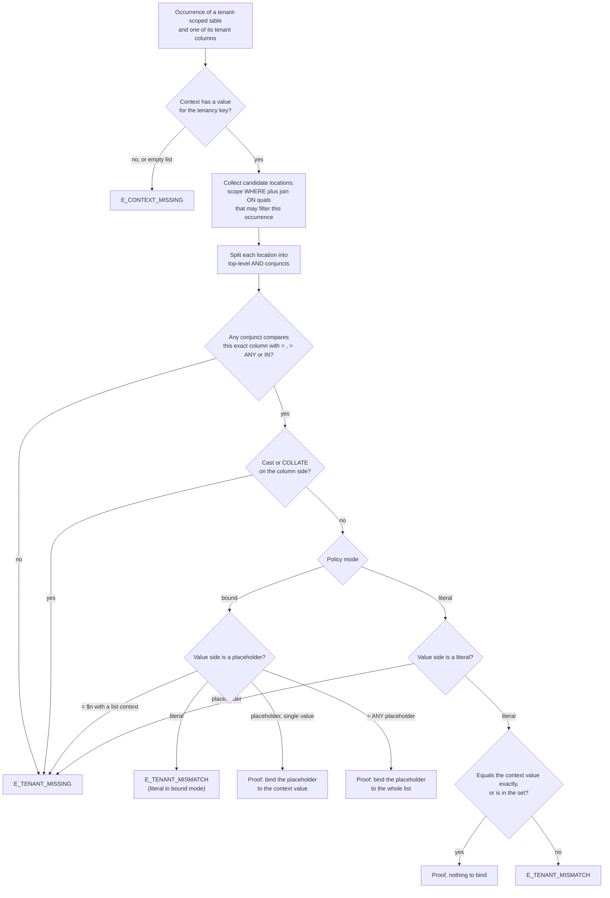
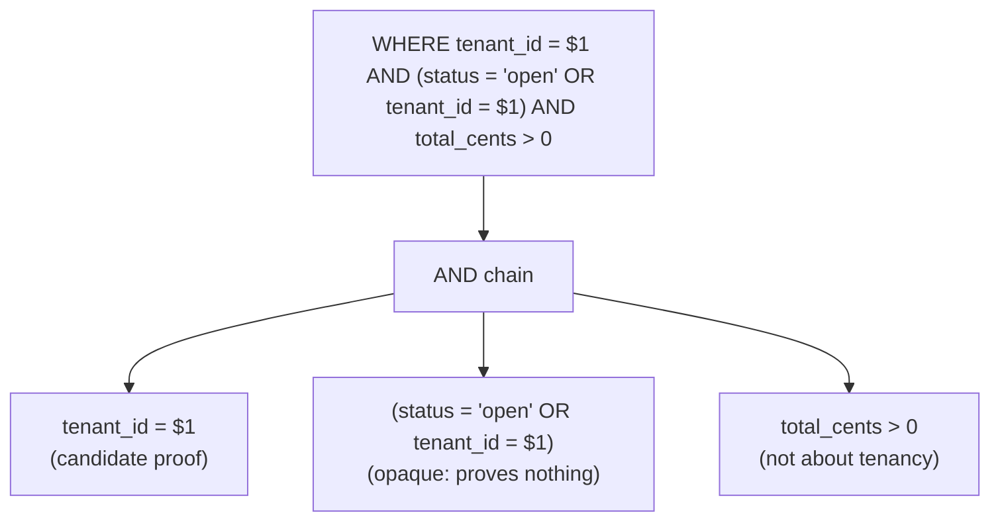
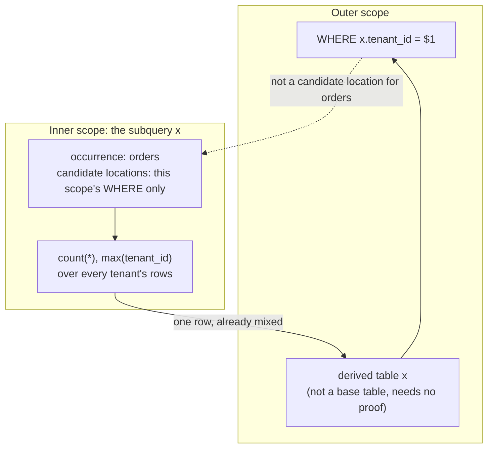
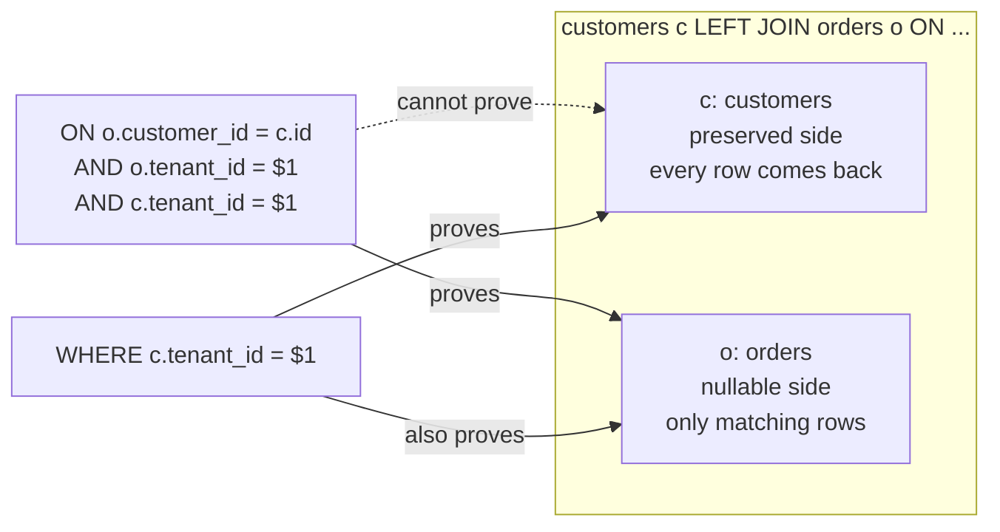
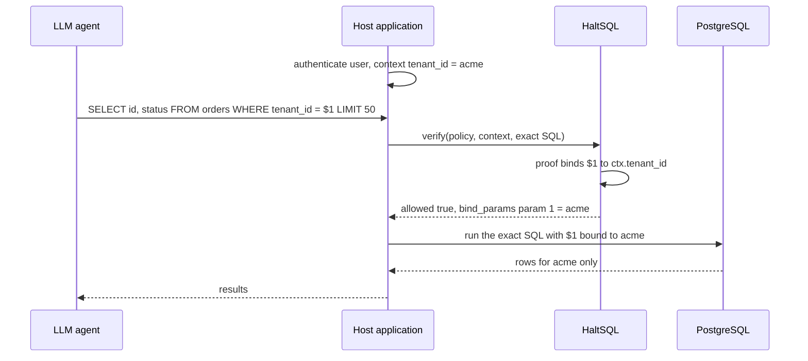
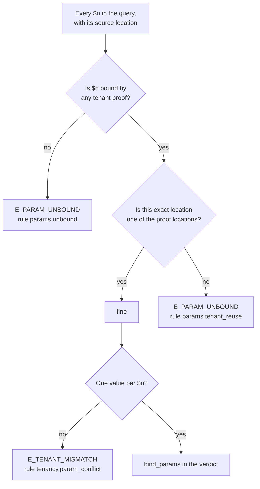

The tenancy proof is the part of the analyzer that answers one question: *can
this exact SQL string ever touch a row that belongs to another tenant?* If
HaltSQL cannot prove the answer is "no", the query is denied.

This page explains how the proof works and why it is built the way it is. The
normative rules are in [tenancy.md](../tenancy.md), and the design decision is
[ADR-0003](../adr/0003-tenancy-semantics.md). The code is
`lib/analyzer/tenancy.ml`. The walker that feeds it is in
`lib/analyzer/walk.ml`, and the parameter checks are in
`lib/analyzer/analyzer.ml`.

> **Note:** Every example on this page is real output from
> `haltsql verify --policy test/fixtures/policies/saas.yaml --context '{"tenant_id":"acme"}' --json`,
> unless another fixture is named. That policy uses bound mode with one key,
> `tenant: ${ctx.tenant_id}`, and every `app.*` table except `currencies` and
> `exchange_rates` has `tenant_column: tenant_id`.

## The idea in one paragraph

HaltSQL does not try to understand what a query *means*. It looks for a
specific, easy-to-audit piece of evidence: for every place a tenant-scoped
table is read, there must be an `AND`-ed equality between that table's tenant
column and the caller's tenant value, in the same query level. If the evidence
is there, the database itself will filter the rows. If it is missing,
misplaced, or wrapped in something that might weaken it, the query is denied
with a hint saying exactly what to add.

## Occurrences and scopes

The proof works on two units.

- **Occurrence:** every place a table appears in a `FROM` clause or join tree.
  `FROM orders a JOIN orders b` has two occurrences of `orders`. Each one is
  checked separately, because each one reads rows separately.
- **Scope:** one query level. Every CTE body, derived table, `LATERAL`
  subquery, scalar subquery, `EXISTS` or `IN` subquery, and each branch of a
  `UNION`, `INTERSECT` or `EXCEPT` is its own scope.

For each scope, the walker collects the occurrences in its `FROM` clause and,
for each one, the **candidate locations** where a tenant predicate is allowed
to live. Then `Tenancy.check_level` looks through those locations for a proof.
The occurrence only counts if every tenant column of its table is proven.

## Deciding one occurrence

This is the decision HaltSQL makes for each (occurrence, tenant column) pair.



A few details in that chart are deliberate.

- **Only `=` counts.** The operator must be `=` (or `pg_catalog.=`), `= ANY`,
  or `IN`. `<>`, `LIKE`, `IS DISTINCT FROM` and anything else prove nothing.
- **The column side must be bare.** `tenant_id::varchar(3) = $1` is not a
  proof. A cast on the column can change equality semantics (for example by
  truncating), so a different tenant's rows could compare equal.
- **The value side may only use value-preserving casts.** `$1::text`, `int4`,
  `int8`, `bigint`, `uuid` and a few others are stripped (see
  `safe_cast_types` in `tenancy.ml`). `$1::varchar(3)` is not, because the
  type modifier is invisible in the AST and could truncate the tenant ID.
- **Literals compare exactly.** In literal mode, `'acme '` and `'ACME'` do not
  match `acme`. Integer literals compare after normalization, so `42` matches a
  context value of `"42"`.

```sql
-- Allowed, bind_params: [{"param": 1, "value": "acme"}]
SELECT id FROM orders WHERE tenant_id = $1::text LIMIT 10

-- Denied: E_TENANT_MISSING (cast with a length modifier on the value side)
SELECT id FROM orders WHERE tenant_id = $1::varchar(3) LIMIT 10

-- Denied: E_TENANT_MISMATCH ("compared to a literal, but this policy uses bound mode")
SELECT id FROM orders WHERE tenant_id = 'acme' LIMIT 10
```

## Top-level AND conjuncts only

`Tenancy.conjuncts` flattens only `AND`. Every other node, including `OR`,
`NOT`, `CASE`, function calls and `COALESCE`, is treated as one opaque
conjunct, and an opaque conjunct cannot be a proof.



The reason is simple logic. An `AND` conjunct must be true for a row to come
back, so it really filters. A term under `OR` might not be true for a returned
row, so it filters nothing.

```sql
-- Denied: E_TENANT_MISSING, and E_PARAM_UNBOUND for $1
SELECT id FROM orders WHERE tenant_id = $1 OR status = 'open' LIMIT 10

-- Denied: E_TENANT_MISSING (NOT and <> are both outside the accepted shapes)
SELECT id FROM orders WHERE NOT (tenant_id <> $1) LIMIT 10
```

`HAVING` is never a candidate location either. It filters after grouping, by
which point an aggregate may already have mixed several tenants' rows.

## Why an outer WHERE does not protect a subquery

The most common way to get this wrong is to put the tenant filter in the
outer query and assume it protects everything below it. It does not. The
inner query reads the table first, and it can aggregate, join or reshape rows
from every tenant before the outer filter runs.



```sql
-- Denied: E_TENANT_MISSING on orders (loc 70, inside the subquery)
SELECT * FROM (
  SELECT count(*) AS n, max(tenant_id) AS tenant_id FROM orders
) x
WHERE x.tenant_id = $1
LIMIT 1
```

Here `x.tenant_id` is just the largest tenant ID in the whole table, and `n`
counts every tenant's orders. The outer filter passes whenever the caller's ID
happens to be the largest. The fix is to filter in the scope that reads
`orders`.

The same rule applies to correlated subqueries. A correlation such as
`o2.customer_id = o.customer_id` does not carry the outer tenant filter
inward:

```sql
-- Denied: E_TENANT_MISSING on o2
SELECT o.id FROM orders o
WHERE o.tenant_id = $1
  AND EXISTS (SELECT 1 FROM orders o2
              WHERE o2.customer_id = o.customer_id AND o2.status = 'refunded')
LIMIT 10

-- Allowed: the same $1 is reused, bind_params: [{"param": 1, "value": "acme"}]
SELECT o.id FROM orders o
WHERE o.tenant_id = $1
  AND EXISTS (SELECT 1 FROM orders o2
              WHERE o2.customer_id = o.customer_id AND o2.tenant_id = $1)
LIMIT 10
```

Each set-operation branch is a scope too, so a `UNION ALL` branch without a
filter is denied even when the first branch is fine. CTE bodies prove their
own occurrences; a reference to the CTE by name is not a base table and needs
no predicate:

```sql
-- Allowed
WITH r AS (SELECT customer_id FROM orders WHERE tenant_id = $1)
SELECT c.name FROM customers c JOIN r ON r.customer_id = c.id
WHERE c.tenant_id = $1
LIMIT 10
```

## Joins and preserved sides

A join's `ON` clause can be a candidate location, but only for the side whose
rows it actually removes. The walker (`walk_from` in `walk.ml`) attaches each
join's `ON` quals to these occurrences:

| Join kind | `ON` quals are attached to |
|---|---|
| `INNER` (or `CROSS` with quals) | occurrences on both sides |
| `LEFT` | occurrences on the right (nullable) side only |
| `RIGHT` | occurrences on the left (nullable) side only |
| `FULL` | nothing |
| `USING`, `NATURAL` | nothing (`NATURAL` is denied as unsupported) |

The scope's `WHERE` is always a candidate location for every occurrence in the
scope.



Why can the `ON` of a `LEFT JOIN` not prove the left table? Because an outer
join returns every row of the preserved side whether or not `ON` matched. The
condition only decides whether the row gets a partner or `NULL`s.

```sql
-- Denied: E_TENANT_MISSING on c, and params.tenant_reuse for the $1 in c.tenant_id = $1
SELECT c.name, o.id
FROM customers c
LEFT JOIN orders o ON o.customer_id = c.id AND c.tenant_id = $1 AND o.tenant_id = $1
LIMIT 10

-- Allowed
SELECT c.name, o.id
FROM customers c
LEFT JOIN orders o ON o.customer_id = c.id AND o.tenant_id = $1
WHERE c.tenant_id = $1
LIMIT 10
```

Notice the second reason on the denied query. `c.tenant_id = $1` sits in a
location that cannot prove `c`, so that use of `$1` is not part of any proof.
That triggers the placeholder rule described [below](#a-tenant-placeholder-may-only-be-a-tenant-value).

`RIGHT JOIN` is the mirror image: its `ON` can prove the left side. For
`FULL JOIN`, neither side can be proven by `ON`, so both need `WHERE`
predicates.

### Equality propagation

An occurrence is also proven by a plain equality between its tenant column and
the tenant column of **another occurrence in the same `SELECT`** that is itself
proven, when both columns carry the same tenancy key:

```sql
SELECT o.id, c.name
FROM orders o JOIN customers c ON c.id = o.customer_id AND c.tenant_id = o.tenant_id
WHERE o.tenant_id = $1
LIMIT 10
```

`o` has a direct predicate; `c` is proven through `c.tenant_id = o.tenant_id`.
The same limits apply as for a direct predicate, and a few more:

- The equality must be a top-level `AND` condition in one of the occurrence's
  own locations (the `WHERE`, or a join `ON` that filters it). In
  `customers c LEFT JOIN orders o ON c.tenant_id = o.tenant_id`, the `ON` does
  not filter `c`, so `c` still needs its own proof.
- Both sides must be bare column references: no cast, no `COLLATE`, no
  expression, and only the `=` operator.
- At least one occurrence in the chain needs a direct predicate. Two
  occurrences that are only equal to each other prove nothing.
- It does not cross a subquery boundary (`EXISTS`, `IN (SELECT ...)`,
  `LATERAL`, CTEs), and `USING (tenant_id)` / `NATURAL JOIN` are not proofs.
  Write a direct predicate there.

Why it is sound: the equality sits in a location that filters the occurrence,
so every surviving row of `c` has `c.tenant_id` equal to the `o.tenant_id` of a
real (not null-extended) row of `o`, and every such row of `o` carries the
tenant's value. The prover starts from direct proofs and adds occurrences
until nothing changes (`Tenancy.transitive_proofs`), so a cycle of unproven
occurrences is never accepted.

## Bound mode and bind_params

In bound mode, the agent never sees the tenant ID. It writes a placeholder,
and HaltSQL tells the caller what to bind.



The verdict for that query:

```json
{
  "allowed": true,
  "reasons": [],
  "statement_kind": "select",
  "tables": [ "app.orders" ],
  "bind_params": [ { "param": 1, "value": "acme" } ]
}
```

(Other verdict fields are omitted here; see [verdict.md](../verdict.md).)

How the binding is built:

1. Each successful proof records a binding: the placeholder number, the
   context value, and the exact source location of that `$n` node
   (`Env.add_binding`).
2. In `Analyzer.finalize`, bindings are grouped by placeholder. If one `$n`
   would need two different values, the query is denied with
   `E_TENANT_MISMATCH` (rule `tenancy.param_conflict`).
3. Every `$n` that appears in the query must have a binding, otherwise
   `E_PARAM_UNBOUND` (rule `params.unbound`). HaltSQL must supply every bound
   value itself, so the agent cannot smuggle in a parameter for the caller to
   fill.
4. A denied verdict carries an empty `bind_params`.

Reusing `$1` for several occurrences of the same key is fine; it is bound
once. Reusing it across *different* keys only works when both keys resolve to
the same value. With `test/fixtures/policies/composite.yaml` (keys `org` and
`workspace`):

```sql
-- context {"org_id":"o1","workspace_id":"w9"}
-- Allowed, bind_params: [{"param":1,"value":"o1"},{"param":2,"value":"w9"}]
SELECT id, name FROM projects WHERE org_id = $1 AND workspace_id = $2 LIMIT 20

-- Denied: E_TENANT_MISMATCH (tenancy.param_conflict)
SELECT id, name FROM projects WHERE org_id = $1 AND workspace_id = $1 LIMIT 20

-- Denied: E_TENANT_MISSING (no workspace predicate)
SELECT id, name FROM projects WHERE org_id = $1 LIMIT 20
```

That last query shows how **composite keys** work. A table with
`tenant_columns: { org_id: org, workspace_id: workspace }` needs a separate
proof for each column, in the same scope. A row comparison such as
`(org_id, workspace_id) = ($1, $2)` is not recognized.

### Sets of tenant values: `= ANY($n)`

The context value for a key can be a list, for example a parent organization
that may see its children. With a list:

- `tenant_id = ANY($1)` is a proof, and HaltSQL binds the whole list. The
  caller binds it as a Postgres array.
- `tenant_id = $1` is *not* a proof, because a single placeholder cannot
  stand for a set. The message says so.
- An empty list allows nothing (`E_CONTEXT_MISSING`).

```sql
-- context {"tenant_id":["acme","acme-eu"]}
-- Allowed, bind_params: [{"param": 1, "value": ["acme", "acme-eu"]}]
SELECT id FROM orders WHERE tenant_id = ANY($1) LIMIT 10

-- Denied: E_TENANT_MISSING
-- "... (the context holds several tenant values: use = ANY($n))"
SELECT id FROM orders WHERE tenant_id = $1 LIMIT 10
```

In literal mode, `tenant_id IN ('acme', 'acme-eu')` is accepted when every
literal is in the set; any literal outside it is `E_TENANT_MISMATCH`.

## A tenant placeholder may only be a tenant value

Finding a proof is not enough. `Analyzer.finalize` also checks that every use
of a tenant placeholder *is* one of the proofs. It compares the location of
every `$n` in the query with the locations recorded by the proofs. Any extra
use is denied with `E_PARAM_UNBOUND`, rule `params.tenant_reuse`.

```sql
-- Denied: E_PARAM_UNBOUND, rule params.tenant_reuse
-- "tenant placeholder $1 is used outside a tenant predicate"
SELECT id FROM orders WHERE $1::float8 IS NOT NULL AND tenant_id = $1 LIMIT 10
```

The predicate `tenant_id = $1` is a perfectly good proof on its own. The
problem is the other use. PostgreSQL infers one type for each parameter from
how it is used. If the query also writes `$1::float8`, Postgres may infer `$1`
as `float8`, and the tenant comparison then happens in floating point.
`float8` rounds large `bigint` values, so a neighbouring tenant's ID could
compare equal and its rows would match. The rule removes that whole class of
trick: the agent cannot influence the type of the tenant parameter except
through the tenant comparison itself. The same applies to `status = $1`,
`SELECT $1`, or `$1 = 'acme'` under an `OR`.



## INSERT, UPDATE and DELETE

Writes use the same machinery, plus a few write-specific checks. The examples
use `test/fixtures/policies/writes.yaml`, where `app.tickets` allows insert,
update of some columns, and delete.

| Statement | What must hold | Code if not |
|---|---|---|
| `INSERT ... VALUES` | The column list names every tenant column, and every row sets it to the tenant value (`$n` in bound mode, the exact literal in literal mode) | `E_TENANT_WRITE` |
| `INSERT ... DEFAULT VALUES` on a tenant table | Never allowed: it cannot set the tenant column | `E_TENANT_WRITE` |
| `INSERT ... SELECT` | Not analyzed in the current version; denied | `E_UNSUPPORTED` |
| `UPDATE` | Never assigns a tenant column, and its `WHERE` proves the target (tables in `UPDATE ... FROM` need their own proofs) | `E_TENANT_WRITE`, `E_TENANT_MISSING` |
| `DELETE` | Its `WHERE` proves the target (tables in `DELETE ... USING` need their own proofs) | `E_TENANT_MISSING` |

For `UPDATE` and `DELETE`, the target and the `FROM`/`USING` items form one
scope whose `WHERE` is the candidate location, exactly like a `SELECT`
(`Tenancy.check_level` is called the same way).

```sql
-- Allowed, bind_params: [{"param": 1, "value": "acme"}]
INSERT INTO tickets (id, tenant_id, title, status) VALUES (101, $1, 'Printer down', 'open')

-- Denied: E_TENANT_WRITE (bound mode: use a $n placeholder)
INSERT INTO tickets (id, tenant_id, title, status) VALUES (101, 'acme', 'Printer down', 'open')

-- Allowed
UPDATE tickets SET status = 'closed' WHERE id = 7 AND tenant_id = $1

-- Denied: E_WRITE_DENIED, E_TENANT_WRITE and params.tenant_reuse
UPDATE tickets SET tenant_id = $1 WHERE id = 7 AND tenant_id = $1

-- Denied: E_TENANT_MISSING
DELETE FROM tickets WHERE id = 7
```

> **Note:** `INSERT ... SELECT` is not supported: the analyzer
> (`walk_insert` in `lib/analyzer/walk.ml`) denies it as `E_UNSUPPORTED`.

## Where to go next

- [analyzer.md](./analyzer.md) explains the rest of the rule families the
  tenancy proof runs alongside.
- [assurance.md](./assurance.md) shows how the proof is tested, including the
  lab that checks allowed queries against real Postgres row-level security.
- [reason-codes.md](../reason-codes.md) lists every code mentioned here.
