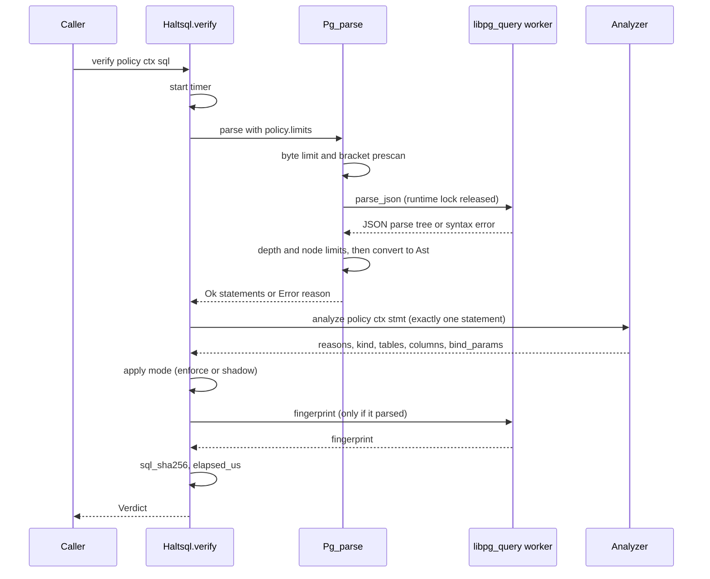
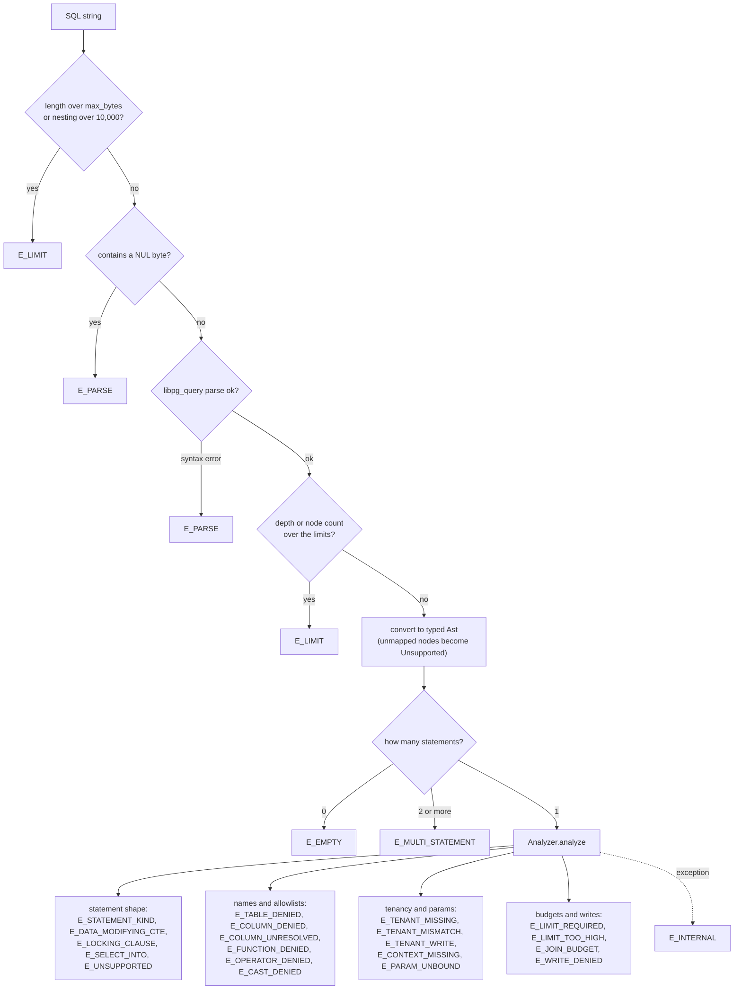
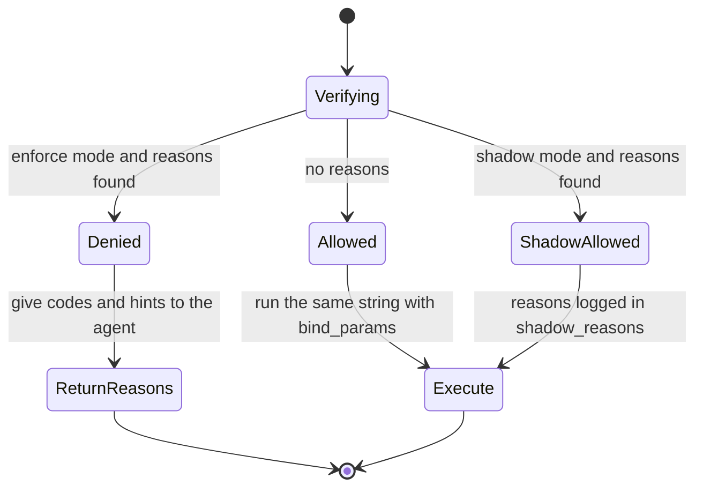
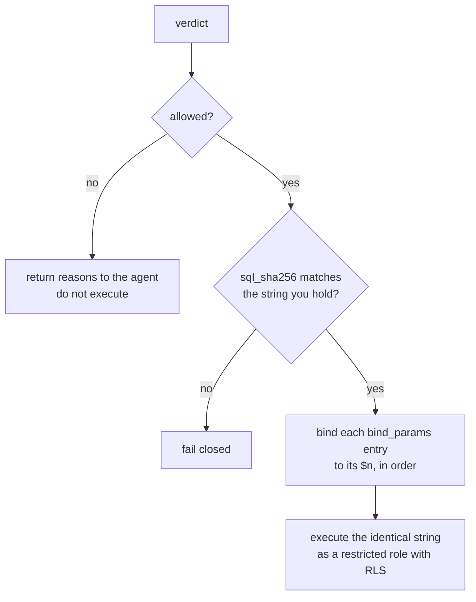

Every surface (the CLI, the HTTP sidecar, the proxy, the test runner) ends up
calling the same function:

```ocaml
val verify : Policy.t -> Context.t -> string -> Verdict.t
```

It lives in `lib/haltsql/haltsql.ml` and is about fifty lines long. This page
walks through it stage by stage. For the big picture see
[Architecture](./architecture.md); for the inner workings of the two heavy
stages see [Parser](./parser.md) and [Analyzer](./analyzer.md).

## The stages at a glance



`verify` never raises. Every stage either produces data for the next one or a
reason that ends up in the verdict.

## Stage by stage

### 1. Input limits

Before the SQL reaches any C code, `Pg_parse.parse_unsafe`
(`lib/parse/pg_parse.ml`) applies two cheap checks:

| Check | Limit | Reason |
|---|---|---|
| Length in bytes | `limits.max_bytes` (default 16,384) | `E_LIMIT` |
| Bracket nesting `(` `[` | hard bound of 10,000 | `E_LIMIT` |

The bracket prescan is a backstop. It counts brackets everywhere, including
inside string literals and comments, so it can only over-count, never miss.
It exists so that absurd nesting is rejected before the C parser and the JSON
reader ever see it.

### 2. NUL bytes

The C stub (`lib/pgquery/pgquery_stubs.c`) rejects any input that contains a NUL
byte, with `E_PARSE` and the message `query contains a NUL byte`. C strings stop
at the first NUL, so libpg_query would only see the text before it, while a
driver might still send the whole buffer to the server. Rejecting the input
removes that gap.

### 3. Parse

libpg_query parses the string with the PostgreSQL 17 grammar and returns its
parse tree as JSON. The call runs on a pool of long-lived worker threads with
large stacks, and the OCaml runtime lock is released while it waits, so other
domains keep working. A syntax error becomes `E_PARSE`, with `loc` set from
the parser's cursor position when it is known. See [Parser](./parser.md).

### 4. Tree limits

The JSON tree is measured **iteratively** (no recursion) before any recursive
code walks it:

| Check | Limit | Reason |
|---|---|---|
| Tree depth | `limits.max_depth` (default 64) | `E_LIMIT` |
| Node count | `limits.max_nodes` (default 20,000) | `E_LIMIT` |

Measuring first means the recursive conversion only ever runs on trees of
bounded size. As a last resort, a `Stack_overflow` or `Out_of_memory` while
parsing is also turned into `E_LIMIT`, and any other exception into
`E_INTERNAL`.

### 5. Convert to the typed AST

The JSON is converted into `Haltsql_core.Ast`. Anything the converter does not
map precisely becomes an explicit `Unsupported` node instead of being dropped.
The analyzer later denies those nodes with `E_UNSUPPORTED`. See
[Parser](./parser.md#from-json-to-the-typed-ast).

### 6. Exactly one statement

`verify` then looks at how many statements came back:

| Statements | Result |
|---|---|
| 0 (empty, whitespace, or only comments) | `E_EMPTY` |
| 1 | analyze it |
| 2 or more | `E_MULTI_STATEMENT`, without analyzing any of them |

Requiring exactly one statement closes the classic `SELECT ...; DROP TABLE ...`
attack. HaltSQL does not try to analyze each statement separately.

### 7. Analyze

`Analyzer.analyze` walks the statement against the policy and the context. It
resolves every table and column, applies every rule family, runs the tenancy
proofs, and collects **all** violations (not just the first). It returns:

- `reasons`: every violation found, de-duplicated, in the order found;
- `statement_kind`: `select`, `insert`, `update`, or `delete`, when known;
- `tables` and `columns`: what the statement reads or writes, sorted and unique;
- `bind_params`: the value for each tenant placeholder `$n`.

The analyzer has its own exception guard: any exception becomes a single
`E_INTERNAL` reason. See [Analyzer](./analyzer.md).

### 8. Apply the policy mode

| `policy.mode` | `allowed` | `reasons` | `shadow_reasons` |
|---|---|---|---|
| `enforce` (default) | `true` exactly when there are no reasons | the reasons | `[]` |
| `shadow` | always `true` | `[]` | the reasons |

Shadow mode lets you roll out a new policy and watch what it would deny. It
enforces nothing, so never rely on it as your only control.

`bind_params` is filled only when the analysis found no reasons at all. In
shadow mode this means a query with would-be violations comes back
`allowed: true` with empty `bind_params`.

### 9. Fingerprint, hash, and timing

- `fingerprint`: libpg_query's fingerprint, equal for queries that differ only
  in literal values. Use it to group queries in logs. It is a second full parse,
  so it is computed **only** when the input parsed into exactly one statement;
  oversized and malformed input stays cheap to reject. It is `null` otherwise,
  or if fingerprinting fails.
- `sql_sha256`: lower-case hex SHA-256 of the exact input string. Audit logs
  can refer to the query without storing it, and clients use it to check that
  the verdict is about the string they sent.
- `elapsed_us`: wall-clock microseconds spent in `verify`. Informational only;
  it is the one field that is not deterministic.

The policy's `name` and `version` (a `sha256:` hash of the normalized policy)
are copied into the verdict so every decision names the policy that made it.

## Where each reason family can come from



`E_INTERNAL` can also come from the parse stage (unreadable parser output, or an
unexpected exception) and from the outer guard in `verify` itself. All of these
are denials. The complete list of codes is in
[reason-codes.md](../reason-codes.md).

Note that the stages before the analyzer stop at the **first** problem and
produce a single reason, while the analyzer reports **every** problem it finds.
A query that fails to parse tells you only that; a query that parses tells you
everything that is wrong with it at once, which lets an agent fix it in one
retry.

## Real examples

These come from the CLI (`haltsql verify --json`) with
`examples/policies/saas.yaml` and the context `{"tenant_id": "acme"}`. Hash and
timing fields are trimmed.

An allowed query in bound tenancy mode:

```sql
SELECT o.id, o.status FROM orders o WHERE o.tenant_id = $1 LIMIT 10
```

```json
{
  "allowed": true,
  "reasons": [],
  "shadow_reasons": [],
  "statement_kind": "select",
  "tables": [ "app.orders" ],
  "columns": [ "app.orders.id", "app.orders.status", "app.orders.tenant_id" ],
  "bind_params": [ { "param": 1, "value": "acme" } ],
  "fingerprint": "d09f905ca477c373"
}
```

Two statements: rejected before analysis, so no fingerprint:

```sql
SELECT 1; SELECT 2
```

```json
{
  "allowed": false,
  "reasons": [
    {
      "code": "E_MULTI_STATEMENT",
      "message": "expected exactly one statement, found 2",
      "rule": "statement.count",
      "hint": "Send a single SQL statement with no semicolon-separated extras."
    }
  ],
  "fingerprint": null
}
```

A syntax error, with `loc` pointing at the problem:

```json
{
  "code": "E_PARSE",
  "message": "syntax error at or near \"SELEC\"",
  "rule": "parse",
  "loc": 0,
  "hint": "Fix the SQL syntax; HaltSQL accepts PostgreSQL only."
}
```

## Life of a verdict



## How the caller must use the verdict

A verdict is only a guarantee about the **exact string** that was verified, with
the **exact parameters** HaltSQL returned. The caller's side of the contract:

1. **If `allowed` is `false`, do not run the query.** Return the `reasons` to
   the agent. The `hint` on each reason is written so a model can act on it.
2. **If `allowed` is `true`, run exactly the verified string.** Do not
   reformat it, append to it, or template values into it. Any change means you
   are running SQL that was never checked. The `sql_sha256` field lets you (and
   the SDKs) confirm the verdict matches the string.
3. **Bind `bind_params` in order of `param`.** Each entry says which `$n` gets
   which value. In bound tenancy mode, the model writes `o.tenant_id = $1` and
   never sees the tenant id; HaltSQL supplies the value from your context.
   `value` is a string, or an array of strings when the context holds a set of
   tenants (used with `= ANY($n)`).
4. **There are no other parameters to bind.** A placeholder that is not a
   tenant predicate value is denied with `E_PARAM_UNBOUND`, so the model can
   never make you bind a value it chose. A tenant placeholder used anywhere
   other than its tenant predicate is denied too.
5. **Treat any failure as a denial.** If the sidecar is unreachable, times out,
   or returns something you cannot parse, do not run the query.
6. **Log the decision.** Record `policy.version`, `fingerprint`, `sql_sha256`,
   `allowed`, and the reason codes.



The official SDKs do all of this for you; see
[integrations.md](../integrations.md). The proxy does it itself: it overwrites
tenancy parameters at `Bind` time, and on the simple query protocol (which
cannot carry parameters) it denies a query that needs `bind_params`. See
[Proxy internals](./proxy-internals.md).

> **Note:** HaltSQL checks the SQL, not the database. Run the verified query as
> a restricted database role with row-level security as well. See
> [defense-in-depth.md](../defense-in-depth.md).
