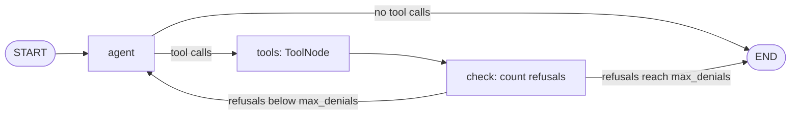

# LangGraph

`haltsql-langgraph` gives a [LangGraph](https://github.com/langchain-ai/langgraph)
agent a `haltsql_query` tool that runs read-only SQL only after HaltSQL has
verified it. The tool works with `ToolNode`, and the package includes an
example graph that lets the model retry after a refusal, up to a limit. The
tenant comes from the graph's runtime context, which your application sets and
the model never sees.

## What it provides

| Name | Kind | What it does |
|---|---|---|
| `haltsql_query_tool(runner, ...)` | Function returning a LangChain `StructuredTool` | A tool named `haltsql_query` whose only model-facing argument is `query`. Verifies, then runs the exact SQL in a `READ ONLY` transaction with a statement timeout and a row cap. Uses `response_format="content_and_artifact"`. |
| `build_sql_agent_graph(model, tool, ...)` | Function returning a compiled graph | An example agent graph with a bounded retry-on-deny loop. |
| `is_denial(message)` | Function | `True` if a message is a `ToolMessage` from the HaltSQL tool whose query did not run. |
| `HaltSQLToolRunner` | Class | Holds the verifier, the connection factory and the limits. Shared by all five agent-framework packages. See [The runner](../agent-frameworks.md#the-runner). |
| `context_from_app(app_state, key="haltsql_context")` | Function | Reads and validates the context from an object or mapping. Used by default to read the runtime context. |
| `ContextUnavailable` | Exception | Raised inside the package when no context can be read. You see it as a refusal. |
| `TOOL_NAME`, `DEFAULT_CONTEXT_KEY` | Constants | `"haltsql_query"` and `"haltsql_context"`. |
| `haltsql_langgraph.graph.SQLAgentState` | `TypedDict` | State of the example graph: `messages` and `denials`. |

The package is a thin layer over the [Python SDK](../sdk-python.md). Every
query goes through `haltsql.guard.authorize` and `guard.execute`.

## Install

The package needs Python 3.10 or newer, `langgraph` 1.2 or newer (below 2),
`langgraph-prebuilt` 1.1 or newer and `langchain-core` 1.6 or newer. It is
not on PyPI yet, so install it and the Python SDK from a checkout of the
repository:

```sh
git clone https://github.com/HaltSQL/HaltSQL && cd HaltSQL
pip install -e clients/python -e integrations/langgraph
```

The SDK depends on psycopg 3, which needs `libpq` on the machine. If you do
not have it, also run `pip install 'psycopg[binary]'`. You also need a chat
model integration, such as `langchain-openai`.

To verify queries you need a running `haltsql-server` (`HaltSQLClient`), the
`haltsql` CLI and a policy file (`LocalVerifier`), or a platform wheel of the
SDK with the bundled engine (`NativeVerifier`). See the
[Python SDK](../sdk-python.md).

## Minimal example

```python
import os

import psycopg
from langchain_openai import ChatOpenAI
from haltsql import HaltSQLClient
from haltsql_langgraph import HaltSQLToolRunner, build_sql_agent_graph, haltsql_query_tool

DSN = os.environ["AGENT_DATABASE_URL"]          # a read-only role

runner = HaltSQLToolRunner(
    HaltSQLClient.from_env(),                   # or LocalVerifier("policy.yaml")
    connect=lambda: psycopg.connect(DSN),       # called only after HaltSQL allows the query
)
tool = haltsql_query_tool(runner)
llm = ChatOpenAI(model="gpt-4o-mini")
graph = build_sql_agent_graph(llm.bind_tools([tool]), tool, max_denials=3)

def answer(user, question: str) -> str:
    out = graph.invoke(
        {"messages": [("user", question)]},
        context={"haltsql_context": {"tenant_id": user.tenant_id}},
    )
    return out["messages"][-1].content
```

`user` is your authenticated user. Build the tool and graph once at startup.
Pass the context on every `invoke`.

To use the tool in your own graph instead, put it in a `ToolNode` as usual:

```python
from langgraph.prebuilt import ToolNode

tools = ToolNode([tool])
```

## Where the tenant comes from

The tool takes LangGraph's `ToolRuntime`, which LangGraph injects and hides
from the model. It reads the HaltSQL context from `runtime.context`, the value
you pass as `graph.invoke(..., context=...)`. By default it reads the
`haltsql_context` key of a mapping, or the `haltsql_context` attribute of an
object such as a dataclass. The value may also be a zero-argument callable that
returns the mapping.

To read the context from your own context object, pass `context_from`:

```python
tool = haltsql_query_tool(runner, context_from=lambda ctx: {"tenant_id": ctx.tenant_id})
```

If you use a typed context, pass its type to the example graph with
`build_sql_agent_graph(..., context_schema=AppContext)`.

| Runtime context | Result |
|---|---|
| Has `haltsql_context` (or `context_from` returns a mapping) | The query is verified with that context. |
| No `context=`, no `haltsql_context`, or `context_from` returns `None` | Refused before verification: "No trusted HaltSQL context is configured for this run". |
| `haltsql_context` is `{}` | Verified with an empty context. Tenant tables are then denied by the policy. |

The tool's argument schema has only `query`. If a tool call carries an extra
argument such as `tenant_id`, LangChain drops it before the tool runs, and the
context still comes from the runtime.

## What the model sees

Each call returns a `ToolMessage`. Its `content` is JSON text for the model,
and its `artifact` is the same result as a dict for your graph's routing. On
success:

```json
{"status":"ok","executed":true,"columns":["id","status"],"rows":[[1,"open"],[3,"paid"]],"row_count":2,"truncated":false}
```

When HaltSQL denies the query, nothing runs, and the model gets each reason
with its code and hint:

```json
{"status":"denied","executed":false,
 "reasons":[{"code":"E_TENANT_MISMATCH","message":"...","hint":"Use a $n placeholder (e.g. orders.tenant_id = $1) instead of a tenant literal; HaltSQL returns the value to bind."}],
 "message":"HaltSQL denied the query; it was not executed. Fix the SQL and retry:\n- E_TENANT_MISMATCH: Use a $n placeholder ..."}
```

Other failures have `"status": "error"`. With `"executed": false`, nothing
ran: HaltSQL was unavailable, no context was configured, the statement was not
a `SELECT`, or the database could not be reached. With `"executed": true`,
HaltSQL allowed the query but the database rejected it, for example on a
statement timeout.

`is_denial(message)` is true for both `denied` and `error` results. See
[reason-codes.md](../reason-codes.md) for every code.

## The example graph



`check` counts the tool messages for which `is_denial` is true, across the
whole run, in the `denials` state key. When the count reaches `max_denials`,
the graph adds the message "Stopping: HaltSQL refused N queries in this run."
and ends, instead of looping. Because `is_denial` also counts `error` results,
database errors and an unavailable verifier count toward the limit too.

`model` can be a runnable such as `llm.bind_tools([tool])`, or a callable that
takes the message list and returns an `AIMessage`. The graph supports both
`invoke` and `ainvoke`.

## Configuration

`HaltSQLToolRunner(verifier, connect, *, max_rows=200, statement_timeout_ms=5000, settings=None)`:

| Argument | Default | Meaning |
|---|---|---|
| `verifier` | required | `HaltSQLClient`, `LocalVerifier`, `NativeVerifier`, or any object with `verify(sql, context)`. |
| `connect` | required | Zero-argument callable that returns a new psycopg 3 connection. Called only after HaltSQL allows the query. The runner closes the connection after each query. |
| `max_rows` | `200` | Row cap, 1 to 100000. `truncated` tells the model more rows were available. |
| `statement_timeout_ms` | `5000` | `statement_timeout` for the query, 1 to 3600000. |
| `settings` | `None` | Transaction-local settings: a mapping, or a function of the verified context, for example `lambda ctx: {"app.tenant_id": ctx["tenant_id"]}` for row-level security. |

`haltsql_query_tool(runner, *, context_from=None, name="haltsql_query", description=DEFAULT_DESCRIPTION)`:

| Argument | Default | Meaning |
|---|---|---|
| `runner` | required | A `HaltSQLToolRunner`. |
| `context_from` | `None` | `f(runtime_context) -> mapping`. Default: the `haltsql_context` key or attribute of the runtime context. |
| `name` | `"haltsql_query"` | Tool name the model sees. |
| `description` | built-in text | Tool description the model sees. |

`build_sql_agent_graph(model, tool, *, max_denials=3, context_schema=None, extra_tools=None)`:

| Argument | Default | Meaning |
|---|---|---|
| `model` | required | A runnable or callable that returns an `AIMessage`. |
| `tool` | required | The tool from `haltsql_query_tool`. |
| `max_denials` | `3` | Stop after this many refused queries in one run, 1 to 20. |
| `context_schema` | `None` | Type of the runtime context, passed to `StateGraph`. |
| `extra_tools` | `None` | Other tools served by the same `ToolNode`. |

Every query runs in a `READ ONLY` transaction, and only statements whose
verdict `statement_kind` is `select` are run. These cannot be turned off.

## Async support

The tool has both a sync and an async implementation. `graph.ainvoke` and
`ToolNode` in async mode use the async one, which runs verification and
execution in a worker thread (`asyncio.to_thread`) so the event loop is not
blocked. Use a sync verifier and a sync psycopg connection either way. Rows are
returned whole; streaming rows is not supported. LangGraph's own streaming of
graph steps works as usual.

## Testing

You can test your wiring without a model, a sidecar or a database. Use
`FakeVerifier` from `haltsql.testing` and check that a denial never opens a
connection:

```python
from haltsql.testing import FakeVerifier, make_verdict_dict
from haltsql_langgraph import HaltSQLToolRunner

def deny(sql, ctx, _policy):
    return make_verdict_dict(sql, allowed=False, codes=["E_TENANT_MISSING"])

def no_db():
    raise AssertionError("connected after a denial")

def test_denial_never_connects():
    fv = FakeVerifier(deny)
    out = HaltSQLToolRunner(fv, no_db).run("SELECT id FROM orders LIMIT 10", {"tenant_id": "acme"})
    assert out["status"] == "denied" and out["reasons"][0]["code"] == "E_TENANT_MISSING"
```

To test the graph without an LLM, pass a plain function as `model` that
returns an `AIMessage` with scripted `tool_calls`. The package's own tests do
this with a real `ToolNode` and `StateGraph`, the real `haltsql` CLI, a real
`haltsql-server` and the lab Postgres:

```sh
make -C lab up
dune build ./bin/haltsql/main.exe ./bin/server/main.exe
ONLY=agents clients/python/run-all-tests.sh
```

`integrations/langgraph/constraints.txt` lists the exact versions the tests
were run with. See [Testing](../agent-frameworks.md#testing).

## Troubleshooting

| Symptom | Cause | Fix |
|---|---|---|
| "No trusted HaltSQL context is configured for this run" | `invoke` got no `context=`, the context has no `haltsql_context`, or `context_from` returned `None` or raised a `LookupError`. | Pass `context=` on every `invoke` and `ainvoke`. |
| Every query on a tenant table is denied | The context is empty or misses a key the policy needs (`E_CONTEXT_MISSING`), or the model wrote a tenant literal (`E_TENANT_MISMATCH`). | Check the context. In bound mode the model must write `$1`. |
| The graph ends with "Stopping: HaltSQL refused N queries in this run." | The model reached `max_denials`. | Read the `ToolMessage` artifacts to see the reasons. Improve the system prompt or the policy; raise `max_denials` only if retries are making progress. |
| "SQL verification is unavailable" | The sidecar or CLI failed, timed out, or returned a verdict for a different string. An unexpected exception in `context_from` is also reported this way. | Check `HALTSQL_URL` and `HALTSQL_TOKEN`, or the `haltsql` binary. Test `context_from` on its own. |
| "The database is unavailable" | `connect` raised. | Check the DSN and network. |
| `TypeError: the model must return an AIMessage` | `model` returned something else. | Return an `AIMessage`, or pass a chat model runnable. |
| `ValueError: max_denials must be an integer in 1..20` | `max_denials` out of range. | Use 1 to 20. |
| `ImportError: no pq wrapper available` | psycopg cannot find `libpq`. | `pip install 'psycopg[binary]'`, or install `libpq`. |

## Limits

- Read-only `SELECT` only. Write policies are not supported by this tool.
- One statement per call. Rows are returned whole, up to `max_rows`; there is
  no streaming or pagination.
- `connect` must return a psycopg 3 connection.
- `build_sql_agent_graph` is an example. For more control, use the tool in
  your own graph and route on `is_denial`.
- HaltSQL verifies the PostgreSQL dialect only.

## Related

- [Agent frameworks](../agent-frameworks.md): what all five packages share.
- [LangChain](langchain.md): a tool and a guarded `SQLDatabase` for LangChain
  agents.
- [Python SDK](../sdk-python.md): verifiers, `guard.execute` and errors.
- [reason-codes.md](../reason-codes.md) and [tenancy.md](../tenancy.md).
- [defense-in-depth.md](../defense-in-depth.md).
- Source: [`integrations/langgraph`](../../integrations/langgraph).
