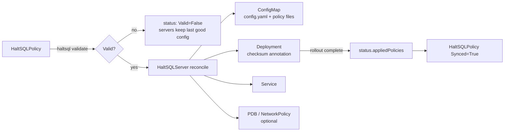

# Kubernetes operator

The HaltSQL operator manages `haltsql-server` on Kubernetes with two custom
resources:

| Resource | What it is |
|---|---|
| `HaltSQLPolicy` | One policy: an inline policy document, or a signed bundle that the server fetches from an OCI registry, S3 or HTTPS. The operator validates it with the real `haltsql validate` and reports `Valid` and `Synced` conditions. |
| `HaltSQLServer` | A `haltsql-server` Deployment that loads a set of `HaltSQLPolicy` objects. The operator renders the config into a ConfigMap and creates the Deployment, Service and (optionally) a PodDisruptionBudget and a NetworkPolicy. When the configuration changes, it rolls the pods. |

Use the operator when policies have their own lifecycle and owners, such as a
platform team running shared servers while application teams own their
policies, or when you want policy validity and rollout state in
`kubectl get`. For a single static deployment, the Helm chart
(`deploy/helm/haltsql`, see [deployment.md](deployment.md)) is simpler.

The operator lives in `deploy/operator` (Go, controller-runtime, kubebuilder
layout). Its API group is `haltsql.dev/v1alpha1`. It may change incompatibly
before `v1`.



## Install

The operator image has the controller and the `haltsql` CLI, which it uses for
validation. Build it from the haltsql image that your servers run, so that
validation and serving use the same loader:

```sh
docker build -t haltsql:dev .                                   # repository root
docker build -t haltsql-operator:dev \
  --build-arg HALTSQL_IMAGE=haltsql:dev deploy/operator
```

Install the CRDs, RBAC and the operator in `haltsql-system` with kustomize:

```sh
cd deploy/operator
make install-manifests IMG=registry.example/haltsql-operator:0.0.1 | kubectl apply --server-side -f -
kubectl -n haltsql-system rollout status deploy/haltsql-operator-controller-manager
```

`make install-manifests` renders `config/default` (`kubectl kustomize`) and
replaces the default image. In your own overlay, use
`kustomize edit set image controller=...` instead. The operator runs one
replica with leader election, as uid 65532, with a read-only root file system
and all capabilities dropped. Its namespace enforces the `restricted` Pod
Security level.

Manager flags:

| Flag | Default | Meaning |
|---|---|---|
| `--haltsql-binary` | `/usr/local/bin/haltsql` | The CLI used to validate policies. The operator exits at startup if it is missing. |
| `--watch-namespaces` | all | Comma-separated namespaces to watch. |
| `--leader-elect` | `false` (`true` in the manifests) | Needed with more than one replica. |
| `--metrics-bind-address` | `:8080` | Prometheus metrics (`0` disables). |
| `--health-probe-bind-address` | `:8081` | `/healthz` and `/readyz`. |

## Quick start

```sh
kubectl create namespace agents
TOKEN="$(openssl rand -hex 32)"                     # give this to the agent
kubectl -n agents create secret generic haltsql-tokens \
  --from-literal=orders-agent.sha256="$(printf '%s' "$TOKEN" | sha256sum | cut -d' ' -f1)"
```

```yaml
apiVersion: haltsql.dev/v1alpha1
kind: HaltSQLPolicy
metadata:
  name: orders
  namespace: agents
spec:
  policy: |
    apiVersion: haltsql.dev/v1
    kind: Policy
    metadata:
      name: orders-agent
    dialect: postgres
    search_path: [app]
    statements:
      allow: [select]
    require_limit:
      max: 100
    tables:
      app.orders:
        columns: [id, status, total_cents]
---
apiVersion: haltsql.dev/v1alpha1
kind: HaltSQLServer
metadata:
  name: haltsql
  namespace: agents
spec:
  replicas: 2
  image: ghcr.io/haltsql/haltsql:0.0.1
  policies:
    - name: orders
  auth:
    tokens:
      - name: orders-agent
        policy: orders-agent                 # metadata.name inside the policy document
        sha256SecretRef: { name: haltsql-tokens, key: orders-agent.sha256 }
  podDisruptionBudget:
    enabled: true
  networkPolicy:
    enabled: true
    ingressFrom:
      - podSelector: { matchLabels: { app: orders-agent } }
```

```sh
kubectl -n agents get haltsqlpolicies,haltsqlservers
# NAME                                   POLICY         VALID   SYNCED   AGE
# haltsqlpolicy.haltsql.dev/orders       orders-agent   True    True     40s
# NAME                                   REPLICAS   READY   STATUS   AGE
# haltsqlserver.haltsql.dev/haltsql      2          2       Ready    40s

kubectl -n agents port-forward svc/haltsql 8080:8080 &
curl -sS http://127.0.0.1:8080/v1/verify -H "Authorization: Bearer $TOKEN" \
  -H 'Content-Type: application/json' \
  -d '{"sql":"SELECT id, status FROM orders LIMIT 10"}'
```

Agents in the namespace call `http://haltsql.agents.svc:8080`. More examples
are in `deploy/operator/config/samples`.

## HaltSQLPolicy

| Field | Type | Meaning |
|---|---|---|
| `spec.policy` | string | A complete policy document (`kind: Policy`, see [policy-reference.md](policy-reference.md)) as YAML or JSON. At most 256 KiB. |
| `spec.bundleSource` | object | Instead of `policy`: a signed bundle fetched by the server (below). |

Exactly one of the two is required (the API server enforces this). Servers,
tokens, OIDC providers and `defaultPolicy` refer to the policy by the
document's `metadata.name`, which is shown in `status.policyName`, not by the
name of the Kubernetes object.

An inline policy cannot reference a catalog file (`catalog: ./schema.json`),
because neither the operator nor the pods have that file. Write the catalog
snapshot inline instead. Such a policy is reported as `Valid=False` with
reason `InvalidSpec`.

### bundleSource

```yaml
spec:
  bundleSource:
    oci:
      ref: ghcr.io/corp/haltsql-policies:prod   # or registry/repo@sha256:<digest>
      auth: { type: basic, secretName: registry-credentials }
    publicKeys:
      - |
        -----BEGIN PUBLIC KEY-----
        ...
        -----END PUBLIC KEY-----
    namePrefix: prod.
    pollIntervalSeconds: 60
```

| Field | Meaning |
|---|---|
| `oci.ref`, `oci.plainHTTP`, `oci.auth` | An OCI artifact. `plainHTTP` is accepted by haltsql only for loopback registries. |
| `https.url`, `https.auth` | An HTTPS URL. |
| `s3.bucket`, `s3.key`, `s3.region`, `s3.endpoint`, `s3.credentials` | An S3 object. `credentials.source` is `env` (set `AWS_*` with `HaltSQLServer.spec.env`), `static` (keys from `secretName`; key names default to `access_key_id`, `secret_access_key`, and an optional `sessionTokenKey`), `web_identity` or `instance`. |
| `auth` | `{type: token, secretName, tokenKey: token}` or `{type: basic, secretName, usernameKey: username, passwordKey: password}`. |
| `publicKeys` | Required, non-empty: trusted ed25519 keys as inline PEM or the base64 of the 32 raw bytes. Signature verification is always on. |
| `namePrefix` | Prepended to the bundle's policy names. With a prefix on every bundle, token and default-policy references are checked against it. |
| `pollIntervalSeconds` | 10 to 86400, default 60. |

Each form maps to the `bundle_source` config entry described in
[config-reference.md](config-reference.md#bundle_source). The server keeps the
last verified bundle in an `emptyDir` at `/var/cache/haltsql/bundles/<name>`.
GCS bundle sources are not supported, because haltsql has no `gcs` bundle
source.

### Validation

The operator writes the policy (or, for a bundle source, a minimal `kind:
Config` document holding it) to a private temporary directory and runs
`haltsql validate` from its own image. That is the same loader
`haltsql-server` uses, so unknown keys, out-of-range values and malformed
references are caught with their file, line and key path. The validator runs
with an empty environment and never sees a Secret. Bundle credentials are
replaced with fixed placeholder values for the check. The bundle itself is
fetched and its signature verified by the server, not by the operator.

We chose this over calling a running `haltsql-server` because it needs no
network, no credentials, and no server that already runs a good
configuration. It also works before any server exists.

### Status

| Condition | Reasons | Meaning |
|---|---|---|
| `Valid` | `Validated`, `ValidationFailed`, `InvalidSpec`, `ValidatorError` | Whether the current generation passed validation. `ValidationFailed` carries the located errors in the message. `ValidatorError` (status `Unknown`) means the check itself could not run; it is retried with backoff. |
| `Synced` | `Synced`, `RollingOut`, `NotReferenced`, `NotValid` | `True` when every `HaltSQLServer` that references the policy has finished rolling out its current content. |

`status.contentHash` is the SHA-256 of the validated content.
`status.observedGeneration` tells you which generation `Valid` refers to.

## HaltSQLServer

| Field | Default | Meaning |
|---|---|---|
| `replicas` | `2` | Pods. The resource has a `scale` subresource, so `kubectl scale` and HPAs work on it. |
| `image`, `imagePullPolicy`, `imagePullSecrets` | required | The haltsql image. Pin a digest in production. |
| `policies` | required | Names of `HaltSQLPolicy` objects in the same namespace (1 to 256). |
| `config.defaultPolicy` | none | `default_policy`. |
| `config.allowUnauthenticated` | `false` | Development only. |
| `config.logLevel`, `config.logFormat` | haltsql defaults | `logging`. |
| `config.maxRequestBytes` | haltsql default | `limits.max_request_bytes`. |
| `config.telemetry`, `config.opa`, `config.admin`, `config.secrets` | none | Rendered as is into `telemetry`, `opa`, `server.admin` and `secrets` (see [config-reference.md](config-reference.md)). |
| `auth.tokens[]` | none | `{name, policy, sha256SecretRef: {name, key}, context, requestContextFields}`. The Secret key holds the lower-case hex SHA-256 of the token. A trailing newline is ignored. `context` (a map of field to string, integer or list of them) fixes the token's context and `requestContextFields` lists what the request body may still add; they render as the token's `context` and `request_context_fields`. A token with neither is unbound: its holder names the tenant in the request body (see [authentication.md](authentication.md#static-tokens)). Both need a haltsql image newer than 0.0.2. |
| `auth.oidc[]` | none | `server.auth.oidc` entries, rendered as is. |
| `auth.mtls.identities[]` | none | `server.auth.mtls.identities` entries. These need `tls` with `clientAuth: optional` or `required`. |
| `tls.secretName`, `tls.clientAuth`, `tls.minVersion` | none | Built-in TLS from a `kubernetes.io/tls` Secret (`tls.crt`, `tls.key`, and `ca.crt` for client certificates). Probes then use a plain-HTTP health port (8081) that serves only `/healthz` and `/readyz`. |
| `audit.sinks[]` | `[{type: stdout}]` | `audit.sinks` entries, rendered as is (stdout, file, s3, gcs, elasticsearch, kafka; see [audit-sinks.md](audit-sinks.md)). |
| `audit.logRawSQL` | `false` | `audit.log_raw_sql`. |
| `env` | none | Extra container environment, for example `AWS_*` from a Secret, used by `${env:...}` placeholders, or `HALTSQL_VERIFY_THREADS` (the verify thread pool; by default the CPU count the process sees, which without a CPU limit is the node's). |
| `resources` | 100m CPU and 64Mi requested, 256Mi limit | Container resources. |
| `serviceAccountName`, `automountServiceAccountToken` | namespace default, `false` | Set `automountServiceAccountToken: true` for Vault Kubernetes auth or IRSA. |
| `podAnnotations`, `podLabels`, `nodeSelector`, `tolerations`, `affinity`, `topologySpreadConstraints` | none | Pod scheduling and metadata. |
| `service.type`, `service.port`, `service.annotations` | `ClusterIP`, `8080` | The Service. |
| `podDisruptionBudget` | off | `{enabled, minAvailable \| maxUnavailable}`. `minAvailable` defaults to 1. |
| `networkPolicy` | off | `{enabled, ingressFrom[]}`. Only the listed peers reach port 8080 (no peers means any pod in the namespace). |

### Secrets

The operator never reads Secrets, and its ClusterRole has no access to them.
Secret keys are mounted into the server pods through one projected volume at
`/var/run/haltsql/secrets/<secret>/<key>`, and the config refers to them with
`${file:...}` placeholders. haltsql resolves those placeholders when it loads
the config.

Raw sections (`auth.oidc`, `auth.mtls.identities`, `audit.sinks` and the
`config.*` sections) can use a Secret anywhere a string is expected. An
object of exactly this form is replaced by the placeholder for that key, and
the key is mounted:

```yaml
audit:
  sinks:
    - type: elasticsearch
      url: https://es.logging.svc:9200
      data_stream: logs-haltsql-prod
      auth:
        api_key: { secretKeyRef: { name: es-credentials, key: api-key } }
    - type: kafka
      brokers: [kafka.logging.svc:9093]
      topic: haltsql.audit
      tls: { ca_file: { secretKeyRef: { name: kafka-tls, key: ca.crt } } }
      sasl:
        mechanism: scram-sha-512
        username: haltsql
        password: { secretKeyRef: { name: kafka-credentials, key: password } }
```

The checksum covers which Secret keys are mounted, but not their values,
because the operator cannot read them. After you rotate a token hash or a
credential, restart the pods with `kubectl rollout restart deploy/<server>`.

Anyone who can create or edit a `HaltSQLServer` can make its pods send a
Secret from the namespace to an endpoint of their choice, for example as an
audit sink credential. Grant write access to `HaltSQLServer` only to people
who may already read Secrets in that namespace. The aggregated
`haltsql-editor-role` follows the built-in `edit` and `admin` roles, which
can read Secrets.

### Owned objects and rollouts

For a server named `hs`, the operator creates:

- the ConfigMap `hs-haltsql-config`, holding `config.yaml` and one
  `policy-<HaltSQLPolicy name>.yaml` file per inline policy;
- the Deployment `hs`;
- the Service `hs`;
- the PodDisruptionBudget `hs` and the NetworkPolicy `hs`, when enabled.

Every owned object carries an owner reference to the server, so deleting the
server garbage-collects all of them. The operator only caches and touches
objects labelled `app.kubernetes.io/managed-by: haltsql-operator` and
controlled by the server. If an object with one of these names already
exists and belongs to someone else, the server reports
`ConfigRendered=False` with reason `NameConflict` and leaves that object
alone.

The rendered configuration's checksum is set on the pod template
(`haltsql.dev/config-checksum`). Any change to a referenced policy, the
server spec or the set of mounted Secret keys therefore starts a rolling
update. The Deployment uses `maxUnavailable: 0` and `maxSurge: 1`, so a ready
pod is never removed before its replacement is ready. `reload.watch` is off
in the rendered config: rollouts, not file watching, deliver changes, so all
replicas switch together and a pod never runs a half-updated ConfigMap.

The operator fails closed at two points:

1. **Invalid policy.** While a referenced policy is not `Valid` for its
   current generation, the server is not re-rendered. The ConfigMap and
   Deployment keep the last good configuration, and the server reports
   `PoliciesReady=False` (`PolicyNotValid`, `PolicyNotFound` or
   `PolicyPendingValidation`). The same applies when the server spec cannot
   be rendered (`ConfigRendered=False`, `InvalidConfig`). Examples are a token
   pinned to a policy that no referenced `HaltSQLPolicy` defines, and two
   policies with the same name.
2. **Configuration that does not start.** Some errors can only be found with
   the Secret values, such as a malformed token hash or a bad OIDC entry.
   With those, the new pods exit with code 2 and never become ready. The
   rollout stops, the old pods keep serving, and after 180 seconds the
   server reports `Progressing=False` with reason `RolloutFailed`. The pod
   logs show the haltsql load error.

The operator only re-applies an owned object when the desired spec changes.
It records a hash of that spec in the `haltsql.dev/spec-hash` annotation.
Manual edits to an owned object are therefore not reverted until the server
or its policies change. A deleted owned object is re-created immediately.

### Status

| Field | Meaning |
|---|---|
| `observedGeneration` | The server generation the status refers to. |
| `replicas`, `readyReplicas`, `updatedReplicas` | From the Deployment. |
| `configChecksum` | Checksum of the last rendered configuration. |
| `appliedPolicies[]` | `{name, contentHash}` of the configuration that has fully rolled out (every replica updated and available). This drives the policies' `Synced` condition. |

| Condition | Reasons |
|---|---|
| `PoliciesReady` | `PoliciesReady`, `PolicyNotFound`, `PolicyNotValid`, `PolicyPendingValidation` |
| `ConfigRendered` | `Rendered`, `InvalidConfig`, `NameConflict`, `NotRendered` |
| `Available` | `Ready`, `Unavailable`, `ScaledToZero`, `DeploymentMissing` |
| `Progressing` | `RollingOut`, `RolloutComplete`, `RolloutFailed`, `DeploymentMissing` |
| `Ready` | `Ready`, or the reason of the first condition that is not satisfied |

```sh
kubectl wait --for=condition=Ready haltsqlserver/haltsql -n agents --timeout=5m
```

## RBAC

The operator's ClusterRole is generated from the controllers by
`controller-gen` (`config/rbac/role.yaml`):

| Resources | Verbs |
|---|---|
| `haltsqlpolicies`, `haltsqlservers` | get, list, watch |
| `haltsqlpolicies/status`, `haltsqlservers/status` | update |
| `haltsqlservers/finalizers` | update (to set `blockOwnerDeletion` on owner references) |
| `configmaps`, `services`, `deployments`, `poddisruptionbudgets`, `networkpolicies` | get, list, watch, create, update, delete |

It has no access to Secrets, Pods or anything cluster-scoped. A namespaced
Role in `haltsql-system` covers leader-election Leases and Events. To confine
the operator to some namespaces, run it with `--watch-namespaces` and replace
the ClusterRoleBinding with RoleBindings in those namespaces.
`haltsql-editor-role` and `haltsql-viewer-role` aggregate into the built-in
`admin`/`edit` and `view` roles.

## Limitations

- GCS bundle sources are not supported (haltsql has no `gcs` bundle source).
- Inline policies cannot reference catalog files. Write the snapshot inline,
  or ship it in a signed bundle.
- The rendered ConfigMap must stay below about 900 KiB. Use a bundle source
  for large policy sets.
- There is no admission webhook. Problems the CRD schema cannot express are
  reported in status, not rejected at `kubectl apply` time.
- The operator deploys haltsql-server only. It has no resource for
  haltsql-proxy.
- An unbound token on a policy with tenancy is not reported in status;
  haltsql-server logs the warning. A `HaltSQLServer` creates no
  PodDisruptionBudget or NetworkPolicy unless `podDisruptionBudget.enabled`
  or `networkPolicy.enabled` is set (the Helm chart creates both by
  default), and its NetworkPolicy restricts ingress only.
- Persistent `spool_dir` storage for S3/GCS audit sinks is not provisioned.
  Without it, each pod starts a new audit hash chain (see
  [audit-sinks.md](audit-sinks.md#restarts-and-chain-continuity)).
- Secret rotation needs a manual `kubectl rollout restart` (see
  [Secrets](#secrets)).

## Development and tests

```sh
cd deploy/operator
make manifests generate          # CRDs, RBAC, deepcopy (controller-gen)
make test                        # unit tests + envtest reconcile tests
make e2e                         # kind end-to-end test
```

- **Unit tests** cover rendering (config, Deployment, checksum, secret
  substitution) and the validator. The rendered config, together with mounted
  Secret files laid out as in a pod, is loaded by the real `haltsql validate`.
- **Reconcile tests** run both controllers against a real kube-apiserver and
  etcd from envtest (`setup-envtest` downloads them into `bin/k8s`), with the
  real `haltsql` CLI as the validator. They do not use a fake client. envtest
  has no controller manager, so the tests write Deployment status themselves
  and check owner references instead of garbage collection. `HALTSQL_BIN`
  points at the CLI (default: `_build/default/bin/haltsql/main.exe` in the
  repository).
- **The end-to-end test** (`test/e2e`, build tag `e2e`) does the following:
  1. builds the haltsql image from the repository `Dockerfile` (unless
     `HALTSQL_IMAGE` names an existing one) and the operator image;
  2. creates the kind cluster `haltsql-operator` and loads both images;
  3. installs `config/default` and checks that the operator's ServiceAccount
     cannot read Secrets;
  4. creates a token Secret, a `HaltSQLPolicy` and a two-replica
     `HaltSQLServer`, then waits for `Ready` and `Synced`;
  5. calls `/v1/verify` through `kubectl port-forward`: an allow, a column
     deny, a statement deny, and 401 for a missing or wrong token;
  6. updates the policy and waits for the new checksum, a new ReplicaSet and
     `Synced` again, then checks the query the update allows;
  7. applies an invalid policy and checks that the pods keep the last valid
     version;
  8. deletes the server, waits for garbage collection of the Deployment,
     pods, ConfigMap, Service, PDB and NetworkPolicy, and deletes the
     cluster.

  Set `HALTSQL_E2E_KEEP_CLUSTER=1` to keep the cluster for debugging.
