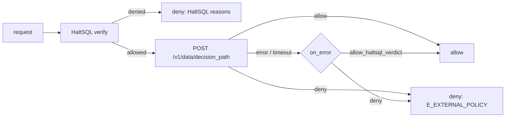

# Open Policy Agent

HaltSQL and [Open Policy Agent](https://www.openpolicyagent.org/) (OPA) work
together in both directions:

- **HaltSQL asks OPA.** After HaltSQL has allowed a query, `haltsql-server`
  can ask OPA for a second opinion based on organisation-wide rules written in
  Rego ("finance tables only for SSO users", "no writes from static tokens").
  OPA can only **further deny**.
- **OPA asks HaltSQL.** When OPA is already your central decision point (an
  API gateway, Envoy `ext_authz`, an agent runtime), a Rego policy can call
  `haltsql-server`'s `POST /v1/verify` with `http.send` and use the verdict.

Both example policies are in [`examples/opa/`](https://github.com/HaltSQL/HaltSQL/tree/main/examples/opa),
with Rego unit tests (`opa test examples/opa`).

## HaltSQL asks OPA

```yaml
opa:
  url: http://127.0.0.1:8181          # an OPA sidecar; https for anything else
  decision_path: haltsql/decision     # POST <url>/v1/data/haltsql/decision
  timeout_ms: 500
  on_error: deny                      # or allow_haltsql_verdict
  headers:
    Authorization: "Bearer ${vault:secret/data/haltsql/opa#token}"
  # tls: { ca_file: ./certs/opa-ca.pem }   # https only
```

The keys are described in
[config-reference.md](config-reference.md#opa).



### Semantics

- A query HaltSQL **denies** is denied without asking OPA. Nothing OPA
  answers can turn a HaltSQL denial into an allow.
- A query HaltSQL **allows** is sent to OPA. It stays allowed only if OPA's
  decision is an allow.
- An OPA denial adds one reason per OPA reason (or one generic reason) with
  the code `E_EXTERNAL_POLICY` and the rule `opa.decision`, so it can be told
  apart from HaltSQL's own reasons.
- In a policy in **shadow mode**, an OPA denial is reported in
  `shadow_reasons` and the query stays allowed, like HaltSQL's own shadow
  denials.

### The request

`POST {url}/v1/data/{decision_path}` with `Content-Type: application/json`,
the configured `headers`, and this body:

```json
{
  "input": {
    "caller": { "name": "analytics-agent", "type": "token" },
    "policy": "saas-analytics",
    "policy_version": "sha256:4f1c...",
    "statement_kind": "select",
    "tables": ["app.orders"],
    "columns": ["app.orders.id", "app.orders.total_cents"],
    "reasons": [],
    "shadow_reasons": [],
    "allowed": true,
    "sql_sha256": "9a0364b9...",
    "fingerprint": "5c2d...",
    "context_keys": ["tenant_id"]
  }
}
```

| Field | Meaning |
|---|---|
| `caller.name` | The caller as in audit records: a token name, `oidc:<provider>`, `mtls:<subject>` or `anonymous`. |
| `caller.type` | `token`, `oidc`, `mtls` or `anonymous`. |
| `policy`, `policy_version` | The HaltSQL policy the query was verified against. |
| `statement_kind` | `select`, `insert`, `update`, `delete`, ... or `null` when the SQL did not parse. |
| `tables`, `columns` | Qualified relations and `schema.table.column` names read or written, sorted. |
| `reasons`, `shadow_reasons` | HaltSQL reason codes (empty in enforce mode, since only allowed queries are sent). |
| `allowed` | HaltSQL's verdict (always `true` here). |
| `sql_sha256`, `fingerprint` | Hash of the exact SQL string and the normalized-query fingerprint. |
| `context_keys` | The **names** of the request context fields, sorted. |

What is **never** sent: the SQL text, context values (tenant ids, user ids),
tokens, and the OIDC subject. Rules that need more should run in HaltSQL's
own policy, which sees the full query and context.

### The decision

The response must be `200` with a JSON object whose `result` is either:

- a boolean: `true` allows, `false` denies; or
- an object `{"allow": <boolean>, "reasons": [<string>, ...]}`. `reasons` is
  optional and only used for a denial. No other keys are accepted.

At most 16 reasons are kept; each is cut to 200 bytes and stripped of
control characters.

Everything else is an **error**, handled by `on_error`: no `result` (an
undefined decision, usually a wrong `decision_path` or a policy that is not
loaded), a `null`, string or number result, an object with other keys or a
non-boolean `allow`, a non-`200` status, invalid JSON, a response over
1 MiB, a connection failure, a TLS failure, or no answer within
`timeout_ms`.

| `on_error` | Effect of an error |
|---|---|
| `deny` (default) | The query is denied with `E_EXTERNAL_POLICY` and a message saying the external check failed. |
| `allow_haltsql_verdict` | HaltSQL's verdict is kept. Use it only when OPA's rules are advisory. |

Error messages contain the OPA host, never header values or the response
body.

### Example policy

[`examples/opa/haltsql.rego`](https://github.com/HaltSQL/HaltSQL/blob/main/examples/opa/haltsql.rego)
exposes both decision forms: `haltsql/allow` (a boolean) and
`haltsql/decision` (`{allow, reasons}`):

```rego
package haltsql

import rego.v1

finance_tables := {"app.invoices"}

static_caller if input.caller.type in {"token", "anonymous"}

default allow := false

allow if {
	input.allowed
	count(deny_reasons) == 0
}

deny_reasons contains msg if {
	some t in input.tables
	t in finance_tables
	static_caller
	msg := sprintf("table %s needs an mTLS or SSO caller, not %s", [t, input.caller.type])
}

decision := {"allow": allow, "reasons": sort(deny_reasons)}
```

A query on `app.invoices` from a static token is then denied with:

```json
{"code": "E_EXTERNAL_POLICY", "rule": "opa.decision",
 "message": "denied by the external policy haltsql/decision (OPA): table app.invoices needs an mTLS or SSO caller, not token"}
```

Run its tests with:

```sh
docker run --rm -v "$PWD/examples/opa:/policies:ro" openpolicyagent/opa:1.10.1 test -v /policies
```

### Deployment notes

- Run OPA as a sidecar on `127.0.0.1` (plain `http` is accepted only for
  loopback addresses) and keep `timeout_ms` small: every allowed query waits
  for the decision.
- OPA's own API can require a bearer token (`opa run --authentication=token
  --authorization=basic` with a `system.authz` policy); put it in `headers`
  with a secret placeholder. `config show` redacts header values.
- For a remote OPA use `https`, with `tls.ca_file` for a private CA.

## OPA asks HaltSQL

[`examples/opa/verify_gate.rego`](https://github.com/HaltSQL/HaltSQL/blob/main/examples/opa/verify_gate.rego)
lets OPA decide on a SQL statement by calling `haltsql-server`:

```rego
package haltsql.gate

import rego.v1

default server := "http://127.0.0.1:8080"

server := data.haltsql_gate.server

response := http.send({
	"method": "POST",
	"url": concat("", [server, "/v1/verify"]),
	"headers": {
		"authorization": concat(" ", ["Bearer", opa.runtime().env.HALTSQL_TOKEN]),
		"content-type": "application/json",
	},
	"body": {"sql": input.sql, "context": object.get(input, "context", {})},
	"timeout": "2s",
	"raise_error": false,
	"cache": false,
})

verdict := response.body if response.status_code == 200

default allow := false

allow if verdict.allowed == true
```

Query it with `POST /v1/data/haltsql/gate/decision` and
`{"input": {"sql": "SELECT ...", "context": {"tenant_id": "acme"}}}`; the
result is `{"allow": true|false, "reasons": ["E_TABLE_DENIED", ...]}`.

- The bearer token is a `server.auth.tokens` entry pinned to one policy; pass
  it to OPA as the `HALTSQL_TOKEN` environment variable, never in `data`.
- A transport error, a non-`200` answer (`401`, `503 AUDIT_UNAVAILABLE`, ...)
  or a missing verdict denies.
- Responses are not cached (`cache: false`), so a policy hot reload takes
  effect immediately.
- HaltSQL still writes its audit record for every call.

## Testing

`test/opa` runs against the real `openpolicyagent/opa` image: allow and
deny in both decision forms, the exact input document (no SQL, no context
values), undefined and malformed decisions, a decision slower than
`timeout_ms`, bearer-token headers against OPA's own authentication, https
with a private CA, the reverse direction against a real `haltsql-server`,
and `opa test` on `examples/opa`. The tests skip when Docker is unavailable.
