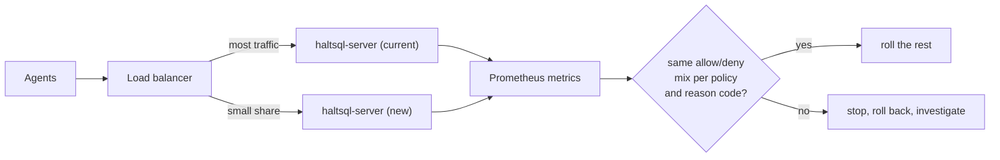

# Upgrades and versioning

This page is for operators who upgrade HaltSQL and need to know what can
change between releases. It covers what the project promises to keep stable,
what it does not promise, how to upgrade each component, how to check a
release before rolling it out, and how to roll back.

## What is promised

HaltSQL follows [Semantic Versioning](https://semver.org/) and records every
notable change in [CHANGELOG.md](../../CHANGELOG.md). The stable contracts and
their rules:

| Contract | Promise | Source |
|---|---|---|
| Verdict JSON (`haltsql.dev/v1`) | Within v1, fields are only added, never renamed, removed or changed in meaning. Clients must ignore unknown fields. A v2 format, if ever needed, would be served side by side with v1. | [ADR-0004](../adr/0004-verdict-schema-and-reason-codes.md), [verdict.md](../verdict.md#stability-guarantees) |
| Reason codes | Never renamed or reused, **even before 1.0**. New codes may be added in minor releases; clients must treat unknown codes as denials. `message`, `rule` and `hint` text may change at any time. | [ADR-0004](../adr/0004-verdict-schema-and-reason-codes.md), [reason-codes.md](../reason-codes.md), [CHANGELOG.md](../../CHANGELOG.md) |
| HTTP API under `/v1` | Fields are only added, never renamed or removed. | [http-api.md](../http-api.md) |
| Prometheus metric names | Stable within `/v1`. | [http-api.md](../http-api.md#get-metrics) |
| Determinism | For the same SQL, policy and context: `allowed`, the reason codes, `tables`, `columns` and `bind_params` are identical across runs and platforms. | [ADR-0004](../adr/0004-verdict-schema-and-reason-codes.md) |
| Document `apiVersion` | Documents must say `haltsql.dev/v1`. "Every released schema version will keep loading, or fail with a clear migration error." | [policy-reference.md](../policy-reference.md#apiversion) |
| `haltsql audit verify` problem kinds | The `kind` values in `--json` output are stable. | [audit-verify.md](../audit-verify.md) |
| Change process | Changes to a stable contract (policy schema, verdict JSON, reason codes, HTTP API, CLI exit codes) need an Architecture Decision Record merged first. | [GOVERNANCE.md](../../GOVERNANCE.md) |

## What is not promised

Read these before you plan an upgrade cadence:

- **Before 1.0, minor releases may contain breaking changes.** They are called
  out under **Changed** or **Removed** in the changelog
  ([CHANGELOG.md](../../CHANGELOG.md)). Read those sections for every version
  you skip over.
- **Verdicts can change between releases.** Determinism holds for one
  version. A release that fixes a bypass denies queries an older release
  allowed. For example, the unreleased changes deny a tenant placeholder reused
  outside its tenant predicate (`E_PARAM_UNBOUND`, rule
  `params.tenant_reuse`) and SQL-executing functions even when allowlisted
  (`E_FUNCTION_DENIED`, rule `functions.dynamic_sql`). Plan to test agent
  traffic against every new version.
- **Only the latest release receives security fixes.** Per
  [SECURITY.md](../../SECURITY.md), 0.1.x (latest) is supported and anything
  older is not. After 1.0, the latest minor release and the current LTS line
  (if any) will be supported. There is no published support window,
  end-of-life schedule or SLA beyond the response targets for vulnerability
  reports in SECURITY.md.
- **`haltsql explain` output is for people** and may change between releases.
  Use `haltsql verify --json` in scripts.
- **The operator API (`haltsql.dev/v1alpha1`) may change incompatibly before
  v1** ([kubernetes-operator.md](../kubernetes-operator.md)).
- **No formal deprecation period is documented.** Watch the changelog.
- The docs do not state whether `policy.version` (the SHA-256 over the
  normalized policy) stays identical for the same policy file across HaltSQL
  releases. Do not treat a version change seen only during a binary upgrade as
  proof that a policy changed; compare the policy files themselves.

> **Note:** At the time of writing, the only tagged release is 0.1.0, and
> many features documented on this site are listed under **Unreleased** in
> the changelog. Check the release notes of the exact version you deploy.

## Version numbers you will see

| Where | How to read it |
|---|---|
| Release tags | `vX.Y.Z`. The release workflow marks `v0.*` tags and tags with a `-` as pre-releases on GitHub. |
| Container image | `ghcr.io/haltsql/haltsql:<version>` (e.g. `0.1.0`) and `:<major.minor>` (e.g. `0.1`). Pin by digest in production. |
| Release archives | `haltsql-<tag>-linux-{amd64,arm64}.tar.gz`, `haltsql-<tag>-darwin-arm64.tar.gz`; each holds `haltsql`, `haltsql-server` and `haltsql-proxy`. |
| Running CLI | `haltsql version` (or `--json`): HaltSQL, PostgreSQL grammar and OCaml versions. |
| Running server | `haltsql_build_info{version,pg}` on `/metrics`; `version` in `GET /v1/admin/status`. |
| Helm chart | Chart `version` and `appVersion` (the default image tag) in `deploy/helm/haltsql/Chart.yaml`. The chart versions in lockstep with HaltSQL and requires Kubernetes 1.27+. |

## Verifying a release

Do this before a version enters any environment. Each GitHub release has
`SHA256SUMS`, a keyless cosign bundle (`*.sigstore.json`) per archive, a
GitHub build-provenance attestation and a CycloneDX SBOM
(`haltsql-<tag>.cdx.json`). The image is signed with cosign and has a
provenance attestation and an SBOM.

```sh
sha256sum -c SHA256SUMS --ignore-missing

cosign verify-blob \
  --bundle haltsql-v0.1.0-linux-amd64.tar.gz.sigstore.json \
  --certificate-identity-regexp '^https://github.com/HaltSQL/HaltSQL/\.github/workflows/release\.yml@refs/tags/v' \
  --certificate-oidc-issuer https://token.actions.githubusercontent.com \
  haltsql-v0.1.0-linux-amd64.tar.gz

gh attestation verify haltsql-v0.1.0-linux-amd64.tar.gz --repo HaltSQL/HaltSQL

cosign verify ghcr.io/haltsql/haltsql@sha256:<digest> \
  --certificate-identity-regexp '^https://github.com/HaltSQL/HaltSQL/\.github/workflows/release\.yml@refs/tags/v' \
  --certificate-oidc-issuer https://token.actions.githubusercontent.com
```

These commands come from [deployment.md](../deployment.md#verifying-release-artifacts);
the signing steps are in `.github/workflows/release.yml`.

> **Warning:** The repository moved to `github.com/HaltSQL/HaltSQL`. Use this
> repository's workflow identity in `cosign verify`. Images published under the
> old `ghcr.io/ardada2468/...` path are not republished
> ([CHANGELOG.md](../../CHANGELOG.md)).

## Before you upgrade

1. **Read the changelog** for every version between yours and the target,
   especially **Changed**, **Removed** and **Security**.
2. **Run your policy tests with the new CLI.** `haltsql validate` and
   `haltsql test` on every policy and suite. A changed verdict shows up as a
   failing case.
3. **Diff verdicts on real queries.** If you keep a corpus of agent SQL (for
   example from audit records written with `audit.log_raw_sql: true`), run it
   through both versions and compare:

   ```sh
   # queries.jsonl: {"id": ..., "sql": ..., "context": {...}} per line
   old/haltsql verify --policy policy.yaml --batch < queries.jsonl > old.jsonl
   new/haltsql verify --policy policy.yaml --batch < queries.jsonl > new.jsonl
   jq -c '{id, allowed, codes: [.reasons[]?.code]}' old.jsonl > old.cmp
   jq -c '{id, allowed, codes: [.reasons[]?.code]}' new.jsonl > new.cmp
   diff old.cmp new.cmp
   ```

   Each output line carries the input `id`, in input order. Lines that could
   not be read have an `error` field instead of a verdict.
4. **Check config compatibility both ways.** Unknown keys are errors in every
   HaltSQL document. A config, policy or bundle that uses a key added in the
   new release will not load on the old one, which matters if you need to roll
   back. Adopt new keys only after the upgrade is complete everywhere.
5. **Validate the config with the new binary**: `haltsql config show --config FILE`
   and `haltsql validate FILE`.

## Upgrading each component

### CLI and policy CI

Install the new release archive or image, or bump the pinned `version` input
of the GitHub Action (`HaltSQL/HaltSQL@<tag>` with `version: <tag>`; pin it,
the default is `latest`). Upgrade CI after or together with the servers, not
before, so CI never accepts a document the servers cannot load. See
[policy-ci.md](../policy-ci.md).

### haltsql-server

Roll replicas one at a time; the server holds no state that replicas share.

| Deployment | How |
|---|---|
| Helm | Set `image.digest` (wins over `image.tag`) and `helm upgrade`. The chart uses `maxUnavailable: 0`. |
| Operator | Set `image` in the `HaltSQLServer` spec (pin a digest); the operator rolls the Deployment with `maxUnavailable: 0`, `maxSurge: 1`. |
| Sidecar | Update the sidecar image in the agent's pod template; the agent rolls with it. |
| systemd | Replace `/usr/local/bin/haltsql-server` and `systemctl restart haltsql`. A reload (`SIGHUP`) does not replace the binary. |
| Terraform | Update the module's image input. See [terraform.md](../terraform.md). |

A new server that cannot load its config exits with code 2 and never becomes
ready. With `maxUnavailable: 0`, the old pods keep serving.

Audit chains across the restart:

- A `file` sink continues its chain from the file's last record.
- `stdout`, `elasticsearch` and `kafka` sinks start a new chain at genesis.
- `s3` and `gcs` sinks continue the chain only with `spool_dir`.

So expect `chain_restart` warnings from `haltsql audit verify` around an
upgrade for sinks without continuity. See
[audit-sinks.md](../audit-sinks.md#restarts-and-chain-continuity).

### haltsql-proxy

Restart each proxy instance. On `SIGTERM` it drains sessions for
`shutdown_grace_seconds` (default 10), then closes them; clients must
reconnect. Validate the config with the new binary first:
`haltsql-proxy validate -c FILE`. A file audit sink whose last line is not a
sealed record stops the proxy from starting. See
[proxy.md](../proxy.md#operations).

### Kubernetes operator

The operator validates policies with the `haltsql` CLI inside its own image,
and its docs recommend building that image from the haltsql image your servers
run, so validation and serving use the same loader. Upgrade the operator and
the servers' image together. There is no published operator image in the
release workflow; you build it (see
[kubernetes-operator.md](../kubernetes-operator.md#install)). Because the API is
`v1alpha1`, read the changelog for CRD changes before applying new manifests.

### SDKs and integrations

Upgrade them like any dependency: the Python package `haltsql`, the npm
package `@haltsql/client`, the Go module
`github.com/HaltSQL/HaltSQL/clients/go/haltsql`, and the Java client in
`clients/java` (`com.haltsql:haltsql-client`). Clients and servers talk `/v1`, which only gains fields, and the clients
ignore unknown fields. No client/server version matrix is published; test the
pair you run. The Python wheel and npm native packages bundle their own engine
for local verification, so a local verifier runs the SDK's engine version,
not your server's.

## Rolling upgrades with a shadow comparison

Shadow mode is a policy feature: it records would-be denials without enforcing
them. You can use the same idea for a binary upgrade by running the new
version next to the old one and comparing outcomes before it takes all
traffic.



1. Add one replica with the new version (a canary) behind the same load
   balancer, or upgrade one agent pod's sidecar.
2. Compare, per pod, `haltsql_verify_total{policy,result}` and
   `haltsql_reasons_total{code}` between old and new replicas over the same
   window. A new reason code, or a shift from `allowed` to `denied`, needs an
   explanation from the changelog before you continue.
3. Run `haltsql report` over each replica's audit records with `--since` to
   see which queries the new version denied, by reason, caller and
   fingerprint ([shadow-reports.md](../shadow-reports.md)).
4. Roll the rest of the replicas, then upgrade CI.

This compares traffic samples, not identical requests: each request goes to
only one replica. For an exact comparison, use the batch diff in
[Before you upgrade](#before-you-upgrade).

If a new release makes previously allowed agent queries fail, you can also
take the cautious path for policies: keep the policy in `mode: shadow` on the
new version for a while, read `shadow_reasons`, then switch back to enforce.
Shadow mode enforces nothing, so do this only where the database role and RLS
hold on their own ([defense-in-depth.md](../defense-in-depth.md)).

## Policy and bundle compatibility

- Every document's `apiVersion` must be `haltsql.dev/v1`; any other value is
  refused with `unsupported apiVersion`.
- Bundles are checked strictly: unknown members are errors at every level.
  Build bundles with a CLI no newer than your oldest server.
- A bundle source only accepts a bundle with the same `metadata.name` and a
  strictly greater `metadata.version`. This is unrelated to the HaltSQL
  version, but it decides how you roll back policies (below).

## Rollback

| What | How | Watch out for |
|---|---|---|
| Server or proxy binary | Redeploy the previous image digest (`helm rollback`, revert the manifest, or reinstall the old binary). | A config that uses keys only the new version knows will not load on the old one (exit 2). Revert the config first. |
| Policy delivered as files or ConfigMap | Revert in version control and redeploy, or reload. | `subPath` mounts are not updated in place; roll the pods. |
| Local `bundle:` file | Put the previous `.haltsqlbundle` and `.sig` back and reload. | Write both files atomically (write, then rename). |
| `bundle_source` | Republish the old policies under a **new, higher** `metadata.version`. Servers refuse older or equal versions (`bundle_source_rollback`). | The config file cannot disable this check. |
| Operator | Revert the `HaltSQLPolicy` or `HaltSQLServer` object; the operator rolls the Deployment. | While a policy is not `Valid`, the operator keeps the last good configuration. |

Step-by-step procedures are in [runbooks.md](runbooks.md#bad-policy-rolled-out).

## Related

- [CHANGELOG.md](../../CHANGELOG.md)
- [SECURITY.md](../../SECURITY.md)
- [GOVERNANCE.md](../../GOVERNANCE.md)
- [ADR-0004: verdict schema and reason codes](../adr/0004-verdict-schema-and-reason-codes.md)
- [Production checklist](production-checklist.md)
- [Runbooks](runbooks.md)
