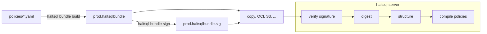
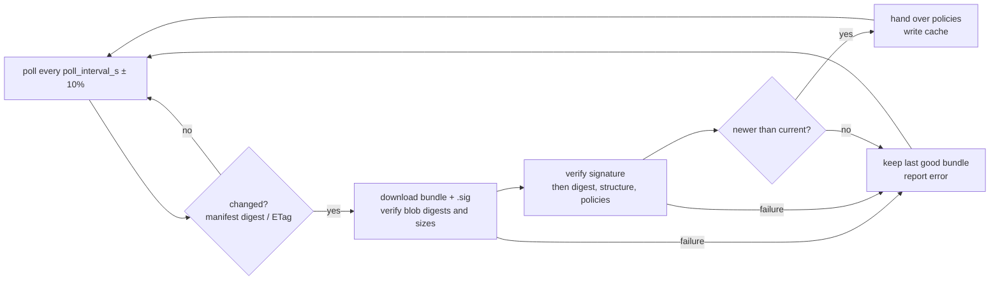

# Signed policy bundles

A policy bundle packages validated policies (and, optionally, catalog snapshots)
into one file that a HaltSQL server can trust without trusting the file system
or the delivery channel it came through. CI builds and signs the bundle once.
Every server verifies the signature before it reads a single policy.



## Quick start

```sh
# once: create a signing key pair (keep the private key in a secret store)
haltsql bundle keygen -o policy-signing.key          # writes policy-signing.key (0600) + .pub

# in CI: build, sign, verify
haltsql bundle build policies/*.yaml --catalog catalog/saas.snapshot.json \
    --name prod-policies --bundle-version 1.4.0 \
    --source-url https://github.com/acme/policies --source-commit "$GITHUB_SHA" \
    -o dist/prod.haltsqlbundle
haltsql bundle sign dist/prod.haltsqlbundle --key policy-signing.key
haltsql bundle verify dist/prod.haltsqlbundle --public-key policy-signing.key.pub

# anywhere: look inside (add --public-key to also check the signature)
haltsql bundle inspect dist/prod.haltsqlbundle
```

The server loads the bundle from its config:

```yaml
policies:
  - bundle: /etc/haltsql/bundles/prod.haltsqlbundle   # signature: prod.haltsqlbundle.sig
    public_keys:
      - /etc/haltsql/keys/policy-signing.pub
    name_prefix: prod.                               # optional
```

See [config-reference.md](config-reference.md#policies) for the config keys.

## Commands

| Command | What it does | Exit codes |
|---|---|---|
| `haltsql bundle keygen -o FILE [--force]` | Writes an Ed25519 private key to `FILE` (PKCS#8 PEM, mode 0600, never overwritten without `--force`) and the public key to `FILE.pub`. Prints the key id. | 0, 2 |
| `haltsql bundle build POLICY... --name N --bundle-version V -o OUT [--catalog [NAME=]FILE]... [--created-by T] [--source-url U] [--source-commit SHA]` | Loads and validates every policy and catalog, then writes the canonical bundle. | 0, 2 |
| `haltsql bundle sign BUNDLE (--key FILE \| --key-env VAR) [--signature FILE] [--append]` | Validates the bundle (it refuses to sign one that does not load), then writes `BUNDLE.sig`. With `--append` the new signature is added next to the existing ones. | 0, 1, 2 |
| `haltsql bundle verify BUNDLE --public-key KEY... [--signature FILE] [--name-prefix P]` | Full verification, the same checks the server runs. | 0, 1, 2 |
| `haltsql bundle inspect BUNDLE [--public-key KEY...]` | Shows metadata, digest, policies (name, version, mode, tables), catalogs and signer key ids. Without keys it does **not** check the signature and says `UNVERIFIED`. | 0, 1, 2 |
| `haltsql bundle push --oci REF BUNDLE` / `haltsql bundle pull --oci REF -o FILE --public-key KEY...` | Publish a signed bundle to an OCI registry, or fetch and verify one. See [Bundle sources](#publishing-and-pulling-with-the-cli). | 0, 1, 2, 3 |

The exit codes follow the CLI conventions. 0 means success. 1 means a bundle or
signature failed verification or validation (verify fails with 1 on any such
problem, including a missing bundle). 2 means a usage error or an input that
cannot be loaded, such as a missing policy file or an unreadable or
group-readable private key. Every command accepts `--json`.

`--public-key` takes a PEM file or the base64 of the 32 raw key bytes. `--key`
refuses a private key file that group or others can read (`chmod 600`).
`--key-env VAR` reads the PEM key from an environment variable, which suits CI
secrets. Keys made with `openssl genpkey -algorithm ed25519` work too.

## File format

### Bundle (`*.haltsqlbundle`)

A bundle is one JSON document in **canonical form**. Object members are sorted
by key in byte order. There is no insignificant whitespace, and the document
ends with exactly one newline. Floats, out-of-range integers, duplicate keys
and alternative string escapes are not allowed. Any other encoding of the same
JSON is rejected, so a given bundle has exactly one valid byte sequence.

```json
{"apiVersion":"haltsql.dev/v1",
 "catalogs":{"saas":{"tables":{...}}},
 "digest":"sha256:50f7bf7a...",
 "kind":"PolicyBundle",
 "metadata":{"created_by":"haltsql/0.2.0","name":"prod-policies",
             "source":{"commit":"4f0c2a91...","url":"https://github.com/acme/policies"},
             "version":"1.4.0"},
 "policies":[{"document":{...normalized policy...},"name":"saas-analytics"}]}
```

(The example is wrapped for reading. The real file is a single line.)

| Member | Meaning |
|---|---|
| `apiVersion` | `haltsql.dev/v1` |
| `kind` | `PolicyBundle` |
| `metadata.name` | 1–128 characters: letters, digits, `_ - .`, starting with a letter or digit. |
| `metadata.version` | 1–64 printable characters, no spaces (for example a semver, a date or a CI run number). |
| `metadata.created_by` | Optional; the default is `haltsql/<version>`. |
| `metadata.source.url`, `.commit` | Optional provenance: an http(s) URL and a 7–64 character lower-case hex commit. |
| `policies[]` | 1–1000 entries `{name, document}`. `document` is the normalized policy JSON (the form `Policy.version` hashes, with presets expanded and the catalog inline). `document.metadata.name` must equal `name`. A catalog given as a path is rejected: bundles are self-contained. |
| `catalogs` | Catalog snapshots by name (may be `{}`). |
| `digest` | `sha256:` + hex SHA-256 of the canonical serialization of the document **without** `digest`. |

Builds are deterministic: the same policies, catalogs and metadata always give
byte-identical bundles. There are no timestamps. A policy written in YAML or in
JSON produces the same bundle. Rebuild in CI and compare digests to check that a
deployed bundle matches its source commit.

### Signature (`*.haltsqlbundle.sig`)

A signature file is also canonical JSON. With one signature it looks like this:

```json
{"algorithm":"ed25519","keyid":"sha256:c380011f...","signature":"8pyF25qk...=="}
```

With several signatures (`sign --append`, used while rotating keys) it looks like this:

```json
{"signatures":[{"algorithm":"ed25519","keyid":"sha256:...","signature":"..."},{"algorithm":"ed25519","keyid":"sha256:...","signature":"..."}]}
```

- `keyid` is `sha256:` + the hex SHA-256 of the 32 raw public-key bytes. It is
  only a lookup hint. It never replaces verification.
- `signature` is the base64 of the 64-byte Ed25519 signature (RFC 8032). It is
  computed over the ASCII domain separator `haltsql.dev/v1 PolicyBundle
  signature\n` followed by the **exact bundle bytes**.
- A file holds 1–16 signatures and is at most 64 KiB.

Because the message is plain bytes, you can check a signature with standard tools:

```sh
jq -r .signature prod.haltsqlbundle.sig | base64 -d > sig.bin
{ printf 'haltsql.dev/v1 PolicyBundle signature\n'; cat prod.haltsqlbundle; } > msg.bin
openssl pkeyutl -verify -pubin -inkey policy-signing.key.pub -rawin -in msg.bin -sigfile sig.bin
```

## Verification order (fail closed)

`haltsql bundle verify` and the server's loader (`Haltsql_bundle.load_verified`)
run the same steps, in this order, and stop at the first failure:

1. **Size.** The bundle must be a regular file of at most 16 MiB (configurable
   in the library), and the signature file at most 64 KiB. Reads are bounded,
   so a file that grows while it is read is still rejected.
2. **Signature.** At least one signature must verify against one of the
   trusted keys. Signatures whose `keyid` matches no trusted key are skipped.
   Nothing in the bundle is parsed before this step succeeds.
3. **Canonical form.** The bytes must be the canonical serialization of the
   parsed JSON.
4. **Digest.** The recorded digest must equal the recomputed one.
5. **Structure.** `apiVersion` and `kind` must be correct, and unknown members
   are errors at every level. Names, versions, provenance and limits are all
   checked.
6. **Policies and catalogs.** Each one is compiled with the normal loaders
   (unknown policy keys are errors). The `name_prefix` is applied before
   compiling, so `Policy.version` reflects the final name.

The tests in `test/bundle/` cover each step. They include a flipped payload
byte, a flipped signature bit, a wrong key, a forged key id, truncated bundle
and signature files, unknown members (in the top level, metadata, policy
entries and policy documents), a non-canonical encoding, a digest mismatch,
duplicate keys, oversized files and catalog path references.

## Key management and rotation

- Generate keys with `haltsql bundle keygen` or `openssl genpkey -algorithm ed25519`.
  Store the private key as a CI secret, such as `HALTSQL_SIGNING_KEY` in a
  protected GitHub environment or a masked, protected GitLab variable. Never
  commit it.
- Distribute only the `.pub` file. It is safe to commit (for example
  `keys/policy-signing.pub`) and to bake into server images or ConfigMaps.
- **Rotation:**
  1. Generate the new key and add its public key to every server's
     `public_keys` list next to the old one. Any listed key may verify.
  2. Optionally, while both keys are in use, dual-sign:
     `haltsql bundle sign B --key old.key` and then
     `haltsql bundle sign B --key new.key --append`.
  3. Switch CI to the new key.
  4. Once no bundle signed only by the old key is in circulation, remove the
     old public key from the servers.
- **Compromise:** remove the key from `public_keys` and reload. Bundles signed
  only by that key stop loading at once. The server keeps the last good policy
  set if a reload fails.

## Bundle sources

A server does not need the bundle on its file system. A `bundle_source` policy
entry makes it fetch the bundle from an **OCI registry**, an **S3** bucket (or
an S3-compatible store such as MinIO) or an **HTTPS** URL, and poll for new
versions:

```yaml
policies:
  - bundle_source:
      oci: ghcr.io/acme/haltsql-policies:prod
    public_keys: [/etc/haltsql/keys/policy-signing.pub]   # mandatory
    name_prefix: prod.
    poll_interval_s: 60
    cache_dir: /var/cache/haltsql/bundles
```

See [config-reference.md](config-reference.md#bundle_source) for every key. The
transport is never trusted. The Ed25519 signature is checked with the
configured `public_keys` before anything in the bundle is parsed, exactly as for
a local bundle, and a source without `public_keys` is a config error.



### What the poller does

1. **Start.** If `cache_dir` holds a bundle from an earlier run, it is verified
   again with the current keys and used straight away. A key you removed from
   `public_keys` therefore also invalidates the cache. Then the source is
   polled once. Startup succeeds when either step produced a bundle, so a
   restart works while the source is down. With no cache and no reachable
   source, startup fails closed.
2. **Conditional fetch.** For OCI, a `HEAD` of the tag returns the manifest
   digest, and nothing is downloaded when it is unchanged. A reference pinned to
   a digest is fetched once and never again. For S3 and HTTPS the bundle request
   carries `If-None-Match` with the ETag of the current bundle, and the
   signature (`<key>.sig` or `<url>.sig`) is only fetched when the bundle has
   changed.
3. **Verification.** OCI manifests and blobs are hashed and must match their
   digests and sizes. Then come the signature and the usual
   [verification steps](#verification-order-fail-closed).
4. **No rollback.** Once a bundle is current, a new one is accepted only when
   it has the same `metadata.name` and a strictly greater `metadata.version`.
   An equal version with different content is refused too, and the bundle
   restored from the cache counts as current. Versions are compared in natural
   order: runs of digits compare as numbers and other runs compare bytewise. So
   `1.9.0 < 1.10.0`, `2026.11.07 < 2026.11.08` and `build-99 < build-100`, and a
   `-` or `~` suffix marks a pre-release (`1.4.0-rc.1 < 1.4.0`). Git commit
   SHAs are not ordered, so give polled bundles a monotonic version (see
   [policy-ci.md](policy-ci.md#publishing-to-an-oci-registry)). To roll back,
   publish the old policies under a **new, higher** version. An embedding
   application can turn the check off (`allow_downgrade`), but the signature is
   still required. The config file does not expose this.
5. **Hand-over.** The verified policies go to the server. If the server
   refuses them (for example because a token references a policy the new bundle
   no longer has), the current bundle stays. Only accepted bundles are cached.
   At startup a freshly fetched bundle is cached only after the server's
   startup checks accepted it. If they refuse it, the server starts from the
   bundle restored from `cache_dir` (the last accepted one) when that passes,
   logs `bundle refused at startup; starting from the cached last good
   bundle`, and reports the refusal as `bundle_source_rejected`; without a
   usable cached bundle, startup fails. Bundle-driven reloads are serialized,
   so two sources that update at the same time both take effect.
6. **Failure.** Any failure (unreachable source, denied, bad digest, bad or
   untrusted signature, rollback, refusal) keeps the last good bundle. It is
   reported with a stable code and retried at the next poll.

| Code | Meaning |
|---|---|
| `bundle_source_unavailable` | Connection failure, timeout, TLS failure, HTTP 429 or 5xx. |
| `bundle_source_denied` | HTTP 401/403, or rejected credentials. |
| `bundle_source_not_found` | No such tag, digest, object or URL. |
| `bundle_source_integrity` | A manifest or blob does not match its digest or size, an unexpected media type, a malformed manifest, or an oversized layer. |
| `bundle_source_protocol` | Any other unexpected response. |
| `bundle_source_signature` | Malformed signature file, or no signature verifies with a trusted key. |
| `bundle_source_invalid` | The bundle is too large, not canonical, has a wrong digest, or a policy or catalog does not load. |
| `bundle_source_rollback` | An older or same version, or another bundle name. |
| `bundle_source_rejected` | The server refused the verified bundle. |
| `bundle_source_cache` | The cache could not be read or written. This is never fatal. |

### Cache

`cache_dir` holds one subdirectory per source (mode 0700), named after a hash
of the source. It contains the last accepted bundle and signature, named after
the bundle's SHA-256, and a `state.json` with the source and its manifest
digest or ETag. Each file is written to a temporary file, fsynced and renamed.
`state.json` is written last, so a crash leaves either the old entry or the new
one. The cache is not trusted: what it holds is verified again on every start,
and a file whose content does not match its name is refused. Give each server
its own `cache_dir`, or at least do not let two processes poll the same source
into the same directory.

### OCI artifact layout

A bundle is published as one OCI artifact: an OCI image manifest (OCI image
spec v1.1 artifact guidance) with two layers. This is what
`oras push --artifact-type` produces, so either tool can publish and either can
pull.

| Part | Value |
|---|---|
| manifest `mediaType` | `application/vnd.oci.image.manifest.v1+json` |
| `artifactType` | `application/vnd.haltsql.bundle.v1` |
| `config` | The empty descriptor `application/vnd.oci.empty.v1+json` (`{}`, `sha256:44136fa3...`). |
| bundle layer | `application/vnd.haltsql.bundle.v1+json`, titled (`org.opencontainers.image.title`) with the bundle's file name. |
| signature layer | `application/vnd.haltsql.bundle.signature.v1+json`, titled `<bundle file>.sig`. |
| manifest annotations | `dev.haltsql.bundle.name`, `dev.haltsql.bundle.version`, `dev.haltsql.bundle.digest`. |

When reading, HaltSQL also accepts the artifact type as the config media type
(the layout of oras 1.0). It requires exactly one bundle layer and one
signature layer. It refuses any other layer, image indexes, Docker manifests,
a bundle layer over 16 MiB and a signature layer over 64 KiB, and it checks
the sizes before downloading. `haltsql bundle push` adds no timestamp, so the
same bundle and signature always give the same manifest digest.

### Publishing and pulling with the CLI

```sh
# publish (CI): validates the bundle, checks the signature against the key, uploads, tags
haltsql bundle push --oci ghcr.io/acme/haltsql-policies:1.4.0 dist/prod.haltsqlbundle \
    --public-key keys/policy-signing.pub \
    --username "$REGISTRY_USER" --password-env REGISTRY_PASSWORD
# -> pinned ghcr.io/acme/haltsql-policies@sha256:<manifest digest>

# fetch and verify (e.g. an init container): nothing is written unless every check passes
haltsql bundle pull --oci ghcr.io/acme/haltsql-policies@sha256:<digest> \
    -o /etc/haltsql/bundles/prod.haltsqlbundle --public-key keys/policy-signing.pub
```

| Command | What it does | Exit codes |
|---|---|---|
| `haltsql bundle push --oci REF BUNDLE [--signature FILE] [--public-key KEY]...` | Refuses a bundle that does not load or a malformed signature file, and with `--public-key` a signature that does not verify. Then it uploads the config, bundle and signature blobs (skipping blobs the registry already has) and the manifest under the tag. Prints the digest-pinned reference. | 0, 1, 2, 3 |
| `haltsql bundle pull --oci REF -o FILE --public-key KEY... [--name-prefix P]` | Verifies the manifest and both blobs against their digests, then the signature and every policy. Only then does it write `FILE.sig` and `FILE` (each atomically, signature first). | 0, 1, 2, 3 |

Both commands accept `--plain-http` (loopback registries only),
`--username U --password-env VAR` or `--token-env VAR`, `--ca-file FILE`,
`--timeout SECONDS` and `--json`. With `--json`, a refused push, a failed
verification or an unreachable registry also prints
`{"ok": false, "exit": N, "error": "..."}` on stdout (exit code `N`), the
shape `bundle verify --json` uses. Passwords and tokens come from environment
variables, never from the command line. Exit code 3 means the registry could
not be reached or refused the request. A digest or size mismatch is a
verification failure (exit 1).

### OCI registries: transport and authentication

- HTTPS only. `plain_http: true` (config) or `--plain-http` (CLI) is accepted
  only for `localhost`, `127.x` and `[::1]`.
- A request first goes out with the credentials already established for it. On
  `401` the registry's `WWW-Authenticate` challenge decides what happens next:
  - `Bearer realm=…,service=…`: a token is requested from `realm` for
    `repository:<repo>:pull` (or `pull,push` for `push`). The request is
    anonymous, or uses basic auth with the configured `{username, password}`.
    The realm must be `https` (or loopback `http`), so credentials never travel
    in clear text. Tokens are cached until shortly before `expires_in`.
  - `Basic`: the configured credentials are sent. Without credentials this is
    a `bundle_source_denied` error.
- `auth: {token}` is a registry token you already have, sent as
  `Authorization: Bearer` to the registry.
- Blob redirects (registries backed by object storage) are followed, at most 3,
  only to `https` (or loopback `http`) targets. Credentials are dropped when
  the origin changes.
- Every manifest and blob is hashed (sha256 or sha512) and compared with the
  requested digest and the registry's `Docker-Content-Digest`. The unverified
  `HEAD` digest is used only to decide that nothing changed.

Tested against `registry:2` with anonymous access, `htpasswd` basic auth and
token auth through `cesanta/docker_auth`, and with `oras` 1.2 pushing and
pulling.

### S3 and HTTPS sources

- **S3**: SigV4-signed `GET`s of `key` and `key.sig`. The request is path-style
  (`endpoint/bucket/key`) when `endpoint` is set (MinIO and other S3-compatible
  stores) and virtual-hosted on AWS. Credentials come from `s3.credentials`, as
  for the S3 audit sink (`env` by default). Tested against MinIO.
- **HTTPS**: `GET url` and `GET url.sig`, with `auth` sent as
  `Authorization: Basic` or `Bearer`. Redirects are followed under the same
  rules as above. Tested against nginx with a private CA.
- **Publishing order.** Upload the new `.sig` first and the bundle second.
  Because the bundle request is conditional, a poll that sees the new bundle
  then always finds the new signature. In the other order, a poll in between
  reports `bundle_source_signature` once and succeeds at the next poll.
- An ETag that changes without a content change costs a download but no
  update: a bundle identical to the current one is ignored.

There is no GCS source yet. Mirror bundles to S3 or serve them over HTTPS.

### Optional: cosign on the OCI artifact

You can also sign the OCI artifact with
[cosign](https://github.com/sigstore/cosign), for example keyless in GitHub
Actions. Registry admission policies (Kyverno, Sigstore policy-controller) can
then require it:

```sh
cosign sign --yes ghcr.io/acme/haltsql-policies@sha256:<digest>
```

That signature protects the registry path. The HaltSQL Ed25519 signature is the
one the server enforces, whatever the transport. HaltSQL does not run cosign.

## Library API (for embedding)

```ocaml
(* haltsql.bundle *)
let keys = List.map (fun f -> Result.get_ok (Haltsql_bundle.Key.public_of_file f)) key_files in
match Haltsql_bundle.load_verified ~name_prefix:"prod." "/etc/haltsql/prod.haltsqlbundle" keys with
| Ok policies -> (* Policy.t list, ready for Haltsql.verify *)
| Error e -> prerr_endline (Haltsql_bundle.error_to_string e)  (* refuse to start *)
```

`Haltsql_bundle.load_config_ref` does the same for a `Config.bundle_ref` from
the runtime config. It decodes the entry's `public_keys` and applies its
`name_prefix`. See `lib/bundle/haltsql_bundle.mli`.

Remote sources are in `haltsql.bundle_source` (`lib/bundle_source/haltsql_bundle_source.mli`):

```ocaml
let* src = Haltsql_bundle_source.create cfg_bundle_source in   (* Config.bundle_source *)
Haltsql_bundle_source.start src
  ~on_update:(fun u -> (* u.policies: verified, prefixed; Error refuses the bundle *) install u)
  ~on_error:(fun e -> log (Haltsql_bundle_source.error_code e) (Haltsql_bundle_source.error_to_string e))
(* resolves after the cache restore and the first poll; polling continues until [stop] *)
```
