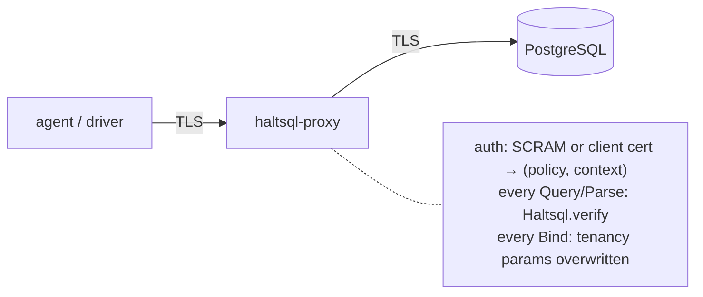

# haltsql-proxy

`haltsql-proxy` is a PostgreSQL wire-protocol (v3) firewall. Clients (an LLM
agent, a BI tool, any libpq/JDBC/psycopg/pgx driver) connect to the proxy as if
it were Postgres. The proxy authenticates them, connects to the real database
with its own service credentials, and runs **every statement** through
`Haltsql.verify` under the policy and context bound to the client's identity
before forwarding it. Denied statements never reach the database.

The library and the HTTP sidecar ask "is this SQL allowed?" and trust the
caller to act on the answer. The proxy enforces the answer itself: a client
cannot skip verification, choose a looser policy, or pick its tenant.



## Quick start

```bash
# 1. A verifier for each proxy user (the password never appears in the config)
printf '%s\n' "$AGENT_PASSWORD" | haltsql-proxy scram-verifier
# SCRAM-SHA-256$4096:...$...:...

# 2. A config (see below), then validate and run it
haltsql-proxy validate --config proxy.yaml
UPSTREAM_PASSWORD=... haltsql-proxy run --config proxy.yaml

# 3. Connect with any driver
psql "host=127.0.0.1 port=6432 dbname=app user=analytics-agent sslmode=require"
```

## Example config

```yaml
apiVersion: haltsql.dev/v1
kind: ProxyConfig
listen: 0.0.0.0:6432
tls:                                   # client side TLS (optional)
  cert: /etc/haltsql/tls.crt
  key: ${file:/run/secrets/tls.key}    # a path or inline PEM both work
  client_ca: /etc/haltsql/clients-ca.pem
  client_auth: optional                # none | optional | require
  required: true                       # refuse plaintext clients (default true)
upstream:
  host: db.internal
  port: 5432
  database: app
  user: haltsql_service                # a read-only role is strongly recommended
  password: ${env:UPSTREAM_PASSWORD}
  tls: { mode: verify-full, ca: /etc/haltsql/db-ca.pem }
policies:
  - path: ./policies/analytics-agent.yaml
auth:
  method: scram
  users:
    - name: analytics-agent
      scram_verifier: "SCRAM-SHA-256$4096:...$...:..."
      policy: analytics-agent          # metadata.name of a loaded policy
      context: { tenant_id: acme }
limits:
  max_connections: 200
  max_message_bytes: 1048576
  idle_timeout_seconds: 300
deny_sqlstate: "42501"
audit:
  sinks:
    - { type: file, path: /var/log/haltsql/proxy-audit.jsonl }   # on_error: fail_closed
reload: { watch: true }                # also reload on file changes (SIGHUP always works)
logging: { level: info }
```

## Config reference

`kind: ProxyConfig`, `apiVersion: haltsql.dev/v1`. Loaded with the same rules
as every HaltSQL document (YAML 1.2 core schema or JSON, duplicate keys and
unknown keys are errors). Strings may use `${env:NAME}` and `${file:/path}`
(relative paths resolve against the config's directory; one trailing newline
is trimmed; `$${` is a literal `${`). Placeholders are not allowed inside inline
policies.

`tls.cert` and `tls.key` accept either a file path or inline PEM: a value that
contains `-----BEGIN` is parsed as PEM, so `${file:...}` and `${env:...}`
placeholders work. Load errors for certificates and keys never echo the
configured value, so key material does not end up in logs.

| Key | Default | Meaning |
|---|---|---|
| `listen` | `127.0.0.1:6432` | `host:port` to accept clients on. `--listen` overrides it. |
| `tls.cert`, `tls.key` | none | PEM server certificate chain and key. Enables `SSLRequest` upgrades. |
| `tls.client_ca` | none | PEM CA bundle for client certificates. Required when `client_auth` is not `none`. |
| `tls.client_auth` | `none` | `none`, `optional` (verify if presented) or `require`. |
| `tls.required` | `true` | Refuse clients that do not upgrade to TLS (FATAL 28000). |
| `upstream.host`, `upstream.port` | -, `5432` | The real server. Every resolved address is tried in order. |
| `upstream.database`, `upstream.user` | required | Service credentials. Clients must ask for exactly this database name. |
| `upstream.password` | none | For SCRAM-SHA-256, MD5 or cleartext (cleartext only over TLS). Omit for `trust`. |
| `upstream.tls.mode` | `disable` | `disable`, `require` (encrypt, no verification) or `verify-full` (chain + host name; the host name is checked against DNS SubjectAltName entries only, so a server certificate that carries the name only in its CN is rejected). With `verify-full`, `upstream.host` must be an IP address or a valid DNS host name (no `_`); a host the certificate check cannot use is a config error. |
| `upstream.tls.ca` | none | PEM CA bundle; required for `verify-full`. |
| `upstream.connect_timeout_seconds` | `10` | TCP connect timeout (authentication gets three times this). |
| `policies` | required | List of `{path: file}` or `{inline: {...policy...}}`. Each is referenced by its `metadata.name`. |
| `auth.method` | required | `scram` or `cert`. |
| `auth.users[]` | | `scram`: `name`, `scram_verifier` (PostgreSQL's stored format), `policy`, `context`. |
| `auth.identities[]` | | `cert`: exactly one of `subject_cn` or `spiffe_id` (URI SAN), plus `policy`, `context`. |
| `limits.max_connections` | `100` | Extra clients get FATAL 53300. |
| `limits.max_message_bytes` | `1048576` | Largest client message; larger is FATAL 08P01. |
| `limits.idle_timeout_seconds` | `0` (off) | Close sessions idle this long with nothing in flight (FATAL 57P05). |
| `limits.auth_timeout_seconds` | `30` | Startup + authentication must finish within this (FATAL 08006). |
| `limits.max_session_lifetime_seconds` | `3600` | A session is ended this long after it authenticated: at its next transaction boundary the client gets `FATAL 57P01` and reconnects. `0` disables the limit. See [Session lifetime](#session-lifetime). |
| `limits.termination_grace_seconds` | `30` | How long a session that has to end (lifetime, reload) may take to finish its transaction before it is closed anyway (0 to 3600). |
| `limits.worker_threads` | CPUs, 2 to 8 | Threads (1 to 64) that run policy verification and audit writes to stdout/file off the event loop, so a slow statement or a slow disk in one session does not stall the others. |
| `deny_sqlstate` | `42501` | SQLSTATE of policy denials. |
| `allow_transaction_control` | `true` | Let plain `BEGIN`/`START TRANSACTION [modes]`, `COMMIT`, `END`, `ROLLBACK`, `ABORT` through without a policy check, so drivers work outside autocommit. Matching is exact, token by token: comments, quotes, savepoints, `AND CHAIN` and `PREPARE TRANSACTION` are not matched and go to the policy. |
| `audit.type` | `stdout` | Single-sink form: `stdout`, `file` (with `path`) or `none`. |
| `audit.on_error`, `audit.max_buffer_records` | `fail_closed` | Failure policy of the single sink (see [Audit](#audit-and-logs)). |
| `audit.sinks[]` | | Several sinks (instead of `type`): `stdout`, `file`, `s3` and `gcs` entries with exactly the keys of the server's `audit.sinks` ([audit-sinks.md](audit-sinks.md)), plus `on_error` (`fail_closed`, `buffer` or `drop`) and `max_buffer_records` (with `buffer`; default 10000 for stdout/file, 100000 for s3/gcs). `elasticsearch` and `kafka` are not supported by the proxy. |
| `audit.log_raw_sql` | `false` | Include the SQL text in audit records (otherwise only its SHA-256). |
| `reload.watch` | `false` | Poll the config file and every file it pulled in (policies, TLS material, `${file:...}`) and reload on change. |
| `reload.poll_interval_seconds` | `2` | Watch interval (0.1 to 3600). |
| `reload.terminate_changed_sessions` | `true` | After a reload, end the sessions whose credentials, policy, context or upstream it changed (see [Hot reload](#hot-reload)). `false`: they keep running under the configuration they started with. |
| `logging.level` | `info` | `debug`, `info`, `warn`, `error`. Logs are JSON lines on stderr. |
| `shutdown_grace_seconds` | `10` | On SIGTERM/SIGINT, how long to let sessions finish before closing them. |

Validation also checks that every user's/identity's `context` provides every
value its policy's tenancy needs, that TLS files parse, that `cert` auth has
`tls.client_auth: require`, and that names are unique.

## Authentication

**SCRAM-SHA-256** (`auth.method: scram`). The proxy implements the server side
of RFC 5802/7677 exactly as PostgreSQL does (mechanism `SCRAM-SHA-256`, no
channel binding). Verifiers use PostgreSQL's stored format, so you can also copy
one from `pg_authid.rolpassword`. Unknown users go through a full fake exchange
with a deterministic per-process salt, so user names cannot be probed. Failures
are always `FATAL 28P01 password authentication failed for user "..."`.
Passwords should be ASCII (SASLprep is the identity for ASCII).

**Client certificates** (`auth.method: cert`). The TLS handshake verifies the
chain against `tls.client_ca`; the proxy then matches the leaf's subject CN or a
`spiffe://` URI SAN against `auth.identities`. The startup user name is not used
for authorization. Certificate revocation lists are not checked. The CN is
decoded from UTF8String, PrintableString, BMPString or UniversalString; a CN
that is a TeletexString, malformed, empty or contains control characters never
matches a `subject_cn` identity (fail closed).

**Upstream.** The proxy authenticates to PostgreSQL with `trust`, cleartext
(only over TLS), MD5 or SCRAM-SHA-256, and verifies the server's SCRAM
signature (mutual authentication). It always sends `client_encoding=UTF8`, and
terminates the session if the server ever reports a different
`client_encoding` or `standard_conforming_strings` other than `on`, because the
verified bytes must mean the same thing to the server as to the parser.

**`search_path` is pinned.** The verifier resolves unqualified names against
the policy's `search_path`, so the upstream session has to resolve them the
same way. The proxy does not trust the role's or database's default:

1. The upstream startup packet sets `search_path` to the `search_path` of the
   policy the client is bound to, each schema double-quoted, followed by
   `pg_temp` (unless the policy places `pg_temp` itself). A startup-packet
   setting overrides `ALTER ROLE ... SET` and `ALTER DATABASE ... SET`.
   `pg_temp` is listed last because PostgreSQL otherwise searches temporary
   tables *first*, ahead of every schema the policy names. `pg_catalog`, when
   the policy does not list it, is searched first by both PostgreSQL and the
   verifier. For `search_path: [app]` the proxy sends `"app", "pg_temp"`.
2. Once the upstream session is ready the proxy runs `SHOW search_path` and
   compares the answer, parsed the way PostgreSQL parses it, with what it
   asked for. Only then does the client see `ReadyForQuery`; no client
   statement is forwarded before the check. On a mismatch (a pooler that drops
   the parameter, a login trigger that changes it) the session is refused with
   `FATAL 08006` and the log line `upstream search_path does not match the
   policy` carries both values.
3. PostgreSQL 18 and later report `search_path` changes as `ParameterStatus`.
   A reported value that differs from the pinned one ends the session.

A session is bound to one policy for its whole life, so the pinned path always
belongs to the policy that verifies its statements. On PostgreSQL 17 and
earlier a later change inside the session is not reported to the proxy:
keep `SET` out of the policy's allowed statements (v1 policies cannot allow
it). A connection pooler between the proxy and PostgreSQL must run in session
mode and pass the `search_path` startup parameter through; PgBouncer rejects
it unless it is tracked or listed in `ignore_startup_parameters`, and ignoring
it makes the check fail, which is the intended outcome.

## Protocol handling

| Message | Behaviour |
|---|---|
| `SSLRequest` | `S` + TLS handshake when `tls` is configured, else `N`. Bytes pipelined after the request are a protocol violation (CVE-2021-23214). |
| `GSSENCRequest` | Always refused with `N`. |
| `StartupMessage` | Protocol 3.x only; a newer minor version or `_pq_.*` options get `NegotiateProtocolVersion` (3.0). Needs `user`; `database` must equal `upstream.database`; any `replication` parameter is refused; only `application_name` is forwarded. `options` and every other parameter are ignored, so clients cannot set GUCs such as `search_path` (the proxy sets it itself, from the policy). |
| `CancelRequest` | Proxy-issued (pid, key) pairs are random and map to the upstream backend; the key is compared in constant time; the request is forwarded over a fresh upstream connection (TLS if configured). |
| `Query` (simple) | Verified as a whole. Denied if the verdict denies, or if it needs bound tenancy parameters (they cannot be bound in the simple protocol: use prepared statements). |
| `Parse` | Verified; the verdict is remembered per statement name. A named statement that already exists is refused (42P05). |
| `Bind` | The statement's verdict is looked up. Every `$n` in `verdict.bind_params` is **replaced** with the session's context value (text format), whatever the client sent; binary format for those parameters is refused. Unknown statements are refused (26000). |
| `Execute` | Audited (one `execute` record per message, see [Audit](#audit-and-logs)), then relayed. If the record cannot be written under `fail_closed`, the Execute is refused (58030) and does not reach the database. |
| `Describe`, `Close`, `Flush`, `Sync`, `Terminate` | Validated and relayed. |
| `FunctionCall` | Refused in-band (`deny_sqlstate`, `PROXY_FUNCTION_CALL`). |
| `CopyData`/`CopyDone`/`CopyFail`, unknown types, malformed or oversized messages | FATAL 08P01 and the connection is closed. `COPY` statements are already denied by the policy (`E_STATEMENT_KIND`); a server that enters COPY mode anyway ends the session. |

The SQL forwarded upstream is always byte-for-byte the SQL that was verified;
only Bind parameter values are rewritten.

### Denials

A denial looks exactly like a PostgreSQL error, so every driver surfaces it
normally, and the connection stays usable:

| Field | Value |
|---|---|
| `S`, `V` | `ERROR` |
| `C` | `deny_sqlstate` (default `42501`, `insufficient_privilege`) |
| `M` | `haltsql: query denied by policy "<name>": <first reason>` |
| `D` | `HaltSQL reasons: E_COLUMN_DENIED, ...` (reason codes, see [reason-codes.md](reason-codes.md)) |
| `H` | the first reason's hint, when it has one |

Denials raised by the proxy itself use these pseudo-codes in `D`:
`E_PARAM_UNBOUND` (bound tenancy over the simple protocol, binary or missing
tenancy parameter), `PROXY_STATEMENT_EXISTS` (42P05),
`PROXY_STATEMENT_UNKNOWN` (26000), `PROXY_FUNCTION_CALL`.

Inside a transaction a denial aborts the transaction, exactly like a real
permission error. In the extended protocol, messages after a denied one are
discarded until `Sync`, as PostgreSQL does.

**How ordering is preserved.** Clients pipeline. Instead of writing the error
directly (which could overtake responses to earlier messages), the proxy
replaces the denied message with a statement that cannot parse
(`haltsql_deny_<random>`), so the server's own error handling produces an error
at exactly the right position and skips to `Sync`. The proxy swaps that error
for the denial. The random token is per denial and never reaches the client.

**Statement bookkeeping.** A `Parse` takes effect only when the server answers
`ParseComplete`; after an error the server ignores later messages until `Sync`.
The proxy therefore commits a statement's verdict only on `ParseComplete`,
drops pending ones on `ErrorResponse`, and makes a `Bind` that depends on an
unresolved `Parse` from an earlier `Sync` segment wait for it. A missing entry
always denies, so bookkeeping can only err towards denial; a client cannot make
the proxy apply one statement's tenancy positions to another statement.

## Audit and logs

One JSON object per verified statement and per execution, per sink,
**hash-chained exactly like the server's audit log** (same `Audit_chain` code,
same sink implementations):

```json
{"ts":"2026-11-07T22:45:17.297Z","event":"statement","session":"49fd05aacd53",
 "user":"agent","policy":"proxy-test","policy_version":"sha256:...",
 "protocol":"extended","allowed":false,"reasons":["E_COLUMN_DENIED"],
 "shadow_reasons":[],"sql_sha256":"...","fingerprint":"...",
 "tables":["app.users"],"bind_params":[1],"statement":"",
 "prev_hash":"<64 hex>","hash":"<64 hex>"}
```

`hash = sha256_hex(prev_hash ^ L)`, where `L` is the compact JSON of the
record without `hash`; the first record of a chain has `prev_hash` = 64 zeros.
`bind_params` lists parameter numbers only, never values. Proxy-level denials
(`bind`, `parse`, `function_call` events) carry `reasons` and `message`.
Verify any of these outputs with [`haltsql audit verify`](audit-verify.md).

**What is recorded when.**

| Event | Written | Meaning |
|---|---|---|
| `statement`, `protocol: simple` | per `Query` | The verdict, and (when allowed) the one execution of that statement. |
| `statement`, `protocol: extended` | per `Parse` | The verdict of a prepared statement. Preparing is not executing. |
| `execute` | per `Execute` the proxy forwards | One execution of a prepared statement. A statement prepared once and run 1000 times leaves one `statement` record and 1000 `execute` records. |
| `bind`, `parse`, `function_call` | per proxy-level denial | See above. |

```json
{"ts":"2026-11-07T22:45:17.301Z","event":"execute","session":"49fd05aacd53",
 "user":"agent","policy":"proxy-test","policy_version":"sha256:...",
 "protocol":"extended","portal":"","statement":"s1","sql_sha256":"...",
 "fingerprint":"...","max_rows":0,"prev_hash":"<64 hex>","hash":"<64 hex>"}
```

`statement`, `sql_sha256` and `fingerprint` are those of the `statement`
record of the same `session` that prepared it (join on `session` and
`sql_sha256`). `portal` is the portal name (`""` for the unnamed portal) and
`max_rows` the row limit of the Execute message (0: all rows). Parameter
values are never recorded, and there is no option to record them. `statement`,
`sql_sha256` and `fingerprint` are `null` for a portal the proxy did not see
being bound, which is a cursor opened with SQL `DECLARE`. An `execute` record
means the Execute was forwarded: like a `statement` record, it does not say
whether the database then raised an error. Messages the proxy discards after
a denial (up to `Sync`) leave no `execute` record.

### Sinks

```yaml
audit:
  sinks:
    - type: file
      path: /var/log/haltsql/proxy-audit.jsonl
      on_error: fail_closed
    - type: s3
      bucket: corp-haltsql-audit
      region: eu-west-1
      prefix: haltsql/proxy/
      spool_dir: /var/lib/haltsql/proxy-spool
      object_lock: { mode: COMPLIANCE, retain_days: 365 }
      on_error: buffer
  log_raw_sql: false
```

| Sink | Chain |
|---|---|
| `stdout` | Starts at genesis in every process. Operational logs go to stderr, so `stdout` carries only audit records (verify a combined log with `--mixed`). |
| `file` | Appends (created `0640`). The chain continues from the file's last record across restarts; a last line that is not a sealed record stops the proxy from starting (rotate the file). |
| `s3`, `gcs` | The server's object sinks: batches, ordered create-only uploads, optional spool, one chain across objects (and across restarts with `spool_dir`). Same keys, credentials and object names as in [audit-sinks.md](audit-sinks.md). |

The single-sink form (`audit: {type: file, path: ..., on_error: ...}`) is
still accepted; `type: none` disables auditing. Two sinks may not share a file
or a spool directory. Sinks are process-wide: every config generation writes
into the same chains.

### Failure policy (`on_error`)

| Mode | While a sink cannot be written | Recovery |
|---|---|---|
| `fail_closed` (default) | The statement is **refused**: `ERROR`, SQLSTATE **`58030`** (`io_error`), message `haltsql: the audit log could not be written; statement refused`, detail `HaltSQL reasons: PROXY_AUDIT_UNAVAILABLE`. No statement reaches the database without its audit record. Denials are refused the same way. | stdout/file: every statement retries the write, so the proxy recovers with the sink. s3/gcs: writes are refused until a background upload retry succeeds. |
| `buffer` | Records are queued in memory (in order; sealed when written, so the chain stays intact) and statements keep flowing, up to `max_buffer_records`. At the bound, statements are refused with `58030`. | Buffered records are written before the next record and every second, in order. |
| `drop` | The record is discarded, **counted and logged** at warn level (`audit sink write failed; record dropped`). Statements keep flowing. Dropped records are never sealed, so the chain has no gap marker: use `drop` only where availability matters more than completeness. | Records written after recovery continue the chain. |

The refusal is in-band like a policy denial: the connection stays usable and,
inside a transaction, the transaction is aborted. `58030` was chosen because it
is PostgreSQL's code for an I/O failure outside the statement itself; it is
distinct from `deny_sqlstate`, so clients can retry it. Every write error is
logged to stderr (`audit sink write failed; ...`, with the sink name and the
OS error); a write that fails after part of a line reached a file makes the
next record start on a new line, so the fragment shows up as one invalid line
in `haltsql audit verify` rather than corrupting the next record.

### Ordering and blocking writes

The proxy is a single event loop. Verification and writes to `stdout`/`file`
sinks run on a small thread pool (`limits.worker_threads`) so that neither a
large statement nor a slow disk, a full pipe or a stalled network mount stops
other sessions. This does not weaken the failure policy: a session still
waits for its record to be written (or refused) before the statement is
forwarded, and within a session messages are still handled strictly one after
the other. Audit writes are serialized process-wide and served in arrival
order, and the timestamp is taken when a record's turn comes, so in every sink
the chain order, the timestamp order and the order in which statements were
accepted agree. While a write is blocked, statements wait for it (none is
forwarded unaudited); at shutdown a write that is still blocked after 5
seconds is abandoned with an error log instead of hanging the exit.

### Logs

Operational logs (stderr, JSON lines) record connections, authentication
results, denials, audit failures, reloads and errors. Neither logs nor audit
records ever contain passwords, verifiers, SCRAM messages, keys, S3 secrets or
bind values, and SQL text only with `log_raw_sql: true`. On shutdown the
`stopped` log line carries per-sink audit counters (`records_written`,
`write_failures`, `dropped`, `buffered`, uploads) and the reload counters.

## Hot reload

`SIGHUP` reloads the config file and everything it pulls in (policies, TLS
certificates and keys, `${env:...}`/`${file:...}` placeholders), with the
same `--listen`/`--log-level` overrides. With `reload.watch: true` the proxy
also polls those files every `reload.poll_interval_seconds` and reloads when
one changes (write files atomically, e.g. write then rename).

- **New connections** use the new configuration (policies, users, identities,
  contexts, upstream, limits, `deny_sqlstate`, TLS certificates,
  `log_raw_sql`, log level).
- **Sessions the reload changed are ended**, the others keep running. A
  session is never switched to another policy while it is open (its upstream
  `search_path` was pinned for the policy it started with); it is told to
  reconnect instead. A session is ended when the new configuration
  - no longer has its user or certificate identity,
  - has another SCRAM verifier for its user (a rotated or revoked password),
    or, for certificate sessions, another `tls.client_ca` bundle,
  - binds it to another policy, or the policy's content changed (its
    `policy_version` differs), or its `context` changed,
  - points at another upstream (host, port, database, user, password, TLS
    mode or CA), or changes `allow_transaction_control`.

  An idle session gets `FATAL 57P01` (`admin_shutdown`) at once. A session
  inside a transaction or with statements in flight keeps its old policy until
  the transaction ends, then gets the error after the last `ReadyForQuery`;
  after `limits.termination_grace_seconds` it is closed regardless (the
  upstream rolls the open transaction back). Until then its statements are
  still verified, under the old policy, and audited with the old
  `policy_version`. `57P01` is what PostgreSQL sends on
  `pg_terminate_backend`: drivers and pools drop the connection and open a new
  one. Set `reload.terminate_changed_sessions: false` to keep the earlier
  behaviour (sessions run under their snapshot until they close or reach
  `limits.max_session_lifetime_seconds`).
- Other changes (limits, `deny_sqlstate`, `log_raw_sql`, TLS server
  certificate) apply to new connections only.
- **Any error keeps the last good configuration**: a parse or validation
  error, an unreadable policy or certificate, unusable TLS material. The
  error is logged (`config reload failed; keeping the current configuration`)
  and the proxy keeps serving. A watched file that stays broken is reported
  once, and retried when it changes again.
- The listen address and the audit sinks need a restart: a reload that
  changes them is applied without that part, with a warning.
- Each reload logs `trigger` (`sighup` or `watch`), `generation` (1 at start,
  +1 per successful reload), `reloads`, `reload_failures`, and how many
  authenticated `sessions` there were and how many are `sessions_ending`. Session logs
  carry `config_generation`. Cancel requests reach the upstream their session
  runs on, across reloads.

```bash
kill -HUP "$(pidof haltsql-proxy)"
# {"level":"info","msg":"config reloaded","trigger":"sighup","policies":["analytics-agent"],
#  "sessions":3,"sessions_ending":3,"generation":2,"reloads":1,"reload_failures":0}
```

### Session lifetime

Not everything a session depends on is in the configuration (a role's
privileges, the upstream's own state), and a reload may be missed. Every
session is therefore ended `limits.max_session_lifetime_seconds` after it
authenticated, the same way as after a reload: `FATAL 57P01` at the next
transaction boundary, or after `limits.termination_grace_seconds`. The default
of one hour is in the range connection pools already use for their own
maximum connection age (HikariCP 30 minutes, PgBouncer `server_lifetime` one
hour), so a pool in front of the proxy sees nothing unusual; `0` turns the
limit off. `limits.idle_timeout_seconds` is separate and off by default.

## Operations

- `haltsql-proxy run -c FILE [--listen HOST:PORT] [--log-level L]`
- `haltsql-proxy validate -c FILE [--json]` prints the effective config with
  secrets redacted. Exit 0 valid, 1 invalid, 2 unreadable.
- `haltsql-proxy scram-verifier [--iterations N]` reads a password from stdin.
- SIGTERM/SIGINT: stop accepting, drain for `shutdown_grace_seconds`, close the
  rest, flush the audit sinks (final S3/GCS uploads), exit 0.
- SIGHUP: reload (see [Hot reload](#hot-reload)).
- `haltsql audit verify FILE|DIR|s3://...` checks the audit chains
  ([audit-verify.md](audit-verify.md)).
- Give the upstream user the least privilege that works (for a read-only
  agent: `SELECT` on the policy's tables only, `default_transaction_read_only`),
  and keep row-level security on as a second layer (see
  [defense-in-depth.md](defense-in-depth.md)).

## Limitations

- No SCRAM channel binding (`SCRAM-SHA-256-PLUS`), no GSSAPI, no CRL/OCSP for
  client certificates.
- `COPY`, the fastpath function-call protocol, replication connections,
  `LISTEN`-style asynchronous workflows that need non-SELECT statements, and
  savepoints (unless the policy allows them, which v1 policies cannot) are not
  available through the proxy.
- No metrics endpoint yet: audit and reload counters are in the logs, and the
  audit stream itself.
- Client `options`/GUC startup parameters are ignored, not forwarded.

## Testing

```bash
make -C lab up      # Postgres 17 on localhost:5417
dune test test/proxy
```

`test/proxy/test_pgwire_unit.ml` covers the codecs, SCRAM (RFC 7677 vector),
config validation, enforcement decisions and statement bookkeeping.
`test/proxy/test_proxy_integration.ml` starts the real binary four times
(SCRAM + optional TLS, client-cert auth, tight limits, unavailable upstream TLS)
against database `haltsql_proxy_test` and drives it with psycopg 3 from
`lab/.venv` and a raw protocol client: allowed and denied queries, tenancy
overwrite (the client asks for another tenant and gets only its own rows),
pipelining, transactions, cancel (plain and TLS), COPY, auth failures, protocol
violations, limits, audit content, log hygiene and graceful shutdown. It skips
when Postgres or the venv is unavailable.

`test/proxy/test_proxy_audit.ml` runs the binary against database
`haltsql_audit_proxy`: chained file records (also across a restart), stdout
records in a combined log verified with `haltsql audit verify --mixed`, a
failing file sink (a FIFO whose reader goes away, so writes get `EPIPE`) with
`fail_closed` (statements refused with `58030`, then recovery), `buffer`
(refusal at the bound, in-order drain) and `drop`, `SIGHUP` and `reload.watch`
(new sessions get the new policy, existing ones keep theirs, a broken config
is kept out), and an S3 sink writing to a real MinIO container (host port
16002) whose objects then verify. `test/proxy/test_proxy_audit_unit.ml`
covers the `audit`/`reload` config sections and the file sink's chain.

`lab/proxy` runs a haltlab scenario through the proxy and checks parity with
the CLI, row-for-row equality with directly bound execution (while the client
always sends another tenant's id), and honeytokens:

```bash
cd lab && .venv/bin/python -m proxy run proxy/scenarios/proxy-smoke.yaml
```
