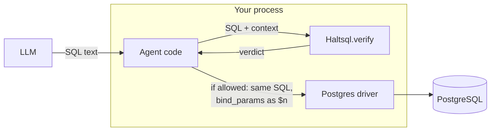
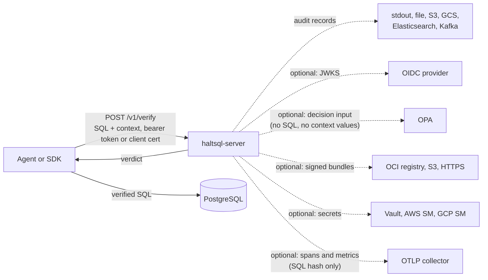
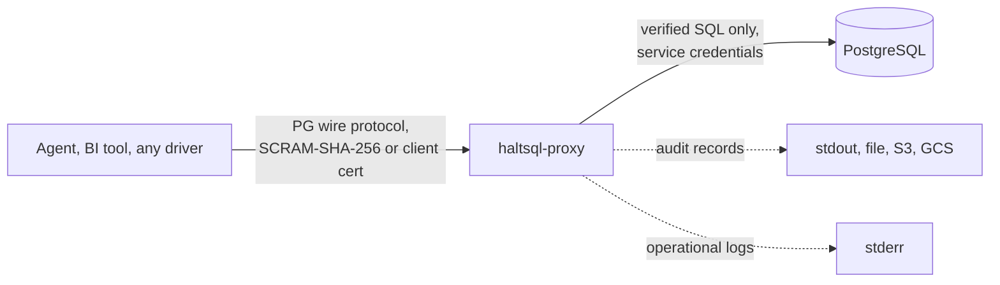

# Security overview

This page is the starting point for a security review of HaltSQL. It is for
security engineers, architects and auditors who need to know what HaltSQL
does, what data it touches, what it sends where, and which guarantees hold.
Each section links to the reference page that has the details.

## What HaltSQL is

HaltSQL is a policy firewall for SQL that a large language model (LLM)
generates for PostgreSQL. It receives three inputs: a SQL string, a policy and
a context (tenant id, user id and so on, taken from your application's
authenticated session). It parses the SQL with libpg_query, which is extracted
from the PostgreSQL source, and returns a verdict: allowed or denied, with
reason codes. See [threat-model.md](../threat-model.md) for the assets,
adversary and guarantees.

HaltSQL is self-hosted software, licensed MIT. It is not a hosted service:
nothing it processes is sent to the HaltSQL project.

## What HaltSQL is not

- **It does not rewrite SQL.** A verdict is about the exact input string. The
  verdict carries `sql_sha256`, the SHA-256 of that string, so a caller can
  check that it runs what was verified. The wire proxy forwards the verified
  SQL byte for byte; the only thing it changes is the value of tenancy
  parameters in `Bind` messages, which it overwrites with the session's
  context values ([proxy.md](../proxy.md#protocol-handling)).
- **The verifier does not connect to the database.** The library, `haltsql
  verify` and `haltsql-server` have no database connection; the server does
  not link the PostgreSQL client code. The components that do connect are
  listed in [Data flows](#data-flows).
- **It does not detect prompt injection.** It judges the SQL, not the prompt.
- **It does not replace database permissions or row-level security (RLS).**
  It is one of three layers ([defense-in-depth.md](../defense-in-depth.md)).
- **It does not decide whether showing allowed data is appropriate.** It
  limits which relations, columns, functions and rows a query may touch.

## Components

| Component | Binary or package | Talks to PostgreSQL? |
|---|---|---|
| Library | OCaml library `haltsql`; the native `libhaltsql` used by the Python and TypeScript packages | No |
| CLI | `haltsql` | Only `haltsql schema pull` and `haltsql rls check`, which you run with a DSN you supply ([schema-and-pii.md](../schema-and-pii.md), [rls-generation.md](../rls-generation.md)) |
| HTTP sidecar | `haltsql-server` | No |
| Wire proxy | `haltsql-proxy` | Yes: it is the client's connection to the database, using its own service credentials |
| SDK guarded-execute helpers | `clients/python`, `clients/typescript`, `clients/go`, `clients/java` | Yes, through the connection your application passes in |
| MCP server | `haltsql-mcp` | Yes: it runs verified queries in a read-only transaction ([mcp.md](../mcp.md)) |
| Kubernetes operator | `deploy/operator` | No; it manages ConfigMaps and `haltsql-server` Deployments ([kubernetes-operator.md](../kubernetes-operator.md)) |

## Data flows

### Library and CLI

Everything stays in your process. The library writes no audit records and
makes no network calls. Your code is responsible for running only allowed SQL
and for any logging.

### HTTP sidecar

The server answers; the caller enforces. Outbound calls happen only for
features you configure (dotted lines).

### Wire proxy

The proxy enforces the verdict itself. The client never sees the database
credentials and cannot choose its policy or tenant: both are bound to the
proxy user or certificate identity in the proxy config.

## What each component sees, stores, logs and sends

| Data | Library / CLI | `haltsql-server` | `haltsql-proxy` |
|---|---|---|---|
| SQL text | Sees it | Sees it; not stored or logged unless `audit.log_raw_sql: true` | Sees it; not logged unless `audit.log_raw_sql: true` |
| Context values (tenant id, user id) | Sees them | Sees them; not written to audit records | Holds them in its config; not written to audit records |
| Bind parameter values | Not involved | Returned to the caller in `bind_params`; not audited | Writes them into `Bind`; audit records list parameter numbers only, never values |
| Query results | Never | Never | Relayed from PostgreSQL to the client; not stored or logged |
| Credentials | None | Stores SHA-256 hashes of static tokens, never the tokens; OIDC tokens are verified and never logged or stored | Stores SCRAM verifiers, never passwords; holds the upstream password in memory |

### Audit records

`haltsql-server` writes one record per verify request that reaches a verdict,
to every configured sink (`bin/server/lib/audit.ml`, `Audit.record_fields`):

| Field | Content |
|---|---|
| `ts` | Timestamp |
| `request_id` | Request id |
| `caller` | Token name, `oidc:<provider>`, `mtls:<subject>` or `anonymous` |
| `caller_type` | `token`, `oidc`, `mtls` or `anonymous` |
| `subject` | OIDC `sub`, SPIFFE ID or certificate CN; `null` for static tokens |
| `policy`, `policy_version` | Policy name and content hash |
| `allowed`, `shadow` | Verdict, and whether shadow-mode reasons were present |
| `codes` | Reason codes |
| `sql_sha256` | SHA-256 of the exact SQL string |
| `fingerprint` | libpg_query fingerprint (equal for queries that differ only in literals) |
| `elapsed_us` | Verification time |
| `sql` | **Only** with `audit.log_raw_sql: true` |
| `prev_hash`, `hash` | Hash chain |

Not recorded: context values, bind values, bearer tokens, the request body,
the caller's IP address.

`haltsql-proxy` writes one record per verified statement
(`lib/pgwire/session.ml`): `ts`, `event`, `session` (a session id), `user`
(the proxy user), `policy`, `policy_version`, `protocol`, `allowed`,
`reasons`, `shadow_reasons`, `sql_sha256`, `fingerprint`, `tables`,
`bind_params` (parameter numbers only), the prepared statement name when there
is one, `sql` only with `log_raw_sql: true`, and the hash chain. Proxy-level
denials carry `reasons` and `message`. See
[proxy.md](../proxy.md#audit-and-logs).

> **Note:** `sql_sha256` is not anonymisation. A hash of a short query with
> guessable literals can be recovered by trying candidates. Treat audit
> records as potentially sensitive even with `log_raw_sql` off.

### Operational logs and telemetry

- Logs are JSON (or text) lines on stderr. Secret values, tokens and key
  material are never logged ([secrets.md](../secrets.md#how-loading-works)).
  OIDC rejections are logged with a reason code and the peer address
  ([authentication.md](../authentication.md#observability)). Proxy logs record
  connections, authentication results, denials, audit failures and reloads,
  and never contain passwords, verifiers, SCRAM messages, keys or bind values
  ([proxy.md](../proxy.md#logs)).
- OTLP spans carry the SQL hash (`db.statement.sha256`), never the SQL, even
  with `log_raw_sql` on.
- `GET /metrics` exposes counters labelled by policy name, reason code,
  route and status. It contains no SQL or context values.
- HaltSQL does not send usage telemetry anywhere. Outbound connections go only
  to endpoints you configure.

### The OPA request

When `opa` is configured, `haltsql-server` sends OPA the caller name and type,
policy name and version, statement kind, tables, columns, reason codes,
`sql_sha256`, fingerprint and the **names** of the context fields. It never
sends the SQL text, context values, tokens or the OIDC subject
([opa.md](../opa.md#the-request)).

### Admin report memory

With `server.admin.enabled`, the server keeps a rolling in-memory window of
recent verdicts for `GET /v1/admin/report`, bounded by `report_window`
(default 24h) and `max_tracked_queries`. It keeps raw SQL for one record per
query fingerprint only when `audit.log_raw_sql` is on. Nothing is kept while
the admin API is disabled ([shadow-reports.md](../shadow-reports.md#server-endpoint-get-v1adminreport)).

## Network exposure

| Listener | Default | Notes |
|---|---|---|
| `haltsql-server` API | `127.0.0.1:8080` (the container image sets `0.0.0.0:8080`) | `/v1/*` requires authentication. `/healthz`, `/readyz` and `/metrics` do not. |
| `haltsql-server --health-listen` | off | Plain HTTP, serves only `/healthz` and `/readyz` |
| `haltsql-proxy` | `127.0.0.1:6432` | PostgreSQL wire protocol |
| `haltsql-mcp` HTTP transport | `8765` in the documented examples | Bearer tokens from a tokens file; no built-in TLS; refuses HTTP off loopback without a tokens file ([mcp.md](../mcp.md)) |

The container image exposes 8080 and 6432. Server connection limits
(`--max-connections` 1024, `--request-timeout` 30 s, `--idle-timeout` 60 s, a
64 KiB cap on request heads, a 1 MiB body limit by default) and proxy limits
(`max_connections`, `max_message_bytes`, `auth_timeout_seconds`) bound what a
client can consume ([deployment.md](../deployment.md),
[proxy.md](../proxy.md#config-reference)).

Outbound connections, all opt-in:

| Feature | Destination |
|---|---|
| OIDC | Discovery document and JWKS of each configured issuer (HTTPS) |
| Secret placeholders | Vault, AWS Secrets Manager, Google Secret Manager |
| Audit sinks | S3, GCS, Elasticsearch/OpenSearch, Kafka |
| Bundle sources | OCI registry, S3, HTTPS |
| OPA | The configured OPA URL |
| OTLP | The configured collector |
| Proxy | The upstream PostgreSQL server |

## Authentication and authorization of callers

`haltsql-server` authenticates every `/v1/*` request, in this order
([authentication.md](../authentication.md)):

1. **mTLS identity**: a client certificate verified against
   `server.tls.client_ca` whose SPIFFE ID or subject CN matches a configured
   identity.
2. **OIDC/JWT**: signature checked against the issuer's JWKS (`RS256`,
   `RS384`, `RS512`, `PS256`, `ES256`, `ES384`, `EdDSA`; `none` and HMAC are
   always rejected), plus `iss`, `aud`, `exp`, `nbf`, `iat` and
   `required_claims`.
3. **Static bearer tokens**: the token's SHA-256 compared in constant time
   with every configured hash.

**Authorization** is by policy pinning. Every identity is pinned to exactly
one policy (OIDC can select from an allowlist, or map IdP groups to policies).
A request that names another policy gets `403`. For OIDC and mTLS callers the
context comes from the verified identity; the request body may add only the
fields listed in `request_context_fields`, and anything else is refused with
`403 CONTEXT_NOT_ALLOWED`. Static-token callers supply the whole context in
the body, so the calling service is trusted to fill it from its session.

`server.auth.allow_unauthenticated` (default `false`) accepts requests without
credentials. It is for local development only.

The admin API (`/v1/admin/status`, `/v1/admin/report`) is off by default.
When enabled, only callers listed in `server.admin.callers` may use it, and
unauthenticated callers never can.

`haltsql-proxy` authenticates clients with SCRAM-SHA-256 (no channel binding)
or a TLS client certificate. Unknown users go through a full fake exchange so
user names cannot be probed. Client certificate revocation (CRL, OCSP) is not
checked ([proxy.md](../proxy.md#authentication)).

## Cryptography

| Use | Algorithm | Source |
|---|---|---|
| `haltsql-server` TLS | TLS 1.2 and 1.3 (`min_version: "1.3"` for 1.3 only). TLS 1.2 limited to ECDHE with AES-GCM or ChaCha20-Poly1305; TLS 1.3 to AES-GCM and ChaCha20-Poly1305. Renegotiation disabled. | `bin/server/lib/tls_setup.ml` |
| `haltsql-proxy` TLS (client side and upstream) | The defaults of the ocaml-tls library: TLS 1.2 and 1.3, AEAD cipher suites, no renegotiation. The version range is not configurable. | `lib/pgwire/server.ml`, `lib/pgwire/upstream.ml` |
| Client certificate validation | RFC 5280 path validation against the configured CA | [authentication.md](../authentication.md#built-in-tls) |
| Outbound HTTPS host checks | Host name matched against DNS SubjectAltName entries only | [authentication.md](../authentication.md#mtls-identities) |
| Policy bundle signatures | Ed25519 (RFC 8032) over a domain separator plus the exact bundle bytes | [policy-bundles.md](../policy-bundles.md#signature-haltsqlbundlesig) |
| Bundle and object digests | SHA-256 (OCI blobs: SHA-256 or SHA-512) | [policy-bundles.md](../policy-bundles.md) |
| Audit chain | `hash = sha256_hex(prev_hash ^ record)`. This is a hash chain, not a signature or MAC. | [audit-sinks.md](../audit-sinks.md) |
| Static token storage | SHA-256 of the token | [config-reference.md](../config-reference.md#server) |
| Proxy client passwords | SCRAM-SHA-256 verifiers in PostgreSQL's stored format (`haltsql-proxy scram-verifier` refuses fewer than 4096 iterations) | [proxy.md](../proxy.md#authentication) |
| AWS requests | SigV4 | `lib/cloud/sigv4.ml` |

The TLS and cryptography implementations are OCaml libraries (`tls`,
`x509`, `mirage-crypto`, `digestif`), statically linked into the release
binaries; the release builds do not link OpenSSL. HaltSQL makes no FIPS 140
claim.

> **Note:** the audit hash chain detects edits, deletions, insertions and
> reordering *relative to other records*. Someone who can rewrite the whole
> log can rebuild a valid chain. Keep the head hash elsewhere, ship to a
> second sink, or use WORM storage
> ([audit-verify.md](../audit-verify.md#what-a-chain-does-not-prove)).

## Secret handling

- Config files never need to contain secrets. Placeholders resolve values
  from environment variables, files, Vault, AWS Secrets Manager and Google
  Secret Manager at load time ([secrets.md](../secrets.md)).
- An unresolvable placeholder is a load error; HaltSQL never substitutes an
  empty string. Placeholders are rejected inside policies.
- `haltsql config show` and `haltsql-proxy validate` print the effective
  config with secrets redacted.
- Static tokens are stored as SHA-256 hashes; proxy passwords as SCRAM
  verifiers. Bundle signing private keys are written with mode `0600`, and
  `haltsql bundle sign --key` refuses a key file that group or others can
  read.
- Error messages and logs never contain secret values, tokens or key
  material.
- A reload builds a fresh resolver, so rotated secrets are picked up on the
  next `SIGHUP` or file-watch reload.

## Fail-closed design

| Situation | Result |
|---|---|
| Parse error, unsupported syntax, limit breach, internal error | `allowed: false`. `verify` never raises. |
| Audit sink cannot be written (`on_error: fail_closed`, the default) | Server: `503 AUDIT_UNAVAILABLE` instead of a verdict, and `/readyz` returns `503`. Proxy: the statement is refused with SQLSTATE `58030`. |
| OIDC keys unavailable past the stale window | `503 AUTH_UNAVAILABLE` |
| OPA unreachable or malformed answer (`on_error: deny`, the default) | Query denied with `E_EXTERNAL_POLICY` |
| Bundle signature, digest or structure invalid | Bundle not loaded; at startup with no cached good bundle, the server does not start |
| Config or policy fails to load | Startup exits with code 2; a failed reload keeps the last good configuration |
| Any non-200, timeout or connection error from the sidecar | SDKs and `haltsql-mcp` treat it as a denial; nothing runs |

These defaults can be relaxed on purpose: `audit.on_error: buffer` (and
`drop` on streaming sinks and the proxy), `opa.on_error:
allow_haltsql_verdict`, `allow_unauthenticated`, and policies in `mode:
shadow`, which report violations but allow the query. See
[hardening.md](hardening.md) for the recommended values.

## Multi-tenancy guarantees and their limits

If HaltSQL returns `allowed: true` for a tenancy-scoped policy, every
occurrence of a tenant-scoped relation is filtered to the caller's tenant in
its own scope, as a top-level `AND` conjunct of `WHERE` or `ON`. In bound mode
the tenant value is a `$n` parameter that the caller binds from
`bind_params`, so the model never sees or chooses it
([tenancy.md](../tenancy.md)).

The guarantee rests on assumptions:

- **The context is trusted.** If the context comes from the prompt, the
  model or the SQL, the proof is about the wrong tenant
  ([threat-model.md](../threat-model.md#adversary)).
- **The caller runs exactly the verified string and binds exactly
  `bind_params`.** With the library and the sidecar, application code is
  trusted to do this; with the proxy, the proxy does it.
- **Views and functions are opaque.** A view or function the policy allows
  may read other tenants' data internally.
- **Inference and timing channels** on the database side are not addressed.
- **One process, many policies.** A single `haltsql-server` can serve many
  callers and policies. They are separated by policy pinning, not by process
  isolation. Run separate instances if you need separate failure or
  blast-radius domains.

Keep database-side controls (a least-privilege role and RLS) as the second
and third layers ([defense-in-depth.md](../defense-in-depth.md)).

## Assurance

HaltSQL is pre-1.0. Version 0.1.0 has not had an external security audit
([threat-model.md](../threat-model.md#guarantees-goals)). Testing includes an
attack corpus, property tests, a mutation fuzzer and a lab that runs every
allowed query against real PostgreSQL under independent oracles
([how-it-works/assurance.md](../how-it-works/assurance.md)). Vulnerabilities
are reported privately ([SECURITY.md](../../SECURITY.md)).

## Related

- [threat-model.md](../threat-model.md)
- [hardening.md](hardening.md)
- [compliance.md](compliance.md)
- [supply-chain.md](supply-chain.md)
- [security-questionnaire.md](security-questionnaire.md)
- [authentication.md](../authentication.md)
- [audit-sinks.md](../audit-sinks.md)
- [defense-in-depth.md](../defense-in-depth.md)
- [how-it-works/deployment-modes.md](../how-it-works/deployment-modes.md)
