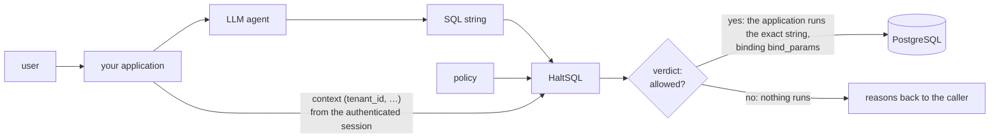

# Threat model

This page states what HaltSQL protects, who it protects against, what it
assumes, and what it does not do. If you find a way to break one of the
guarantees below, please report it privately (see [SECURITY.md](../SECURITY.md)).

## System

HaltSQL receives three inputs: the SQL string, the policy, and the context. It
returns a verdict. It does not run SQL, rewrite SQL, or connect to the database.

## Assets

1. **Other tenants' rows.** The primary asset in multi-tenant applications.
2. **Sensitive columns** (PII, credentials, salaries) that the policy omits.
3. **Database integrity:** schema, data, sequences, settings, locks.
4. **Database availability:** CPU, memory, I/O, connections.
5. **Server-side capabilities:** files, network access, other databases, and
   administrative functions reachable from SQL.

## Adversary

The adversary **controls the full text of the SQL**, either directly (a
malicious user of the agent) or indirectly (prompt injection through documents,
web pages, tickets, emails, or tool output the model reads). Assume they know
HaltSQL's source code and the policy.

The adversary **does not control**:

- the **context** (tenant ID, user ID, role), which your application takes from
  its own authenticated session;
- the **policy** and **config** files;
- the code that calls HaltSQL and runs the query (it must run the exact
  verified string and bind exactly `bind_params`);
- the database role and its privileges.

If any of these assumptions fail, HaltSQL's guarantees do not hold. In
particular, **never take the context from the prompt, the SQL, or anything the
model produced.**

## Guarantees (goals)

For any SQL string, policy, and context, if HaltSQL returns `allowed: true`:

1. The input is exactly one statement of an allowed kind.
2. Every relation read or written is listed in the policy, and no system
   catalog is reachable.
3. Every column referenced (including through `*` and whole-row references) is
   allowed.
4. Every function, operator, and cast is allowed.
5. Every occurrence of a tenant-scoped relation is filtered to the caller's
   tenant in its own scope (see [tenancy.md](tenancy.md)).
6. No construct with hidden side effects is present (data-modifying CTEs,
   `SELECT ... INTO`, locking clauses, `EXPLAIN ANALYZE`, disallowed functions).
7. Size, depth, node, join, and `LIMIT` budgets are respected.

And in all cases:

8. **Fail closed.** Parse errors, unsupported syntax, limit breaches, and
   internal errors produce `allowed: false`. `verify` never raises.
9. **Deterministic.** The same inputs give the same verdict.

These are design goals backed by tests (see [testing.md](testing.md)). HaltSQL
0.0.3 has not had an external security audit.

## Attack classes and defenses

| Attack class | Examples | Defense | Reason codes |
|---|---|---|---|
| Statement smuggling | `SELECT 1; DROP TABLE x`, `DO $$…$$`, `CALL p()`, `COPY … TO PROGRAM` | Exactly one statement; allowlist of statement kinds; NUL bytes rejected before parsing so a C string cannot hide a second statement | `E_MULTI_STATEMENT`, `E_STATEMENT_KIND`, `E_PARSE` |
| Data-modifying CTEs | `WITH d AS (DELETE FROM t RETURNING *) SELECT * FROM d` | Every CTE body classified recursively | `E_DATA_MODIFYING_CTE` |
| Hidden side effects in SELECT | `nextval()`, `set_config()`, `pg_sleep()`, `dblink()`, `lo_import()`, `pg_read_file()`, `SELECT … INTO`, `FOR UPDATE` | Function allowlist (deny by default); `INTO` and locking clauses rejected | `E_FUNCTION_DENIED`, `E_SELECT_INTO`, `E_LOCKING_CLAUSE` |
| `EXPLAIN ANALYZE` | `EXPLAIN ANALYZE DELETE FROM t` | `EXPLAIN` off by default; `ANALYZE` always denied; inner statement classified | `E_STATEMENT_KIND` |
| Table and column escape | Subqueries, `LATERAL`, set operations, views, `pg_catalog`, `information_schema`, `'t'::regclass`, `row_to_json(t)` | Full scope resolution; system schemas denied; `reg*` casts denied; whole-row references count as every column | `E_TABLE_DENIED`, `E_COLUMN_DENIED`, `E_CAST_DENIED` |
| Tenant bypass | `OR 1=1`, predicate only in an outer query, a `UNION` branch without a filter, `LEFT JOIN` to an unscoped tenant table, wrong literal | Per-occurrence, per-scope top-level conjunct proof; bound mode keeps the tenant ID away from the model | `E_TENANT_MISSING`, `E_TENANT_MISMATCH`, `E_PARAM_UNBOUND` |
| Identifier confusion | `"Users"` vs `users`, `U&"\0075sers"`, schema-qualified vs unqualified names, CTE shadowing a table | Names come from the real parser's output, never from regular expressions; explicit `search_path` in the policy | `E_TABLE_DENIED`, `E_COLUMN_UNRESOLVED` |
| Resource exhaustion | Deep nesting, huge `IN` lists, cartesian joins, `generate_series(1, 1e12)` | Byte, depth, and node limits; join budget; required `LIMIT`; set-returning functions only via allowlist | `E_LIMIT`, `E_JOIN_BUDGET`, `E_LIMIT_REQUIRED`, `E_LIMIT_TOO_HIGH`, `E_FUNCTION_DENIED` |
| Parser differentials | SQL that HaltSQL parses differently from the server | HaltSQL uses libpg_query, which is extracted from the Postgres source; the vendored grammar is tracked and upgraded deliberately | n/a |
| Unknown constructs | New Postgres syntax, rarely used clauses | Typed AST: anything not mapped becomes `Unsupported` and is denied | `E_UNSUPPORTED` |
| Analyzer crashes | Malformed or adversarial input | Every exception becomes a denial; fuzzing of the parser bridge and loaders | `E_INTERNAL`, `E_PARSE` |
| Policy loosening by typo | `tenant_colum: tenant_id`, YAML `no` turning into `false` | Unknown and duplicate keys are errors; YAML 1.2 core schema | load error |
| Policy selection by caller | Agent asks the sidecar for a looser policy | Each bearer token is pinned to one policy | HTTP 403 |

## Known limitations and non-goals

- **Not a replacement for database permissions or RLS.** A bug in HaltSQL, a
  misconfigured policy, or a caller that skips the check would expose data if
  HaltSQL were the only control. See [defense-in-depth.md](defense-in-depth.md).
- **No prompt-injection detection.** HaltSQL judges the SQL, not the prompt.
- **Views and functions are opaque.** If a policy allows a view or a function
  that reads other tenants' data internally, HaltSQL cannot see that.
- **Allowed data can still be misused.** HaltSQL limits which rows and columns
  an agent can read. It does not decide whether showing allowed data to the
  user is appropriate.
- **Inference and timing channels.** Aggregates over the caller's own tenant are
  allowed by design. HaltSQL does not prevent side-channel inference through
  query timing or error behavior on the database side.
- **Costly but allowed queries.** A query within all limits can still be
  expensive (for example a large sort over the tenant's rows). Use
  `statement_timeout` and connection limits.
- **Grammar version.** HaltSQL parses with the Postgres 17 grammar. Running
  against an older server is expected to work for the SQL HaltSQL allows, but
  is checked in the lab rather than guaranteed.
- **PostgreSQL only.** Other dialects are out of scope before 1.0.

## Trust boundaries in deployment

- **Library:** runs in your process; trust is the same as your application.
- **Sidecar:** treat the network between the agent and `haltsql-server` as
  untrusted. Keep the listener on localhost in the same pod, or turn on the
  server's built-in TLS or mutual TLS (`server.tls`, see
  [authentication.md](authentication.md#built-in-tls)), or terminate TLS in a
  proxy or service mesh in front of it. Use bearer
  tokens pinned to policies, and do not enable `allow_unauthenticated`
  outside development.
- **Audit logs** may contain sensitive data if `log_raw_sql` is enabled. It is
  off by default.
