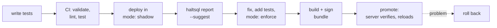

# Tutorial: roll out a policy change safely

In this tutorial you treat a HaltSQL policy as code. You test it, check it in
CI, run it in shadow mode against real traffic, act on the shadow report,
then ship it as a signed bundle that servers verify before loading. Finally
you roll it back.

**What you'll build:**

- A policy repository with the `saas-analytics` policy, its catalog snapshot
  and a test suite, based on the files in [`examples/`](../../examples/).
- A GitHub Actions workflow that validates, lints and tests every pull
  request, and builds a signed bundle on `main`.
- A local `haltsql-server` that first runs the policy in shadow mode, then
  loads only signed bundles.

**Time:** about 40 minutes.

**Prerequisites:**

- The `haltsql` CLI and `haltsql-server`, installed as in
  [Quickstart: Install](../quickstart.md#1-install).
- `git`, `curl` and `openssl`.
- A GitHub repository you can push to, for step 4 only.

The lifecycle you'll walk through:



## 1. Set up the policy repository

Create a working directory with two parts: `policy-repo`, which becomes a git
repository, and `server`, which stands in for a host that runs
`haltsql-server`.

```sh
git clone https://github.com/HaltSQL/HaltSQL
mkdir -p policy-repo/policies policy-repo/catalog policy-repo/tests policy-repo/keys
mkdir -p server/bundles server/audit
cp HaltSQL/examples/policies/saas.yaml policy-repo/policies/
cp HaltSQL/examples/catalog/saas.snapshot.json policy-repo/catalog/
cp HaltSQL/examples/suites/saas.suite.yaml policy-repo/tests/
cd policy-repo && git init
```

The layout matters. The policy refers to `../catalog/saas.snapshot.json` and
the suite to `../policies/saas.yaml`, both relative to their own files:

```text
policy-repo/
  policies/saas.yaml           # kind: Policy
  catalog/saas.snapshot.json   # kind: Catalog
  tests/saas.suite.yaml        # kind: TestSuite
  keys/                        # public signing key only (step 7)
```

Check that everything loads:

```sh
haltsql validate policies/saas.yaml tests/saas.suite.yaml catalog/saas.snapshot.json
```

## 2. Make the policy lint-clean

`validate` checks that a document loads. `lint-policy` checks for settings that
load but are risky:

```sh
haltsql lint-policy policies/saas.yaml
```

```text
warning: W_BROAD_COLUMNS: table app.currencies allows all columns ("*"); list columns explicitly so new sensitive columns are not exposed automatically
info: I_TENANT_SCOPED: 3 of 4 table(s) are tenant-scoped (mode: bound)
info: I_FUNCTIONS: functions allowlist has 60 entries
1 warning(s)
```

`columns: "*"` means a column added to `currencies` later becomes readable
without review. In `policies/saas.yaml`, replace the `currencies` entry with an
explicit list:

```yaml
  app.currencies:
    columns: [code, name, minor_units]   # global reference table, not tenant-scoped
```

Run `lint-policy` again. It ends with `0 warning(s)`. In step 4, CI fails on
warnings, so this check cannot regress.

## 3. Write tests

`tests/saas.suite.yaml` already has six cases. Each case is an exact SQL
string, an expectation, and optionally the reason codes a denial must include
or the parameters an allowed query must bind. Add the common tenant-bypass
shapes to the end of `cases:`:

```yaml
  - name: OR does not satisfy the tenant filter
    sql: SELECT id FROM orders WHERE tenant_id = $1 OR status = 'open' LIMIT 10
    expect: deny
    codes: [E_TENANT_MISSING]
    tags: [tenancy]
  - name: every UNION branch needs its own filter
    sql: SELECT id FROM orders WHERE tenant_id = $1 UNION ALL SELECT id FROM invoices LIMIT 10
    expect: deny
    codes: [E_TENANT_MISSING]
    tags: [tenancy]
  - name: an outer filter does not cover the subquery
    sql: SELECT * FROM (SELECT id, tenant_id FROM orders) o WHERE o.tenant_id = $1 LIMIT 10
    expect: deny
    codes: [E_TENANT_MISSING]
    tags: [tenancy]
  - name: filtered left join is allowed
    sql: >-
      SELECT o.id, i.amount_cents FROM orders o
      LEFT JOIN invoices i ON i.order_id = o.id AND i.tenant_id = $1
      WHERE o.tenant_id = $1 LIMIT 10
    expect: allow
    bind: [{ param: 1, value: acme }]
    tags: [tenancy]
```

Run the suite:

```sh
haltsql test tests/
```

```text
suite saas-analytics-basics (tests/saas.suite.yaml)
  PASS  filtered select is allowed
  PASS  missing tenant filter
  ...
  PASS  filtered left join is allowed

1 suite(s), 10 case(s): 10 passed, 0 failed
```

To see why each denial happened, add `--verbose`. To see what a failure
looks like, add `email` to the `customers` columns and run the suite again:

```text
  FAIL  pii column denied
        expected deny, got allow
        sql: SELECT email FROM customers WHERE tenant_id = $1 LIMIT 10
```

`haltsql test` exits `1`, which is what fails CI. Undo the change. The suite
format is in [Policy test suites](../testing.md#policy-test-suites).

## 4. Run the checks in CI

The repository ships a ready-made workflow whose paths match this layout.
Copy it and commit everything:

```sh
mkdir -p .github/workflows
cp ../HaltSQL/examples/ci/github-policy-ci.yml .github/workflows/policy-ci.yml
git add . && git commit -m "Add saas-analytics policy, tests and CI"
```

The workflow has two jobs:

- **`check`** runs on every pull request that touches `policies/`, `tests/` or
  `catalog/`. The `HaltSQL/HaltSQL` action installs `haltsql` (checking the
  release's `SHA256SUMS`), then runs `validate`, `lint-policy` (failing on
  warnings) and `test`. It writes a job summary with per-suite results and
  every denied case with its reason codes, and posts the same summary as a
  pull-request comment.
- **`bundle`** runs on `main` after `check` passes. It builds a bundle and
  signs it with the `HALTSQL_SIGNING_KEY` secret. You set that up in step 7.

Pin the action and `version:` to a release tag or a full commit SHA, as the
example does. Push the repository to GitHub and open a pull request that
changes the policy: the `check` job reports the result on the pull request.
Every input and output is in [Policy CI](../policy-ci.md#github-action). GitLab
CI templates and pre-commit hooks run the same commands.

## 5. Deploy the policy in shadow mode

The tests show the policy denies what you meant it to deny. They cannot show
that it allows everything your agent legitimately needs. For that, run it
against real traffic in **shadow mode**: every query is allowed, and what the
policy would have denied is recorded as `shadow_reasons`.

> **Warning:** A shadow policy enforces nothing. Run shadow mode only where
> the database role and row-level security from
> [Defense in depth](../defense-in-depth.md) already protect the data.

Shadow mode needs a second, client-side switch. The guarded executors in the
SDKs and the MCP server refuse to run a query that a shadow policy would deny
unless the application opts in, so a policy flipped to `shadow` cannot by
itself turn enforcement off:

| Client | Opt-in for the shadow rollout |
|---|---|
| Python SDK, integrations, MCP server | `HALTSQL_ALLOW_SHADOW=1`, or `haltsql.guard.set_allow_shadow(True)` |
| TypeScript | `guardedQuery(..., { allowShadow: true })` |
| Go | `haltsql.AllowShadow()` guard option |
| Java | `new JdbcGuard(client).allowShadow()` |

Remove the opt-in when the rollout ends. Code that calls `verify` itself and
runs the SQL on `allowed` must make the same check: treat a verdict with
non-empty `shadow_reasons` as a denial unless you are in a shadow rollout.

In `policies/saas.yaml`, change the last line:

```yaml
mode: shadow
```

The suite still passes: in shadow mode, test cases are checked against
`shadow_reasons`, so the same tests work before and after you switch back.

Set up the server. Create a token for the agent:

```sh
cd ../server
export HALTSQL_TOKEN="$(openssl rand -hex 32)"
export HALTSQL_ANALYTICS_TOKEN_HASH="$(printf '%s' "$HALTSQL_TOKEN" | shasum -a 256 | cut -d' ' -f1)"
```

Save this as `server/haltsql.yaml`. For this stage it loads the policy file
straight from the repository, and logs the raw SQL so the report can name the
exact columns and functions involved:

```yaml
apiVersion: haltsql.dev/v1
kind: Config
server:
  listen: 127.0.0.1:8080
  auth:
    tokens:
      - name: analytics-agent
        token_sha256: ${env:HALTSQL_ANALYTICS_TOKEN_HASH}
        policy: saas-analytics
policies:
  - path: ../policy-repo/policies/saas.yaml
reload: { watch: true }
audit:
  sinks:
    - type: file
      path: ./audit/audit.jsonl
  log_raw_sql: true        # SQL can contain sensitive literals; see the note below
```

Start it:

```sh
haltsql validate haltsql.yaml
haltsql-server --config haltsql.yaml
```

> **Note:** `log_raw_sql: true` puts query text, including any literals, in
> the audit log. Turn it on for a shadow period only if your data allows it.
> Without it the report still counts denials by reason code, but cannot name
> the column or function for a suggestion.

Now send traffic. In a real rollout this is your agent, pointed at this
server, for days. Here, simulate a few queries. In a second shell, export the
same `HALTSQL_TOKEN`, then save this as `traffic.jsonl` in `server/`:

```json
{"sql": "SELECT status, count(*) FROM orders WHERE tenant_id = $1 GROUP BY status LIMIT 100", "context": {"tenant_id": "acme"}}
{"sql": "SELECT id, internal_notes FROM orders WHERE tenant_id = $1 LIMIT 50", "context": {"tenant_id": "acme"}}
{"sql": "SELECT id, internal_notes FROM orders WHERE tenant_id = $1 LIMIT 20", "context": {"tenant_id": "acme"}}
{"sql": "SELECT to_char(created_at, 'YYYY-MM') AS month, sum(total_cents) FROM orders WHERE tenant_id = $1 GROUP BY 1 LIMIT 24", "context": {"tenant_id": "acme"}}
{"sql": "SELECT id, total_cents FROM orders WHERE tenant_id = $1 ORDER BY created_at DESC LIMIT 2000", "context": {"tenant_id": "acme"}}
{"sql": "SELECT name, email FROM customers WHERE tenant_id = $1 LIMIT 10", "context": {"tenant_id": "acme"}}
{"sql": "SELECT count(*) FROM orders LIMIT 1", "context": {"tenant_id": "acme"}}
{"sql": "SELECT id, amount_cents FROM invoices WHERE tenant_id = $1 LIMIT 10", "context": {"tenant_id": "acme"}}
```

Send each line to the sidecar:

```sh
while IFS= read -r body; do
  curl -s -H "Authorization: Bearer $HALTSQL_TOKEN" -H 'Content-Type: application/json' \
    -d "$body" localhost:8080/v1/verify; echo
done < traffic.jsonl
```

Every response has `"allowed":true`. Five of them carry `shadow_reasons`, for
example the `internal_notes` query:

```json
{"allowed":true,"reasons":[],"shadow_reasons":[{"code":"E_COLUMN_DENIED", ...}], ...}
```

## 6. Read the shadow report and act on it

`haltsql report` reads the audit log, summarizes what the policy would have
denied, and suggests small, conservative policy changes. Run it in the second
shell, in `server/`:

```sh
haltsql report audit/ --suggest --policy-file ../policy-repo/policies/saas.yaml
```

The report starts with totals (`records: 8 (allowed 3, denied 0,
shadow-denied 5)`), confirms the audit hash chain, and breaks the would-be
denials down by reason code, table, column, caller and time. Then come the
parts you act on:

```text
Suggestions (2)
  [saas-analytics/column/app.orders.internal_notes]
    2 shadow-denied queries by caller analytics-agent read app.orders.internal_notes (E_COLUMN_DENIED); add internal_notes to tables.app.orders.columns
      tables:
        app.orders:
          columns: [id, tenant_id, customer_id, status, total_cents, currency, created_at, internal_notes]
  [saas-analytics/limit]
    1 shadow-denied query by caller analytics-agent used LIMIT up to 2000, above require_limit.max 1000 (E_LIMIT_TOO_HIGH); raise require_limit.max to 2000
      require_limit:
        max: 2000

Sensitive columns (flagged, never suggested)
  saas-analytics/app.customers.email  x1: sensitive column (column name matches "email"): not suggested; rewrite the query without it

Needs a query fix, not a policy change (or never relaxed)
  E_TENANT_MISSING            1  [never_weaken] tenant isolation is never relaxed: the query must carry a tenant predicate on every tenant-scoped table
```

The `to_char` query is not listed: the policy's `datetime` preset already
allows it. Decide on each item with the policy owner:

| Finding | Decision in this tutorial | Action |
|---|---|---|
| `internal_notes` read twice | Reject. The notes are for staff, not for an agent. | Keep the column out. Add a deny test. Change the agent's prompt or query. |
| `LIMIT 2000` for an export | Accept. | Raise `require_limit.max` to 2000. Add an allow test. |
| `email` | Never suggested: the name looks like PII. | Fix the agent's query. |
| `E_TENANT_MISSING` | Tenant isolation is never relaxed. | Fix the agent's query. |

Make the accepted change by hand in `policies/saas.yaml`, which keeps the
file's comments:

```yaml
require_limit:
  max: 2000
```

(To have the report write the change for you, run
`haltsql report audit/ --policy-file ../policy-repo/policies/saas.yaml --apply-to ../policy-repo/policies/saas.yaml --accept saas-analytics/limit -o saas.next.yaml`
and compare the result. It never edits the input file, and it does not keep
YAML comments. See [Shadow reports](../shadow-reports.md).)

Record both decisions as tests, at the end of `tests/saas.suite.yaml`:

```yaml
  - name: internal notes stay hidden
    sql: SELECT id, internal_notes FROM orders WHERE tenant_id = $1 LIMIT 20
    expect: deny
    codes: [E_COLUMN_DENIED]
  - name: export-sized page is allowed
    sql: SELECT id, total_cents FROM orders WHERE tenant_id = $1 ORDER BY created_at DESC LIMIT 2000
    expect: allow
    bind: [{ param: 1, value: acme }]
```

When the shadow-denied queries that remain are ones you want denied, switch
the policy to enforcement. Change the last line of `policies/saas.yaml` back:

```yaml
mode: enforce
```

Then check and commit:

```sh
cd ../policy-repo
haltsql lint-policy policies/saas.yaml
haltsql test tests/
git commit -am "saas-analytics: allow 2000-row pages, enforce"
```

All 12 cases pass. Stop the shadow server with Ctrl-C.

## 7. Sign a bundle

Servers in production should not trust whatever file appears on disk. A
**bundle** packages the validated policies into one canonical file, and an
Ed25519 signature lets each server check where it came from before it reads a
single policy.

Create a signing key pair once. Keep the private key out of the repository:

```sh
mkdir -p ~/.haltsql-keys
haltsql bundle keygen -o ~/.haltsql-keys/policy-signing.key
cp ~/.haltsql-keys/policy-signing.key.pub keys/policy-signing.pub
git add keys/policy-signing.pub && git commit -m "Add the policy signing public key"
```

`keygen` writes the private key with mode `0600` and prints its key id. The
public key is safe to commit and to ship to servers.

Build, sign and verify version `1.0.1`:

```sh
mkdir -p dist
haltsql bundle build policies/saas.yaml --name prod-policies --bundle-version 1.0.1 \
  --source-commit "$(git rev-parse HEAD)" -o dist/prod-policies-1.0.1.haltsqlbundle
haltsql bundle sign dist/prod-policies-1.0.1.haltsqlbundle --key ~/.haltsql-keys/policy-signing.key
haltsql bundle verify dist/prod-policies-1.0.1.haltsqlbundle --public-key keys/policy-signing.pub
haltsql bundle inspect dist/prod-policies-1.0.1.haltsqlbundle --public-key keys/policy-signing.pub
```

`sign` writes `dist/prod-policies-1.0.1.haltsqlbundle.sig`. `verify` prints a
line starting with `OK` and exits `0`. `inspect` shows the bundle's name and
version, its digest, each policy with its `sha256:` version and mode, and
`status   verified`. Builds are deterministic: the same policies always give
a byte-identical bundle. Add `dist/` to `.gitignore`.

In CI, the `bundle` job from step 4 does the same on every push to `main`.
Store the private key's PEM as the secret `HALTSQL_SIGNING_KEY` in a GitHub
environment named `policy-release` that requires reviewers, and the job
uploads the signed bundle as the `haltsql-policy-bundle` artifact. See
[Signing in CI safely](../policy-ci.md#signing-in-ci-safely).

## 8. Promote the bundle

Point the server at a bundle instead of a policy file. Copy the public key to
the server, and replace `server/haltsql.yaml` with:

```yaml
apiVersion: haltsql.dev/v1
kind: Config
server:
  listen: 127.0.0.1:8080
  auth:
    tokens:
      - name: analytics-agent
        token_sha256: ${env:HALTSQL_ANALYTICS_TOKEN_HASH}
        policy: saas-analytics
policies:
  - bundle: ./bundles/prod-policies.haltsqlbundle   # signature: same name + .sig
    public_keys: [./policy-signing.pub]
reload: { watch: true }
audit:
  sinks:
    - type: file
      path: ./audit/audit.jsonl
  log_raw_sql: false
```

In the first shell, install the bundle (signature first) and start the server:

```sh
cd ../server
cp ../policy-repo/keys/policy-signing.pub .
cp ../policy-repo/dist/prod-policies-1.0.1.haltsqlbundle.sig bundles/prod-policies.haltsqlbundle.sig
cp ../policy-repo/dist/prod-policies-1.0.1.haltsqlbundle bundles/prod-policies.haltsqlbundle
haltsql-server --config haltsql.yaml
```

The server verifies the signature, then the digest, structure and every
policy, before it loads anything. Check which policy version is live, from the
second shell:

```sh
curl -s -H "Authorization: Bearer $HALTSQL_TOKEN" localhost:8080/v1/policies
```

The `version` is the same `sha256:...` that `bundle inspect` printed for
`saas-analytics`. Every verdict and audit record carries it too, so you can
always tell which policy made a decision.

Now promote a second version. Suppose the team decides to hide
`customers.country`. In `policies/saas.yaml`, change the `customers` columns
to `[id, tenant_id, name, created_at]`. Then, from the second shell:

```sh
cd ../policy-repo
haltsql test tests/
git commit -am "saas-analytics: hide customers.country"
haltsql bundle build policies/saas.yaml --name prod-policies --bundle-version 1.0.2 \
  --source-commit "$(git rev-parse HEAD)" -o dist/prod-policies-1.0.2.haltsqlbundle
haltsql bundle sign dist/prod-policies-1.0.2.haltsqlbundle --key ~/.haltsql-keys/policy-signing.key
cd ../server
cp ../policy-repo/dist/prod-policies-1.0.2.haltsqlbundle.sig bundles/prod-policies.haltsqlbundle.sig
cp ../policy-repo/dist/prod-policies-1.0.2.haltsqlbundle bundles/prod-policies.haltsqlbundle
```

With `reload.watch` the server notices within about two seconds. Without it,
send `SIGHUP` (`pkill -HUP haltsql-server`). The server log shows
`policies reloaded` with the new version, and `/v1/policies` returns it. A
reload is atomic: the policy that was live keeps serving until the new set
has fully loaded.

A bundle that fails any check never goes live. If the file is signed with a
key the server doesn't trust, the server logs
`reload failed; keeping the last good configuration` with
`signature verification failed: signed by sha256:..., which is not a trusted key`,
and keeps serving the previous version. While the `.sig` and the bundle are
being replaced one after the other, the server may log one such failed reload
and then succeed on the next one.

For a fleet, push the signed bundle to an OCI registry
(`haltsql bundle push --oci ...`) and have each server poll it with a
`bundle_source`. See [Bundle sources](../policy-bundles.md#bundle-sources).

## 9. Roll back

Suppose a dashboard turns out to need `customers.country`, and `1.0.2` now
denies its queries with `E_COLUMN_DENIED`. How you roll back depends on how
the server gets bundles.

**Local bundle files (this tutorial).** Copy the previous signed bundle back.
It still verifies, because its signature has not changed:

```sh
cp ../policy-repo/dist/prod-policies-1.0.1.haltsqlbundle.sig bundles/prod-policies.haltsqlbundle.sig
cp ../policy-repo/dist/prod-policies-1.0.1.haltsqlbundle bundles/prod-policies.haltsqlbundle
```

The server reloads, and `/v1/policies` shows the `1.0.1` policy version
again. Keep every released bundle and its `.sig`, for example as CI
artifacts, so this is always possible.

**Bundle sources (OCI, S3, HTTPS).** A polling server refuses a bundle whose
`metadata.version` is not strictly greater than the one it runs. This is
rollback protection: an attacker who can write to the registry cannot replay
an old, looser bundle. To roll back, revert the policy change in git and
publish the old content under a new, higher version:

```sh
cd ../policy-repo
git revert --no-edit HEAD
haltsql bundle build policies/saas.yaml --name prod-policies --bundle-version 1.0.3 \
  --source-commit "$(git rev-parse HEAD)" -o dist/prod-policies-1.0.3.haltsqlbundle
haltsql bundle sign dist/prod-policies-1.0.3.haltsqlbundle --key ~/.haltsql-keys/policy-signing.key
```

In CI that is a revert merged to `main`. The bundle job builds and signs it
with a higher run number, and the servers pick it up at their next poll.
Because builds are deterministic, the rolled-back policy has exactly the
`sha256:` policy version it had before.

## Next steps

- Generate database grants and row-level security from the same policy, so
  the database enforces it too: [RLS generation](../rls-generation.md).
- Watch shadow reports live from the server instead of the CLI:
  [`GET /v1/admin/report`](../shadow-reports.md#server-endpoint-get-v1adminreport).
- Publish bundles to a registry and rotate signing keys:
  [Signed policy bundles](../policy-bundles.md#key-management-and-rotation).
- Import PII labels from your data catalog so the report flags more sensitive
  columns: [Schema and PII](../schema-and-pii.md).
- Read how each stage protects you: [The policy lifecycle](../how-it-works/policy-lifecycle.md).
