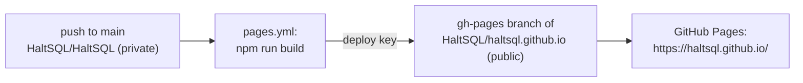

# HaltSQL docs site

The [Docusaurus](https://docusaurus.io/) site published to GitHub Pages at
<https://haltsql.github.io/>.

The pages themselves are the Markdown files in [`../docs`](../docs): this folder
holds only the site shell (config, sidebar, landing page, styles). Edit a doc in
`docs/` and it changes both on GitHub and on the site.

```bash
cd website
npm ci
npm start          # live preview at http://localhost:3000/
npm run build      # static site in website/build
```

- `docusaurus.config.js`: site config. Docs are read from `../docs` as plain
  CommonMark (`markdown.format: detect`), so `.md` files must not use MDX/JSX.
  Diagrams are ` ```mermaid ` code blocks.
- `sidebars.js`: the sidebar. Add new pages here.
- `src/pages/index.js`: the landing page.
- `src/remark/repo-links.js`: rewrites links from `docs/` to repository files
  outside `docs/` (for example `../SECURITY.md`) into GitHub URLs.

## Publishing

`HaltSQL/HaltSQL` is private, so the site is published from a separate public
repository, [`HaltSQL/haltsql.github.io`](https://github.com/HaltSQL/haltsql.github.io),
which only ever holds the built HTML.



- `.github/workflows/pages.yml` builds the site on pull requests (check only)
  and on pushes to `main` that touch `docs/` or `website/`, or on demand.
- On `main` it force-pushes `website/build` as a single commit to the
  `gh-pages` branch of the public repository, so that branch never accumulates
  history and no source is published.
- It authenticates with an SSH deploy key: the public half is a write-enabled
  deploy key on `HaltSQL/haltsql.github.io` only; the private half is the
  `PAGES_DEPLOY_KEY` Actions secret here. GitHub's host key is pinned in the
  workflow.
- The public repository's Pages source is "Deploy from a branch: `gh-pages`,
  `/` (root)".

To rotate the key: generate a new ed25519 key pair, replace the deploy key on
`HaltSQL/haltsql.github.io`, update the `PAGES_DEPLOY_KEY` secret, and delete
the old deploy key.
